<p align="center"></p>

# Agent Skills Infra

Generic, shared infrastructure for Claude Code **skills** and **MCP servers**. Instead of every
skill or MCP server building its own storage, logging, auth and quality checks, they all reuse 4
capabilities exposed as HTTP APIs and wrapped by one CLI, `agentinfra`:

| Capability | What a consumer gets | Backed by |
|---|---|---|
| **Auth** | An OAuth 2 identity (client id = tenant) and short-lived Bearer tokens with scopes | auth service, JWT HS256 |
| **State** | A private key/value store that only it can read and write | Postgres with Row Level Security |
| **Logs** | Centralized structured logs, private per tenant, browsable in Grafana | Grafana Loki (multi tenant) |
| **Evals** | 9 common evaluators, stored runs, a UI showing the health of every suite | Postgres + React UI |

The repo also ships 2 skills and 2 MCP servers that are built only on the CLI:

| Consumer | Kind | Uses |
|---|---|---|
| `skills/decision-log` | Claude Code skill | state (decisions), logs (every change), evals (smoke suite) |
| `skills/answer-grader` | Claude Code skill | evals (grades answers), state (score history), logs (trend) |
| `mcp/bookmarks-mcp` | MCP server (stdio) | state (bookmarks), logs, evals |
| `mcp/feature-flags-mcp` | MCP server (stdio) | state (flags), logs (audit trail with before/after), evals |

On top of that there is the **Agent Infra Console**, a central UI with a live animated topology of
every skill and MCP server and the infra each one uses, plus Logs, State, Evals and Auth tabs. An app
that signs in sees only its own data; `infra-admin` sees every app and can filter by app. A
provisioned **Grafana dashboard** shows the same data from Loki and Postgres.

## How it Works

1. `scripts/setup.sh` runs `agentinfra bootstrap`, which creates one OAuth 2 client per consumer, stores the hashed secrets for the auth service and writes each plain secret into a git ignored credentials file.
2. A skill or MCP server runs `agentinfra --client <its id> state put ...` (or `log write`, `eval run`).
3. The CLI gets a token with the client credentials grant, caches it until 30 seconds before it expires, and calls the right service with `Authorization: Bearer`.
4. Each service checks the JWT signature, expiry, issuer and scope, then takes the tenant from the `sub` claim. The request never names the tenant.
5. State and evals open a transaction and run `SET LOCAL app.tenant = <sub>`. Postgres RLS policies then hide every row of other tenants and refuse writes into them.
6. Logs are pushed to Loki with `X-Scope-OrgID: <sub>`, so each consumer is its own Loki tenant.
7. Eval suites produce outputs locally (commands or files). The evals service grades them with the shared evaluators, so scores are comparable across consumers. The UI shows every tenant through a read-all scope.
8. The console polls the admin APIs every 2 seconds. When a tenant's keys, log lines or eval runs change, it animates particles from that consumer through the CLI and the capability API into the store.

## Architecture

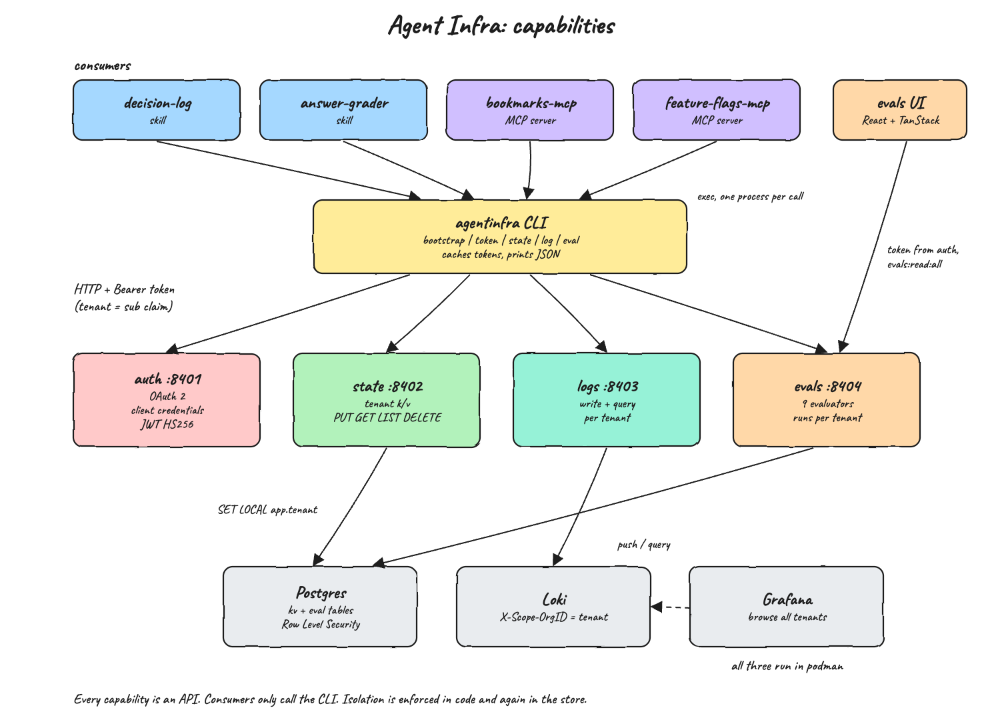

The 4 capability services are separate Granian processes on separate ports. Postgres, Loki and
Grafana run in podman. Skills and MCP servers never talk HTTP: they run the CLI as a subprocess
and read JSON from stdout.

```
infra/
  auth/        OAuth 2 authorization server (client credentials, introspection, metadata)
  state/       tenant scoped key/value API
  logs/        centralized logging API in front of Loki
  evals/       evaluators + runs API
  cli/         agentinfra CLI (the only client of the APIs)
  common/      JWT, ASGI router, secrets, settings, tenant transactions
  ui/          Agent Infra Console (Bun, Vite, React, TanStack)
  containers/  Postgres (schema + RLS), Loki, Grafana images
  tests/       unit + live tests
  bin/agentinfra
skills/
  decision-log/   SKILL.md, scripts/decision.py, evals/suite.json
  answer-grader/  SKILL.md, scripts/grade.py, evals/suite.json + fixtures
mcp/
  mcpkit/              stdio JSON-RPC server + CLI helper shared by the MCP servers
  bookmarks-mcp/       server.py, run.sh, evals/suite.json
  feature-flags-mcp/   server.py, run.sh, evals/suite.json
```

## Capabilities in Detail

### 1. Auth (OAuth 2)

**Why:** every other capability needs to know *who* is calling, and that answer must not be
forgeable by the caller. Without it, multi tenancy is just a naming convention.

* **Grant:** OAuth 2 client credentials (RFC 6749 section 4.4). Skills and MCP servers are machines, so no browser flow is needed.
* **Client authentication:** `client_secret_basic` (HTTP Basic) or `client_secret_post`. Secrets are stored as PBKDF2-SHA256 hashes with a random salt and compared in constant time.
* **Tokens:** HS256 JWTs with `sub` (the client id, which is the tenant), `scope`, `iss`, `iat`, `exp` (15 minutes) and `jti`. Services verify them locally, so a request does not need a round trip to the auth service.
* **Scopes:** `state:read`, `state:write`, `logs:write`, `logs:read`, `evals:write`, `evals:read` for apps, and the read-only admin scopes `clients:read`, `state:read:all`, `logs:read:all`, `evals:read:all`. A client can ask for fewer scopes (`scope=state:read`) to get a down-scoped token, never more (`invalid_scope`).
* **Introspection** (RFC 7662) and **server metadata** (RFC 8414) are available for other resource servers.
* **Clients:** `decision-log`, `answer-grader`, `bookmarks-mcp`, `feature-flags-mcp` (app scopes), `infra-admin` (the 4 admin scopes, no write scope at all), `eval-viewer` (`evals:read:all` only), and `itest-alpha`, `itest-beta`, `itest-readonly` for the tests.
* **Bootstrap is incremental:** running `agentinfra bootstrap` again only creates clients that are new or whose scopes changed. Existing secrets stay valid.
* **`GET /v1/me`** describes the caller's own token. **`GET /v1/admin/clients`** (`clients:read`) lists every client with its kind and scopes, never its secret or hash.

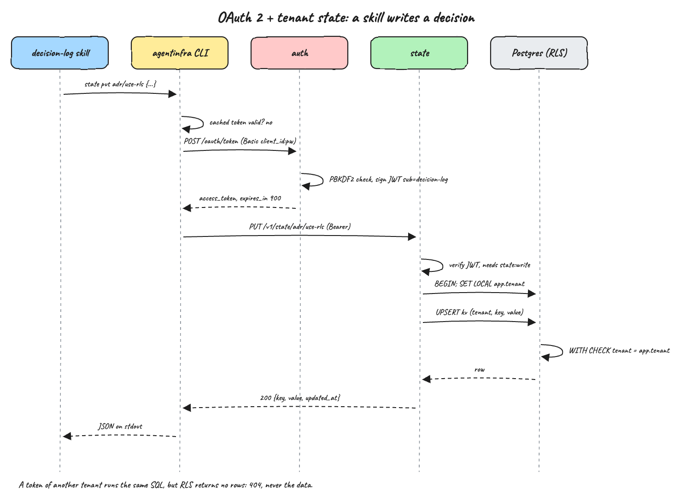

### 2. State (multi tenant key/value)

**Why:** skills and MCP servers are stateless processes. They need a durable place for decisions,
bookmarks, flags and score history, and one consumer must never see or overwrite another's data.

* **API:** `PUT/GET/DELETE /v1/state/{key}` and `GET /v1/state?prefix=`. Keys may contain `/` so consumers namespace them (`adr/use-rls`, `flag/new-ui`, `bm/<hash>`).
* **Values:** any JSON up to 64 KB, stored as `jsonb`.
* **Isolation, layer 1:** the service only ever uses the token's `sub` as the tenant.
* **Isolation, layer 2:** the table has Row Level Security forced on, and the service connects as `agentinfra_app`, a role that does not own the table. Policy: `USING (tenant = current_setting('app.tenant'))` and the same `WITH CHECK`. Without `app.tenant` the role sees zero rows, and inserting a row for another tenant fails with a privilege error. A test proves both straight against the database.
* **Admin read, never admin write:** a separate `FOR SELECT` policy lets a transaction with `app.read_all = on` read every tenant. It applies to SELECT only, so even with read-all on, UPDATE and DELETE still match only the caller's own rows. A test proves this against Postgres. The policy lives in `migrate.sql`, which `start-all.sh` applies idempotently on every start.
* **Admin endpoints:** `GET /v1/admin/state?tenant=&prefix=` and `GET /v1/admin/state/summary` (`state:read:all`).
* **Same key, different tenants:** `greeting` in `decision-log` and `greeting` in `bookmarks-mcp` are two separate rows. The primary key is `(tenant, key)`.
* `LIKE` wildcards in `prefix` are escaped, so `prefix=%` matches a literal `%`.

### 3. Logs (centralized logging on Loki)

**Why:** when an agent misbehaves you need one place to see what every skill and MCP server did,
in order, with structured fields, and you need audit trails (who changed the flag, from what, to what).

* **API:** `POST /v1/logs {"level","message","fields"}` and `GET /v1/logs?since_minutes=&limit=&level=`.
* **Levels:** `debug`, `info`, `warn`, `error`. Lines are JSON `{"message","fields"}` with stream labels `service_name="agentinfra"` and `level`.
* **Isolation:** Loki runs with `auth_enabled: true`. The logs service sends `X-Scope-OrgID` set to the token's `sub` on every push and query, so isolation happens inside Loki. The `level` filter is validated against the allowed list, so LogQL cannot be injected.
* **Admin endpoints:** `GET /v1/admin/logs?tenant=&level=&since_minutes=` and `GET /v1/admin/logs/summary` (`logs:read:all`). They send `X-Scope-OrgID` as one tenant, or as `a|b|c` of every registered client for all apps.
* **Loki has no web UI.** `http://localhost:3110/` answers 404 by design, so `start-all.sh` prints its `/ready` link. Read logs in the console Logs tab or in Grafana.
* **Grafana** is provisioned with a Loki datasource that asks for the 4 product tenants at once (`decision-log|answer-grader|bookmarks-mcp|feature-flags-mcp`). Loki has `multi_tenant_queries_enabled` turned on only so this admin view works. The logs API always sends a single tenant.

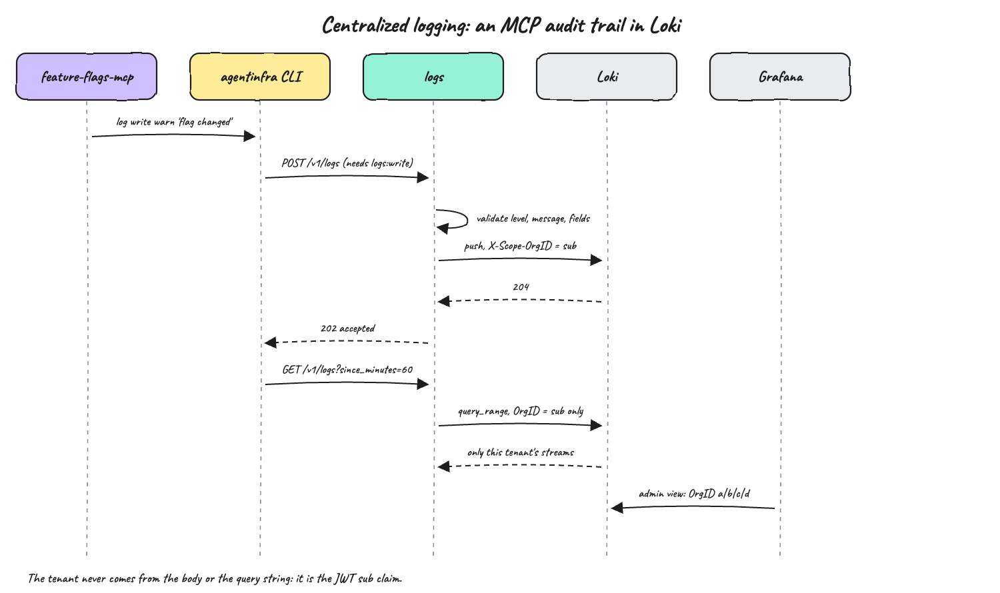

### 4. Evals (UI + common evaluators)

**Why:** skills and MCP servers change often and their outputs are text. You need a cheap, shared
way to prove they still behave, and one dashboard to see which ones regressed.

* **Common evaluators**, all graded on the server:

| Evaluator | Value | Passes when |
|---|---|---|
| `exact_match` | text | output equals the text, ignoring surrounding whitespace |
| `contains` | text | output contains the text, case insensitive |
| `not_contains` | text | output does not contain the text, case insensitive |
| `regex` | pattern | the pattern matches (multi line); a bad pattern fails the check |
| `json_valid` | none | output parses as JSON |
| `json_field_equals` | `{"path","equals"}` | the dotted path (`items.1.id`) equals the value; `1` is not `true` |
| `max_length` / `min_length` | int | output length is within the bound, inclusive |
| `max_latency_ms` | int | the case finished within the bound, inclusive |

* **Suites:** a JSON file with `suite` and `cases`. A case has `checks` and one of: `command` (the CLI runs it in the suite folder and captures stdout and latency), `output_file`, or `output`.
* **Score:** a case passes only when every check passes, and the run score is passed cases / all cases. An unknown evaluator name fails the check, and a case with no checks is rejected, so typos never pass silently.
* **Storage:** `eval_runs` and `eval_cases` with the same RLS policies as state, plus `app.read_all` for clients with `evals:read:all`.
* **UI:** signs in with the `eval-viewer` client, then shows totals, the current health of every tenant suite, a sortable table filtered by tenant, run details with input, output and every check, and the evaluator catalog.

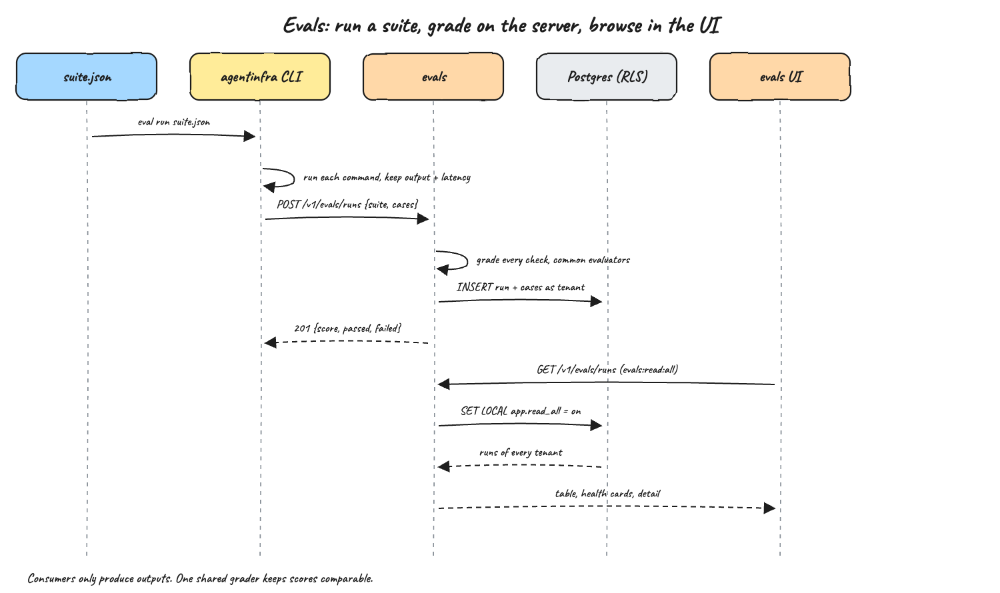

### 5. Agent Infra Console (central UI)

**Why:** with several skills and MCP servers sharing one platform you need to see, in one place,
who is using what right now, and each app owner needs to see their own data without seeing anyone else's.

* **Login with a clients panel.** The right side of the login page lists every local OAuth client with its kind, scopes and secret (show, copy, or one click to sign in). The local Vite dev server reads them from the git ignored `infra/.secrets` folder through `/__local/credentials`; nothing is hard coded in the UI.
* **Overview (infra-admin):** totals; a live topology (skills and MCP servers, then the CLI, the 4 capability APIs, then Postgres and Loki) where every real state write, log line and eval run becomes a particle travelling along its path, with active edges and nodes lit; a matrix of which infra each consumer uses (scopes, keys, log lines, warnings, runs, last score); and a live activity feed.
* **Logs, State, Evals, Auth tabs:** each tab picks its API from the token's scopes. An app token (`logs:read`) calls `/v1/logs` and the server returns only that app's lines. An admin token (`logs:read:all`) calls `/v1/admin/logs`, and the **App** filter in the header (all apps or one app) is passed as `tenant`. A banner on each tab says which scope is in effect. A client with neither scope sees an explanation instead of a 403.
* **Live and replay particles.** Bright particles are live: a real change seen between two polls. Faint particles replay each app's real activity from the last hour (log lines, state writes, eval runs, interleaved across apps), so the graph keeps moving between bursts. With no activity in the last hour the graph is still.
* **Auth tab:** the caller's client, kind, scopes, expiry countdown and decoded JWT claims; for admin, the list of every OAuth client.
* **Isolation is server side.** Hiding the filter for apps is only UX: even with a hand-made request, an app token cannot reach the admin endpoints (403), and a `tenant` parameter cannot widen what RLS returns.

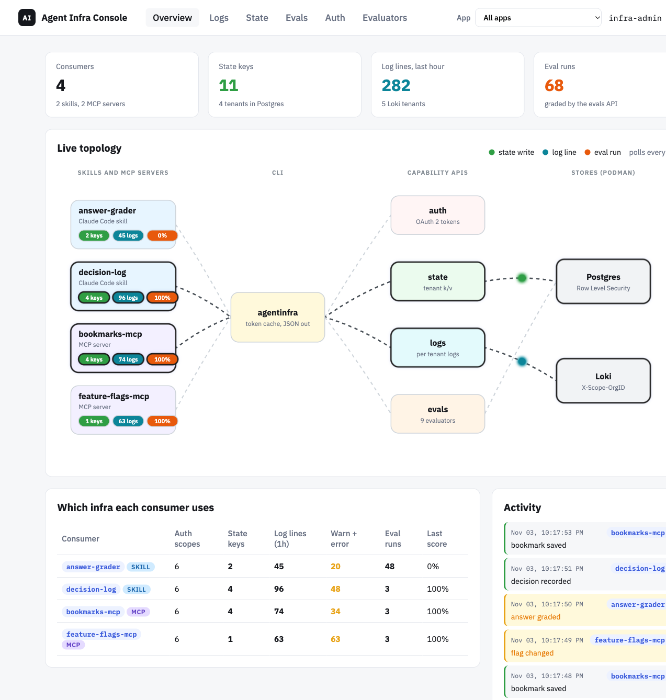

### 6. Grafana dashboard

`http://localhost:3111` opens the provisioned **Agent Infra** dashboard as its home page: log lines,
state keys, eval runs and warnings; log lines per tenant and per level; keys per tenant; latest eval
score per tenant suite; score over time; the warn/error audit trail and all log lines. It uses the
Loki datasource (all 4 app tenants) and a Postgres datasource. Test tenants are excluded.

### 7. CLI (`agentinfra`)

**Why:** skills are prompts plus scripts and MCP servers can be written in any language. A CLI is
the smallest contract they can all use: no HTTP, no tokens, JSON on stdout, non zero exit on error.

```bash
infra/bin/agentinfra bootstrap [--force]
infra/bin/agentinfra --client <id> token [--force]
infra/bin/agentinfra --client <id> state put <key> <json|text>
infra/bin/agentinfra --client <id> state get <key>
infra/bin/agentinfra --client <id> state list [--prefix p]
infra/bin/agentinfra --client <id> state delete <key>
infra/bin/agentinfra --client <id> log write <debug|info|warn|error> <message> [--field k=v ...]
infra/bin/agentinfra --client <id> log query [--since-minutes 60] [--limit 100] [--level warn]
infra/bin/agentinfra --client <id> eval run <suite.json>
infra/bin/agentinfra --client <id> eval runs [--suite s] [--limit 20]
infra/bin/agentinfra --client <id> eval show <run-id>
infra/bin/agentinfra --client <id> eval evaluators
```

`--client` can also come from `AGENTINFRA_CLIENT`. Errors go to stderr as
`{"status": <http status>, "error": {...}}` with exit code 1 (2 for local problems such as a
missing credentials file). When a request gets a 401 with a cached token, the CLI fetches a new
token and retries once.

## The Skills and MCP Servers

### `decision-log` skill

Keeps architecture decisions across sessions. The id is the slug of the title. `supersede` links the
old decision to the new one. Every write is logged, and supersede/remove are logged as `warn`.

```bash
python3.15 skills/decision-log/scripts/decision.py add --title "Use Postgres RLS" --decision "State uses RLS" --why "isolation even with app bugs"
python3.15 skills/decision-log/scripts/decision.py list --status accepted
python3.15 skills/decision-log/scripts/decision.py supersede use-postgres-rls --by use-rls-and-audit
```

### `answer-grader` skill

Grades an answer file against checks taken from the user's criteria. The run is stored in evals
(visible in the UI), the score history and best score are kept in state, and the trend
(`first`, `better`, `same`, `worse`) is logged, as `warn` when the score drops.

```bash
python3.15 skills/answer-grader/scripts/grade.py grade --suite release-notes --answer notes.md --checks '[{"type":"contains","value":"Breaking changes"}]'
python3.15 skills/answer-grader/scripts/grade.py history --suite release-notes
```

### `bookmarks-mcp`

Tools: `save_bookmark`, `list_bookmarks`, `search_bookmarks`, `delete_bookmark`. Only `http(s)` URLs
are accepted, tags are lowercased and deduplicated, and keys are `bm/<sha256(url)[:16]>`.

### `feature-flags-mcp`

Tools: `set_flag`, `get_flag`, `list_flags`, `evaluate_flag`, `delete_flag`. A user lands in a stable
bucket `sha256(flag:user) % 100` and the flag is on when it is enabled and the bucket is below
`rollout_percent`. Every change is logged as `warn` with `before` and `after`.

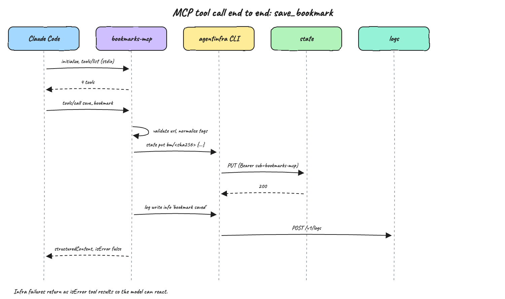

Both MCP servers speak MCP over stdio (JSON-RPC 2.0: `initialize`, `ping`, `tools/list`,
`tools/call`) with no SDK, using `mcp/mcpkit`. Infra failures come back as `isError: true` tool
results, so the model can react instead of the session breaking. `run.sh --call <tool> '<json>'`
calls one tool directly, which the eval suites use.

### Install into Claude Code

```bash
./scripts/install.sh
./scripts/install.sh uninstall
```

`install.sh` changes only this project: it symlinks the 2 skills into `.claude/skills/` and writes
`.mcp.json` with the `bookmarks` and `feature-flags` servers. Open Claude Code in this folder to use them.

## Features

* **OAuth 2 client credentials** - standard machine identity, so every capability knows the tenant without trusting the caller.
* **Down-scoped tokens** - a consumer can ask for fewer scopes for risky operations.
* **Two layer tenant isolation** - checks in the service code plus Postgres RLS and Loki tenants, so one bug does not leak data.
* **Tenant key/value state** - durable JSON state for stateless skills and MCP servers.
* **Centralized structured logs** - one Loki for every consumer, private per tenant, with an admin view in Grafana.
* **9 common evaluators** - one grader for all suites, so scores are comparable.
* **Evals UI** - one screen shows which tenant suite is failing right now.
* **CLI contract** - any language can use the infra by running a process and reading JSON.
* **Token cache with retry** - one token request per 15 minutes per client, not one per call.
* **Project-local install** - nothing global is touched.

## Stack

* **Python 3.15 + uv** - the services, CLI, skills and MCP servers; uv manages the venv.
* **ty** - type checks all infra code and tests.
* **Granian** - fast ASGI server for the 4 raw ASGI services; no web framework.
* **psycopg 3 (async)** - the only database library.
* **Postgres 17** - state and eval storage with Row Level Security.
* **Grafana Loki 3.5** - centralized logs with native multi tenancy.
* **Grafana 12** - browsing logs across tenants.
* **podman + podman-compose** - runs Postgres, Loki and Grafana.
* **TypeScript 7 + Bun 1.4.4** - the UI toolchain and test runner (Bun 2.x is not published yet).
* **Vite 8 + React 19.3** - UI dev server and rendering.
* **TanStack Router 1, Query 5, Table 8, Form 1** - routing, data fetching with polling, the runs table, and the login form.
* **unittest** - the Python standard library test runner, no extra dependency.

## Contracts / APIs

Every error is JSON: `{"error": "<code>", "error_description": "<text>"}`. A 401 also sends
`WWW-Authenticate: Bearer`.

### auth (port 8401)

| Method | Path | Auth | Request | Response |
|---|---|---|---|---|
| GET | `/health` | none | | `{"status":"UP","service":"auth"}` |
| GET | `/.well-known/oauth-authorization-server` | none | | RFC 8414 metadata |
| GET | `/v1/me` | any valid token | | `{"client_id","kind","description","scopes","iat","exp","iss"}` |
| GET | `/v1/admin/clients` | `clients:read` | | `{"items":[{"client_id","kind","description","scopes"}]}` |
| POST | `/oauth/token` | Basic or form client credentials | `grant_type=client_credentials[&scope=...]` | `{"access_token","token_type":"Bearer","expires_in":900,"scope"}` |
| POST | `/oauth/introspect` | client credentials | `token=...` | `{"active":true,"sub","scope","exp",...}` or `{"active":false}` |

Errors: `unsupported_grant_type` (400), `invalid_scope` (400), `invalid_client` (401).

### state (port 8402)

| Method | Path | Scope | Request | Response |
|---|---|---|---|---|
| GET | `/v1/state?prefix=` | `state:read` | | `{"tenant","items":[{"key","value","updated_at"}]}` |
| GET | `/v1/state/{key}` | `state:read` | | `{"key","value","updated_at"}` or 404 |
| PUT | `/v1/state/{key}` | `state:write` | `{"value": <json>}` | `{"key","value","updated_at"}` |
| DELETE | `/v1/state/{key}` | `state:write` | | `{"deleted": key}` or 404 |
| GET | `/v1/admin/state?tenant=&prefix=` | `state:read:all` | | `{"tenant","items":[{"tenant","key","value","updated_at"}]}` |
| GET | `/v1/admin/state/summary` | `state:read:all` | | `{"items":[{"tenant","keys","last_updated","recent_keys"}]}` |

Errors: `invalid_key` (400), `value_too_large` (413), `insufficient_scope` (403), `invalid_token` (401).

### logs (port 8403)

| Method | Path | Scope | Request | Response |
|---|---|---|---|---|
| POST | `/v1/logs` | `logs:write` | `{"level","message","fields":{}}` | 202 `{"tenant","accepted":{...}}` |
| GET | `/v1/logs?since_minutes=60&limit=100&level=` | `logs:read` | | `{"tenant","items":[{"timestamp_ns","level","message","fields"}]}` newest first |
| GET | `/v1/admin/logs?tenant=&level=&since_minutes=&limit=` | `logs:read:all` | | `{"tenant","items":[{"tenant","timestamp_ns","level","message","fields"}]}` |
| GET | `/v1/admin/logs/summary?since_minutes=60` | `logs:read:all` | | `{"counts":[{"tenant","level","count"}],"recent":[...]}` |

Errors: `invalid_level`, `invalid_message`, `invalid_fields` (400), `loki_unavailable` (503).

### evals (port 8404)

| Method | Path | Scope | Request | Response |
|---|---|---|---|---|
| GET | `/v1/evals/evaluators` | any valid token | | `{"items":[{"name","description","value"}]}` |
| POST | `/v1/evals/runs` | `evals:write` | `{"suite","cases":[{"name","input","output","latency_ms","checks":[{"type","value"}]}]}` | 201 run summary + graded cases |
| GET | `/v1/evals/runs?suite=&tenant=&limit=` | `evals:read` or `evals:read:all` (`tenant` narrows a read-all view) | | `{"items":[{"id","tenant","suite","passed","failed","score","created_at"}]}` |
| GET | `/v1/evals/runs/{id}` | `evals:read` or `evals:read:all` | | run + `cases` with every check result |

## Key Data Structures and Design Decisions

```sql
kv         (tenant, key, value jsonb, updated_at)       PRIMARY KEY (tenant, key)
eval_runs  (id, tenant, suite, passed, failed, score, created_at)
eval_cases (id, run_id, tenant, name, input, output, latency_ms, passed, checks jsonb)
```

* **Tenant = client id = JWT `sub`.** There is no tenant table to keep in sync.
* **RLS is forced, and the app role does not own the tables.** Table owners bypass RLS by default, so the services connect as a separate role.
* **`SET LOCAL` inside a transaction.** The tenant setting cannot leak to the next request even if connections are reused later.
* **The tenant is never a label in Loki.** It is the Loki org id, so a query cannot select another tenant with a label matcher.
* **Grading happens on the server.** Consumers cannot report their own pass/fail, and every suite uses the same evaluator code.
* **Strict JSON equality in `json_field_equals`.** In Python `1 == True`, which would let a wrong answer pass; booleans are compared by type.
* **Raw ASGI and stdlib MCP.** The whole request path can be read in a few files, at the cost of hand written routing and JSON-RPC.
* **HS256 shared key.** It keeps the services simple; RS256 with JWKS is the upgrade path when services are owned by different teams.

Full trade-offs are in [design-doc.md](design-doc.md).

## How to Run

Requirements: podman with podman-compose, uv, Python 3.15, Bun.

```bash
./scripts/setup.sh
./scripts/start-all.sh
./scripts/install.sh
./scripts/ui.sh
```

Open `http://localhost:5190` and click **Sign in** next to `infra-admin` in the clients panel. Run `./scripts/traffic.sh` in another terminal to generate traffic until Ctrl+C and watch it flow through the topology.

## How to Test

```bash
./scripts/test-all.sh
```

`test-all.sh` needs the stack running. It runs, and stops at the first failure:

* `ty check` on all infra code and tests.
* 58 infra tests: JWT tampering and expiry, every evaluator, router, key and log validation, CLI token cache, and live tests for OAuth errors and down-scoping, cross-tenant state reads, writes and deletes, RLS straight against Postgres, Loki tenant isolation, eval run privacy, every admin endpoint refusing app tokens, the admin client being unable to write, the app filter returning only that app, and read-all being SELECT only in Postgres.
* 12 MCP tests: the JSON-RPC protocol, both servers over real stdio, rollout bucket math, and bookmarks not being visible to the feature-flags tenant.
* 5 skill tests: the decision lifecycle, a failed supersede that changes nothing, and the grader trend and best score.
* UI type check and 23 `bun test` tests: score tones, tenant health, activity detection (no animation without a real change, no cross-tenant attribution), particle routes, usage counts, scope to view mapping, JWT claim decoding.
* The 4 eval suites through the CLI, which fail the run if any score is below 1.0.

```
== infra unit and live tests
Ran 58 tests
OK
== mcp tests
Ran 12 tests
OK
== skills tests
Ran 5 tests
OK
== ui type check and tests
 23 pass
 0 fail
== eval suites
decision-log score passed failed run: 1.0 6 0 81
answer-grader score passed failed run: 1.0 4 0 84
bookmarks-mcp score passed failed run: 1.0 5 0 85
feature-flags-mcp score passed failed run: 1.0 5 0 86
all tests passed
```

## Printscreens

### Login with the local clients panel

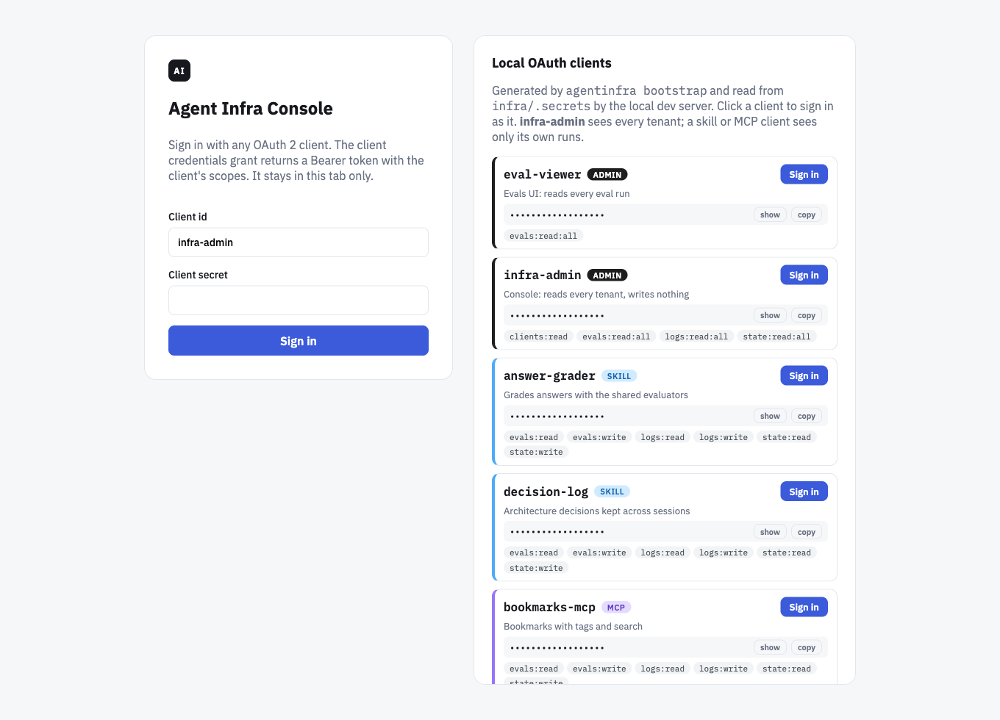

Left: the OAuth 2 sign in form. Right: every client created by `agentinfra bootstrap`, with its kind
(admin, skill, mcp, test), description, scopes and secret (hidden until **show**). **Sign in** next to a
client exchanges its secret for a Bearer token with the client credentials grant.

### Overview: live topology (infra-admin)


Totals at the top. In the topology, the green particle is a state write travelling into Postgres and
the teal particle is a log line travelling into Loki. Active edges animate, active nodes are outlined,
and each consumer card shows its keys, log lines and last eval score. Below, the matrix shows which
infra each consumer uses, and the activity feed shows the newest log lines from every app.

### Logs tab, admin, all apps

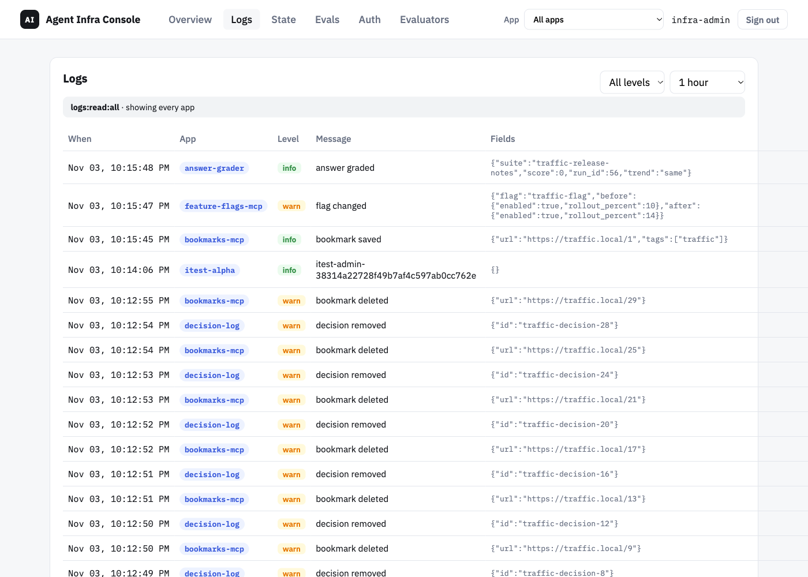

`logs:read:all` with **All apps**: one table across tenants, newest first, filterable by level and
time window, with the JSON fields of each line (here the flag audit trail with before and after).

### State tab, admin, filtered to one app

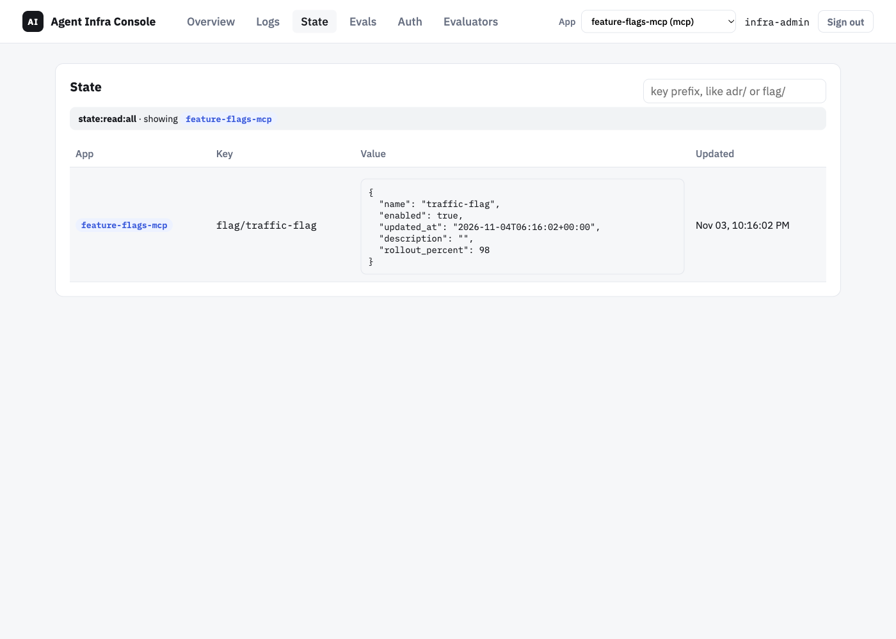

The header **App** filter is set to `feature-flags-mcp`, so `/v1/admin/state?tenant=feature-flags-mcp`
returns only its keys. Clicking a row expands the JSON value.

### Auth tab, admin

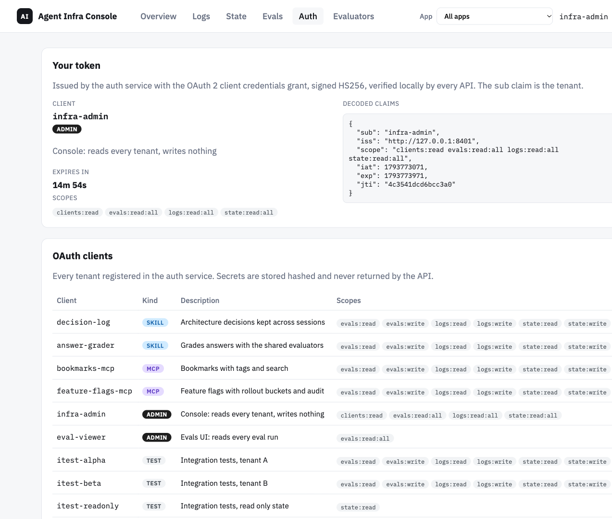

The current token (client, kind, scopes, expiry, decoded claims, where `sub` is the tenant) and every
registered OAuth client with its scopes. Secrets are never returned by the API.

### Logs tab as an app

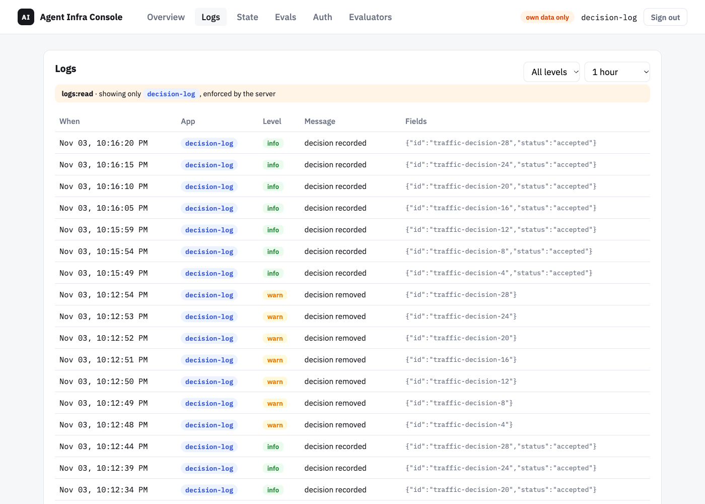

Signed in as the `decision-log` skill: the header shows **own data only** and has no app filter, and
the banner says `logs:read`. The server returns only `decision-log` lines.

### Evals tab as an app

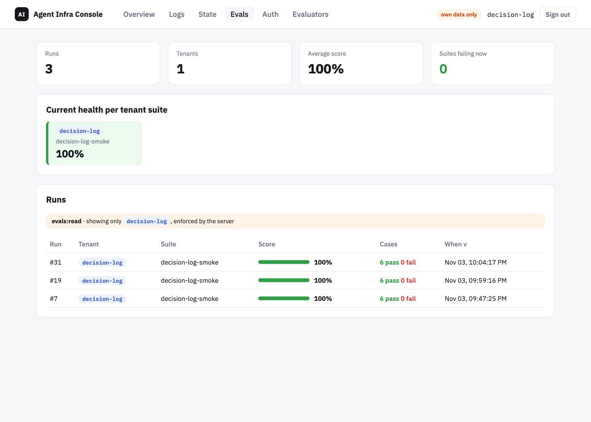

The same skill sees only its own 3 eval runs. RLS hides every other tenant's runs.

### Evals tab, admin

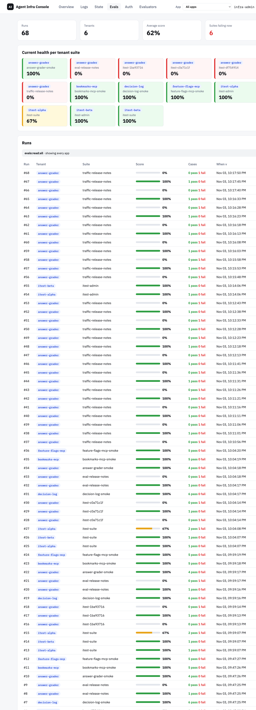

Totals, the current health of every tenant suite (green at 90% or more, yellow at 60% or more, red
below) and every run, sortable. `answer-grader` suites are red when their last grading was a weak
answer, which the eval and traffic scripts produce on purpose.

### A failed run

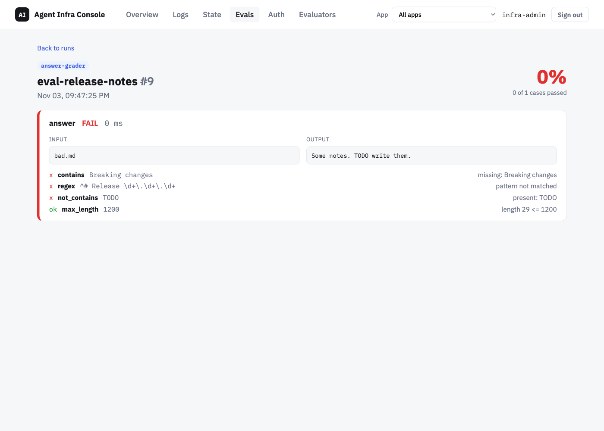

A grading by the `answer-grader` skill of a weak release note. Each check shows the evaluator, the
expected value and the server's explanation: `missing: Breaking changes`, `pattern not matched`,
`present: TODO`.

### A passing run

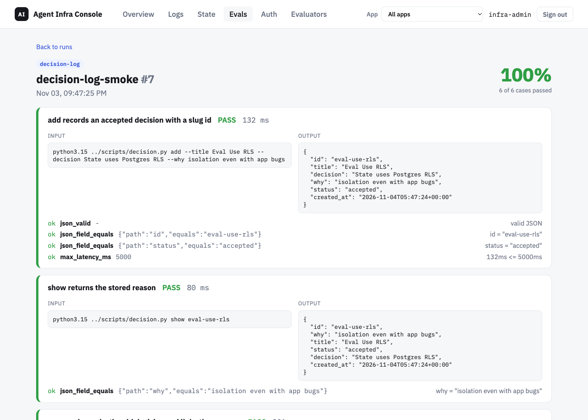

The `decision-log` smoke suite: every case is a real command that the CLI ran, with its JSON output
and latency, graded by `json_field_equals`, `contains`, `not_contains` and `max_latency_ms`.

### Evaluator catalog

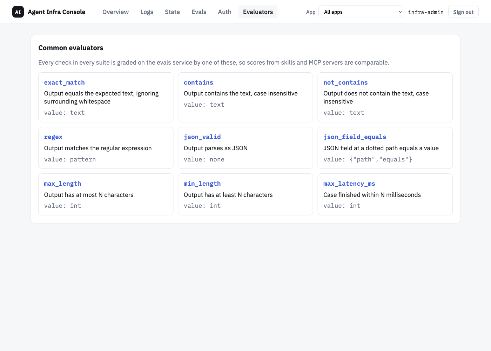

The 9 common evaluators served by `GET /v1/evals/evaluators`, with the value each expects.

### Grafana dashboard

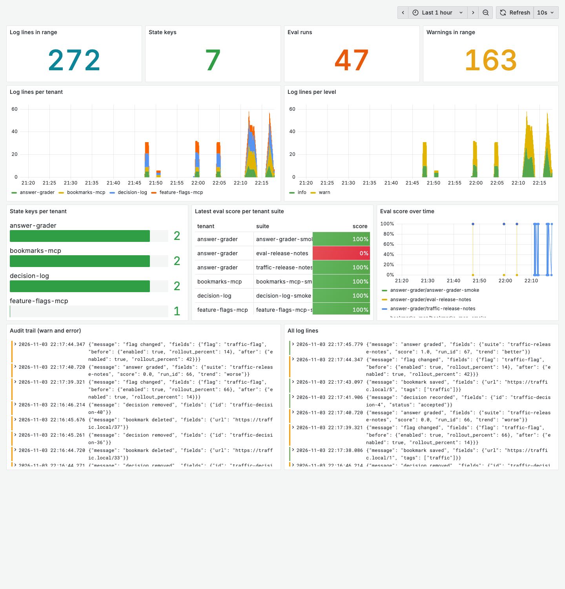

The provisioned home dashboard: stat tiles, log lines per tenant and per level, keys per tenant,
latest score per suite with colored cells, score over time, and the audit trail.

### Grafana Explore

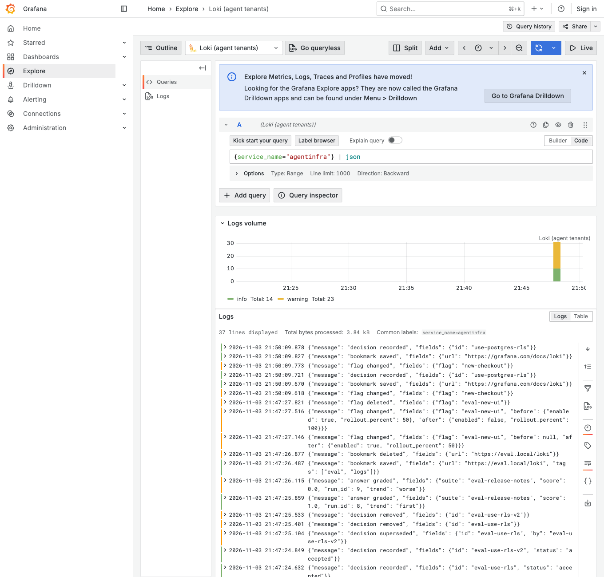

Ad hoc LogQL over all 4 app tenants through the provisioned Loki datasource.

## Traffic generator

`./scripts/traffic.sh` drives the real consumers without Claude:

* It opens one **MCP stdio session** to each server (`initialize`, `notifications/initialized`, `tools/list`) with `mcp/mcpkit/client.py`, then sends `tools/call` requests: `save_bookmark`, `search_bookmarks`, `set_flag`, `evaluate_flag`.
* It runs the **skill scripts** the way Claude would: `decision.py add` and `grade.py grade` with a good or a weak answer.
* One random action every 0.7 seconds, printed as `ok` or `FAIL` with its latency. At most 10 bookmarks and 10 decisions are kept alive (the oldest is deleted), so state does not grow forever.
* Ctrl+C (or `./scripts/traffic.sh 50` for 50 actions) deletes every bookmark, decision and flag it created and closes the MCP sessions.

```
mcp sessions open: bookmarks-mcp ['save_bookmark', 'list_bookmarks', 'search_bookmarks', 'delete_bookmark'], feature-flags-mcp [...]
     1 ok     312ms skill answer-grader grade good.md
     2 ok     149ms mcp bookmarks-mcp save_bookmark
     3 ok     119ms mcp feature-flags-mcp evaluate_flag
cleaning up traffic data
traffic stopped after 9 actions
```

## Scripts

All scripts live in `scripts/` and run from any directory of the repository.

| Script | What it does |
|---|---|
| `./scripts/setup.sh` | Installs dependencies, generates OAuth clients and the signing key, builds the containers |
| `./scripts/start-all.sh` | Starts Postgres, Loki, Grafana, the 4 APIs and the UI, and prints the full link of each one |
| `./scripts/status.sh` | Shows every service port as UP or DOWN |
| `./scripts/test-all.sh` | Runs every test suite and the 4 eval suites |
| `./scripts/ui.sh` | Opens the evals UI in the browser |
| `./scripts/stop-all.sh` | Stops every service |
| `./scripts/sql-console.sh` | Opens psql on the database |
| `./scripts/install.sh` | Installs (or `uninstall`s) the skills and MCP servers into this project for Claude Code |
| `./scripts/traffic.sh [rounds]` | Generates real traffic non-stop (or for N actions) through both MCP servers over MCP stdio and both skill scripts, no Claude needed; Ctrl+C cleans up |

Ports are declared in `scripts/ports.env`: auth 8401, state 8402, logs 8403, evals 8404, ui 5190,
postgres 5440, loki 3110 (no UI, use `/ready`), grafana 3111.

```bash
./scripts/setup.sh
./scripts/start-all.sh
./scripts/status.sh
./scripts/ui.sh
./scripts/stop-all.sh
```
