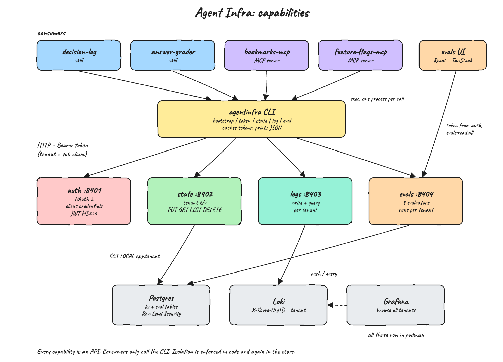

# Design Doc

## Architecture Principles

* One shared platform, many tenants. Every skill and every MCP server is an OAuth 2 client, and its `client_id` is its tenant id.
* The tenant is never a parameter. Services read it from the signed access token, so a caller cannot ask for another tenant's data.
* Defense in depth. Tenant isolation is enforced twice: in the service code and in the store itself (Postgres Row Level Security, Loki `X-Scope-OrgID`).
* APIs first, CLI on top. Every capability is a small HTTP API. The `agentinfra` CLI is the only client skills and MCP servers use, so they never deal with tokens, URLs or HTTP.
* One responsibility per capability. Auth, state, logs and evals are separate services on separate ports and can be replaced one by one.
* Least libraries. Services are raw ASGI apps on Granian; the only runtime Python libraries are `granian` and `psycopg`. Skills, MCP servers and the CLI use the standard library only.

## Features

* **Auth (OAuth 2)**: client credentials grant (RFC 6749 4.4), token introspection (RFC 7662), server metadata (RFC 8414). HS256 JWT access tokens with scopes.
* **State**: tenant scoped key/value store backed by Postgres with Row Level Security. A tenant can only read, list, write and delete its own keys.
* **Logs**: centralized structured logging into Grafana Loki running in podman. Each tenant is a Loki tenant, so queries only return the caller's lines. Grafana is provisioned for browsing.
* **Evals**: a catalog of common evaluators (exact match, contains, regex, JSON checks, length, latency), a run API that grades and stores results per tenant, and a React UI to browse every run.
* **CLI**: `agentinfra` wraps all four capabilities, caches tokens and prints JSON.
* **Consumers**: 2 Claude Code skills (`decision-log`, `answer-grader`) and 2 MCP servers (`bookmarks-mcp`, `feature-flags-mcp`), all built only on the CLI.

## Overall Diagram



Sequence diagrams: `docs/seq-auth-state.png`, `docs/seq-logs.png`, `docs/seq-evals.png`, `docs/seq-mcp.png`.

## Stack

* Python 3.15, uv, ty, Granian (ASGI) for the four services and the CLI.
* psycopg 3 (async) for Postgres.
* Postgres 17, Grafana Loki 3, Grafana 12 in podman via podman-compose.
* TypeScript 7, Bun 1.4.4 (Bun 2.x is not published yet), Vite 8, React 19.3, TanStack Router 1, Query 5, Table 8 and Form 1 for the evals UI.
* `unittest` from the standard library for Python tests, `bun test` for the UI.

## TradeOffs

| Choice | Pros | Cons |
|---|---|---|
| Client credentials grant for every consumer | Simple, machine to machine, no browser, standard | No end user identity; a stolen client secret is the whole tenant |
| HS256 JWT verified locally by each service | No call to auth per request, fast, no extra library | Every service holds the signing key; rotation needs a restart. RS256 + JWKS would avoid sharing the key |
| Postgres RLS for state and evals | Isolation holds even if service code has a bug | Policies must be kept in sync with the schema; every query runs in a transaction that sets `app.tenant` |
| One connection per request | No pool library, no shared state | Slower under load than a pool |
| Loki native multi tenancy | Isolation done by Loki, not by query strings | Grafana needs the tenant list in its datasource header and `multi_tenant_queries_enabled` for the admin view |
| CLI as the only client | Skills and MCPs stay tiny and language agnostic | A process spawn per call (tokens are cached on disk to keep it cheap) |
| Console logs in with client credentials, listed by the local dev server | One click login as any tenant locally, no extra login server | Client secrets reach the browser; fine on a laptop, never for production (use authorization code + PKCE and drop the panel) |
| Console polls every 2 seconds | No push channel to build | Activity is detected per poll; Loki counts are windowed |
| Raw ASGI instead of a web framework | No dependencies, every line is visible | Routing, parsing and errors are hand written |

## Decisions

1. Tenant id = OAuth `client_id` = JWT `sub`. There is no separate tenant table.
2. Scopes: apps get `state:read`, `state:write`, `logs:write`, `logs:read`, `evals:write`, `evals:read`. `infra-admin` gets only the read-only admin scopes `clients:read`, `state:read:all`, `logs:read:all`, `evals:read:all`; `eval-viewer` gets `evals:read:all`.
3. Client secrets are generated by `agentinfra bootstrap` and stored hashed (PBKDF2-SHA256) in `infra/.secrets/clients.json`. Plain secrets live only in `infra/.secrets/credentials/<client>.env`, which is git ignored.
4. The services connect to Postgres as `agentinfra_app`, a non owner role, so RLS applies. Every statement runs in a transaction with `SET LOCAL app.tenant`.
5. Logs are pushed to Loki with `X-Scope-OrgID: <tenant>` and labels `service_name`, `level`. Queries use the caller's tenant header only.
6. Evals are graded on the server, so every consumer uses the same evaluator code and the UI shows comparable scores. The CLI only produces outputs (runs commands or reads given outputs).
7. Keys are `[A-Za-z0-9._:/-]{1,200}`, values are any JSON up to 64 KB.
8. Skills and MCP servers are installed project local (`.claude/skills` symlinks and `.mcp.json`), nothing global is changed.
9. Read-all is a separate `FOR SELECT` RLS policy, so an admin transaction can never update or delete another tenant's rows. `migrate.sql` applies it on every start, so existing volumes get it too.
10. The console picks each tab's API from the token's scopes. Hiding the app filter for apps is only UX; isolation stays on the server.
11. The login clients panel is served by a local Vite middleware reading `infra/.secrets`; it exists only on the local dev server.

## How to Run

```bash
./scripts/setup.sh
./scripts/start-all.sh
./scripts/ui.sh
./scripts/stop-all.sh
```

## How to Test

```bash
./scripts/test-all.sh
```

## All REST Endpoints

| Service | Method | Path | Scope | Description |
|---|---|---|---|---|
| auth | GET | `/health` | none | Liveness |
| auth | GET | `/.well-known/oauth-authorization-server` | none | RFC 8414 metadata |
| auth | POST | `/oauth/token` | client auth | Client credentials grant, returns a Bearer JWT |
| auth | POST | `/oauth/introspect` | client auth | RFC 7662 introspection |
| auth | GET | `/v1/me` | any token | The caller's client, kind and scopes |
| auth | GET | `/v1/admin/clients` | `clients:read` | Every client with kind and scopes, no secrets |
| state | GET | `/health` | none | Liveness |
| state | GET | `/v1/state?prefix=` | `state:read` | List the caller's keys |
| state | GET | `/v1/state/{key}` | `state:read` | Read one key |
| state | PUT | `/v1/state/{key}` | `state:write` | Write `{"value": <json>}` |
| state | DELETE | `/v1/state/{key}` | `state:write` | Delete one key |
| state | GET | `/v1/admin/state?tenant=&prefix=` | `state:read:all` | Entries of every app or one app |
| state | GET | `/v1/admin/state/summary` | `state:read:all` | Keys per tenant |
| logs | GET | `/health` | none | Liveness |
| logs | POST | `/v1/logs` | `logs:write` | Write `{"level","message","fields"}` |
| logs | GET | `/v1/logs?since_minutes=&limit=&level=` | `logs:read` | Read the caller's log lines |
| logs | GET | `/v1/admin/logs?tenant=&level=&since_minutes=` | `logs:read:all` | Lines of every app or one app |
| logs | GET | `/v1/admin/logs/summary` | `logs:read:all` | Line counts per tenant and level, recent lines |
| evals | GET | `/health` | none | Liveness |
| evals | GET | `/v1/evals/evaluators` | any token | Catalog of common evaluators |
| evals | POST | `/v1/evals/runs` | `evals:write` | Grade and store a run |
| evals | GET | `/v1/evals/runs?suite=&tenant=&limit=` | `evals:read` or `evals:read:all` | List runs |
| evals | GET | `/v1/evals/runs/{id}` | `evals:read` or `evals:read:all` | One run with every case and check |
