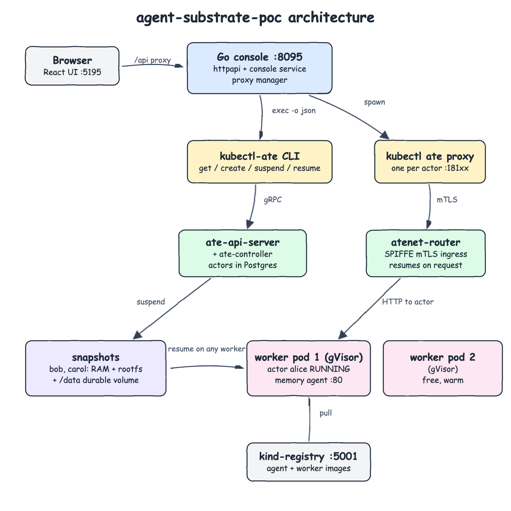
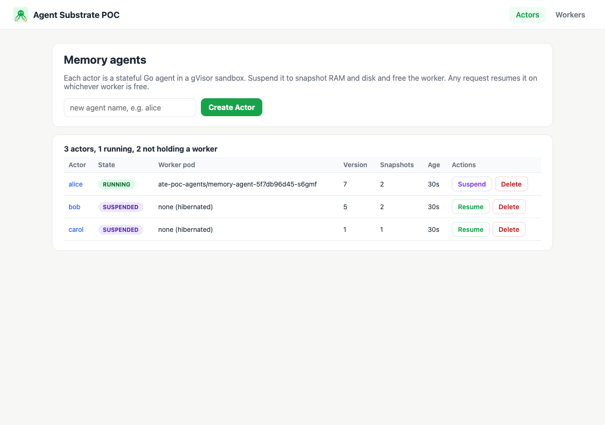
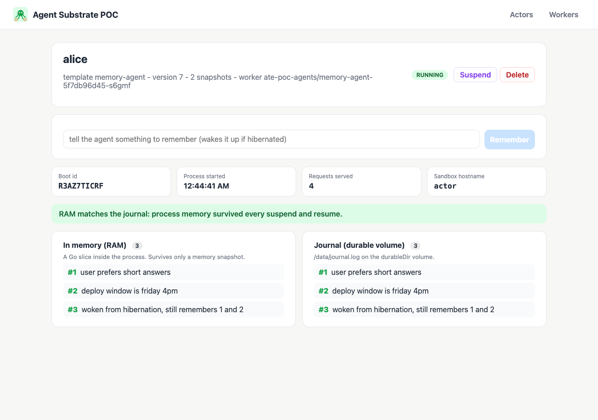
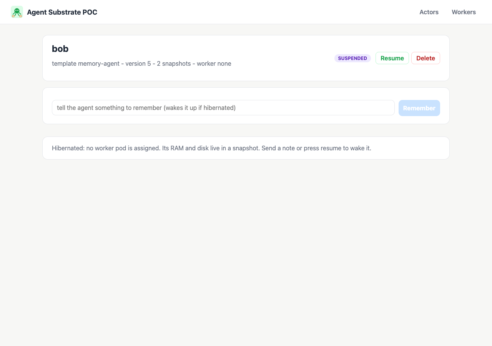
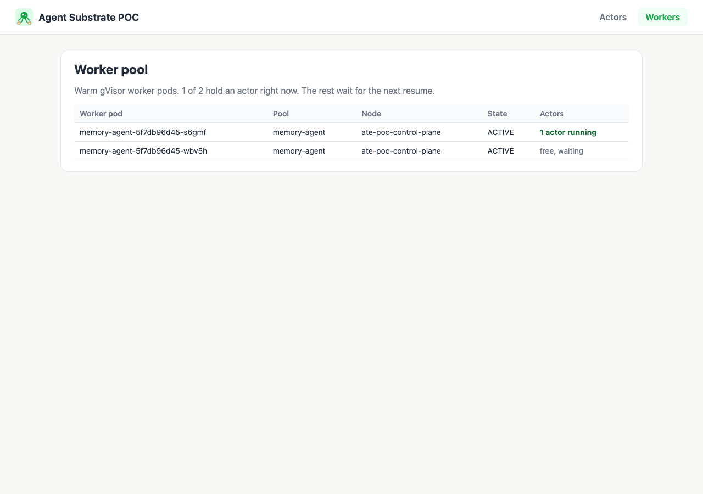

<p align="center"></p>

# Agent Substrate POC

A hands-on POC of [Agent Substrate](https://github.com/agent-substrate/substrate), the zero-trust runtime that runs stateful agents in gVisor sandboxes on Kubernetes and hibernates them when idle. It deploys a small stateful Go **memory agent** as a Substrate actor on a local kind cluster. A Go console plus a React UI let you create agents, talk to them, suspend them and wake them up. You can watch their RAM, their disk and their worker pod across every hibernation.

## How it Works

1. `scripts/setup.sh` creates a kind cluster on podman and installs Substrate with its own `ate-setup`. Then `scripts/deploy-agent.sh` builds the worker and agent images with ko and creates a `WorkerPool` (2 warm gVisor workers) and the `memory-agent` `ActorTemplate`.
2. The template asks for `SNAPSHOT_FIDELITY_MEMORY`, so a suspend captures the process memory, the root filesystem and the `/data` durable volume.
3. The Go console drives the cluster through the `kubectl-ate` CLI with `-o json`: list, create, suspend, resume and delete actors, and list workers.
4. To talk to an actor, the console starts one `kubectl ate proxy actor` per actor on a local port (18100 and up). The proxy authenticates to `atenet-router` with a SPIFFE certificate, and the router resumes a hibernated actor on any free worker before forwarding the request.
5. The agent keeps every note twice: in a Go slice (RAM) and in `/data/journal.log` (durable volume). It also reports a random **boot id** made once per process start.
6. After suspend and resume, the same boot id with the same RAM notes proves the process itself was restored, not restarted.

## Architecture



## Features

* **Create memory agents**: each one is a Substrate actor from the `memory-agent` template, isolated in its own gVisor sandbox.
* **Suspend / resume**: suspend snapshots the actor and frees its worker pod. Resume restores it on whichever worker is free.
* **Wake on request**: sending a note to a hibernated agent resumes it through the router, with no explicit resume call.
* **RAM vs disk view**: notes in process memory and in the durable journal are shown side by side, with a verdict telling a memory restore from a cold boot.
* **Boot id**: a per-process random id that makes "same process restored" visible.
* **Worker pool view**: shows which warm worker pods hold an actor and which are free, so oversubscription is visible.
* **Live refresh**: the actor and worker lists refresh every 2 seconds, so state transitions show up as they happen.
* **Correlation id**: `X-Correlation-Id` flows from the browser to the console and on to the actor, and every Go log line carries it.

## Stack

* **Agent Substrate (pinned commit in `scripts/cluster.env`)**: the runtime under test, installed from source with `ate-setup`.
* **kind on podman**: local Kubernetes; a small `docker` shim maps `buildx --push` to podman.
* **gVisor (`runsc`)**: the sandbox every actor runs in.
* **ko**: builds the worker image and the agent image straight from Go, like Substrate itself does.
* **Go 1.26, standard library only**: the agent and the console, with `net/http`, `log/slog` and `os/exec`.
* **TypeScript 7 + Bun + Vite + React 19**: the UI, with Bun as package manager and test runner.
* **TanStack Router, Query, Form, Table**: routes, polling server state, the create and note forms, and the actor and worker grids.

## Contracts / APIs

Console REST API (`backend/internal/httpapi`):

| Method | Path | Body | Response |
|---|---|---|---|
| `GET` | `/api/health` | - | `{"status":"ok"}` |
| `GET` | `/api/actors` | - | `[Actor]` |
| `POST` | `/api/actors` | `{"name":"alice"}` | `201 Actor` |
| `GET` | `/api/actors/{name}` | - | `Actor` |
| `POST` | `/api/actors/{name}/suspend` | - | `Actor` |
| `POST` | `/api/actors/{name}/resume` | - | `Actor` |
| `DELETE` | `/api/actors/{name}` | - | `{"deleted":"alice"}` |
| `GET` | `/api/actors/{name}/state` | - | `AgentState` (resumes the actor if needed) |
| `POST` | `/api/actors/{name}/notes` | `{"text":"..."}` | `201 Note` (resumes the actor if needed) |
| `GET` | `/api/workers` | - | `[Worker]` |

* `Actor`: `{ name, template, state: RESUMING|RUNNING|SUSPENDING|SUSPENDED|CRASHED|DELETING|REVERTING|UNKNOWN, workerPod, node, version, snapshots, createdAt }`
* `Worker`: `{ name, pool, pod, node, state, actors, capacity }`
* `AgentState`: `{ bootId, startedAt, hostname, requests, memoryNotes: [Note], journalNotes: [Note] }`, where `Note` is `{ id, text, at }`

Errors are mapped in one place: `400` bad name or body, `404` unknown actor, `409` already exists or wrong state, `503` no free proxy port, `502` cluster or actor failure.

Memory agent API (inside the sandbox, port 80): `GET /readyz` (the template's wakeup probe), `GET /state` and `POST /notes`.

## Key data structures and design decisions

* **The CLI as the boundary**: Substrate's router dialer lives in an `internal` Go package, so another module cannot import it. The console shells out to the pinned `kubectl-ate` instead, behind a one-method `Runner` interface, so tests swap in a fake.
* **Protojson parsing**: `ate/types.go` decodes `kubectl-ate -o json`. It accepts `int64` versions as JSON strings, maps unknown states to `UNKNOWN`, and hides the template's golden actor (a UUID name).
* **Stdout and stderr kept apart**: the CLI prints a `--token-file` warning on stderr. Merging the two broke JSON parsing, and the e2e test caught it.
* **Proxy manager**: one live `kubectl ate proxy` per actor from a bounded port range. A dead proxy is replaced, one that never opens its port is killed, and deleting an actor closes its proxy.
* **Boot id plus two note stores**: comparing RAM notes with journal notes shows which snapshot fidelity really happened. Equal lists mean MEMORY; RAM behind the journal means a cold boot that kept only VOLUMES.
* **Immutable templates**: `deploy-agent.sh` recreates the template only when the agent image digest changes or the golden snapshot failed. Otherwise it is a no-op.
* **Validation at the edge**: actor names are checked as DNS-1123 labels in the UI and again in the console service, before anything reaches `os/exec`.

## Local requirements found the hard way

* **Rootless podman needs `cpuset` delegated**, or `runsc create` fails with `mandatory cgroup controller "cpuset" is missing`. `setup.sh` checks this and prints the one-time fix: add `cpuset` to `/etc/systemd/system/user@.service.d/delegate.conf` in the podman machine, then restart the machine.
* **The VM kernel keyring quota** (`kernel.keys.maxkeys=200` by default) runs out when several kind clusters share the VM, and pods fail with `unable to create session key: disk quota exceeded`. `setup.sh` raises it on every run, because the setting resets when the VM restarts.
* **Rootless podman cannot publish `[::1]` and `127.0.0.1` on the same port**, so `setup.sh` starts the registry on IPv4 only before Substrate's kind script runs.

## How to run

```bash
./scripts/setup.sh
./scripts/build-all.sh
./scripts/start-all.sh
./scripts/test-all.sh
./scripts/ui.sh
./scripts/stop-all.sh
```

The first `setup.sh` takes a while: it builds Substrate from source, including a Rust envoy module. Later runs skip everything that is already in place.

## Printscreens

**Actors**: three memory agents. `alice` is RUNNING on a worker pod. `bob` and `carol` are SUSPENDED and hold no worker. Version and snapshot counts grow with every transition.



**Running actor**: `alice` after being suspended and woken up by a note. RAM and the journal both hold all three notes, so the verdict is that process memory survived the hibernation.



**Hibernated actor**: `bob` has no worker pod. His state lives in a snapshot until the next note or a resume.



**Workers**: the two warm gVisor worker pods. One hosts `alice`; the other waits for the next resume. Three actors share two workers.



## Scripts

All scripts live in `scripts/` and run from any directory of the repository.

| Script | What it does |
|---|---|
| `./scripts/setup.sh` | Fetches Substrate, builds `kubectl-ate`, creates the kind cluster, installs Substrate and deploys the agent |
| `./scripts/deploy-agent.sh` | Builds images with ko, applies the worker pool, creates the template and waits for its golden snapshot |
| `./scripts/build-all.sh` | Builds every part of the app |
| `./scripts/build-backend.sh` | gofmt, go vet and builds the console and agent |
| `./scripts/build-frontend.sh` | Type checks and builds the frontend |
| `./scripts/start-all.sh` | Starts the console and the UI and prints the full link of each one |
| `./scripts/status.sh` | Shows every service port as UP or DOWN, plus the Substrate install |
| `./scripts/test-all.sh` | Runs every test suite |
| `./scripts/unit-test.sh` | Runs Go and bun unit tests |
| `./scripts/e2e-test.sh` | Runs the live cluster test: create, note, suspend, note, then checks that RAM and the boot id survived |
| `./scripts/ui.sh` | Opens the UI in the browser |
| `./scripts/stop-all.sh` | Stops the console, the UI and every actor proxy; the cluster keeps running |

Ports are declared in `scripts/ports.env`: console `8095`, frontend `5195`, registry `5001`. Cluster settings live in `scripts/cluster.env`.

```bash
./scripts/setup.sh
./scripts/build-all.sh
./scripts/start-all.sh
./scripts/status.sh
./scripts/ui.sh
./scripts/stop-all.sh
```
