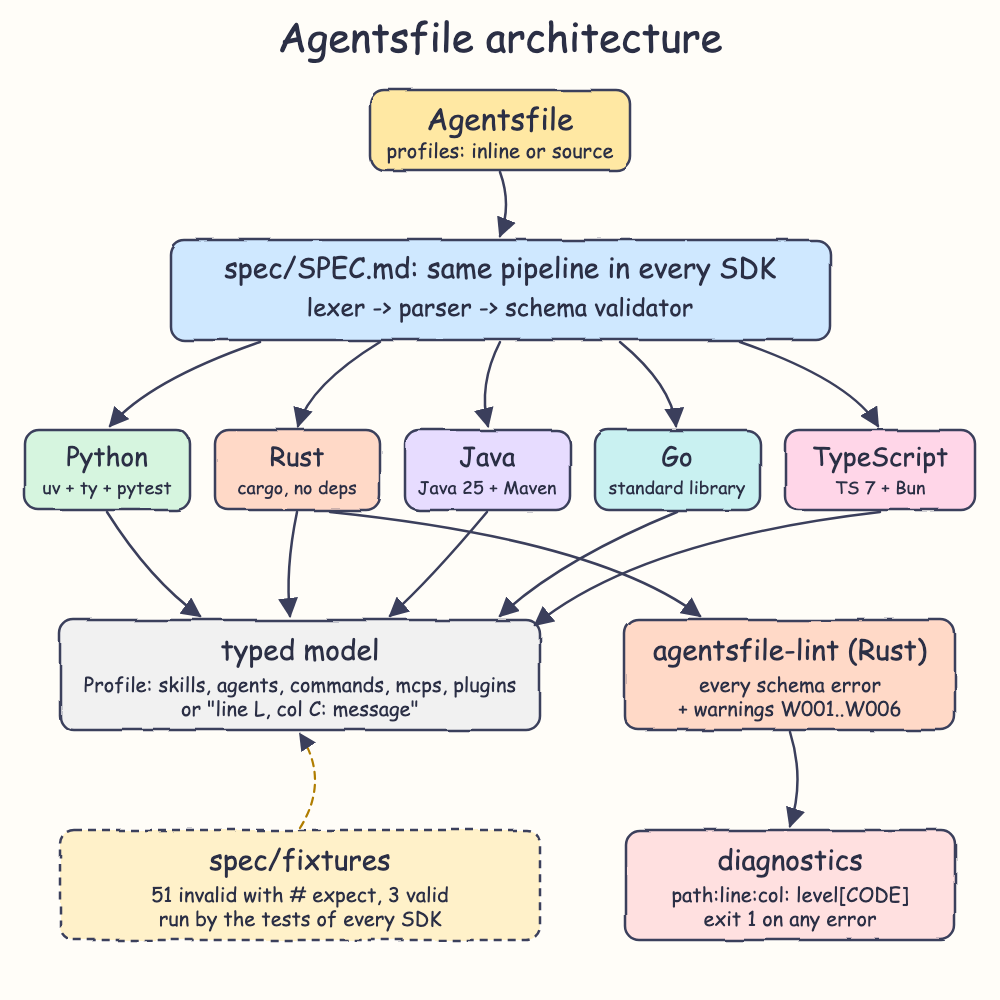
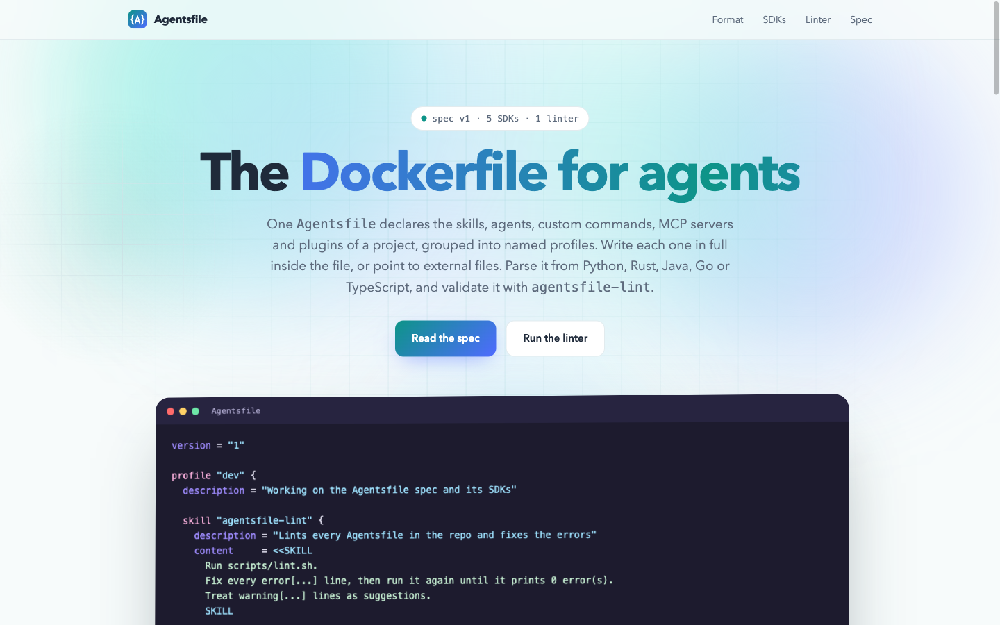
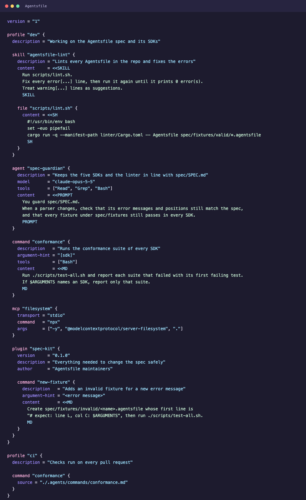
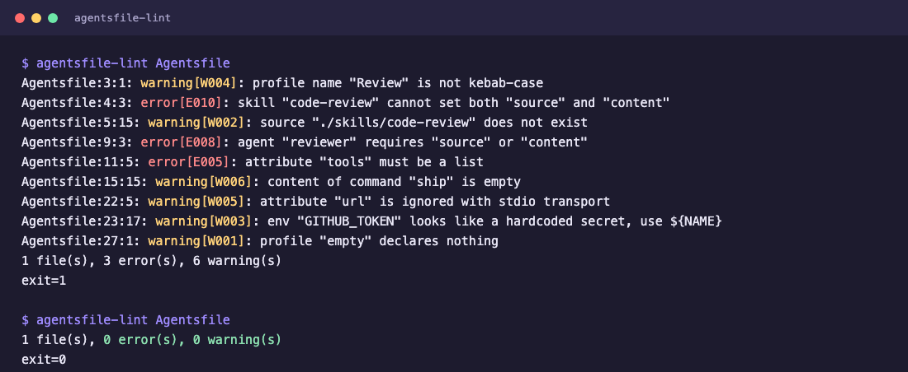
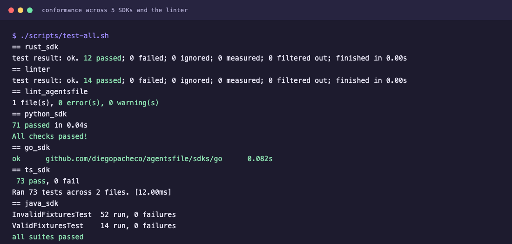

<p align="center"></p>

# Agentsfile

`Agentsfile` is to agents what a `Dockerfile` is to images, or `main.tf` is to infrastructure. It
is one file that declares the skills, agents, custom commands, MCP servers and plugins of a project,
grouped into named profiles such as `dev` or `ci`. Each item can be written in full inside the file
(the skill body and its extra files, the agent prompt, the command prompt, the MCP server, the
plugin and its contents), or it can point to external files with `source`. This repo has the spec,
parsers in Python, Rust, Java, Go and TypeScript, a linter written in Rust, and a landing page.

```hcl
version = "1"

profile "dev" {
  skill "code-review" {
    description = "Reviews the current diff"
    content     = <<EOT
      Read the diff and list bugs first, then style issues.
      EOT

    file "scripts/diff.sh" {
      content = <<SH
        #!/usr/bin/env bash
        git diff --stat
        SH
    }
  }

  agent "tester" {
    model   = "claude-sonnet-5-5"
    tools   = ["Read", "Bash"]
    content = "You write tests first and keep each test small."
  }

  command "ship" {
    argument-hint = "<branch>"
    content       = "Run the tests, then open a PR for $ARGUMENTS."
  }

  mcp "github" {
    transport = "stdio"
    command   = "npx"
    args      = ["-y", "@modelcontextprotocol/server-github"]
    env       = { GITHUB_TOKEN = "${GITHUB_TOKEN}" }
  }

  plugin "toolkit" {
    version = "1.2.0"
    skill "lint" { content = "Run the linter and fix every error." }
  }

  plugin "security" { source = "https://github.com/acme/plugins/security" }
  agent "reviewer"  { source = "./agents/reviewer.md" }
}
```

## How it works

1. The file uses an HCL-like block syntax. Values are strings, lists of strings or maps of strings, and `#` starts a comment. Heredocs (`<<EOT ... EOT`) hold multi-line text such as prompts and scripts. Their shared indentation is stripped, and nothing inside them is escaped.
2. Each skill, file, agent, command, MCP server and plugin sets exactly one of two things: `source` (a pointer to external files) or its inline definition (`content`, `transport`, or nested items for a plugin).
3. Every SDK runs the same three steps from `spec/SPEC.md`: a lexer, a parser that builds statements, and a schema validator that builds the typed model.
4. A parser stops at the first error and reports it as `line L, col C: message`. The message text is fixed by the spec, so all five SDKs report the same error at the same position.
5. `spec/fixtures/invalid/` holds 51 broken files. Line 1 of each one is `# expect: <error>`, and every SDK's tests require that exact error string.
6. `agentsfile-lint` is built on the Rust SDK. It reports every schema error, not only the first, and adds 6 warnings that a parser should not reject.
7. `${NAME}` is never expanded by a parser. The tool that applies a profile resolves it, so the file holds no secrets.

## Architecture



## Features

- **Profiles**: one file holds several setups, and a tool loads only the profile it needs.
- **Five block kinds**: `skill`, `agent`, `command`, `mcp` and `plugin` cover what coding agents load.
- **Whole definitions inline**: a skill body with its extra `file` blocks, an agent's system prompt, a command prompt with `argument-hint`, `model` and `tools`, a full MCP server, and a plugin with its own items.
- **Or by reference**: any item can use `source` instead, pointing at a path, a URL or a published plugin.
- **Heredocs**: multi-line prompts and scripts fit in the file without escaping.
- **MCP transports**: `stdio` with command, args and env; `http` and `sse` with url and headers.
- **Identical errors in every SDK**: the message and position are pinned by the spec and by 51 fixtures.
- **Typed model**: records, dataclasses or structs in each language, never untyped maps.
- **No runtime dependencies**: every SDK is just the language and its standard library.
- **Linter with codes**: errors `E001`-`E010` and warnings `W001`-`W006`. It exits 1 on any error, so it fits CI.
- **Dogfooded**: the `Agentsfile` at the root of this repo describes its own agent setup and lints clean.

## Stack

- **Python 3.15 + uv + ty + pytest**: a uv project, type-checked with ty.
- **Rust 1.99, edition 2024**: the reference SDK and the base of the linter. No crates.
- **Java 25 + Maven + JUnit 5**: records and sealed interfaces for the model and the syntax tree.
- **Go 1.26**: standard library only.
- **TypeScript 7 + Bun 1.4**: `bun test` and `tsc --noEmit` with a strict config.
- **Single HTML file**: the landing page has no framework and no external assets.

The SDKs are libraries, so the stack skill's server parts (Spring Boot, Postgres, Granian, React,
Tokio) were left out on purpose. The skill asks for Bun 2.x, but 1.4.4 is the latest Bun release,
so the TS SDK uses that.

## Contracts / APIs

| SDK | Parse a string | Parse a file | Error type |
|---|---|---|---|
| Python | `agentsfile.parse(text)` | `agentsfile.load(path)` | `AgentsfileError` (`line`, `col`, `message`) |
| Rust | `agentsfile::parse(src)` | `agentsfile::parse_file(path)` | `agentsfile::Error`, `LoadError` |
| Java | `Agentsfile.parse(String)` | `Agentsfile.load(Path)` | `AgentsfileException` (`line()`, `col()`) |
| Go | `agentsfile.Parse(src)` | `agentsfile.ParseFile(path)` | `*agentsfile.Error` (`Line`, `Col`, `Message`) |
| TypeScript | `parse(src)` | `load(path)` | `AgentsfileError` (`line`, `col`) |

Linter CLI:

```bash
agentsfile-lint [paths...]
```

With no paths it lints `./Agentsfile`. It prints one line per diagnostic,
`path:line:col: level[CODE]: message`, then a summary line. The exit code is 1 when any error is found.

| Code | Level | Rule |
|---|---|---|
| E001 | error | lexical or syntax error |
| E002 / E003 | error | unknown attribute / unknown block |
| E004 / E005 | error | duplicate attribute / wrong attribute kind |
| E006 | error | unsupported version or invalid transport |
| E007 | error | duplicate profile, or duplicate item of one kind in a profile |
| E008 | error | missing `version`, or neither `source` nor the inline definition |
| E009 | error | transport requirement not met |
| E010 | error | both `source` and the inline definition |
| W001 | warning | the profile declares nothing |
| W002 | warning | a `source` starting with `.` or `/` does not exist |
| W003 | warning | an `env` or `headers` value looks like a hardcoded secret |
| W004 | warning | a block name is not kebab-case |
| W005 | warning | an attribute is ignored by the chosen transport |
| W006 | warning | an inline `content` is empty |

## Key data structures and design decisions

- **Typed model**: every SDK exposes the same shape:
  - `Agentsfile { version, profiles[] }`
  - `Profile { name, description?, skills[], agents[], commands[], mcps[], plugins[] }`
  - `Skill { name, description?, source?, content?, files[] }`, with `SkillFile { path, source?, content? }`
  - `Agent { name, description?, model?, tools[], source?, content? }`
  - `Command { name, description?, argument_hint?, model?, tools[], source?, content? }`
  - `Mcp { name, description?, source?, transport?, command?, args[], env{}, url?, headers{} }`
  - `Plugin { name, description?, version?, author?, source?, skills[], agents[], commands[], mcps[] }`
- **Exactly one of `source` or inline**: each item is either a pointer or a full definition, never a mix. A tool can always tell where an item's body comes from.
- **Two stages**: the parser produces generic statements (attributes and labelled blocks with positions), and the schema step turns them into the typed model. The linter reuses the Rust statements to place its warnings.
- **Fixed processing order**: lex the whole file, then parse, then validate in document order. This is why "first error" means the same thing in every language.
- **Columns count characters, not bytes**: positions agree across UTF-8 (Rust, Go), UTF-16 (Java, JS) and code-point (Python) strings.
- **Rust validator collects issues**: `parse` returns the first issue, and the linter takes all of them, so there is no second implementation of the schema rules.
- **Missing lists and maps are empty, not null**: callers never have to check them.

## How to run

```bash
./scripts/setup.sh
./scripts/test-all.sh
cargo run -q --manifest-path linter/Cargo.toml -- Agentsfile
```

Run one SDK's tests:

```bash
cd sdks/python && uv run pytest -q && uv run ty check
cd sdks/rust && cargo test
cd sdks/java && mvn test
cd sdks/go && go test ./...
cd sdks/ts && bun test && bunx tsc --noEmit
cd linter && cargo test
```

`sdks/java` needs JDK 25. `scripts/` finds it on its own, or you can set `JAVA25_HOME`.

## Printscreens

The landing page hero: the headline, the two calls to action, and this repo's own `Agentsfile` as the product shot.



The `Agentsfile` at the root of the repo. The `dev` profile is fully inline: a skill with its body
and a bundled `scripts/lint.sh`, an agent with its system prompt, a command with `argument-hint`, a
stdio MCP server, and a `spec-kit` plugin with its own command. The `ci` profile points its command
at `.agents/commands/conformance.md`.



`agentsfile-lint` run twice. On a broken file it reports both errors (a missing `source` and `tools`
given as a string) and five warnings, then exits 1. On the repo's own `Agentsfile` it reports
nothing and exits 0.



`scripts/test-all.sh` runs the Rust SDK, the linter suite, a lint of the `Agentsfile`, and the Python, Go, TypeScript and Java SDKs. Every suite passes.



## Scripts

All scripts live in `scripts/` and run from any directory of the repository.

| Script | What it does |
|---|---|
| `./scripts/setup.sh` | Installs the dependencies of every SDK and builds the linter |
| `./scripts/start-all.sh` | Serves the landing page and prints its full link |
| `./scripts/status.sh` | Shows whether the landing page port is UP or DOWN |
| `./scripts/test-all.sh` | Runs every test suite and lints the `Agentsfile` |
| `./scripts/ui.sh` | Opens the landing page in the browser |
| `./scripts/stop-all.sh` | Stops the landing page server |

Ports are declared in `scripts/ports.env` (`landing=8099`).

```bash
./scripts/setup.sh
./scripts/start-all.sh
./scripts/status.sh
./scripts/ui.sh
./scripts/stop-all.sh
```
