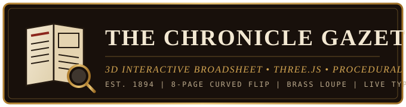
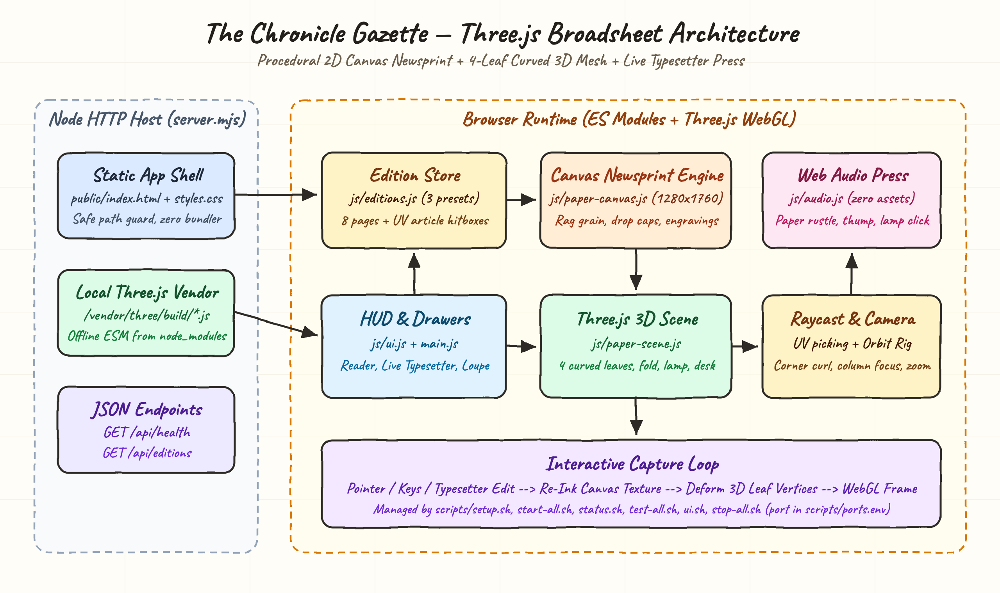
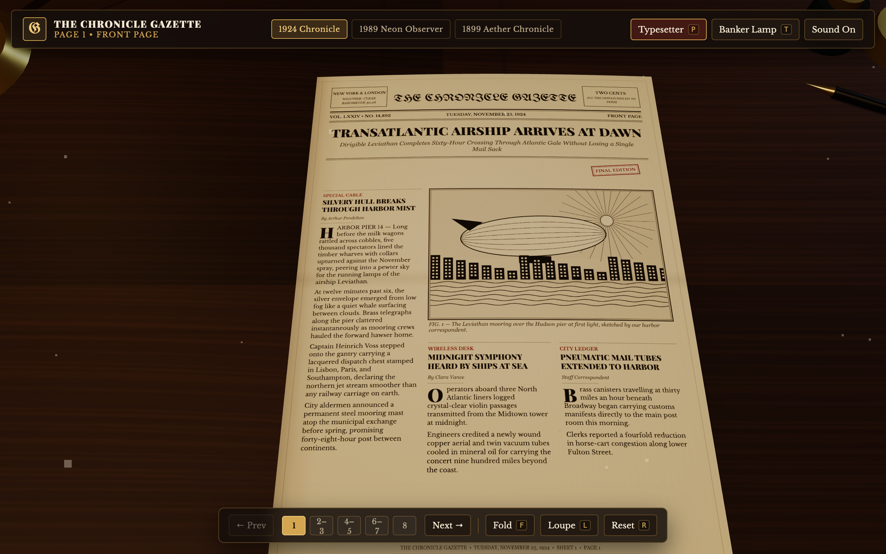
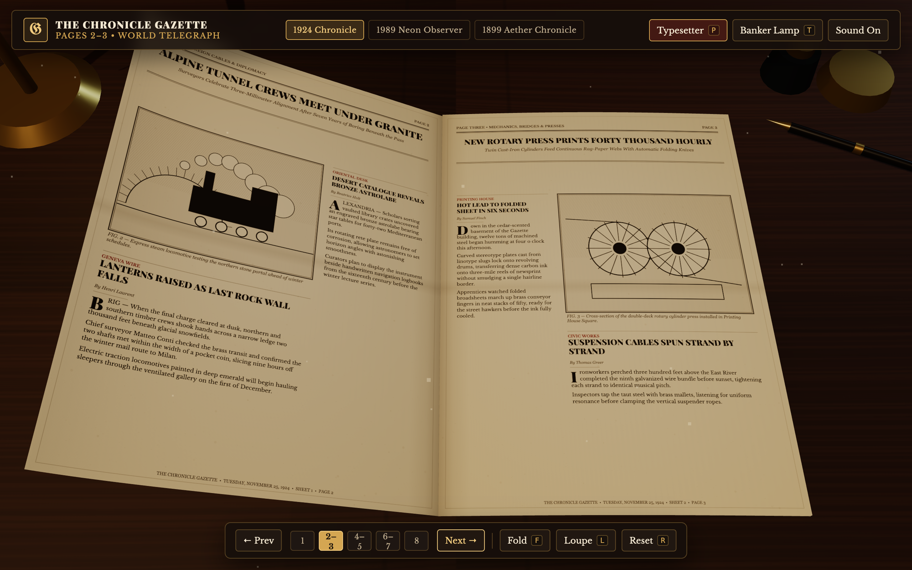
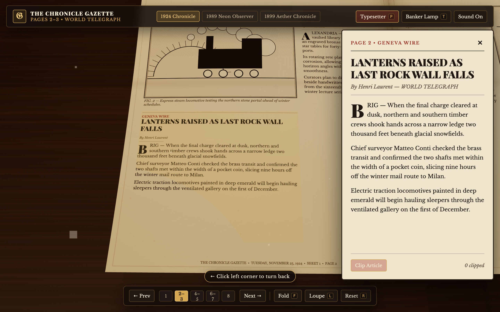
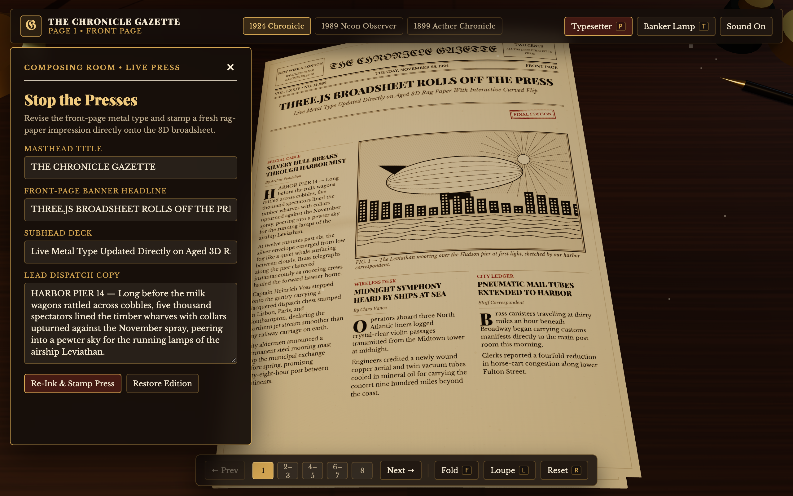
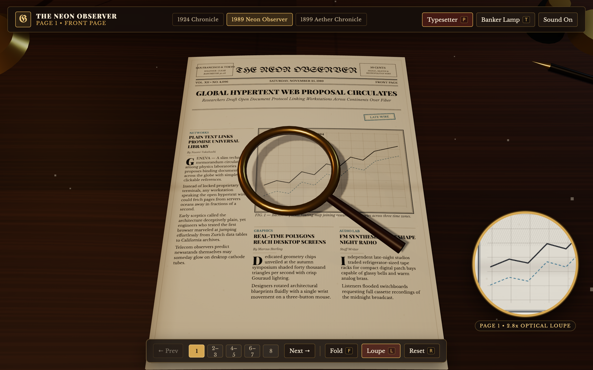

<p align="center"></p>

# agy-gemini-4-neon-paper-poc

An interactive old-school 3D broadsheet newspaper built with **Three.js** and procedural HTML5 Canvas newsprint. Flip through four double-sided curved paper leaves (eight full pages) on a mahogany newsroom desk lit by an emerald glass banker's lamp, inspect engravings through a 3D brass magnifying loupe, click any article column to read it in focus, fold the sheet like a commuter broadsheet, or edit front-page headlines live in the Composing Room press.

## How it Works?

1. `server.mjs` serves the static web app, exposes `/api/health` and `/api/editions`, and maps `/vendor/three/` directly to the local `three` package with no bundler.
2. `public/js/editions.js` defines three complete 8-page broadsheet presets (`1924 Chronicle`, `1989 Neon Observer`, `1899 Aether Chronicle`) with normalized UV article hitboxes.
3. `public/js/paper-canvas.js` paints each page onto a `1280x1760` offscreen canvas with rag-paper grain, spine shading, Gothic mastheads, drop caps, and procedural woodcut engravings.
4. `public/js/paper-scene.js` binds those canvases as Three.js textures onto four subdivided front/back leaf planes (`34x24` segments each) on a mahogany desk with brass props and drifting dust motes.
5. Turning pages, hovering corners, or toggling Fold deforms leaf vertex positions in real time with cylindrical spine curl, gravity sag, and soft shadow projection.
6. Raycasting maps pointer hits on the active 3D leaves back to normalized UV coordinates to highlight columns, drive the 3D brass magnifying loupe, trigger corner turns, or swoop the camera to an article.
7. Submitting changes in the Composing Room drawer immutably updates the front page, re-inks the canvas texture, bounces the newspaper with a mechanical press thump, and synthesizes tactile audio via Web Audio API.

## Architecture



## Features

- **Curved 4-Leaf (8-Page) Broadsheet Physics**: Subdivided Three.js meshes curl organically across the center spine so page turns catch warm lamp light instead of rotating as flat cards.
- **Procedural Rag-Paper & Copperplate Engravings**: Every page renders fresh high-resolution newsprint grain, double hairline rules, drop caps, and vector engravings without external image assets.
- **Live "Stop the Presses" Typesetter**: Edit the masthead, front-page banner, subhead deck, and lead copy live to re-ink the 3D newspaper on the fly.
- **3D Brass Magnifying Loupe**: Glides above the paper casting real shadows while rendering a synchronized 2.8x circular optical zoom HUD for inspecting fine print.
- **Interactive Article Reader & Clipping**: Clicking any article column focuses the 3D camera on that block and opens a crisp vintage reader drawer with article clipping.
- **Commuter Fold & Lighting Modes**: Toggle horizontal crease folding (`F`), switch between warm emerald Banker's Lamp and Daylight studio light (`T`), or orbit and zoom freely.
- **Three Selectable Broadsheet Editions**: Switch instantly between *The Chronicle Gazette (1924)*, *The Neon Observer (1989)*, and *The Aether Chronicle (1899)*.
- **Synthesized Web Audio Press Soundscape**: Generates paper-flip rustles, press thumps, and brass switch clicks procedurally with zero audio files.

## Stack

- **Node.js 24**: Serves static ES modules, JSON endpoints, and runs the built-in `node:test` test suite with zero extra server or test libraries.
- **Three.js 0.174**: Renders the WebGL broadsheet meshes, PCF soft shadows, banker's lamp lighting, brass loupe, and dust particles locally from `node_modules`.
- **HTML5 Canvas 2D**: Generates procedural vintage newsprint textures, mahogany desk grain, crosshatched engravings, and the 2.8x loupe view.
- **Web Audio API**: Synthesizes filtered noise paper rustles and press thumps on user interaction without bundled sound clips.

## Contracts/APIs

| Method | Path | Purpose |
|---|---|---|
| `GET` | `/` | Serves the broadsheet web application shell (`public/index.html`) |
| `GET` | `/api/health` | Returns `{ "status": "ok", "service": "chronicle-gazette" }` |
| `GET` | `/api/editions` | Returns `{ "editions": [...] }` containing all 3 bundled 8-page editions |
| `GET` | `/vendor/three/*` | Serves local Three.js ES modules from `node_modules/three` with path-traversal protection |

Keyboard shortcuts inside the application:

| Key | Action |
|---|---|
| `ArrowLeft` / `ArrowRight` | Turn to previous or next broadsheet spread |
| `F` | Fold or unfold the newspaper horizontally |
| `L` | Toggle the 3D brass magnifying loupe and 2.8x optical inset |
| `P` | Open or close the live Typesetter Composing Room drawer |
| `T` | Switch between warm Banker's Lamp and Daylight illumination |
| `R` / Double-click | Reset camera orbit and zoom |
| `Escape` | Close the Article Reader drawer and reset focus |

## Key Data Structures and Software Design Decisions

- **Normalized UV Article Hitboxes**: Each article stores `{ x, y, w, h }` in `[0, 1]` page space. Both the 2D canvas renderer (`paper-canvas.js`) and Three.js raycast picker (`hitTestArticle` in `editions.js`) read the exact same coordinates, guaranteeing pixel-accurate clicks even while pages tilt or curve.
- **Paired Front/Back Leaf Meshes**: Each of the four physical sheets uses separate `THREE.FrontSide` front and back `PlaneGeometry` meshes offset by `±0.0025` along the local surface normal. This eliminates double-sided Z-fighting and preserves accurate lighting normals on both sides of a flipped sheet.
- **Immutable Edition Updates**: `applyHeadlineEdit` clones the active edition via `structuredClone` before applying Composing Room changes, allowing instant one-click restoration of any preset edition.
- **Zero-Bundler Local Serving**: Serving `three.module.js` directly under `/vendor/three/` keeps `package.json` down to a single runtime dependency (`three`) and removes build latency.

## How to Run the App and Tests

```bash
./scripts/setup.sh
./scripts/start-all.sh
./scripts/test-all.sh
./scripts/stop-all.sh
```

Or directly via npm:

```bash
npm install
npm test
PORT=4173 npm start
```

## Printscreens of the UI

### Front Page Under the Banker's Lamp
The default front-page view of *The Chronicle Gazette (1924)* resting on the mahogany desk with Gothic masthead typography, aged rag-paper fibers, copperplate dirigible engraving, edition tabs, and tactile spread controls.



### Open Two-Page Broadsheet Spread
Turning Leaf 1 reveals Pages 2 and 3 laid open side by side across the spine crease, with soft 3D curvature, dynamic center-gutter shadows, and procedural locomotive and rotary-press engravings.



### Focused Article Reader Drawer
Clicking any column on the 3D broadsheet smoothly swoops the camera toward that column and opens the ivory Typesetter Reader drawer with full article copy, drop cap, and article clipping.



### Live Composing Room ("Stop the Presses")
Opening the left Typesetter drawer lets you rewrite the masthead, front-page banner headline, deck, and lead copy, then stamp the freshly inked texture straight onto the 3D newspaper.



### 1989 Neon Observer & 3D Brass Magnifying Loupe
Switching to *The Neon Observer* edition and activating Loupe mode (`L`) floats a 3D brass magnifying glass over the page while displaying a live 2.8x optical zoom inset in the lower-right corner.



## Scripts

All scripts live in `scripts/` and run from any directory of the repository.

| Script | What it does |
|---|---|
| `./scripts/setup.sh` | Installs dependencies and prepares the app |
| `./scripts/start-all.sh` | Starts every service and prints the full link of each one |
| `./scripts/status.sh` | Shows every service port as UP or DOWN |
| `./scripts/test-all.sh` | Runs every test suite |
| `./scripts/ui.sh` | Opens the UI in the browser |
| `./scripts/stop-all.sh` | Stops every service |

Ports are declared in `scripts/ports.env` (`frontend=4173`).

```bash
./scripts/setup.sh
./scripts/start-all.sh
./scripts/status.sh
./scripts/ui.sh
./scripts/stop-all.sh
```
