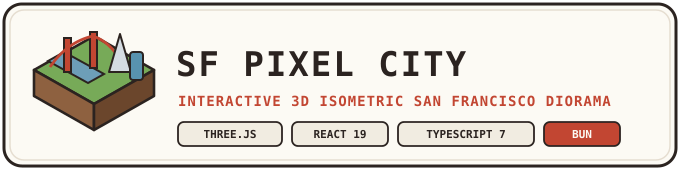
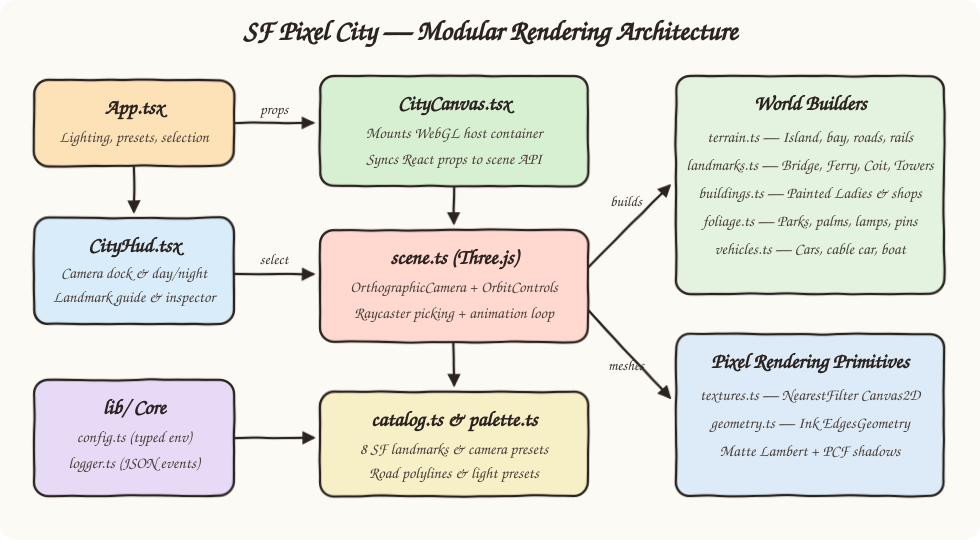
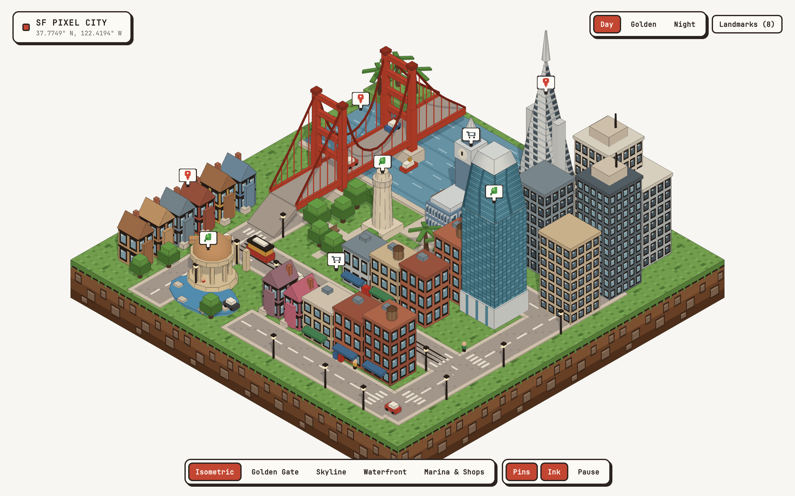
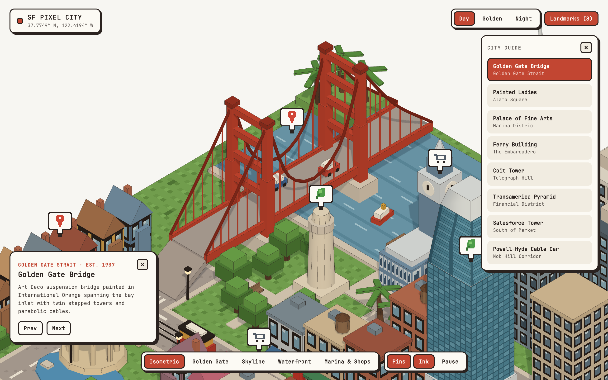
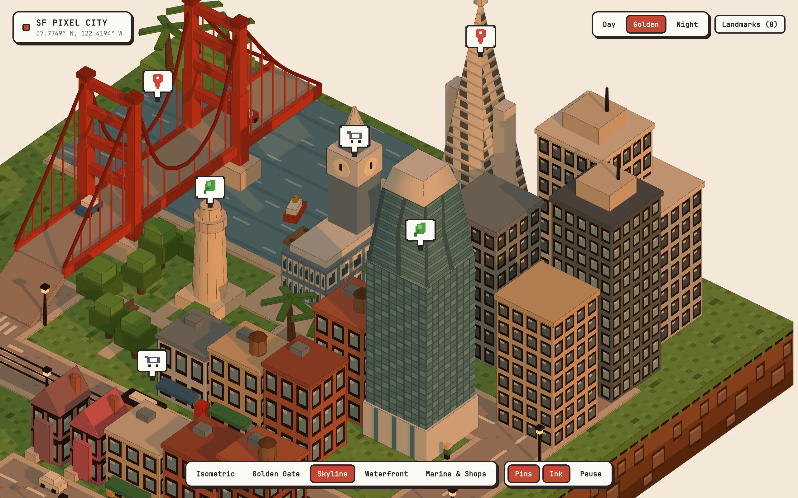
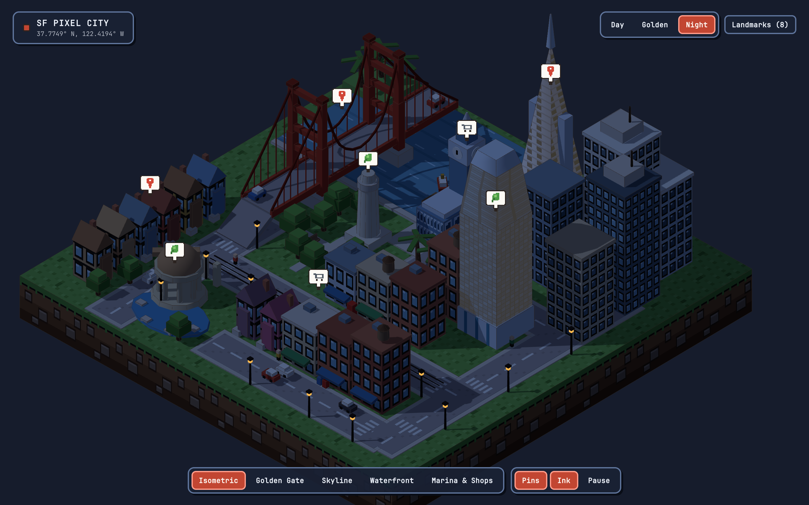

# SF Pixel City

An interactive 3D isometric San Francisco pixel-art diorama built with Three.js, React 19, TypeScript 7, Vite, and Bun. Explore iconic landmarks—including the Golden Gate Bridge, Painted Ladies, Palace of Fine Arts, Ferry Building, Coit Tower, Transamerica Pyramid, Salesforce Tower, and a moving Powell-Hyde Cable Car—floating on a cutaway bay island with animated vehicles, bay boats, pedestrians, and dynamic lighting.

## How it Works?

1. `App.tsx` owns the lighting mode, camera preset, visibility toggles, and selected landmark state.
2. `CityCanvas.tsx` mounts a WebGL canvas managed by `createCityScene()` inside `src/features/city/scene.ts`.
3. World builders compose five modular Three.js groups: cutaway terrain and San Francisco Bay (`terrain.ts`), six monumental landmarks (`landmarks.ts`), Painted Ladies and neighborhood blocks (`buildings.ts`), parks, palms, streetlamps, and floating pixel pins (`foliage.ts`), plus live vehicles, cable car, bay boat, and walkers (`vehicles.ts`).
4. Crisp nearest-neighbor Canvas2D pixel textures (`textures.ts`) pair with dark ink `EdgesGeometry` line overlays (`geometry.ts`) to achieve an illustrated isometric pixel-city aesthetic inside real-time 3D.
5. An orthographic camera with `OrbitControls` enables smooth orbit, pan, zoom, preset camera glides, and raycasted landmark selection linked directly to `CityHud.tsx`.

## Architecture



## Features

- **Orthographic Isometric Diorama**: Renders San Francisco on a floating layered-earth cutaway island with unobstructed true-isometric proportions and full orbit/zoom controls.
- **Eight Interactive SF Landmarks**: Click any landmark or floating pixel pin to glide the camera into focus and inspect its district, year built, and architectural notes.
- **Crisp Pixel Facades and Ink Outlines**: Procedural `THREE.NearestFilter` textures and toggleable `EdgesGeometry` outlines deliver sharp pixel architecture with zero external raster assets.
- **Living City Traffic**: Animated pixel cars cross streets and ascend the Golden Gate Bridge deck while the Powell-Hyde cable car glides on embedded steel rails alongside bay ferry traffic and pedestrians.
- **Day, Golden Hour, and Night Lighting**: Switch sun angles, sky palette, streetlamp glow, and skyscraper window illumination on demand.
- **Camera Viewpoint Presets**: Jump smoothly between Isometric, Golden Gate, Skyline, Waterfront, and Marina & Shops viewpoints from the bottom dock.

## Stack

- **Three.js 0.187**: Renders the orthographic 3D diorama, procedural shadows, suspension cables, and raycasted picking at 60fps.
- **React 19.3**: Drives the lightweight HUD overlay, landmark guide drawer, and state synchronization with the WebGL controller.
- **TypeScript 7.0**: Enforces strict domain types (`strict: true`, `noUncheckedIndexedAccess: true`) with zero `any` types across scene and UI modules.
- **Vite 8.4**: Serves instant hot reload during development and bundles the static production site cleanly.
- **Bun 1.4**: Handles dependency installation, script execution, and fast native unit tests without extra test runners.

## Contracts / APIs

This application runs completely client-side with no backend server. Its public boundaries are environment configuration and the typed scene controller contract:

### Environment Configuration (`src/lib/config.ts`)

| Variable | Type | Default | Description |
|---|---|---|---|
| `VITE_APP_NAME` | `string` | `"sf-pixel-city"` | Application identifier attached to structured JSON logs |
| `VITE_DEFAULT_LIGHTING` | `"day" \| "golden" \| "night"` | `"day"` | Initial lighting mood applied when the diorama loads |

### Scene Controller Interface (`src/features/city/scene.ts`)

```ts
export type CitySceneController = {
  readonly setLighting: (mode: LightingMode) => void;
  readonly setPaused: (paused: boolean) => void;
  readonly setShowPins: (visible: boolean) => void;
  readonly setCrispOutlines: (visible: boolean) => void;
  readonly focusPreset: (preset: CameraPreset) => void;
  readonly focusLandmark: (id: LandmarkId) => void;
  readonly dispose: () => void;
};
```

## Key Data Structures and Software Design Decisions

- **Immutable Domain Catalog (`src/features/city/catalog.ts`)**: `LANDMARKS`, `CAMERA_PRESETS`, and `VEHICLE_ROUTES` are declared as `readonly` tuples so rendering, HUD navigation, and unit tests share a single source of truth.
- **Pure Polyline Sampler (`samplePolyline`)**: Vehicle placement and heading interpolation are implemented as pure deterministic math independent of Three.js, enabling fast unit testing of loop wrapping and segment angles.
- **Procedural Canvas2D Textures (`src/features/city/textures.ts`)**: Building windows, grass dithering, bay wave glints, soil rock strata, and floating map pin bubbles are synthesized in memory with `THREE.NearestFilter` and `generateMipmaps = false`, keeping the bundle self-contained and razor-sharp at any zoom level.
- **Single Shared Ink Material (`src/features/city/geometry.ts`)**: All architectural edge outlines share one `THREE.LineBasicMaterial`, allowing instant toggling of ink outlines across hundreds of meshes in O(1) time.
- **Centralized Logging and Config (`src/lib/logger.ts`, `src/lib/config.ts`)**: All environment reads and structured JSON logs flow through two single-owner modules with session correlation IDs.

## How to Run the App and Tests

```bash
./scripts/setup.sh
./scripts/build-all.sh
./scripts/test-all.sh
./scripts/start-all.sh
./scripts/ui.sh
```

To stop the running server:

```bash
./scripts/stop-all.sh
```

## Printscreens of the UI

### 1. Sunlit Isometric Overview (Day Mode)



The default orthographic view frames the entire floating San Francisco island from the Painted Ladies and Palace of Fine Arts on the left, across the Golden Gate Bridge, Coit Tower, and Ferry Building in the center, to the Transamerica Pyramid and Salesforce Tower skyline on the right, with floating landmark pins and the camera dock below.

### 2. Landmark Guide Drawer and Inspector (Golden Gate Bridge Focus)



Opening the City Guide drawer lists all eight landmarks; selecting **Golden Gate Bridge** smoothly glides and zooms the orthographic camera onto the twin Art Deco vermilion towers, parabolic suspension cables, and crossing vehicles while displaying the landmark inspector card with Prev/Next navigation.

### 3. Golden Hour Skyline View



Switching to **Golden** lighting and selecting the **Skyline** camera preset casts warm late-afternoon light across the Transamerica Pyramid, Salesforce Tower, Ferry Building clock tower, and Financial District blocks.

### 4. Night Mode Isometric View



Enabling **Night** mode transitions the backdrop and HUD cards into a deep twilight palette while activating warm glowing streetlamps along every avenue and subtle interior illumination across downtown towers.

## Scripts

All scripts live in `scripts/` and run from any directory of the repository.

| Script | What it does |
|---|---|
| `./scripts/setup.sh` | Installs dependencies and prepares the app |
| `./scripts/build-all.sh` | Builds every part of the app |
| `./scripts/build-frontend.sh` | Builds the frontend |
| `./scripts/start-all.sh` | Starts every service and prints the full link of each one |
| `./scripts/status.sh` | Shows every service port as UP or DOWN |
| `./scripts/test-all.sh` | Runs every test suite |
| `./scripts/unit-test.sh` | Runs the unit tests |
| `./scripts/ui.sh` | Opens the UI in the browser |
| `./scripts/stop-all.sh` | Stops every service |

Ports are declared in `scripts/ports.env`.

```bash
./scripts/setup.sh
./scripts/build-all.sh
./scripts/start-all.sh
./scripts/status.sh
./scripts/ui.sh
./scripts/stop-all.sh
```
