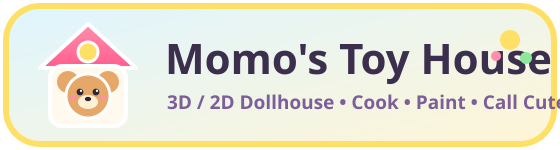
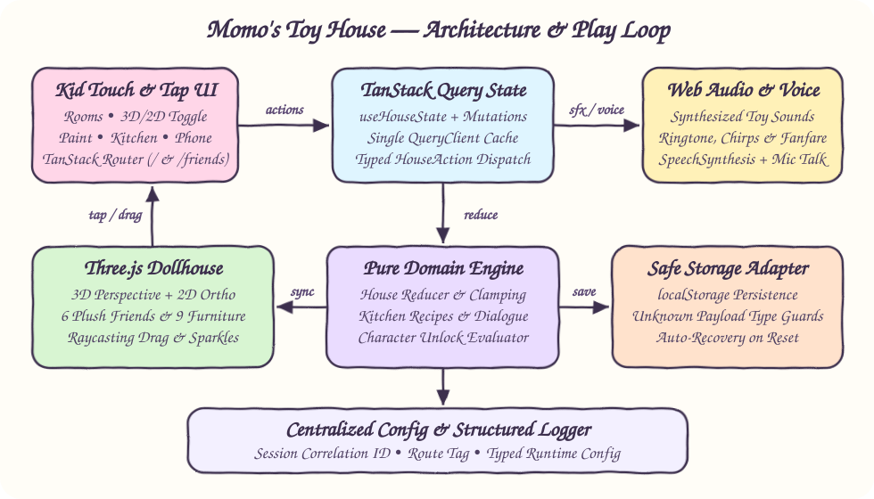
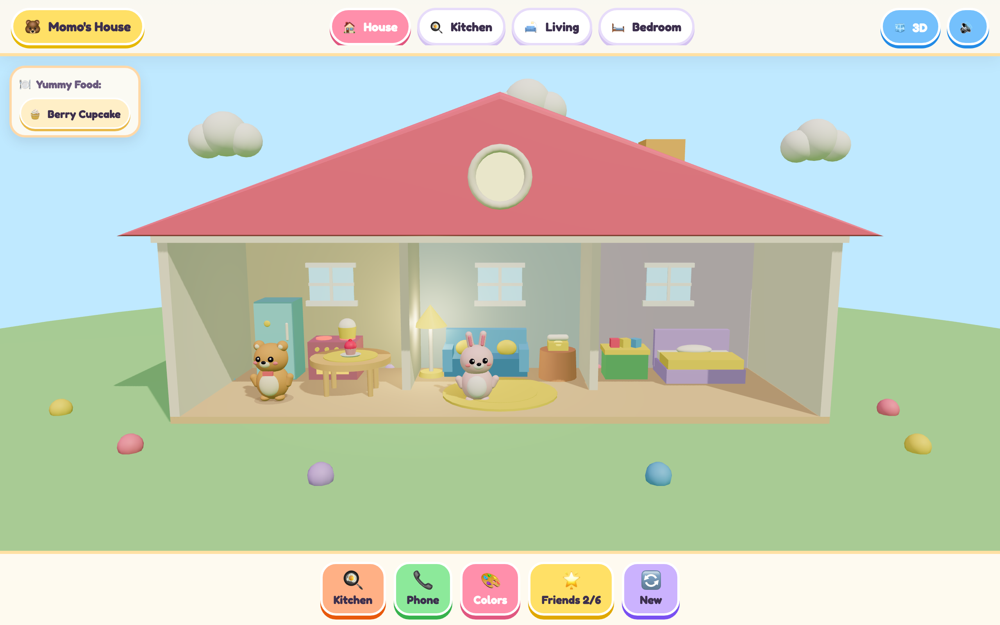
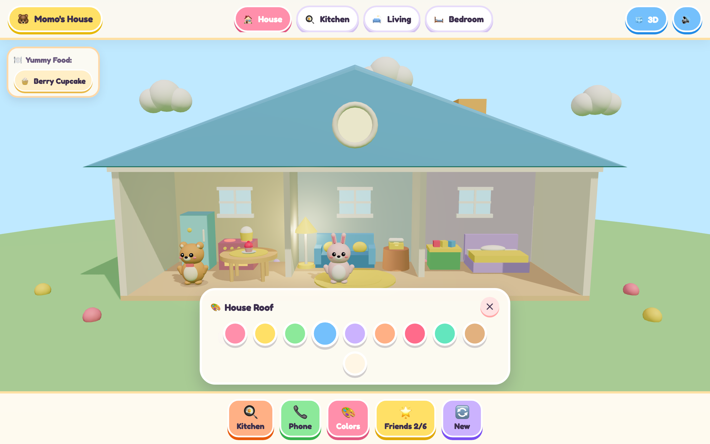
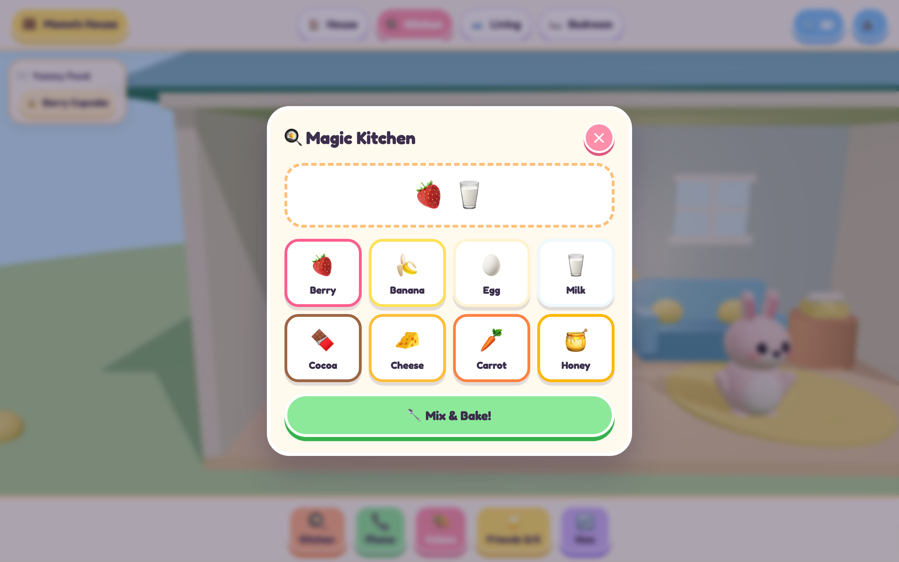
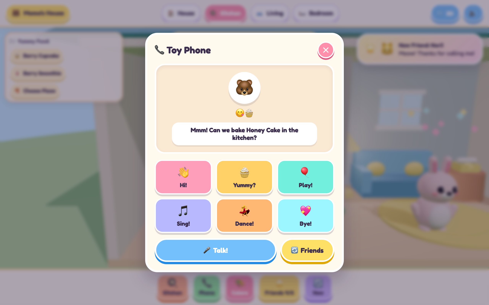
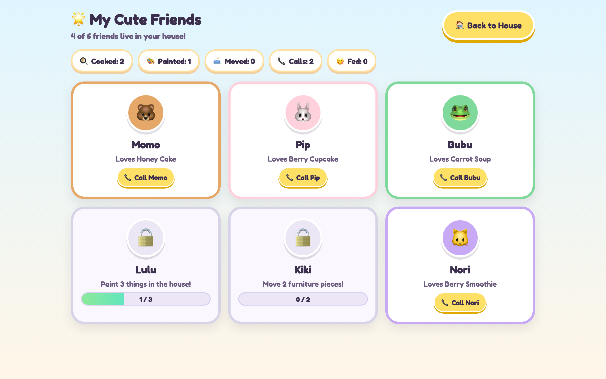
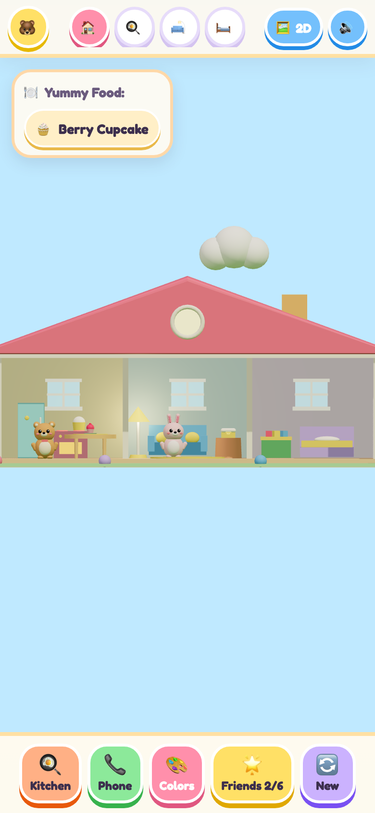

# Momo's Toy House

An interactive 3D and 2D storybook dollhouse game built for kids ages 4–5. Children explore a sunny three-room house, cook colorful dishes in the Magic Kitchen, recolor and restyle walls and furniture, drag toys and characters across rooms, call cute animal friends on a talking Toy Phone, and unlock new friends through playful activities.

## How it Works

1. Open the dollhouse in either cozy 3D perspective view or flat 2D orthographic view, and jump between the whole house, Kitchen, Living Room, or Bedroom.
2. Drag any furniture piece or cute animal friend smoothly across the house floor using mouse or touch; moving two furniture items unlocks **Kiki the Owl**.
3. Tap any wall, floor, roof, or furniture piece to open the oversized color palette and style switcher; painting three items unlocks **Lulu the Fox**.
4. Open the **Magic Kitchen** (or tap the stove) to combine ingredients into cakes, pancakes, smoothies, soup, or pizza; cooking two dishes unlocks **Bubu the Frog**, and every dish appears on the table to feed friends.
5. Open the **Toy Phone** (or tap the phone table) to ring friends, talk with picture buttons or voice microphone, and make them dance and wave; placing a call unlocks **Nori the Kitty**.
6. Every room change, cooked dish, and unlocked friend saves automatically in browser storage and is tracked in the **Friends** album route (`/friends`).

## Architecture



## Features

- **3D & 2D Dollhouse View**: Switches smoothly between angled Three.js perspective and flat orthographic storybook views so young kids can explore comfortably on web and mobile.
- **6 Unlockable Plush Characters**: Momo, Pip, Bubu, Lulu, Kiki, and Nori reward cooking, painting, moving furniture, and calling friends with joyful fanfare and animations.
- **Magic Kitchen & Feeding**: Kids combine 8 ingredients into 7 miniature 3D dishes that appear on the kitchen table and feed characters with munching sounds and sparkle bursts.
- **Live Recolor & Style Swapper**: Any wall, roof, floor, or furniture piece can be painted in 10 storybook pastel colors or cycled through visual styles instantly.
- **Touch & Mouse Dragging**: Pointer-captured raycasting moves furniture and friends smoothly on the house floor while clamping every item safely inside the dollhouse.
- **Talking Toy Phone**: Plays synthesized ringtones, musical character chirps, kid-friendly speech synthesis, big picture talk buttons, and optional microphone voice replies.
- **Zero-Asset Web Audio Engine**: Synthesizes pops, paint chimes, bubbling pots, munching, and unlock fanfares natively with Web Audio API so audio loads instantaneously offline.

## Stack

- **TypeScript 7.x**: Enforces strict static typing across domain actions, character rules, storage parsers, and Three.js interaction targets.
- **Bun 1.4.x**: Provides fast package installation, script execution, and built-in unit test runner.
- **Vite 8.x**: Serves rapid local hot module replacement and builds compact production bundles.
- **React 19.3.x**: Renders responsive touch-friendly HUD controls, modals, and route views cleanly.
- **TanStack Router 1.x**: Handles typed client-side navigation between the dollhouse (`/`) and Friends album (`/friends`) with route error boundaries.
- **TanStack Query**: Manages house state cache and action mutations through a single centralized query key factory.
- **Three.js**: Renders the procedural 3D/2D dollhouse, plush characters, furniture, miniature foods, lighting, shadows, and sparkle particles.

## Contracts / APIs

The game runs locally in the browser with a typed domain action contract and validated storage schema:

| Contract | Location | Purpose |
|---|---|---|
| `HouseAction` | `src/features/house/types.ts` | Discriminated union of all play mutations (`moveFurniture`, `moveCharacter`, `paintFurniture`, `cycleFurnitureStyle`, `toggleFurnitureActive`, `paintSurface`, `cookDish`, `feedCharacter`, `recordCall`, `reset`) |
| `HouseState` | `src/features/house/types.ts` | Serializable snapshot of `surfaces`, `furniture`, `unlockedCharacters`, `characters`, `dishes`, and `stats` |
| `StorageAdapter` | `src/lib/storage.ts` | Boundary interface for state persistence; swaps seamlessly between `localStorage` and in-memory fakes in unit tests |
| `parseHouseState(raw: unknown)` | `src/features/house/state.ts` | Validates unknown persisted JSON payloads with strict type guards and safely recovers defaults |
| Routes | `src/router.tsx` | `/` (interactive 3D/2D dollhouse) and `/friends` (character album & unlock progress) |

## Key Data Structures and Software Design Decisions

- **Pure Reducer + Unlock Evaluator**: `reduceHouseState` returns `{ state, newlyUnlocked }` deterministically without side effects, allowing the UI, TanStack Query mutations, and unit tests to share identical game rules.
- **Dual Camera Dollhouse Canvas**: `DollhouseCanvas` owns both a `PerspectiveCamera` (3D) and an `OrthographicCamera` (2D) sharing one Three.js scene graph, adapting zoom automatically for portrait mobile viewports.
- **Fail-Safe Ingredient Recipes**: `cookRecipe` guarantees every ingredient mix yields a cheerful dish so 4–5 year old players always succeed and stay encouraged.
- **Centralized Cross-Cutting Modules**: Runtime configuration (`src/lib/config.ts`), structured JSON logging with session correlation ID (`src/lib/logger.ts`), audio (`src/lib/sound.ts`), and query client (`src/lib/queryClient.ts`) each have a single owner.

## How to Run the App and Tests

```bash
./scripts/setup.sh
./scripts/build-all.sh
./scripts/test-all.sh
./scripts/start-all.sh
./scripts/ui.sh
```

## Printscreens

### 1. 3D Dollhouse View
The sunlit open-front three-room dollhouse showing the Kitchen, Living Room, and Bedroom with Momo the Bear, Pip the Bunny, interactive furniture, cooked food tray, room switcher, and chunky bottom play dock.



### 2. Painting & Changing Colors
Tapping the Colors button or any wall, roof, floor, or furniture piece opens the oversized paint palette bar, immediately updating the 3D dollhouse materials (here painting the roof Sky Blue).



### 3. Magic Kitchen Cooking Station
Children pick colorful ingredients such as Berry and Milk into the bubbling mixing pot and tap Mix & Bake to create miniature 3D dishes placed right on the kitchen table.



### 4. Talking Toy Phone
Calling a friend on the Toy Phone triggers a cheerful ringtone, animated character portrait, speech bubbles, big picture talk buttons (`Hi!`, `Yummy?`, `Play!`, `Sing!`, `Dance!`, `Bye!`), and microphone voice talk-back.



### 5. Cute Friends Storybook Album (`/friends`)
Displays all 6 unlockable characters, activity counters (cooked, painted, moved, calls, fed), unlocked call shortcuts, and visual unlock progress bars for remaining friends.



### 6. Mobile Portrait & 2D Dollhouse Mode
Responsive mobile viewport (`390x844`) switched into flat 2D orthographic dollhouse view with compact top icons, full-width meadow framing, and thumb-friendly bottom dock buttons.



## Scripts

All scripts live in `scripts/` and run from any directory of the repository.

| Script | What it does |
|---|---|
| `./scripts/setup.sh` | Installs dependencies and prepares the app |
| `./scripts/build-all.sh` | Builds every part of the app |
| `./scripts/build-frontend.sh` | Builds the frontend |
| `./scripts/start-all.sh` | Starts every service and prints the full link of each one |
| `./scripts/status.sh` | Shows every service port as UP or DOWN |
| `./scripts/test-all.sh` | Runs every test suite |
| `./scripts/unit-test.sh` | Runs the unit tests |
| `./scripts/ui.sh` | Opens the UI in the browser |
| `./scripts/stop-all.sh` | Stops every service |

Ports are declared in `scripts/ports.env`.

```bash
./scripts/setup.sh
./scripts/build-all.sh
./scripts/start-all.sh
./scripts/status.sh
./scripts/ui.sh
./scripts/stop-all.sh
```
