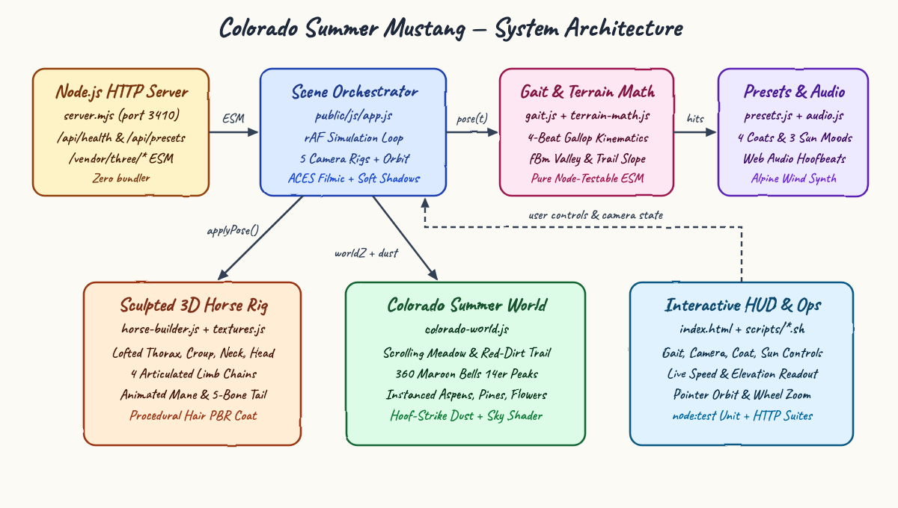
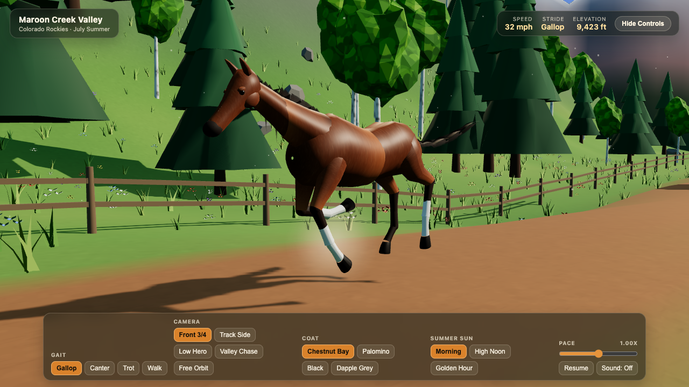
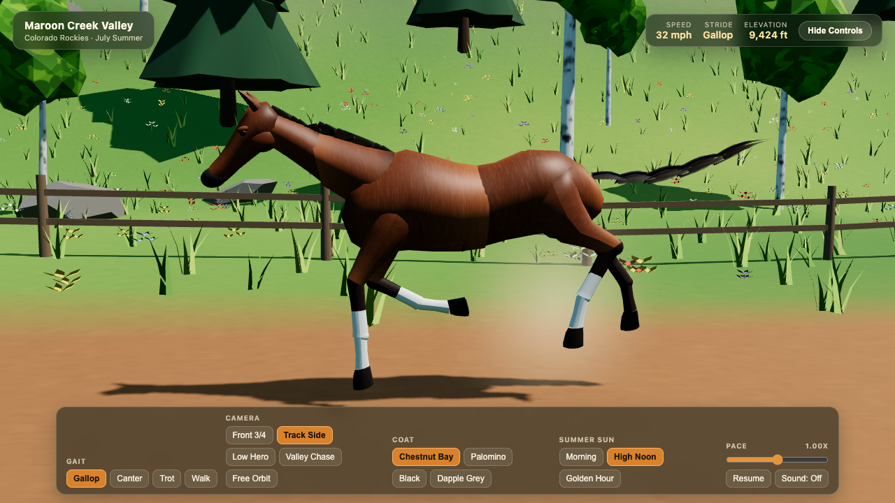
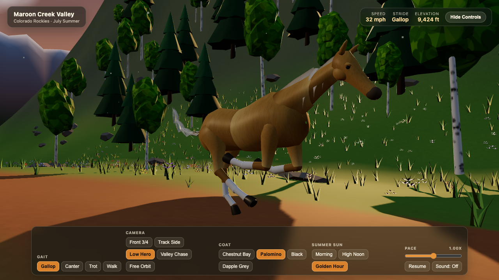
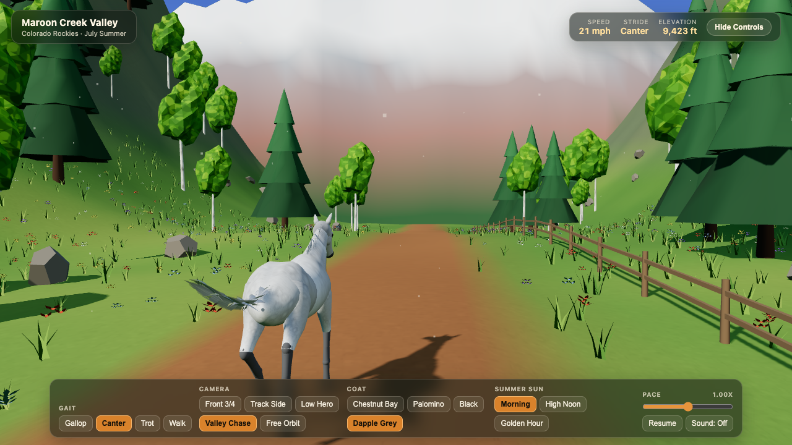
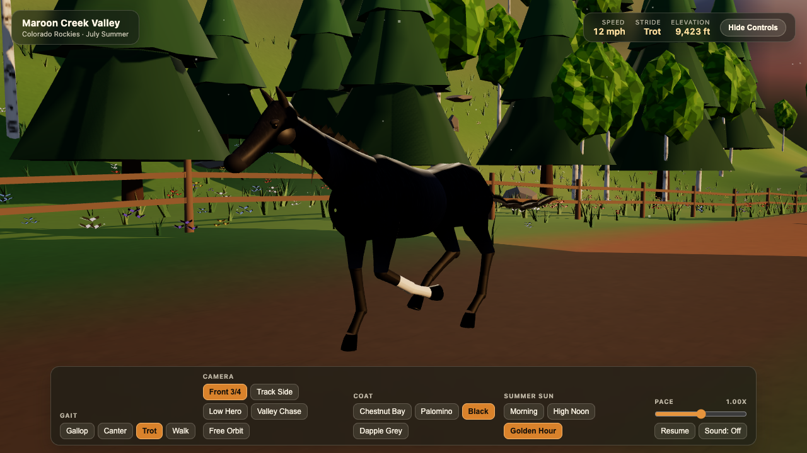

<p align="center"></p>

# agy-neon-4-horse-poc

A real-time 3D biomechanical horse simulation built with **Three.js**, set in a sun-drenched Colorado Rocky Mountain valley during July summer. Watch a sculpted, articulated horse gallop, canter, trot, or walk along an undulating Maroon Creek Valley red-dirt trail framed by snow-streaked 14er peaks, quaking aspens, Engelmann spruces, alpine wildflowers, and sunlit hoof-kick dust clouds.

## How it Works?

1. `server.mjs` serves the web application shell, exposes `/api/health` and `/api/presets`, and maps `/vendor/three/` directly to the local `three` package with zero bundler.
2. `public/js/terrain-math.js` computes deterministic multi-octave fBm alpine terrain height, red-dirt trail path curving, ground surface normals, and the 360-degree Rocky Mountain peak ring.
3. `public/js/gait.js` evaluates continuous equine kinematics for gallop, canter, trot, and walk, solving four-limb joint flexion, spine coil, vertical bounce, neck counter-balance, and exact hoof ground-impact triggers.
4. `public/js/textures.js` synthesizes procedural HTML5 Canvas PBR maps for directional horse coat hair, dapples, feathered mane and tail strands, papery aspen bark, meadow grit, clouds, and soft dust sprites.
5. `public/js/horse-builder.js` constructs an anatomically lofted 3D horse rig (thorax, lumbar-pivoted hindquarters, two-stage muscular neck, sculpted skull with eyes/muzzle/ears, four articulated limb chains, flowing mane locks, and five-segment tail).
6. `public/js/colorado-world.js` streams the infinite scrolling subalpine meadow, instanced pines, aspens, wildflowers, swaying grass tufts, split-rail fencing, soaring hawks, sky Rayleigh shader, and hoof-strike dust plumes.
7. `public/js/app.js` binds the simulation loop, ACES Filmic renderer, dynamic horse-tracking soft shadows, five camera rigs with pointer orbit/zoom, live telemetry HUD, and optional synthesized Web Audio hoofbeats via `public/js/audio.js`.

## Architecture



## Features

- **Anatomical Lofted 3D Horse Rig**: Smooth cross-section lofted meshes form the chest, withers, croup, muscular neck, head, and tapered limbs so silhouettes read naturally from every angle.
- **Four Authentic Equine Gaits**: Switch live between transverse Gallop (with airborne suspension), 3-beat Canter, diagonal Trot, and 4-beat Walk to inspect limb coordination and spine flexion.
- **Procedural PBR Coat & Markings**: Swap between Chestnut Bay, Palomino Gold, Midnight Black, and Dapple Grey coats with directional hair bump maps, satin sheen, white blaze, and sock patterns.
- **Colorado Summer Rocky Mountain World**: Infinite scrolling Maroon Creek Valley trail surrounded by snow-streaked 14er peaks, white-barked quaking aspens, scalloped spruce trees, split-rail fences, and alpine wildflowers.
- **Three Summer Sunlight Moods**: Transition instantly between Alpine Morning, High Noon, and Golden Hour to alter sun elevation, atmospheric Rayleigh sky gradients, and long valley shadows.
- **Five Camera Rigs & Free Orbit**: Cycle through Front 3/4, Track Side, Low Hero, Valley Chase, and interactive drag-and-zoom Free Orbit (`1`-`5` hotkeys, `Space` to pause).
- **Hoof-Strike Dust & Synthesized Audio**: Exact hoof ground-contact events emit sunlit ochre dust plumes and trigger optional Web Audio API hoofbeat thuds over mountain wind.

## Stack

- **Node.js 24**: Serves static ES modules, JSON endpoints, and runs the built-in `node:test` test suites with zero extra server or test dependencies.
- **Three.js 0.174**: Renders the WebGL horse rig, custom atmospheric sky shader, instanced alpine flora, ACES Filmic tone mapping, and PCF soft shadows from local `node_modules`.
- **HTML5 Canvas 2D**: Generates all coat hair grain, bump maps, feathered hair strands, aspen bark, foliage, cloud, and dust textures procedurally with no external image downloads.
- **Web Audio API**: Synthesizes rhythmic hoofbeats and alpine meadow breeze on user opt-in without bundled audio assets.

## Contracts/APIs

| Method | Path | Purpose |
|---|---|---|
| `GET` | `/` | Serves the 3D application shell (`public/index.html`) |
| `GET` | `/api/health` | Returns `{ "status": "ok", "service": "colorado-summer-horse" }` |
| `GET` | `/api/presets` | Returns location metadata plus all coats, gaits, lighting moods, and camera presets |
| `GET` | `/vendor/three/*` | Serves local Three.js ES modules directly from `node_modules/three` |

## Key Datastructures and Software Design Decisions

- **Pure Headless Simulation Modules**: `public/js/gait.js` and `public/js/terrain-math.js` carry zero Three.js or DOM dependencies so Node unit tests verify joint flexion directions, airborne suspension phases, and terrain normals directly.
- **Treadmill World Streaming (`worldZ`)**: Keeping the horse near local world origin while scrolling terrain chunks and wrapping instanced flora along `worldZ` prevents floating-point jitter and keeps the directional shadow frustum razor-sharp at any travel distance.
- **Instanced Alpine Vegetation**: Over 3,300 pines, aspens, multi-blade grass tufts, wildflower sprays, rocks, and fence segments render through batched `THREE.InstancedMesh` draw calls to maintain smooth frame rates.
- **Automatic Outward Loft Winding**: `createLoftedAlongZ` and `createLoftedLimb` inspect travel direction along each anatomical section list to guarantee outward-facing vertex normals across thorax, neck, skull, and limb segments.

## How to Run the App and Tests

```bash
./scripts/setup.sh
./scripts/build-all.sh
./scripts/test-all.sh
./scripts/start-all.sh
./scripts/ui.sh
./scripts/stop-all.sh
```

## Printscreens

### Front 3/4 Gallop — Alpine Morning (Chestnut Bay)

The Chestnut Bay stallion gallops down the sunlit red-dirt trail at 32 mph in crisp morning light, showing white socks, hoof-kick dust, split-rail fencing, quaking aspens, spruce slopes, and meadow wildflowers beneath the telemetry HUD.

### Track Side Profile — High Noon (Chestnut Bay)

Side tracking camera under bright Colorado high-altitude noon sun highlighting full limb articulation, backward-folding fore-knee, forward-flexing hind hock, streaming tail, and crisp ground shadow projection.

### Low Hero Angle — Golden Hour (Palomino Gold)

Low tracking shot of the Palomino Gold coat bathed in warm late-afternoon Colorado sunlight with long valley shadows, aspen groves, and distant sunlit granite ridges.

### Valley Chase — Maroon Creek Peaks (Dapple Grey)

Chase view behind the Dapple Grey horse cantering along the winding red-earth trail toward snow-streaked Rocky Mountain 14er peaks rising against a vibrant cobalt summer sky.

### Front 3/4 Trot — Golden Hour (Midnight Black)

The Midnight Black coat at a 12 mph diagonal trot in Golden Hour lighting, showing satin coat sheen, white hind sock contrast, and compact controls for gait, camera, coat, sunlight, pace, pause, and sound.

## Scripts

All scripts live in `scripts/` and run from any directory of the repository.

| Script | What it does |
|---|---|
| `./scripts/setup.sh` | Installs dependencies and prepares the app |
| `./scripts/build-all.sh` | Builds every part of the app |
| `./scripts/build-frontend.sh` | Validates syntax and local Three.js availability for the frontend |
| `./scripts/start-all.sh` | Starts every service and prints the full link of each one |
| `./scripts/status.sh` | Shows every service port as UP or DOWN |
| `./scripts/test-all.sh` | Runs every test suite |
| `./scripts/unit-test.sh` | Runs the unit tests |
| `./scripts/integration-test.sh` | Runs the HTTP integration tests |
| `./scripts/ui.sh` | Opens the UI in the browser |
| `./scripts/stop-all.sh` | Stops every service |

Ports are declared in `scripts/ports.env`.

```bash
./scripts/setup.sh
./scripts/build-all.sh
./scripts/start-all.sh
./scripts/status.sh
./scripts/ui.sh
./scripts/stop-all.sh
```
