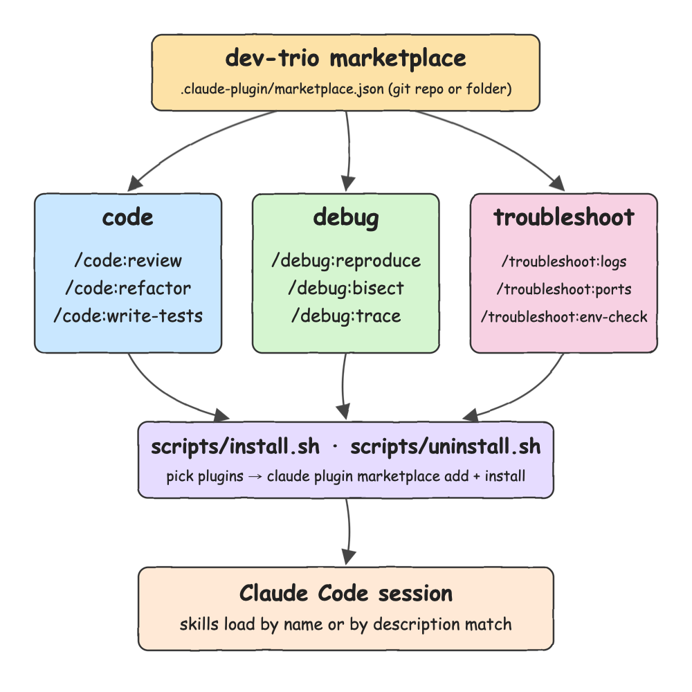

# claude-code-plugin

A Claude Code plugin marketplace called `dev-trio`. It holds three plugins that you install separately: `code`, `debug` and `troubleshoot`. Each plugin has three skills. Install and uninstall scripts let you choose which plugins to install and which to skip.

## How it Works

1. `.claude-plugin/marketplace.json` is the catalog. It lists the three plugins and the folder each one lives in.
2. Each plugin folder has a `.claude-plugin/plugin.json` manifest and a `skills/<name>/SKILL.md` file for each of its three skills.
3. `claude plugin marketplace add <path or git repo>` registers the catalog with Claude Code.
4. `claude plugin install <plugin>@dev-trio` installs one plugin. The plugin is the smallest unit you can choose to install.
5. `scripts/install.sh` asks yes or no for each plugin, or takes plugin names as arguments. It adds the marketplace and installs only the plugins you chose.
6. `scripts/uninstall.sh` removes the plugins you choose. When no `dev-trio` plugin is left, it also removes the marketplace.
7. In a session, run a skill as `/<plugin>:<skill>`, or let Claude pick it when its `description` matches the task.

## Architecture



```
.
├── .claude-plugin/marketplace.json
├── plugins/
│   ├── code/
│   │   ├── .claude-plugin/plugin.json
│   │   └── skills/{review,refactor,write-tests}/SKILL.md
│   ├── debug/
│   │   ├── .claude-plugin/plugin.json
│   │   └── skills/{reproduce,bisect,trace}/SKILL.md
│   └── troubleshoot/
│       ├── .claude-plugin/plugin.json
│       └── skills/{logs,ports,env-check}/SKILL.md
├── scripts/{common,install,uninstall,status,test-all}.sh
├── samples/            inputs used to run the skills for the evidence
├── evidence/           captured output of every command in this README
└── docs/architecture.{svg,png}
```

## Features

| Plugin | Skill | Command | What it does |
|---|---|---|---|
| code | review | `/code:review <file>` | Finds bugs, risky patterns and missing tests, ordered by severity |
| code | refactor | `/code:refactor <file>` | Simplifies the code without changing behavior and runs the tests before and after |
| code | write-tests | `/code:write-tests <file>` | Writes tests with the framework the project already uses |
| debug | reproduce | `/debug:reproduce <bug>` | Turns a bug report into a small failing reproduction. It does not fix the bug |
| debug | bisect | `/debug:bisect <regression>` | Runs `git bisect` with a check command to find the commit that caused a regression |
| debug | trace | `/debug:trace <value>` | Follows a value from where it enters the code to where it goes wrong |
| troubleshoot | logs | `/troubleshoot:logs <file>` | Groups WARN, ERROR and FATAL lines and links them into a chain of causes |
| troubleshoot | ports | `/troubleshoot:ports <port>` | Shows which process holds a port and whether it answers. It never kills a process |
| troubleshoot | env-check | `/troubleshoot:env-check` | Compares the installed tool versions with the versions the build files require |

* Choose what to install: each plugin installs on its own, so you can take `debug` and skip the other two.
* Scripts are idempotent: running install or uninstall again changes nothing and still exits 0.
* Errors are loud: an unknown plugin name, or no names when there is no terminal to ask, exits 1 with a message.

## Stack

* Claude Code plugin system: `marketplace.json`, `plugin.json` and `SKILL.md`, with no runtime code.
* Bash 3.2: the scripts run on a stock macOS shell without extra installs.
* `claude` CLI: the scripts only call `claude plugin ...`, so they follow Claude Code's own install rules.

## Contracts

`.claude-plugin/marketplace.json`: the marketplace name and one entry for each plugin. Each entry has a `name` and a `source` folder.

```json
{
  "name": "dev-trio",
  "owner": { "name": "Diego Pacheco" },
  "plugins": [
    { "name": "code", "source": "./plugins/code" },
    { "name": "debug", "source": "./plugins/debug" },
    { "name": "troubleshoot", "source": "./plugins/troubleshoot" }
  ]
}
```

`plugins/<plugin>/.claude-plugin/plugin.json`: the plugin `name`, which must match its marketplace entry, plus `description`, `version` and `author`.

`plugins/<plugin>/skills/<skill>/SKILL.md`: frontmatter with `name`, which must match the folder name, and `description`, which Claude uses to pick the skill automatically. Then the instructions. `$ARGUMENTS` is replaced with whatever you type after the command.

## Design Decisions

* Three plugins instead of one plugin with nine skills: Claude Code installs a whole plugin, so making each plugin small is the only way to let users choose what they install.
* Skill folders are named after verbs and plugins after nouns: commands read naturally, like `/debug:reproduce` and `/troubleshoot:logs`.
* The scripts check the `--json` output of `claude plugin list` and `claude plugin marketplace list` before acting. That is what makes them idempotent.
* `uninstall.sh` removes the marketplace only after the last `dev-trio` plugin is gone, so removing one plugin never breaks the others.

## Install in Claude Code

### Option 1: scripts

```text
./scripts/install.sh                   asks y/N for code, debug and troubleshoot
./scripts/install.sh debug             installs only debug
./scripts/install.sh code troubleshoot
./scripts/install.sh all
./scripts/status.sh
./scripts/uninstall.sh debug
./scripts/uninstall.sh all             also removes the marketplace
SCOPE=project ./scripts/install.sh all installs into .claude/settings.json of the current project
```

### Option 2: claude CLI from the terminal

```bash
git clone https://github.com/diegopacheco/ai-playground.git
cd ai-playground
claude plugin marketplace add ./pocs/claude-code-plugin
claude plugin install code@dev-trio
claude plugin install debug@dev-trio
claude plugin install troubleshoot@dev-trio
claude plugin list
claude plugin details code@dev-trio
claude plugin uninstall debug@dev-trio
claude plugin marketplace remove dev-trio
```

### Option 3: slash commands inside a Claude Code session

```
/plugin marketplace add ./pocs/claude-code-plugin
/plugin install code@dev-trio
/plugin
/reload-plugins
```

`/plugin` opens the plugin manager, where you can browse `dev-trio` and choose plugins. Restart Claude Code or run `/reload-plugins` after installing.

### Use the skills

```
/code:review samples/cart.py
/code:refactor samples/cart.py
/code:write-tests samples/cart.py
/debug:reproduce average([10, 20, 30]) returns 16.66 instead of 20
/debug:bisect checkout total is wrong since last week
/debug:trace where does discount in samples/cart.py come from
/troubleshoot:logs samples/app.log
/troubleshoot:ports 8080 5432
/troubleshoot:env-check
```

## Evidence

Every file in `evidence/` is real output captured from the commands in this README, with local paths removed.

### Install with the picker: yes to code, no to debug, yes to troubleshoot

[evidence/01-install-pick.txt](evidence/01-install-pick.txt)

```
install code? [y/N] y
install debug? [y/N] n
install troubleshoot? [y/N] y
Adding marketplace…✔ Successfully added marketplace: dev-trio (declared in user settings)
Installing plugin "code@dev-trio"...✔ Successfully installed plugin: code@dev-trio (scope: user)
Installing plugin "troubleshoot@dev-trio"...✔ Successfully installed plugin: troubleshoot@dev-trio (scope: user)
installed: code troubleshoot
```

[evidence/02-status-after-pick.txt](evidence/02-status-after-pick.txt): `debug` was skipped.

```
marketplace dev-trio ADDED
code@dev-trio INSTALLED
debug@dev-trio NOT INSTALLED
troubleshoot@dev-trio INSTALLED
```

### Add debug later. The script is idempotent

[evidence/03-install-args-idempotent.txt](evidence/03-install-args-idempotent.txt)

```
$ ./scripts/install.sh debug code
marketplace dev-trio already added
Installing plugin "debug@dev-trio"...✔ Successfully installed plugin: debug@dev-trio (scope: user)
code@dev-trio already installed
```

### What Claude Code sees

[evidence/04-plugin-list.txt](evidence/04-plugin-list.txt) and [evidence/05-plugin-details.txt](evidence/05-plugin-details.txt)

```
$ claude plugin details code@dev-trio
code 1.0.0
  Description: Skills to review, refactor and write tests for code
Component inventory
  Skills (3)  refactor, review, write-tests
Projected token cost
  Always-on:   ~170 tok   added to every session
```

### Skills running headless with `claude -p`

[evidence/06-skill-code-review.txt](evidence/06-skill-code-review.txt): `/code:review samples/cart.py` finds the off-by-one bug.

```
1. samples/cart.py:3: The loop starts at index 1, so it always leaves out the first price.
   total([10,20,30], 0) returns 50.0 instead of 60. Fix: sum every item with result = sum(prices).
2. samples/cart.py:9: average([]) raises ZeroDivisionError when the cart is empty.
```

[evidence/07-skill-debug-reproduce.txt](evidence/07-skill-debug-reproduce.txt): `/debug:reproduce` writes a failing reproduction and does not fix the bug.

```
average([10,20,30]) = 16.666666666666668
total([10,20,30],0) = 50.0
average([10]) = 0.0
AssertionError: average([10]) expected 10, got 0.0
Where it goes wrong: samples/cart.py:3, in total(), called by average() at samples/cart.py:9
```

[evidence/08-skill-troubleshoot-logs.txt](evidence/08-skill-troubleshoot-logs.txt): `/troubleshoot:logs samples/app.log` links the errors into one chain.

```
| 1 | WARN  | slow query on orders                          | 2 | 10:02:11 |
| 2 | ERROR | connection pool exhausted max=10              | 1 | 10:03:40 |
| 3 | ERROR | request /checkout failed: timeout acquiring…  | 3 | 10:03:41 |
| 4 | FATAL | health check failed 3 times, shutting down    | 1 | 10:05:12 |
Root cause: the slow orders query fills the 10-connection pool, /checkout times out,
and then the health check fails and the service stops.
```

### Uninstall, bad input and reinstall

* [evidence/09-uninstall.txt](evidence/09-uninstall.txt): uninstalling `debug` leaves the other two installed. `all` removes the marketplace. Running it a second time is a no-op.
* [evidence/10-bad-input.txt](evidence/10-bad-input.txt): an unknown plugin exits 1, and no names without a terminal exits 1.
* [evidence/11-install-all.txt](evidence/11-install-all.txt): `install.sh all` from a clean state.

## Tests

`scripts/test-all.sh` validates the marketplace and every plugin with `claude plugin validate`. It also checks that each plugin is listed in the marketplace, so it can be installed on its own. It checks that each plugin ships exactly three skills, and that each skill's `name` matches its folder and has a `description` for automatic selection. Output: [evidence/00-test-all.txt](evidence/00-test-all.txt).

```bash
./scripts/test-all.sh
```

## Scripts

All scripts live in `scripts/` and run from any directory of the repository. This project is a plugin, not a service, so there are no ports, start or stop scripts.

| Script | What it does |
|---|---|
| `./scripts/install.sh [code\|debug\|troubleshoot\|all]` | Adds the marketplace and installs the chosen plugins. Asks y/N for each plugin when no names are given |
| `./scripts/uninstall.sh [code\|debug\|troubleshoot\|all]` | Uninstalls the chosen plugins and removes the marketplace once none are left |
| `./scripts/status.sh` | Shows the marketplace and each plugin as installed or not |
| `./scripts/test-all.sh` | Validates the manifests and the skill layout |

`SCOPE` sets the install scope: `user` (the default), `project` or `local`.

```bash
./scripts/install.sh
./scripts/status.sh
./scripts/test-all.sh
./scripts/uninstall.sh all
```
