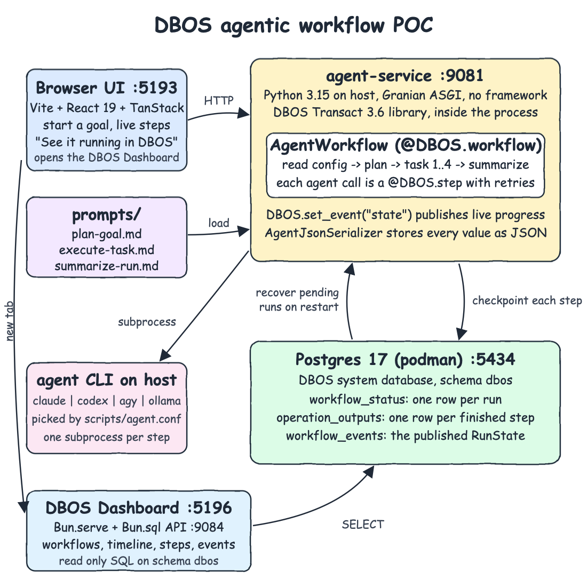
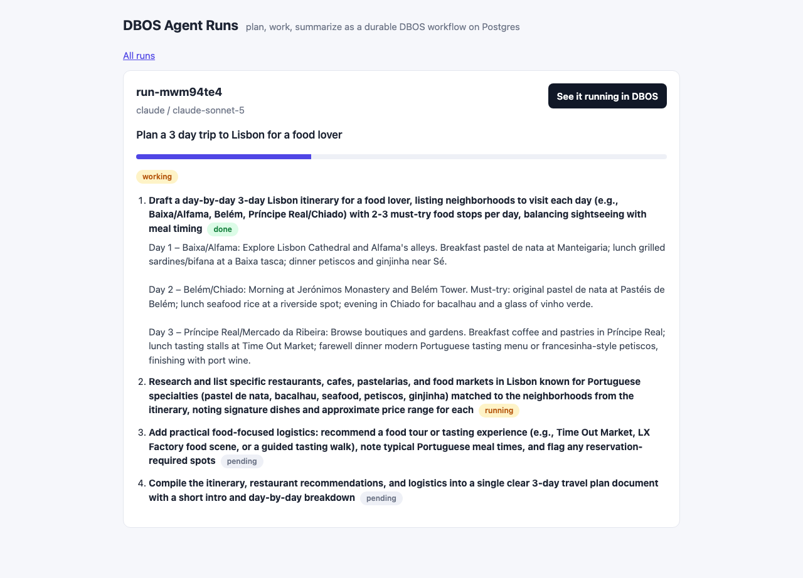
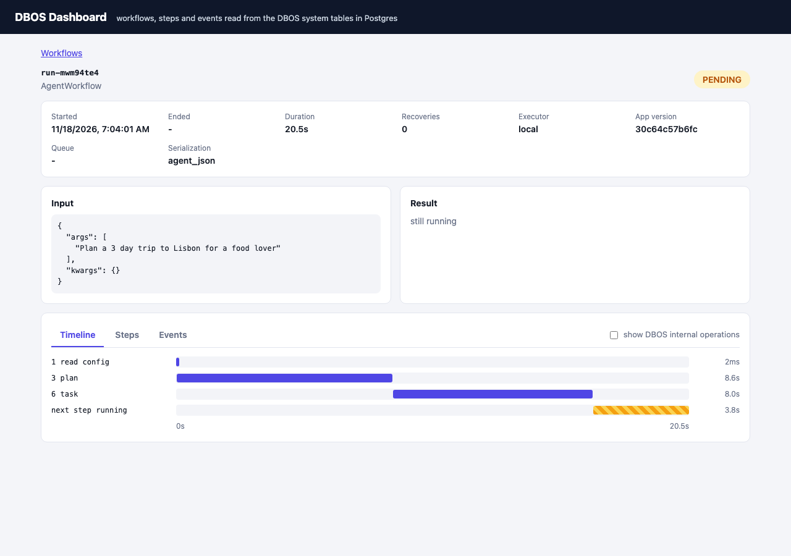
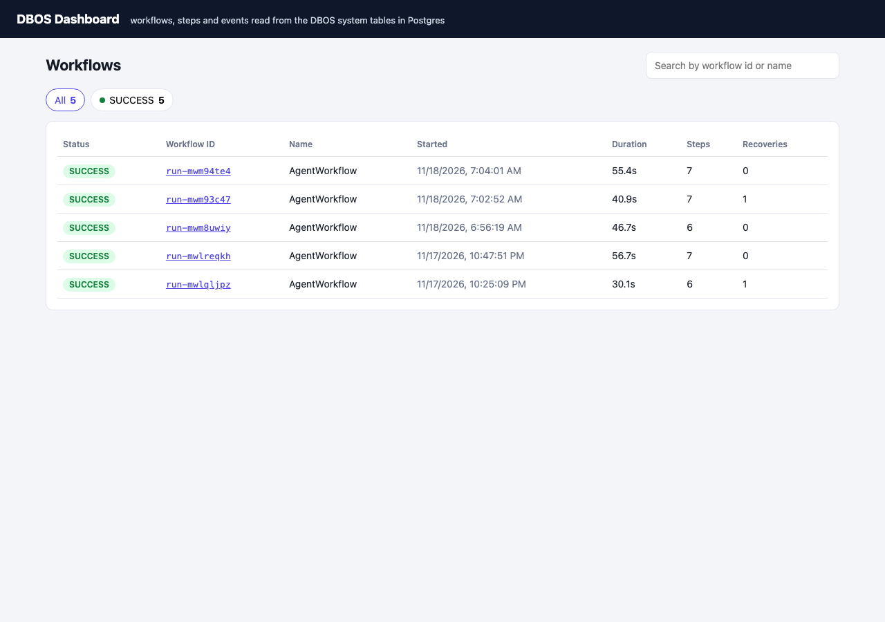
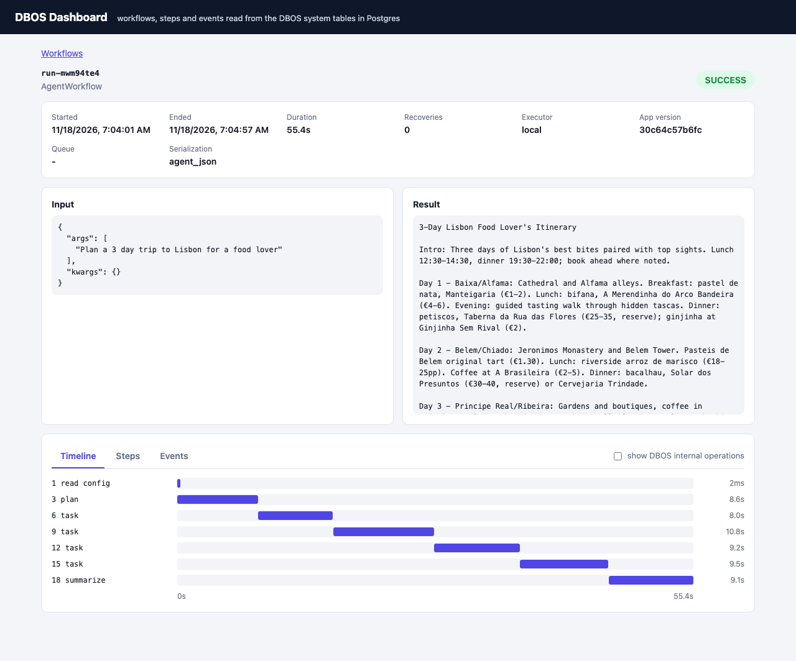
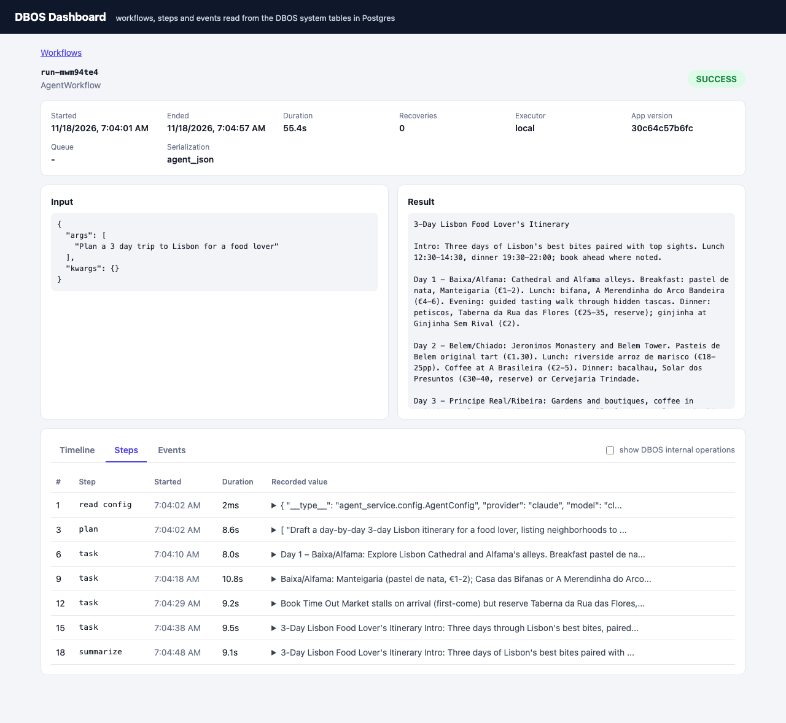
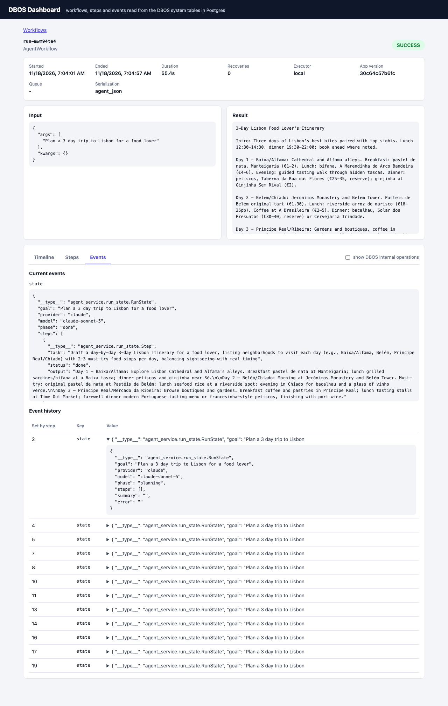
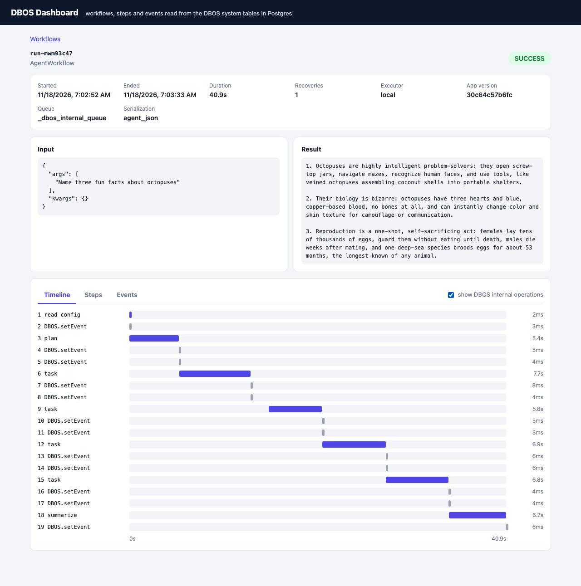

# DBOS Agentic Workflow POC (Python)

An agentic plan-and-execute workflow that runs as a durable [DBOS](https://www.dbos.dev/) workflow. You give the agent a goal in the UI. A planner agent splits it into 2 to 4 tasks, a worker agent completes each task, and a reviewer agent writes the final answer. Every agent call is a DBOS step checkpointed in Postgres, so if the service crashes the run resumes from the last finished step instead of starting over. Each run has a **See it running in DBOS** button that opens the run in the **DBOS Dashboard**, a Temporal-style web UI built in this POC that reads the workflows, steps and events DBOS recorded in Postgres.

DBOS Transact is an open source library (MIT). It needs no server and no account: the only infrastructure is a Postgres container. The official DBOS Console needs an account, so the dashboard here is a small Bun + React app over the DBOS system tables.

## How it Works

1. The UI posts the goal to `agent-service` (`POST /runs`), which starts `AgentWorkflow` with `DBOS.start_workflow` under a fresh workflow id.
2. DBOS writes a `workflow_status` row in Postgres and runs the workflow in a background thread.
3. The workflow calls `read config`, `plan`, one `task` step per planned task and `summarize`. Each is a `@DBOS.step`, and DBOS stores its output in `operation_outputs` once it finishes.
4. After each step the workflow publishes its progress with `DBOS.set_event("state", ...)`.
5. The UI polls `GET /runs/{id}` every 1.5s, which reads that event with `DBOS.get_event`, and renders the steps live.
6. DBOS stores every value with the service's JSON serializer, so the dashboard API (Bun) reads `workflow_status`, `operation_outputs` and `workflow_events` with plain SQL and the dashboard UI polls it.
7. If `agent-service` dies mid-run, `DBOS.launch()` finds the `PENDING` workflow on restart and re-runs it: finished steps return their recorded output, and the run continues from the interrupted step.

## Architecture



Postgres runs in Podman. The agent service runs on the host because it calls the local `claude`, `codex`, `agy` and `ollama` CLIs, which exist only on the host. DBOS lives inside the service process as a library and talks straight to Postgres. The dashboard is a separate Bun process that only reads the `dbos` schema, so it keeps working while the agent service is down.

## Features

* **Durable agent steps**: each LLM call is a `@DBOS.step`, so a crash never reruns a finished, paid-for agent call.
* **Crash recovery proven by a test**: the end-to-end test SIGKILLs the service mid-run, restarts it, and checks that the plan step was not called again.
* **Plan-and-execute agent**: the model decides the tasks, and each worker sees the results of earlier tasks.
* **Live progress**: `DBOS.set_event` gives the UI step-by-step progress with no table of its own.
* **DBOS Dashboard**: a workflow list with status filters, search and live durations, and a workflow page with a step timeline, steps, input, result and event history.
* **Readable checkpoints**: a JSON serializer replaces DBOS's default pickle, so every input, step output and event in Postgres is plain JSON any tool can read.
* **Any agent CLI**: switch between Claude Code, Codex, Agy or Ollama in `scripts/agent.conf` with no code change.
* **Externalized prompts**: the three prompts live in `prompts/`, and an empty parameter fails loud.
* **Bounded retries**: each agent step retries at most 3 times with backoff, then the run is marked `failed` with the error.
* **No registration**: no DBOS Cloud account, no license key, nothing leaves the machine.

## Stack

* **Python 3.15 + uv**: the agent service, its dependencies and its virtual env.
* **DBOS Transact 3.6.0**: durable workflows, steps, events and recovery, as a library on Postgres.
* **Granian 2.8.8**: the ASGI server. The app is a small plain ASGI callable, so there is no web framework.
* **ty 0.0.105 + pytest 9.2**: type checking and tests.
* **Postgres 17** in Podman with podman-compose: the DBOS system database.
* **Bun 1.4.4 + TypeScript 7.0.2**: UI tooling and tests (Bun 2.x does not exist yet).
* **Vite 8 + React 19.3 + TanStack Router 1.170 + TanStack Query 5.108**: the agent UI and the dashboard UI, routes and polling.
* **Bun.serve + Bun.sql**: the dashboard API, with Bun's built-in Postgres client, so no web framework and no database driver library.

## About the DBOS Console and Conductor

DBOS has a web console (DBOS Conductor and the DBOS Console). The self-hosted Conductor image is under a proprietary license and needs a license key, and even the free development key comes from a DBOS account. Signing up was out of scope for this POC, so it does not use Conductor. The DBOS Dashboard in `dashboard/` replaces it: it reads the same system tables Conductor would, with SQL, and needs nothing but the Postgres connection.

DBOS stores values as base64 Python pickle by default, which only Python can read. The agent service passes `serializer=AgentJsonSerializer()` to DBOS, which stores dataclasses as JSON with a `__type__` tag and rebuilds them on recovery. It only loads dataclasses from the `agent_service` package, never arbitrary classes. Runs recorded before this change stay pickle, and the dashboard labels those values as not readable outside Python.

## Contracts / APIs

The UI dev server proxies `/api` to `agent-service`.

| Call | Method + path | Body | Returns |
|---|---|---|---|
| Start a run | `POST /runs` | `{"goal": "..."}` | `202 {"runId": "run-..."}`, `400` without a goal |
| Run progress | `GET /runs/{runId}` | none | `RunState` or `null` before the first event |
| List runs | `GET /runs` | none | `[{"run_id", "status", "created_at"}]`, newest 20 |
| Health | `GET /health` | none | `{"ok": true}` |

The dashboard dev server proxies `/api` to `dashboard-api`.

| Call | Method + path | Returns |
|---|---|---|
| Workflows | `GET /api/workflows?status=&search=` | `{"counts": [{"status", "count"}], "workflows": [...]}`, newest 50 |
| Workflow | `GET /api/workflows/{id}` | `{"workflow", "serialization", "input", "output", "error", "steps", "events", "history"}`, `404` if unknown |
| Health | `GET /api/health` | `{"ok": true}` |

Every stored value comes back as `{"format", "readable", "value"}`, where `value` is the decoded JSON.

## Key data structures and design decisions

```python
@dataclass(frozen=True)
class RunState:
    goal: str
    provider: str
    model: str
    phase: Literal["planning", "working", "summarizing", "done", "failed"]
    steps: tuple[Step, ...]
    summary: str
    error: str
```

* **The workflow id is the run id**: `SetWorkflowID(run_id)` makes the run id the DBOS key, so the UI, the event and the dashboard all use the same id.
* **The config is a step**: `read config` is checkpointed, so a recovered run uses the same provider and model even if `agent.conf` changed in between.
* **The plan is parsed inside the step**: a model reply without a valid task list fails that step, which DBOS retries, and only a valid plan is recorded.
* **Pure state transitions**: `run_state.py` returns new frozen dataclasses, so the workflow reads as plan, run, done and is unit tested without DBOS.
* **A store protocol between HTTP and DBOS**: `http.py` depends on the `RunStore` protocol in `runs.py`, so the routes are tested with a fake and only `store.py` imports DBOS.
* **The running step is drawn, not recorded**: DBOS writes a step row only when the step finishes, so the dashboard draws the step in progress from the last finished step to now while the workflow is `PENDING`.
* **No framework**: Granian serves a plain ASGI function with a `match` on method and path, and DBOS launches in the ASGI lifespan.

## How to run

You need Podman with a running machine, podman-compose, uv, Bun, and the agent CLI named in `scripts/agent.conf` (default `claude` with `claude-sonnet-5`).

```bash
./scripts/setup.sh
./scripts/start-all.sh
./scripts/ui.sh
```

To use another agent, edit `scripts/agent.conf`, for example `AGENT_PROVIDER=ollama` and `AGENT_MODEL=llama3.2`, then restart.

To see durability yourself, start a run, then kill the service during a task and start it again:

```bash
kill -9 "$(pgrep -P "$(cat .run/agent-service.pid)")" "$(cat .run/agent-service.pid)"
rm .run/agent-service.pid
./scripts/start-all.sh
```

The run continues from the task that was interrupted. In the dashboard, the earlier steps keep their original timestamps and **Recoveries** goes to 1.

## How to test

```bash
./scripts/test-all.sh
```

This runs `ty` and 27 pytest tests for the agent service, the UI typecheck, build and 3 unit tests, the dashboard typecheck, build and 7 unit tests, and `scripts/test-e2e.sh`. The end-to-end script starts a real workflow on the running stack and waits for the first task. It then SIGKILLs the service, restarts it, and waits for DBOS to recover the run and finish it. Last, it checks that the `plan` step completed before the crash, which proves it was replayed from Postgres and not called again. It reads all of this through the dashboard API, and also checks that DBOS recorded the recovery and that the published state decodes as JSON.

## Printscreens

### Runs list


The home page: type a goal and start the agent workflow. Below, every `AgentWorkflow` run comes from `DBOS.list_workflows` with its DBOS status, and each row has an **Open in DBOS dashboard** button.

### Run in progress



The planner agent split the goal into 4 tasks. Task 1 is `done` with the worker's output, task 2 is `running` and the rest are `pending`. The page polls the `state` event, and **See it running in DBOS** opens the dashboard in a new tab.

### DBOS Dashboard while the agent runs



What the button opens. The workflow is `PENDING`. The timeline shows `read config`, `plan` and the first `task` as recorded steps, and the striped bar is the step running now. The input is the goal, decoded from the JSON DBOS stored.

### Run completed


All 4 tasks are `done` with each worker agent's output, and the reviewer agent's final answer is at the bottom.

### DBOS Dashboard workflow list



Every DBOS workflow with its status, duration, agent step count and recoveries. The chips filter by status with live counts, and the search box matches workflow ids and names.

### DBOS Dashboard after the run



The workflow is `SUCCESS`. The result panel has the reviewer agent's final answer, and the timeline shows how long each agent step took.

### Steps tab



Each recorded step with its start time, duration and the value DBOS checkpointed, such as the plan's task list and each task's output. These are the values DBOS replays after a crash.

### Events tab



The current `state` event and its history: every `DBOS.set_event` call with the step that set it and the `RunState` it published.

### Recovered workflow



The run from the end-to-end test, where the service was SIGKILLed mid-run. **Recoveries** is 1, and with the DBOS internal operations shown you can see the gap where the service was down before the next step ran.

## Scripts

All scripts live in `scripts/` and run from any directory of the repository.

| Script | What it does |
|---|---|
| `./scripts/setup.sh` | Installs dependencies and pulls the Postgres image |
| `./scripts/start-all.sh` | Starts Postgres, the agent service, the dashboard and the UI, and prints the link of each one |
| `./scripts/status.sh` | Shows every service as UP or DOWN |
| `./scripts/test-all.sh` | Runs every test suite, including the crash recovery end-to-end test |
| `./scripts/ui.sh` | Opens the UI in the browser |
| `./scripts/stop-all.sh` | Stops every service |

Ports are declared in `scripts/ports.env`: Postgres 5434, agent-service 9081, UI 5193, dashboard 5196, dashboard-api 9084. The agent provider and model are in `scripts/agent.conf`.
