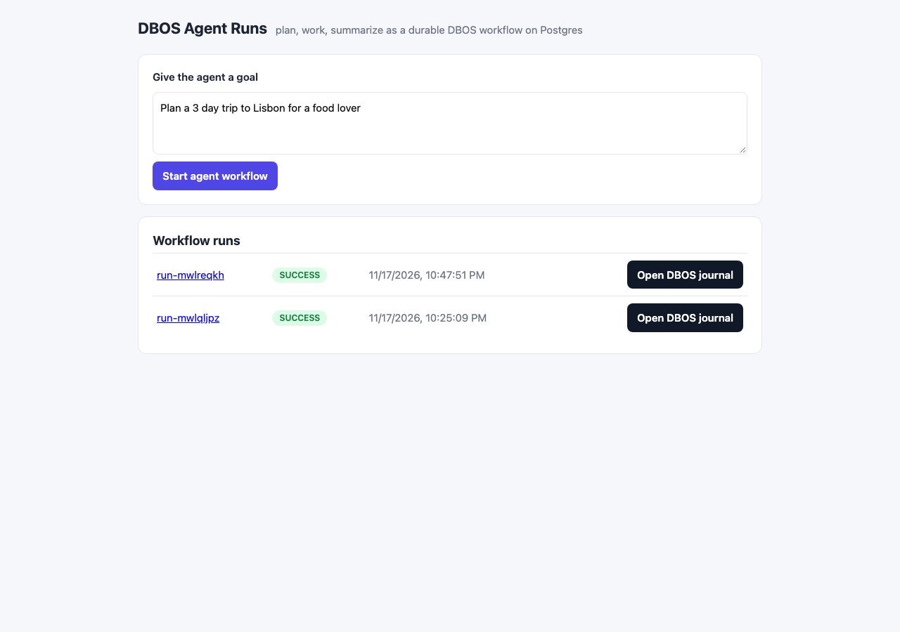
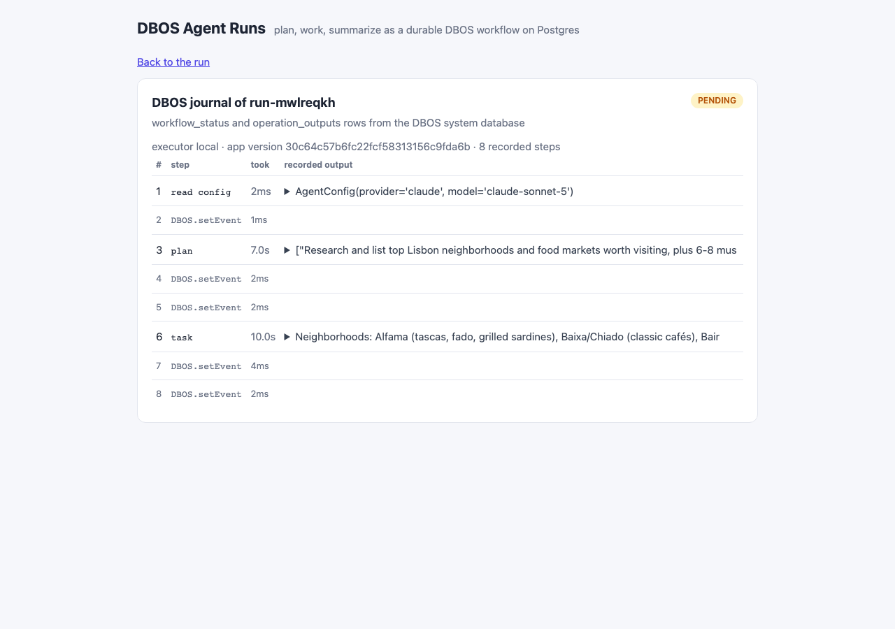
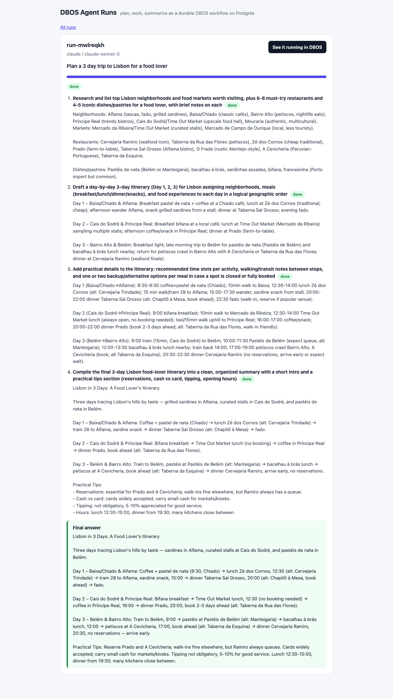
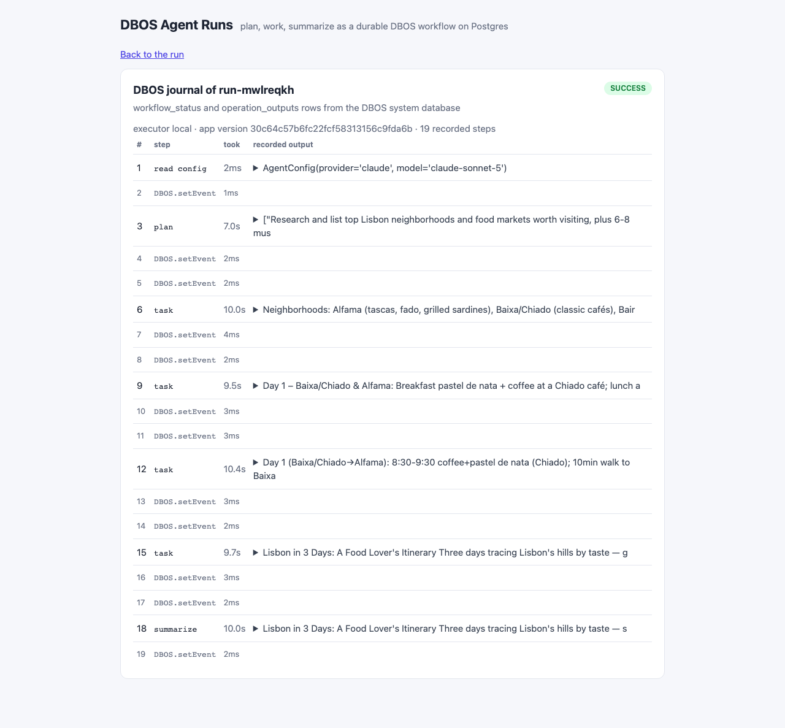

# DBOS Agentic Workflow POC (Python)

An agentic plan-and-execute workflow that runs as a durable [DBOS](https://www.dbos.dev/) workflow. You give the agent a goal in the UI. A planner agent splits it into 2 to 4 tasks, a worker agent completes each task, and a reviewer agent writes the final answer. Every agent call is a DBOS step checkpointed in Postgres, so if the service crashes the run resumes from the last finished step instead of starting over. Each run has a **See it running in DBOS** button that opens the run's DBOS journal: the workflow and step rows DBOS recorded in its system database.

DBOS Transact is an open source library (MIT). It needs no server and no account: the only infrastructure is a Postgres container.

## How it Works

1. The UI posts the goal to `agent-service` (`POST /runs`), which starts `AgentWorkflow` with `DBOS.start_workflow` under a fresh workflow id.
2. DBOS writes a `workflow_status` row in Postgres and runs the workflow in a background thread.
3. The workflow calls `read config`, `plan`, one `task` step per planned task and `summarize`. Each is a `@DBOS.step`, and DBOS stores its output in `operation_outputs` once it finishes.
4. After each step the workflow publishes its progress with `DBOS.set_event("state", ...)`.
5. The UI polls `GET /runs/{id}` every 1.5s, which reads that event with `DBOS.get_event`, and renders the steps live.
6. The journal page polls `GET /runs/{id}/journal`, which reads `DBOS.get_workflow_status` and `DBOS.list_workflow_steps`.
7. If `agent-service` dies mid-run, `DBOS.launch()` finds the `PENDING` workflow on restart and re-runs it: finished steps return their recorded output, and the run continues from the interrupted step.

## Architecture


Postgres runs in Podman. The agent service runs on the host because it calls the local `claude`, `codex`, `agy` and `ollama` CLIs, which exist only on the host. DBOS lives inside the service process as a library and talks straight to Postgres.

## Features

* **Durable agent steps**: each LLM call is a `@DBOS.step`, so a crash never reruns a finished, paid-for agent call.
* **Crash recovery proven by a test**: the end-to-end test SIGKILLs the service mid-run, restarts it, and checks that the plan step was not called again.
* **Plan-and-execute agent**: the model decides the tasks, and each worker sees the results of earlier tasks.
* **Live progress**: `DBOS.set_event` gives the UI step-by-step progress with no table of its own.
* **DBOS journal page**: every recorded step with its duration and output, including DBOS's own `DBOS.setEvent` operations.
* **Any agent CLI**: switch between Claude Code, Codex, Agy or Ollama in `scripts/agent.conf` with no code change.
* **Externalized prompts**: the three prompts live in `prompts/`, and an empty parameter fails loud.
* **Bounded retries**: each agent step retries at most 3 times with backoff, then the run is marked `failed` with the error.
* **No registration**: no DBOS Cloud account, no license key, nothing leaves the machine.

## Stack

* **Python 3.15 + uv**: the agent service, its dependencies and its virtual env.
* **DBOS Transact 3.6.0**: durable workflows, steps, events and recovery, as a library on Postgres.
* **Granian 2.8.8**: the ASGI server. The app is a small plain ASGI callable, so there is no web framework.
* **ty 0.0.105 + pytest 9.2**: type checking and tests.
* **Postgres 17** in Podman with podman-compose: the DBOS system database.
* **Bun 1.4.4 + TypeScript 7.0.2**: UI tooling and tests (Bun 2.x does not exist yet).
* **Vite 8 + React 19.3 + TanStack Router 1.170 + TanStack Query 5.108**: the UI, routes and polling.

## About the DBOS Console and Conductor

DBOS has a web console (DBOS Conductor and the DBOS Console). The self-hosted Conductor image is under a proprietary license and needs a license key, and even the free development key comes from a DBOS account. Signing up was out of scope for this POC, so it does not use Conductor. The journal page here reads the same data straight from the open source library: `DBOS.get_workflow_status` and `DBOS.list_workflow_steps`.

## Contracts / APIs

The UI dev server proxies `/api` to `agent-service`.

| Call | Method + path | Body | Returns |
|---|---|---|---|
| Start a run | `POST /runs` | `{"goal": "..."}` | `202 {"runId": "run-..."}`, `400` without a goal |
| Run progress | `GET /runs/{runId}` | none | `RunState` or `null` before the first event |
| List runs | `GET /runs` | none | `[{"run_id", "status", "created_at"}]`, newest 20 |
| DBOS journal | `GET /runs/{runId}/journal` | none | `{"run_id", "status", "executor", "app_version", "steps": [...]}`, `404` if unknown |
| Health | `GET /health` | none | `{"ok": true}` |

## Key data structures and design decisions

```python
@dataclass(frozen=True)
class RunState:
    goal: str
    provider: str
    model: str
    phase: Literal["planning", "working", "summarizing", "done", "failed"]
    steps: tuple[Step, ...]
    summary: str
    error: str
```

* **The workflow id is the run id**: `SetWorkflowID(run_id)` makes the run id the DBOS key, so the UI, the event and the journal all use the same id.
* **The config is a step**: `read config` is checkpointed, so a recovered run uses the same provider and model even if `agent.conf` changed in between.
* **The plan is parsed inside the step**: a model reply without a valid task list fails that step, which DBOS retries, and only a valid plan is recorded.
* **Pure state transitions**: `run_state.py` returns new frozen dataclasses, so the workflow reads as plan, run, done and is unit tested without DBOS.
* **A store protocol between HTTP and DBOS**: `http.py` depends on the `RunStore` protocol in `runs.py`, so the routes are tested with a fake and only `store.py` imports DBOS.
* **No framework**: Granian serves a plain ASGI function with a `match` on method and path, and DBOS launches in the ASGI lifespan.

## How to run

You need Podman with a running machine, podman-compose, uv, Bun, and the agent CLI named in `scripts/agent.conf` (default `claude` with `claude-sonnet-5`).

```bash
./scripts/setup.sh
./scripts/start-all.sh
./scripts/ui.sh
```

To use another agent, edit `scripts/agent.conf`, for example `AGENT_PROVIDER=ollama` and `AGENT_MODEL=llama3.2`, then restart.

To see durability yourself, start a run, then kill the service during a task and start it again:

```bash
kill -9 "$(pgrep -P "$(cat .run/agent-service.pid)")" "$(cat .run/agent-service.pid)"
rm .run/agent-service.pid
./scripts/start-all.sh
```

The run continues from the task that was interrupted, and the journal page shows the earlier steps with their original timestamps.

## How to test

```bash
./scripts/test-all.sh
```

This runs `ty` and 23 pytest tests for the agent service, the UI typecheck, build and 6 unit tests, and `scripts/test-e2e.sh`. The end-to-end script starts a real workflow on the running stack and waits for the first task. It then SIGKILLs the service, restarts it, and waits for DBOS to recover the run and finish it. Last, it checks that the `plan` step completed before the crash, which proves it was replayed from Postgres and not called again.

## Printscreens

### Runs list



The home page: type a goal and start the agent workflow. Below, every `AgentWorkflow` run comes from `DBOS.list_workflows` with its DBOS status, and each row has an **Open DBOS journal** button.

### Run in progress


The planner agent split the goal into 4 tasks. Task 1 is `done` with the worker's output, task 2 is `running` and the rest are `pending`. The page polls the `state` event, and **See it running in DBOS** opens the journal.

### DBOS journal while the agent runs



What the button opens. The workflow is `PENDING`, and the journal already has `read config`, `plan` and `task` with their recorded outputs. These are the rows DBOS replays after a crash.

### Run completed



All 4 tasks are `done` with each worker agent's output, and the reviewer agent's final answer is at the bottom.

### DBOS journal after the run



The workflow is `SUCCESS` with 19 recorded operations: the agent steps (`plan` 7.0s, `task` around 10s each, `summarize` 10.0s) and the `DBOS.setEvent` writes that published the live progress.

## Scripts

All scripts live in `scripts/` and run from any directory of the repository.

| Script | What it does |
|---|---|
| `./scripts/setup.sh` | Installs dependencies and pulls the Postgres image |
| `./scripts/start-all.sh` | Starts Postgres, the agent service and the UI, and prints the link of each one |
| `./scripts/status.sh` | Shows every service as UP or DOWN |
| `./scripts/test-all.sh` | Runs every test suite, including the crash recovery end-to-end test |
| `./scripts/ui.sh` | Opens the UI in the browser |
| `./scripts/stop-all.sh` | Stops every service |

Ports are declared in `scripts/ports.env`: Postgres 5434, agent-service 9081, UI 5193. The agent provider and model are in `scripts/agent.conf`.
