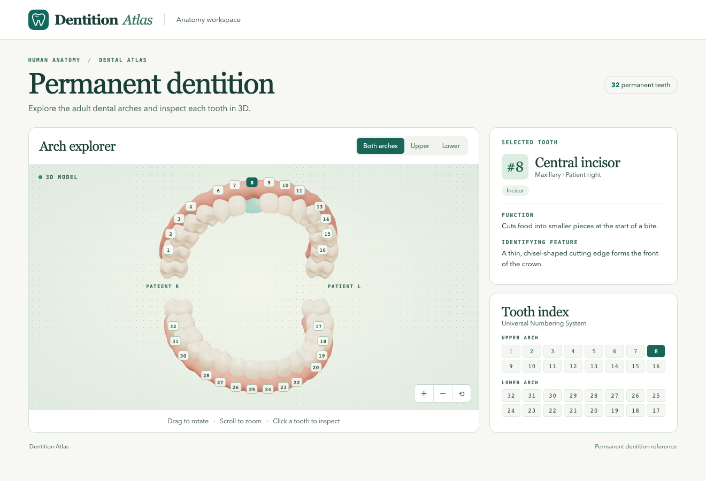
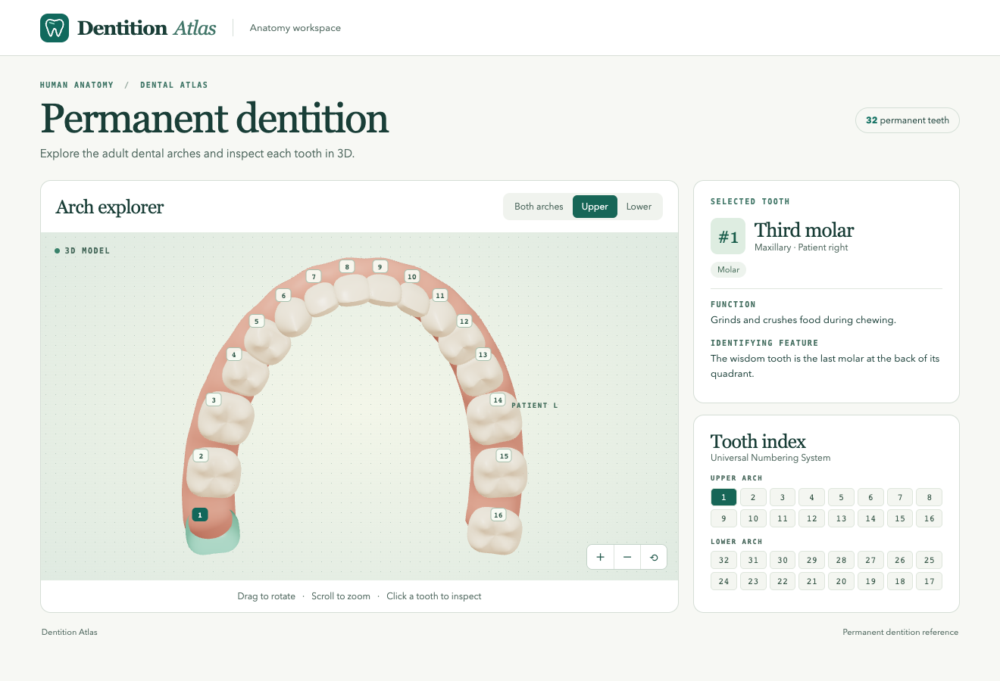
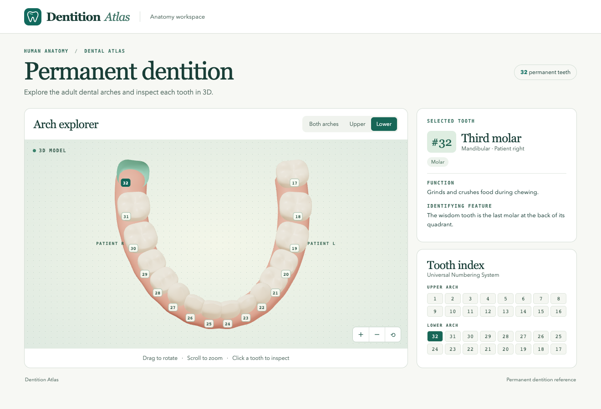
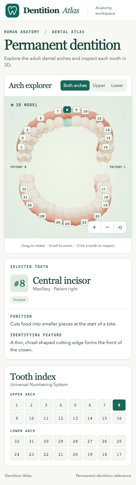
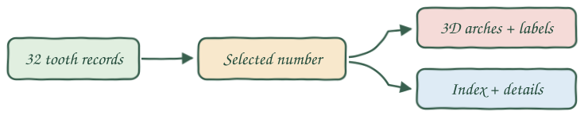

# Dentition Atlas

Explore 32 permanent teeth in an interactive 3D atlas. Pick a crown or a number to see the tooth’s name, position, function, and identifying feature.



The opening view faces the patient. Tooth 8 is highlighted in green and its index button and information panel match the selection.

## Run and test

Install Node.js 22 or newer, npm, Python 3 and Bash. From the project directory run

```bash
./scripts/setup.sh
./scripts/start-all.sh
```

Open the loopback address printed by the start script. Setup installs pinned dependencies and the Chromium browser used for testing. The running atlas loads its code and models locally.

```bash
./scripts/test-all.sh
./scripts/stop-all.sh
```

The suite checks all 32 records and index selections, clicks the four wisdom crowns directly, selects an incisor by keyboard, rotates and resets the model, and exercises arch isolation, narrow screens and loss of WebGL availability at startup.

## How it works

The atlas opens with upper and lower arches separated so you can see both rows.
Drag the model to rotate it, scroll or use the zoom buttons to magnify it, and use the circular arrow to restore the starting angle.
Choose Upper or Lower to face the chewing surfaces more directly.
Click a crown or tab to a numbered button and press Enter to inspect it.
When rotating or zooming crowds the numbers, the selected tooth gets label priority. The index always lists all 32 teeth.

## Features and views

| Upper arch | Lower arch |
| --- | --- |
|  |  |
| Follow 1 through 16 from the patient’s upper right to upper left. | Follow 17 through 32 from the patient’s lower left to lower right. |

<details><summary>Narrow-screen layout</summary>



The viewer sits above the tooth details and index. The numbered buttons and descriptions also work when WebGL 2 is unavailable.

</details>

## Architecture



### Stack

- JavaScript modules, HTML and CSS provide the index, details, controls and responsive layout.
- Three.js builds the crown and gum meshes, projects labels and raycasts pointer clicks.
- Python’s static HTTP server serves the application on loopback.
- Playwright drives an isolated Chromium browser for interaction checks and screenshots.

### Contracts and data structures

The application consumes static files over HTTP. Its data contract is the ordered array in `src/teeth.js`. Each record includes a Universal ID, arch, patient side, position within the quadrant, anatomical name, family, function and feature.

In `src/app.js`, both the index and raycast hits call the same selection function. In `src/model.js`, each crown carries its record ID. Labels project from crown-local coordinates whenever the camera or viewport changes. The renderer draws on demand. Crown profiles and cusp layouts vary by tooth family. These are schematic educational surfaces and represent a complete adult dentition.

## Dental references

The numbering, arch, side and anatomical names follow the permanent-tooth rows on pages 2–3 of the ADA chart. [ADA Universal Tooth Designation System](https://www.ada.org/-/media/project/ada-organization/ada/ada-org/files/publications/cdt/universal_tooth_designation_system_valueset_2.pdf)

The descriptions of cutting, tearing, crushing and grinding follow the clinical overview of the four tooth types. [Cleveland Clinic tooth anatomy](https://my.clevelandclinic.org/health/body/24655-teeth)

## Scripts

| Command | Purpose |
| --- | --- |
| `./scripts/setup.sh` | Install dependencies and Chromium. |
| `./scripts/start-all.sh` | Start the atlas and print its address. |
| `./scripts/status.sh` | Show the configured port and running state. |
| `./scripts/test-all.sh` | Run the chart and browser checks, starting a temporary server if needed. |
| `./scripts/ui.sh` | Capture the running atlas in headless Chromium into `.run/view.png`. |
| `./scripts/stop-all.sh` | Stop the server started by the launch script. |

Configure the HTTP port in `scripts/ports.env`.
