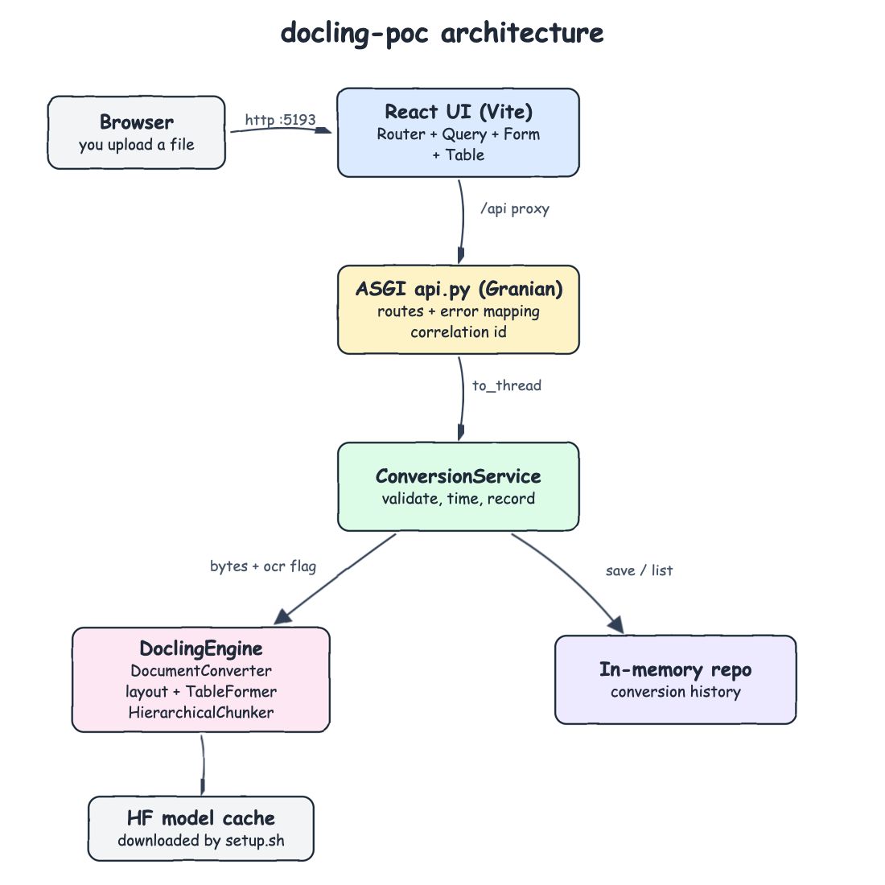
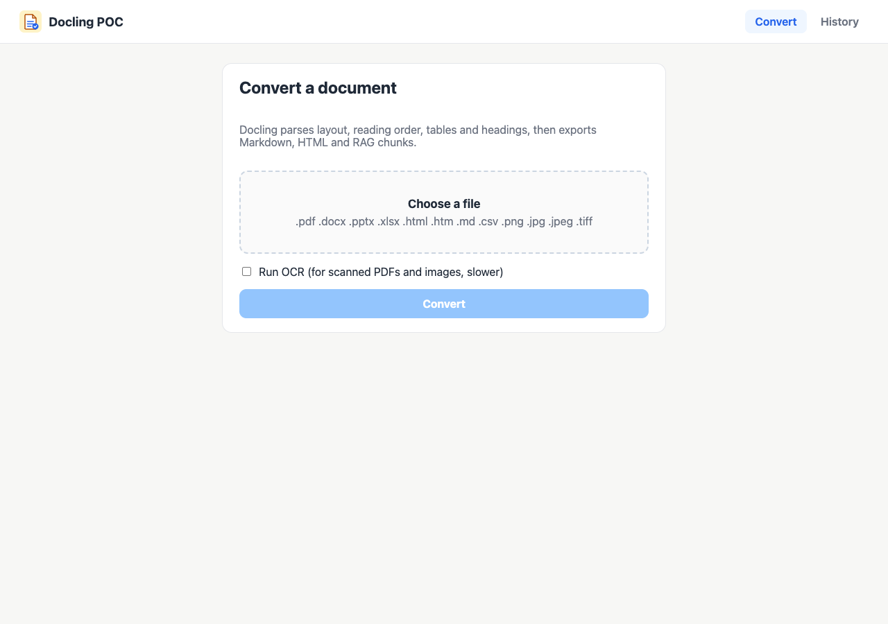
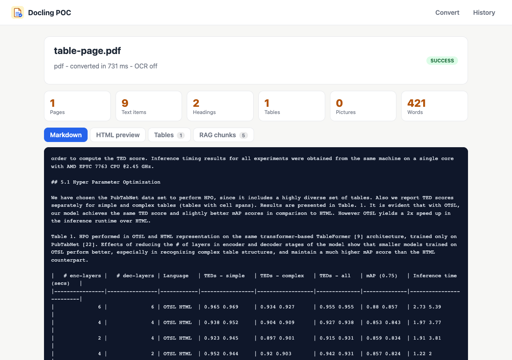
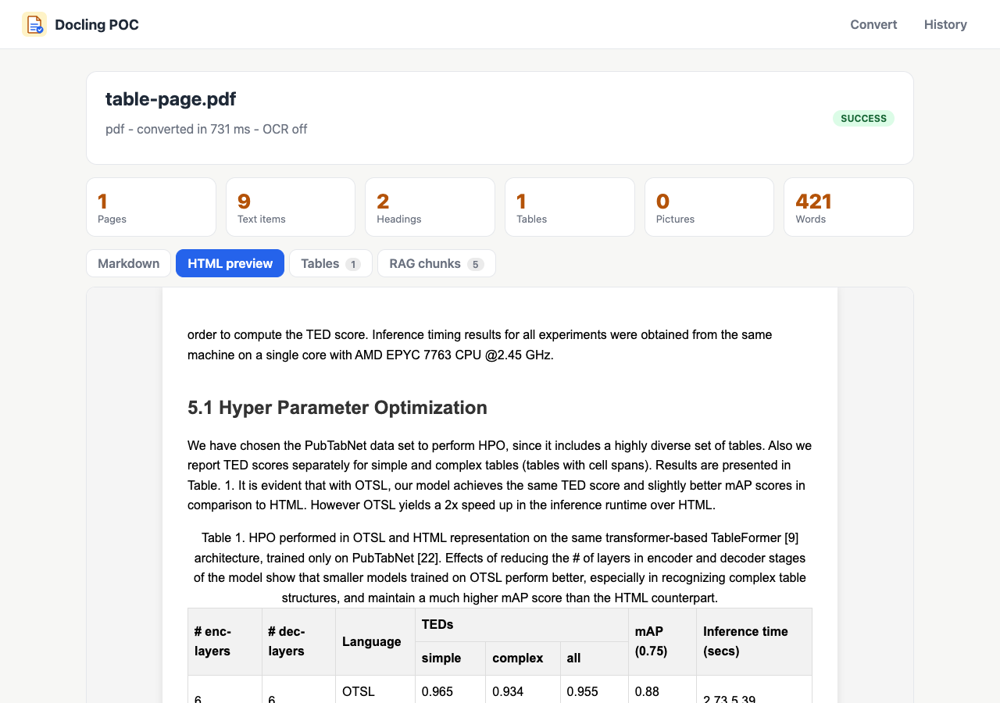
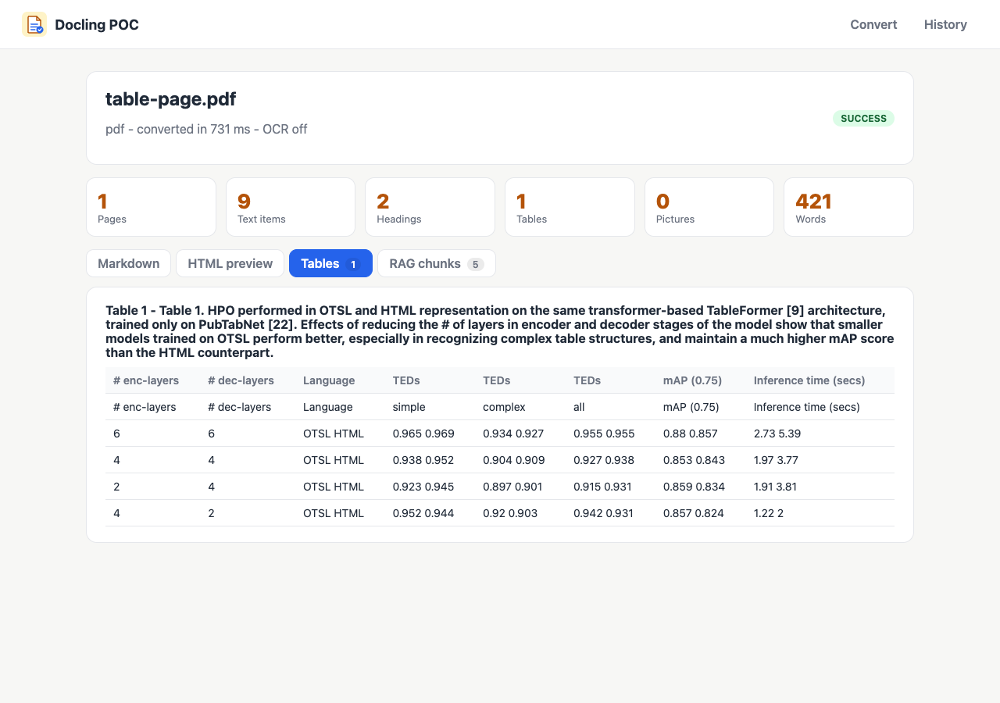
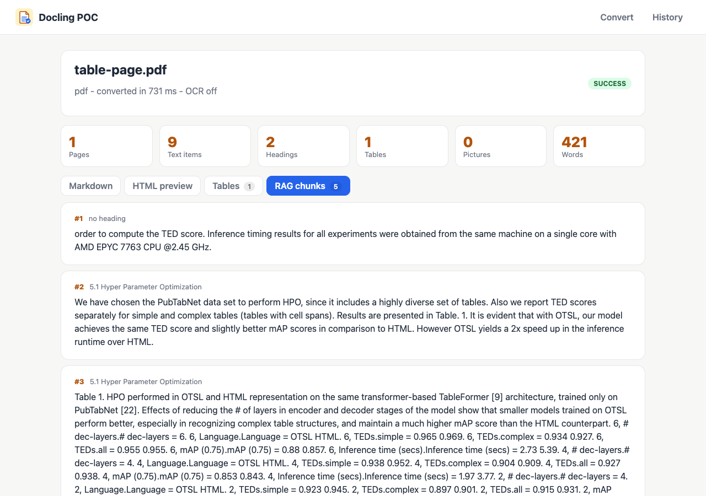
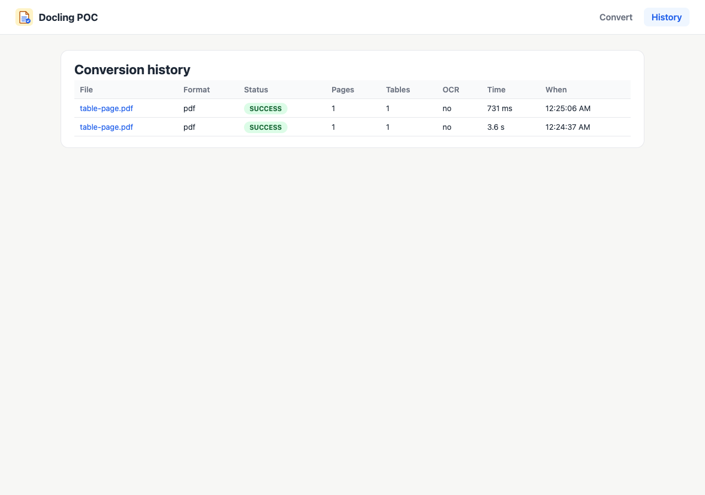

<p align="center"></p>

# Docling POC

A small document conversion service built on [Docling](https://github.com/docling-project/docling). Upload a PDF, DOCX, PPTX, XLSX, HTML, Markdown, CSV or image. Docling turns it into a structured `DoclingDocument`. The app then shows the Markdown, an HTML preview, every table it found as a real grid, and RAG-ready chunks with their heading path.

## How it Works

1. The UI posts the raw file bytes to `POST /api/conversions`, with the name in the `X-Filename` header and an `ocr` flag in the query string.
2. A plain ASGI app running on Granian reads the body with a size limit. It hands the bytes to `ConversionService` on a worker thread.
3. The service checks the filename, size and extension, then calls the `DocumentEngine` protocol.
4. `DoclingEngine` wraps `DocumentConverter`. For PDFs and images it runs the layout model and TableFormer, with OCR only when you ask for it.
5. The resulting `DoclingDocument` is exported to Markdown and HTML. Its tables are read cell by cell from `table.data.grid`, and it is split into chunks with `HierarchicalChunker`.
6. The service records the result, successful or failed, in an in-memory history and returns it to the UI.

## Architecture



## Features

* **Multi-format conversion**: one endpoint takes PDF, Office, HTML, Markdown, CSV and images, because Docling picks the right backend from the file type.
* **Layout-aware PDF parsing**: the layout model and TableFormer recover reading order and table structure instead of flat text.
* **Optional OCR**: off by default for speed, and one checkbox turns it on for scanned PDFs and images.
* **Table extraction**: every table is shown as a real grid with its caption, ready to copy into a spreadsheet.
* **RAG chunks**: `HierarchicalChunker` output with the heading path of each chunk, which is what you feed to a vector store.
* **Document stats**: pages, text items, headings, tables, pictures and words, so you can see at a glance what Docling found.
* **History**: every conversion is kept, failures included, so a bad file is visible instead of silently lost.
* **Correlation id**: the browser sends `X-Correlation-Id` and the backend logs and echoes it, so a UI action can be traced to its log lines.

## Stack

* **Python 3.15 + uv**: runtime and dependency management for the backend.
* **Docling 2.154**: the document conversion engine this POC is about.
* **Granian**: a fast ASGI server, with no web framework on top.
* **ty + pytest**: type checking and tests for the backend.
* **TypeScript 7 + Bun**: typed UI code, with Bun as package manager and test runner.
* **Vite + React 19**: dev server, proxy and UI rendering.
* **TanStack Router, Query, Form, Table**: file-based routes, server state, the upload form and the history grid.

## Contracts / APIs

| Method | Path | Body | Response |
|---|---|---|---|
| `GET` | `/api/health` | - | `{"status":"ok"}` |
| `GET` | `/api/formats` | - | `{"extensions":[".pdf",".docx",...]}` |
| `POST` | `/api/conversions?ocr=true\|false` | raw file bytes, header `X-Filename` (URL encoded) | `201` full conversion |
| `GET` | `/api/conversions` | - | history summaries, newest first |
| `GET` | `/api/conversions/{id}` | - | full conversion |

The full conversion is `{ id, filename, format, ocr, status, createdAt, durationMs, error, document: { markdown, html, tables[{index, caption, headers, rows}], chunks[{index, headings, text}], stats{pages, texts, headings, tables, pictures, words} } }`.

Error status codes, all mapped in one place in `backend/app/api.py`:

| Code | Meaning |
|---|---|
| `400` | missing `X-Filename` or an empty file |
| `404` | unknown conversion or route |
| `413` | file larger than `MAX_UPLOAD_MB` (default 50) |
| `415` | unsupported file type |
| `422` | Docling could not convert the file (the failure is kept in history) |

## Key data structures and design decisions

* **`ConvertedDocument`, `TableView`, `Chunk`, `Stats`** are frozen dataclasses. Docling types stay inside `engine.py`, so the API never leaks Docling's internal model.
* **The `DocumentEngine` protocol** lets the service and API tests run with a fake engine in milliseconds. Real Docling runs only in the integration tests.
* **Raw body upload instead of multipart** keeps the backend free of a web framework or multipart parser. The size limit is checked while the body streams in.
* **One converter per OCR setting** is built lazily and reused, because building a `DocumentConverter` loads models. A lock serializes conversions, since the models are CPU-bound.
* **Failures are recorded, not swallowed.** A failed conversion is saved with its error and also returned as `422`.
* **The UI parses every payload** with type guards in `features/conversions/types.ts`. A contract drift fails loudly instead of rendering `undefined`.

## How to run

```bash
./scripts/setup.sh
./scripts/build-all.sh
./scripts/start-all.sh
./scripts/test-all.sh
./scripts/ui.sh
./scripts/stop-all.sh
```

`setup.sh` downloads the Docling layout and TableFormer models once. A sample PDF page with a table lives in `samples/table-page.pdf`, taken from Docling's own test data.

## Printscreens

**Convert**: pick a file and optionally turn on OCR. The accepted extensions come from `/api/formats`.



**Markdown**: the Docling Markdown export, with the stats bar on top. This page of the TableFormer paper took under a second on CPU.



**HTML preview**: Docling's HTML export in a sandboxed iframe. The merged `TEDs` header cell is kept as a real column span.



**Tables**: each detected table as a grid with its caption. The two header rows from the PDF become a header plus a first row.



**RAG chunks**: `HierarchicalChunker` output. Each chunk carries the heading it belongs to (`5.1 Hyper Parameter Optimization`), and tables are turned into text.



**History**: every conversion with status, pages, tables, OCR flag and time. The first run is slower because the models load.



## Scripts

All scripts live in `scripts/` and run from any directory of the repository.

| Script | What it does |
|---|---|
| `./scripts/setup.sh` | Installs dependencies and downloads the Docling models |
| `./scripts/build-all.sh` | Builds every part of the app |
| `./scripts/build-backend.sh` | Type checks the backend with ty |
| `./scripts/build-frontend.sh` | Type checks and builds the frontend |
| `./scripts/start-all.sh` | Starts every service and prints the full link of each one |
| `./scripts/status.sh` | Shows every service port as UP or DOWN |
| `./scripts/test-all.sh` | Runs every test suite (unit, integration, e2e) |
| `./scripts/unit-test.sh` | Runs backend pytest and frontend bun unit tests |
| `./scripts/integration-test.sh` | Runs real Docling conversions of HTML and PDF |
| `./scripts/e2e-test.sh` | Uploads the sample PDF through the running UI proxy and checks the result |
| `./scripts/ui.sh` | Opens the UI in the browser |
| `./scripts/stop-all.sh` | Stops every service |

Ports are declared in `scripts/ports.env`: backend `8090`, frontend `5193`.

```bash
./scripts/setup.sh
./scripts/build-all.sh
./scripts/start-all.sh
./scripts/status.sh
./scripts/ui.sh
./scripts/stop-all.sh
```
