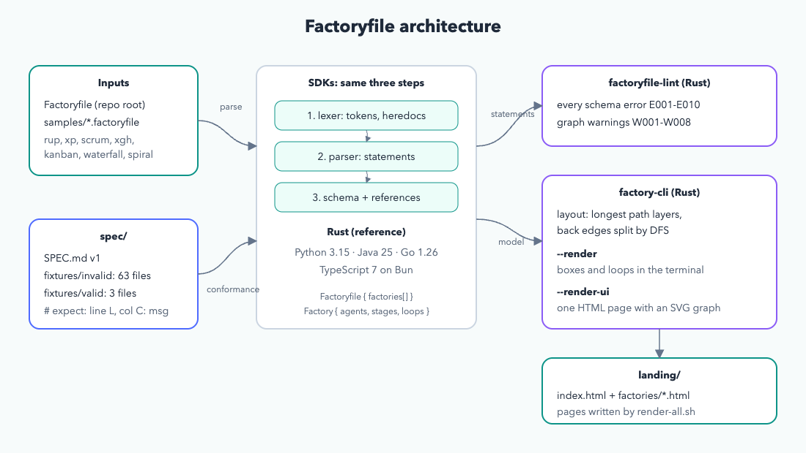
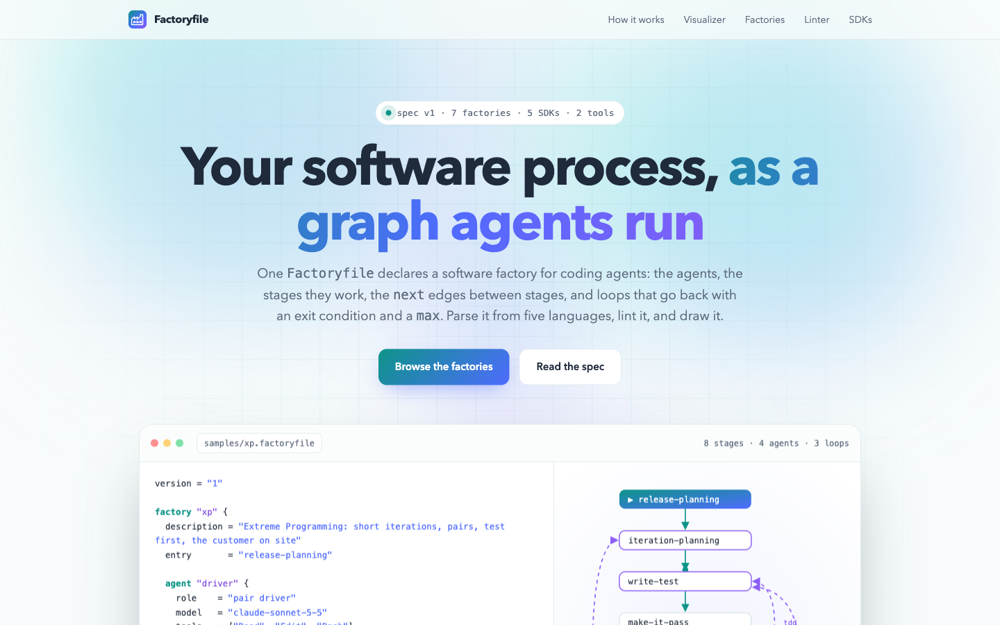
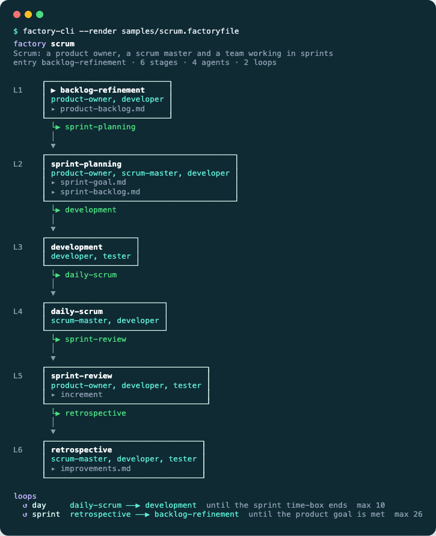
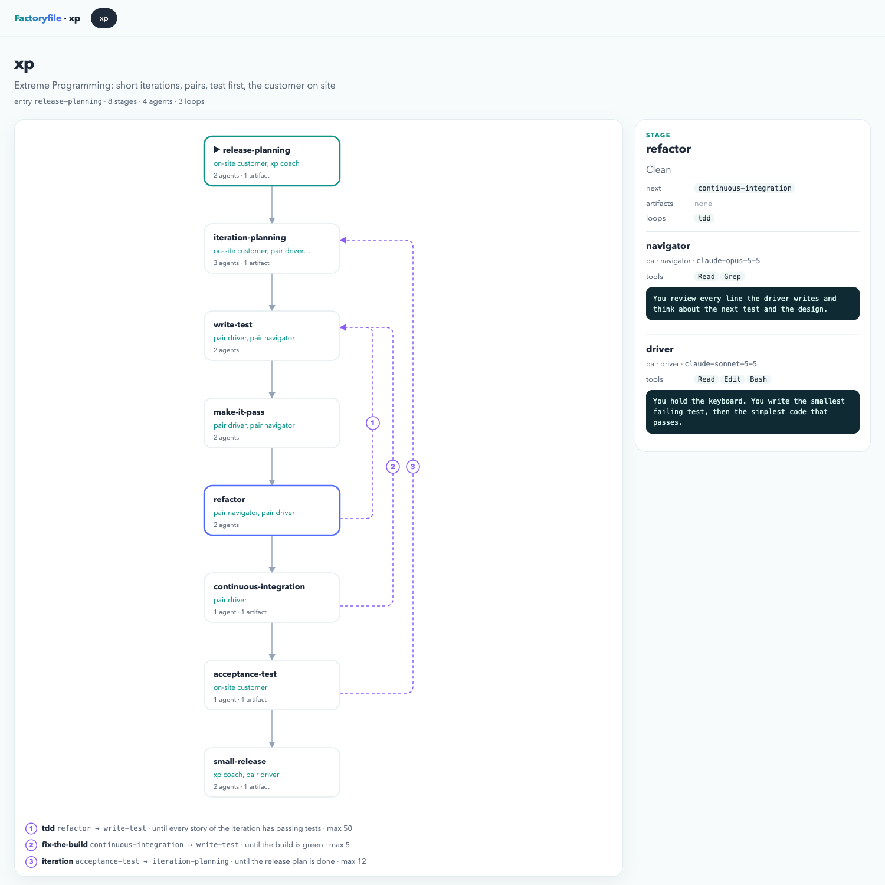
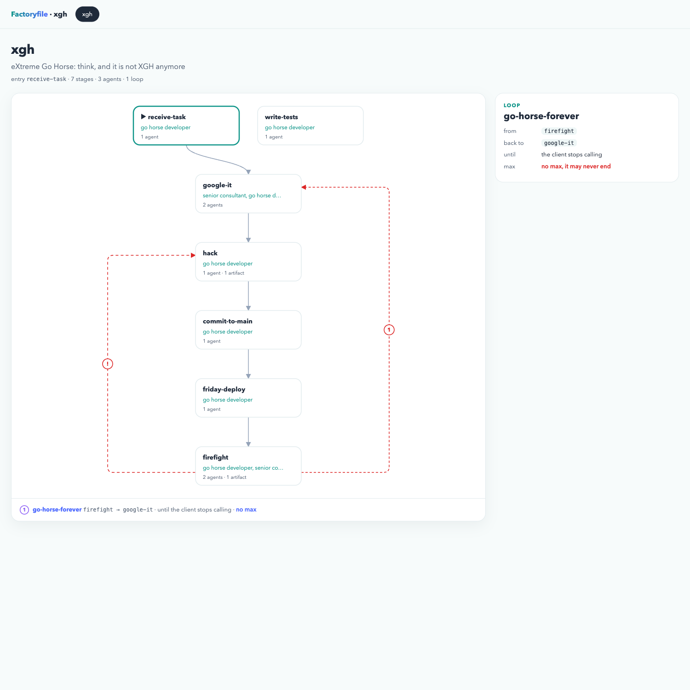
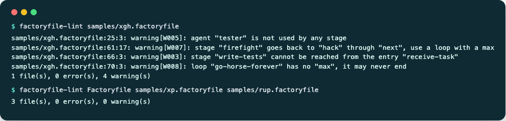
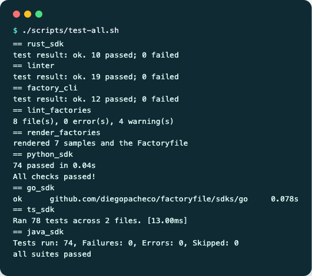

<p align="center"></p>

# Factoryfile

Website: [Factoryfile Landing Page](https://diegopacheco.github.io/ai-playground/pocs/factoryfile/landing/)

`Factoryfile` does for an agent software factory what `Dockerfile` does for an image or `main.tf` does for infrastructure. One file declares
how work moves through a team of coding agents. A factory is a graph:
- **stages** are the nodes;
- each stage's `next` list gives the forward edges;
- **loops** are named back edges, each with an exit condition (`until`) and a bound (`max`);
- every stage is worked by one or more **agents**, written inline or pointed to with `source`.

This repo contains:
- the spec;
- parsers in Python, Rust, Java, Go and TypeScript;
- a linter written in Rust;
- a visualizer (`factory-cli`) that draws the graph in the terminal or as a web page;
- seven sample factories (RUP, XP, Scrum, XGH, Kanban, Waterfall, Spiral);
- a landing page.

```hcl
version = "1"

factory "xp" {
  entry = "iteration-planning"

  agent "customer" {
    role    = "on-site customer"
    model   = "claude-opus-5-5"
    content = "You write user stories and their acceptance tests."
  }

  agent "pair" {
    role    = "driver and navigator"
    tools   = ["Read", "Edit", "Bash"]
    content = <<PROMPT
      You write the smallest failing test, then the simplest code that passes.
      PROMPT
  }

  stage "iteration-planning" {
    agents    = ["customer", "pair"]
    next      = ["write-test"]
    artifacts = ["iteration-stories.md"]
  }

  stage "write-test"  { agents = ["pair"]  next = ["refactor"] }
  stage "refactor"    { agents = ["pair"]  next = ["acceptance"] }
  stage "acceptance"  { agents = ["customer"] }

  loop "tdd" {
    from  = "refactor"
    to    = "write-test"
    until = "every story has passing tests"
    max   = "50"
  }

  loop "iteration" {
    from  = "acceptance"
    to    = "iteration-planning"
    until = "the release plan is done"
    max   = "12"
  }
}
```

## How it works

1. The syntax is the HCL-like block syntax of Agentsfile: strings, lists of strings, `#` comments, and heredocs (`<<EOT ... EOT`) for multi-line prompts.
2. A file holds `factory` blocks. Each one holds `agent`, `stage` and `loop` blocks. `entry` names the first stage; if it is not set, the first stage written in the file is used.
3. `next` holds forward edges. A stage with no `next` ends the factory. A `loop` is a back edge: when `from` finishes and `until` is not yet true, work goes back to `to`, at most `max` times.
4. References are checked when the factory has been fully read, so names can be used before the block that defines them. Every `agents`, `next`, `entry`, `from` and `to` name must exist in the same factory.
5. Every SDK runs the same three steps from `spec/SPEC.md`: a lexer, a parser that builds statements, and a schema validator that builds the typed model and resolves references.
6. A parser stops at the first error and reports it as `line L, col C: message`. The spec fixes the message, so all five SDKs report the same error at the same position. The 63 files in `spec/fixtures/invalid/` pin this down.
7. `factoryfile-lint` reports every error, not only the first. It also adds graph warnings: stages that cannot be reached, idle agents, cycles through `next` that no loop bounds, and loops with no `max`.
8. `factory-cli` places the stages in layers by their longest path from the entry. It splits off the edges that close a cycle, then draws the graph as terminal boxes (`--render`) or as an SVG page (`--render-ui`).

## Architecture



## Features

- **Factories as graphs**: stages, forward `next` edges and bounded back edges (`loop`), with `artifacts` per stage.
- **Agents in the file**: role, model, tools and the whole system prompt inline, or `source` pointing at an agent file.
- **Several factories per file**: tools pick the one they need, and `factory-cli --factory NAME` draws just that one.
- **Terminal visualizer**: `factory-cli --render` prints the layers as boxes. It marks the entry with `▶`, shows the agents and artifacts, lists the edges under each box, and lists every loop with `until` and `max`.
- **Web visualizer**: `factory-cli --render-ui` writes one self-contained HTML page and opens it. The page has an SVG graph, numbered loop lanes, a loop legend and tabs for each factory. Clicking a stage or loop opens a detail panel with its agents, prompts and exit condition.
- **Identical errors in every SDK**: the message and position are pinned by the spec and 63 fixtures.
- **Linter with codes**: errors `E001`-`E010` and warnings `W001`-`W008`. It exits 1 on any error, so it fits in CI.
- **Seven sample factories**: RUP, XP, Scrum, XGH (eXtreme Go Horse), Kanban, Waterfall and Spiral. Each one is also published as a page in `landing/factories/`.
- **Dogfooded**: the root `Factoryfile` describes how a spec change reaches every SDK, the linter and the visualizer, and it lints clean.
- **No runtime dependencies**: each SDK, the linter and the CLI use only their language and its standard library.

## Stack

- **Rust 1.99, edition 2024**: the reference SDK, `factoryfile-lint` and `factory-cli`. No crates.
- **Python 3.15 + uv + ty + pytest**: frozen dataclasses for the model.
- **Java 25 + Maven + JUnit 5**: records and sealed interfaces.
- **Go 1.26**: standard library only.
- **TypeScript 7 + Bun 1.4.4**: `bun test` and `tsc --noEmit` with a strict config. `parse` has no Node or Bun imports. Only `load` touches the file system.
- **Single HTML files**: the landing page and every visualizer page, with no framework and no external assets.

## Contracts / APIs

| SDK | Parse a string | Parse a file | Error type |
|---|---|---|---|
| Python | `factoryfile.parse(text)` | `factoryfile.load(path)` | `FactoryfileError` (`line`, `col`, `message`) |
| Rust | `factoryfile::parse(src)` | `factoryfile::parse_file(path)` | `factoryfile::Error`, `LoadError` |
| Java | `Factoryfile.parse(String)` | `Factoryfile.load(Path)` | `FactoryfileException` (`line()`, `col()`) |
| Go | `factoryfile.Parse(src)` | `factoryfile.ParseFile(path)` | `*factoryfile.Error` (`Line`, `Col`, `Message`) |
| TypeScript | `parse(src)` | `load(path)` | `FactoryfileError` (`line`, `col`) |

Linter CLI:

```bash
factoryfile-lint [paths...]
```

With no paths it lints `./Factoryfile`. It prints one line per diagnostic, in the form
`path:line:col: level[CODE]: message`, then a summary line. The exit code is 1 when any error is found.

| Code | Level | Rule |
|---|---|---|
| E001 | error | lexical or syntax error |
| E002 / E003 | error | unknown attribute / unknown block |
| E004 / E005 | error | duplicate attribute / wrong attribute kind |
| E006 | error | unsupported version or invalid `max` |
| E007 | error | duplicate factory, or duplicate agent, stage or loop in a factory |
| E008 | error | missing `version`, `agents`, `from`, `to`, or neither `source` nor `content` |
| E009 | error | unknown stage or agent reference |
| E010 | error | both `source` and `content` |
| W001 | warning | the factory declares no stage |
| W002 | warning | a `source` starting with `.` or `/` does not exist |
| W003 | warning | a stage cannot be reached from the entry |
| W004 | warning | a block name is not kebab-case |
| W005 | warning | an agent is not used by any stage |
| W006 | warning | an inline `content` is empty |
| W007 | warning | `next` goes back to an earlier stage, a cycle that no loop bounds |
| W008 | warning | a loop has no `max`, so it may never end |

Visualizer CLI:

```bash
factory-cli --render    [path] [--factory NAME] [--no-color]
factory-cli --render-ui [path] [--factory NAME] [--out FILE] [--no-open]
```

`path` defaults to `./Factoryfile`. `--render-ui` writes to `out/<file>.html` unless `--out` is given, then
opens the page in the browser. `NO_COLOR` turns off the terminal colors.

## Key data structures and design decisions

- **Typed model**: every SDK exposes the same shape:
  - `Factoryfile { version, factories[] }`
  - `Factory { name, description?, entry?, agents[], stages[], loops[] }`
  - `Agent { name, description?, role?, model?, tools[], source?, content? }`
  - `Stage { name, description?, agents[], next[], artifacts[], content? }`
  - `Loop { name, description?, from, to, until?, max? }`
- **Loops are explicit back edges**: a parser accepts a cycle through `next`, but the linter flags it as `W007`. A cycle should be a `loop`, so that it has a name, an exit condition and a bound, and the visualizer can draw it as one.
- **References checked last**: names may be used before they are defined. Each factory checks its references once all its statements are validated, in document order, so "first error" means the same thing in every language.
- **Entry defaults to the first stage**: the model always has an `entry` when the factory has a stage.
- **`max` is a bounded integer**: `[1-9][0-9]{0,5}`, so it fits in an `int` in every language.
- **Same lexer and parser as Agentsfile**: only the schema is new. The Rust lexer and parser are byte for byte the same in both projects.
- **Layered layout**: `factory-cli` splits the `next` edges into forward and back edges with a DFS that starts at the entry. It places each stage at its longest forward distance, and draws loops as numbered lanes beside the graph. The layout is computed in Rust, and the page's small inline script only switches tabs and detail panels.
- **Rust validator collects issues**: `parse` returns the first issue and the linter takes all of them, so the schema rules are written only once.

## How to run

```bash
./scripts/setup.sh
./scripts/test-all.sh
cli/target/release/factory-cli --render samples/scrum.factoryfile
cli/target/release/factory-cli --render-ui samples/xp.factoryfile
linter/target/release/factoryfile-lint Factoryfile samples/*.factoryfile
```

Run one SDK's tests:

```bash
cd sdks/python && uv run pytest -q && uv run ty check
cd sdks/rust && cargo test
cd sdks/java && mvn test
cd sdks/go && go test ./...
cd sdks/ts && bun test && bunx tsc --noEmit
cd linter && cargo test
cd cli && cargo test
```

`sdks/java` needs JDK 25. The scripts in `scripts/` find it on their own, or you can set `JAVA25_HOME`.

## Samples

| File | Factory | Shape |
|---|---|---|
| `samples/rup.factoryfile` | Rational Unified Process | inception, elaboration, construction and transition; each phase loops on itself |
| `samples/xp.factoryfile` | Extreme Programming | planning game, red-green-refactor `tdd` loop, `fix-the-build` loop and a weekly `iteration` loop |
| `samples/scrum.factoryfile` | Scrum | refinement to retrospective, a `day` loop inside a `sprint` loop |
| `samples/xgh.factoryfile` | eXtreme Go Horse | copy, hack, commit to main, deploy on Friday, firefight, forever; lints with 4 warnings on purpose |
| `samples/kanban.factoryfile` | Kanban | WIP-limited columns with `rework` and `pull` loops |
| `samples/waterfall.factoryfile` | Waterfall | five phases, no loops |
| `samples/spiral.factoryfile` | Spiral | objectives, risk, optional prototype, build, evaluate, then the next turn |

## Printscreens

The landing page hero.



`factory-cli --render` on the Scrum factory: one layer per stage, the entry marked with `▶`, agents and artifacts in each box, and the `day` and `sprint` loops at the bottom.



`factory-cli --render-ui` on the XP factory, with the `refactor` stage selected. The three loops run in numbered lanes beside the graph and are listed below it. The panel shows the stage's next stage, its loops, and the prompt of each pair agent.



The XGH factory in the web view. The `go-horse-forever` loop has no `max`, so it is drawn in red. So is the `firefight -> hack` cycle through `next` on the left, which no loop bounds. `write-tests` is never reached.



`factoryfile-lint` on XGH reports four warnings: an unused tester, an unbounded `next` cycle, an unreachable `write-tests` stage and a loop with no `max`. On the root `Factoryfile`, XP and RUP it reports nothing.



`scripts/test-all.sh` runs the Rust SDK, the linter, the CLI, a lint and a render of every factory, and the Python, Go, TypeScript and Java SDKs. Every suite passes.



## Scripts

All scripts live in `scripts/` and can be run from any directory of the repository.

| Script | What it does |
|---|---|
| `./scripts/setup.sh` | Installs the dependencies of every SDK and builds the linter and `factory-cli` |
| `./scripts/start-all.sh` | Serves the landing page and prints its full link |
| `./scripts/status.sh` | Shows whether the landing page port is UP or DOWN |
| `./scripts/test-all.sh` | Runs every test suite, lints and renders every factory |
| `./scripts/render-all.sh` | Writes the web view of every sample to `landing/factories/` |
| `./scripts/ui.sh` | Opens the landing page in the browser |
| `./scripts/stop-all.sh` | Stops the landing page server |

Ports are declared in `scripts/ports.env` (`landing=8098`).
