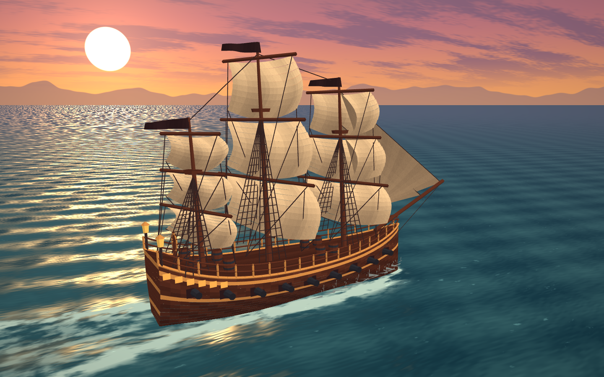
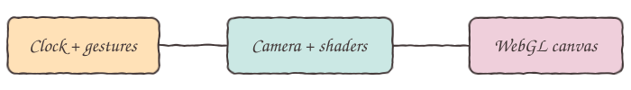
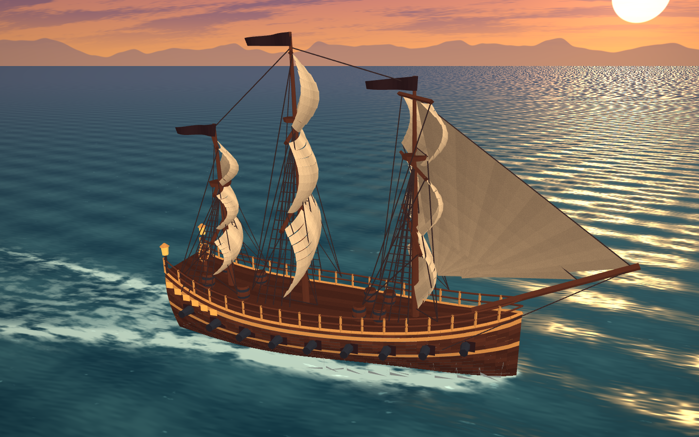

# Sunset under sail

Nine square sails and two jibs carry an armed three-master through a sunset sea. Drag to orbit and scroll or pinch to zoom.

## Architecture

## How it works

A hull cross-section changes along the keel to shape the bow, waist and stern. Planking, trim, rigging, yards and fittings share an interleaved triangle buffer. The vertex shader rolls and pitches the vessel and flexes its canvas. A second program shades view rays as sky or water, combining ripples, reflected sunlight and hull-relative foam. The camera follows the ship as the wave field travels past it.

## Stack

- HTML and JavaScript package the entire scene in one file.
- JavaScript generates the ship geometry and draws it directly through the browser’s WebGL API. GLSL shaders render the ocean, sky, and lighting. The scene runs offline without Three.js or any other runtime library.
- Playwright drives Chromium for verification.

## Contracts and controls

The page consumes pointer, wheel, viewport and animation-frame events. Its runtime requires a browser with WebGL. All geometry and materials are generated locally.

## Run and test

Run `./start.sh` and open <http://127.0.0.1:8347/> on the same computer. Run `./stop.sh` to stop the server. You can also open `index.html` directly. For browser checks install Playwright locally with `npm install --no-save playwright`, run `npx playwright install chromium`, then run `./scripts/test-all.sh`.

The second capture shows the view after dragging and zooming.

## Build prompt

Harness: Codex. Model family: GPT-6. The exact serving variant was unavailable.

> use my git, scritps readme skills and do this: Create from scratch a fully interactive 3D scene of a pirate ship sailing across a dynamic ocean at sunset. The visual style should be cinematic and stylized rather than photorealistic, while still being exceptionally rich, detailed, polished, and visually sophisticated. Build the ship, ocean, sky, lighting, materials, sails, rigging, cannons, small structural details, sea foam, wake, particles, animation, camera work, composition, atmospheric depth, and color grading. The final result should feel like a premium, high-production 3D artwork, not a prototype, technical d[…]o, or low-quality scene. Start from a completely blank page. Do not reuse or depend on any previous project or scene. You may create the assets yourself or use reliable, trusted, open-source assets and libraries when necessary. Mandatory requirements: No text of any kind may appear anywhere inside the scene. No titles, names, logos, descriptions, credits, labels, or control instructions in any language. Deliver the entire project as one final standalone page file that can be opened directly in a web browser, with assets embedded inside it as much as reasonably possible. The ocean, ship, sails, and camera must all be animated naturally and smoothly. Avoid artificial slow motion or sluggish movement. The ship should feel like it is genuinely moving through the water. Do not rely on primitive geometric shapes as the finished result. Build a visually convincing and detailed pirate ship, including a carefully shaped hull, masts, sails, rigging, ropes, cannons, railings, lanterns, deck structures, and clearly visible small-scale details. Lighting must reveal the ship's geometry and materials clearly. Create a rich sunset atmosphere, deep ocean shading, reflections, convincing sea foam, and a detailed sailing wake behind and around the vessel. Maintain a strong balance between visual quality and real-time performance, preserving smooth interaction and animation without making an obvious sacrifice in quality. Automatically use the most appropriate skills, tools, libraries, techniques, and available assets needed to achieve the best result. Do not wait for me to specify which technologies to use. Actually test the finished result in a desktop web browser. Capture visual screenshots, inspect the browser console for errors, and fix every visible or technical issue you find, including distorted geometry, black screens, failed asset loading, broken animation, poor composition, rendering artifacts, or camera problems. At the end, verify that the final file opens and works directly, that the scene contains no text whatsoever, and that there are no remaining runtime or loading errors. Then finish the task with only a brief response.
>
> also add the promot to the readme with the harness/model we use here
>
> progress x/y every 20s
