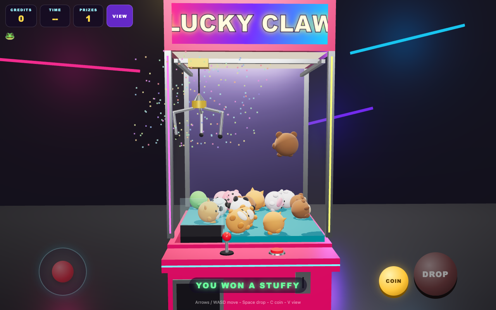
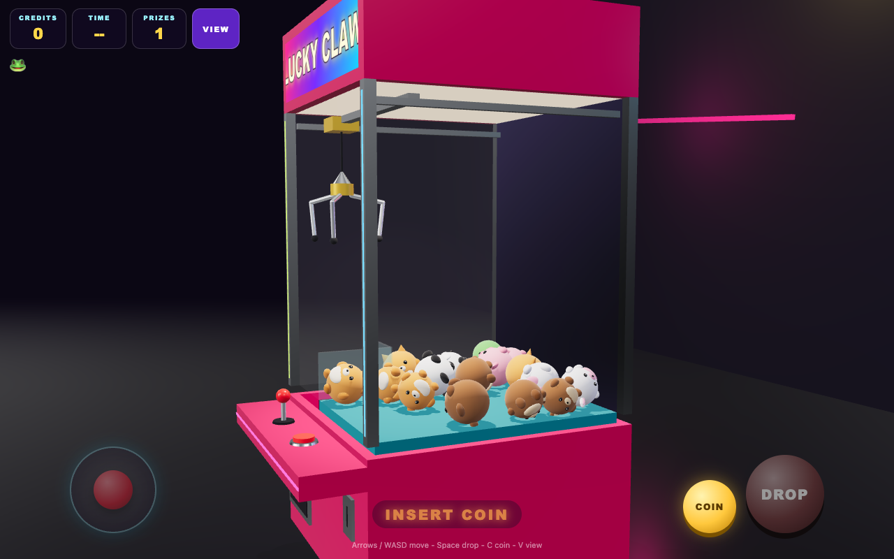

# Lucky Claw - machine-claw-game

A 3D arcade claw machine for the browser. Insert a coin, steer the claw over a pile of plush toys,
drop it and try to carry a stuffy to the prize chute. It runs on desktop and on phones, and every
grab is decided by a real physics simulation: nothing is scripted and nothing is magnetic.



## How it works

1. A coin buys one try and starts a 20 second timer.
2. While the timer runs the player moves the claw left, right, forward and back.
3. DROP (or the timer running out) sends the claw down until it touches a toy or the floor.
4. The three fingers close, the claw lifts, travels back over the chute and opens.
5. A toy that falls through the chute is a prize. A new toy falls in from the top to replace it.
6. The fingers and toys are rigid bodies in Rapier, so a toy is lifted only by contact and friction
   and can slip out on the way, like on a real machine.

## Architecture


* The player uses the React HUD (or the keyboard), which sends input to the engine.
* The engine runs the frame loop: it steps the simulation, draws the scene, plays sounds and
  publishes one HUD snapshot back to React.
* The simulation is headless. It joins the pure round rules with the Rapier arena and has no
  browser dependency, which is why a full round is played inside the test suite.
* The Three.js scene only reads poses from the simulation, it never changes them.

## Features

* Coin and credits - one coin is one try, extra coins are kept as credits, up to 9.
* Real physics grab - kinematic fingers and dynamic toys, so skill and luck both matter.
* Slack sensor - the claw stops on top of a toy instead of pushing through it.
* Eight plush kinds - bear, bunny, cat, panda, frog, chick, koala and pig, built in code.
* Restock - every prize is replaced by a new toy falling from the top.
* Two cameras - front view and a side view to check depth, like leaning around a real cabinet.
* Web and mobile - keyboard on desktop, touch joystick and big buttons on phones, portrait or landscape.
* Arcade feel - animated LEDs, marquee, coin toss, confetti and synthesized sound effects.

## Stack

* TypeScript 7 (strict) - typed rules, typed events, no `any`.
* Bun 1.4 - package manager and test runner.
* Vite 8 - dev server and production build.
* React 19.3 - the HUD overlay only.
* Three.js 0.187 - the 3D scene, lights, shadows and materials.
* Rapier 0.21 - rigid body physics compiled to WASM.

TanStack is in the ts stack but is not used: the game has no routes, server state, forms or tables.

## Contracts

There is no backend and no REST API. The app is one web page.

| Action | Keyboard | Touch / mouse |
|---|---|---|
| Insert coin | `C` | COIN button |
| Move claw | Arrows or `WASD` | Joystick |
| Drop claw | `Space` | DROP button |
| Switch camera | `V` | VIEW button |

## Key data structures and design decisions

* `GameState` and `advance(state, input, sensors, dt)` in `src/game/machine.ts` - the round is a pure
  reducer over seven phases: idle, aiming, descending, closing, lifting, returning, releasing.
* `Sensors` - what physics tells the rules: touching, at top, at home, grip closed, grip open.
* `Arena` in `src/physics/arena.ts` - the Rapier world: cabinet boxes, toy bodies and the claw
  (a hub and three fingers, each finger two capsules and a tip).
* `layout.ts` - cabinet boxes and finger segments declared once and used by physics and rendering,
  so what is drawn is what collides.
* Toys are round with one ball collider. A taller two-ball toy was measured first and the claw
  squeezed it out instead of cupping it.
* Physics steps with the frame time, clamped to 1/30 s, for smooth motion on 60 Hz and 120 Hz screens.
* More detail in `design-doc.md`.

## How to run

```bash
./scripts/setup.sh
./scripts/start-all.sh
./scripts/ui.sh
./scripts/stop-all.sh
```

## How to test

```bash
./scripts/test-all.sh
```

It runs the typecheck, the 15 tests (round rules and headless physics rounds) and the production build.

## Printscreens

### Insert coin

The machine waits for a coin. The claw is parked open over the chute and the pile has settled by physics.

### Aiming

A coin was inserted, the timer is running and the claw was moved over the pile. DROP is lit.

### Lifting

The fingers closed under a frog and the claw is carrying it up. Only contact and friction hold it.

### Prize

The frog fell through the chute: the prize counter is 1, the frog is on the prize shelf, confetti
flies and a new bear is falling in to restock the pile.

### Side view

The VIEW button swings the camera to the side so the player can judge depth.

### Mobile

Portrait phone layout: touch joystick on the left, COIN and DROP on the right.

## Scripts

All scripts live in `scripts/` and run from any directory of the repository.

| Script | What it does |
|---|---|
| `./scripts/setup.sh` | Installs dependencies and prepares the app |
| `./scripts/start-all.sh` | Starts every service and prints the full link of each one |
| `./scripts/status.sh` | Shows every service port as UP or DOWN |
| `./scripts/test-all.sh` | Runs every test suite |
| `./scripts/ui.sh` | Opens the UI in the browser |
| `./scripts/stop-all.sh` | Stops every service |

Ports are declared in `scripts/ports.env`.

```bash
./scripts/setup.sh
./scripts/start-all.sh
./scripts/status.sh
./scripts/ui.sh
./scripts/stop-all.sh
```
