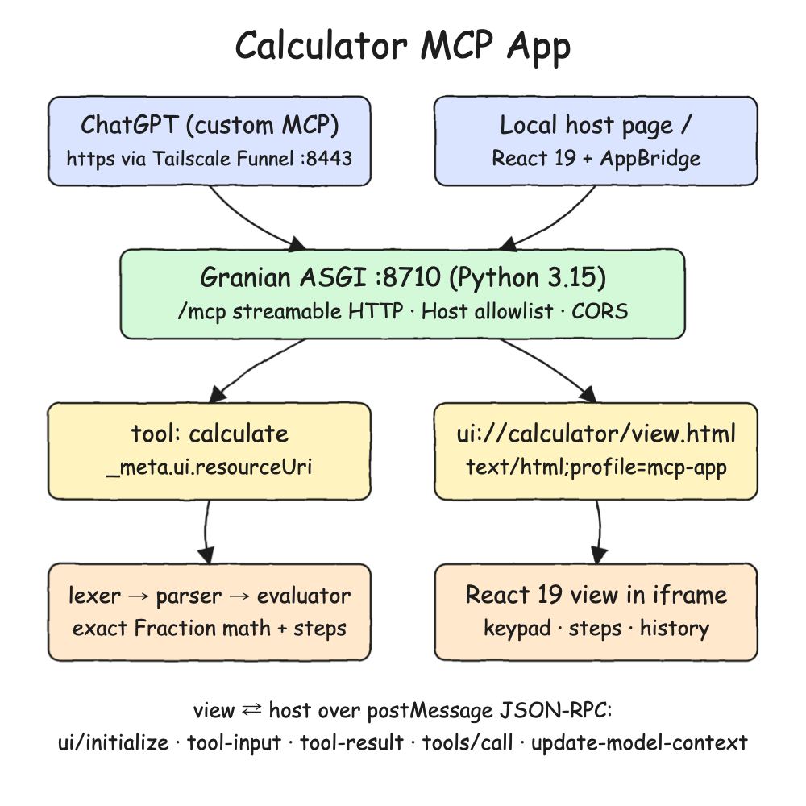
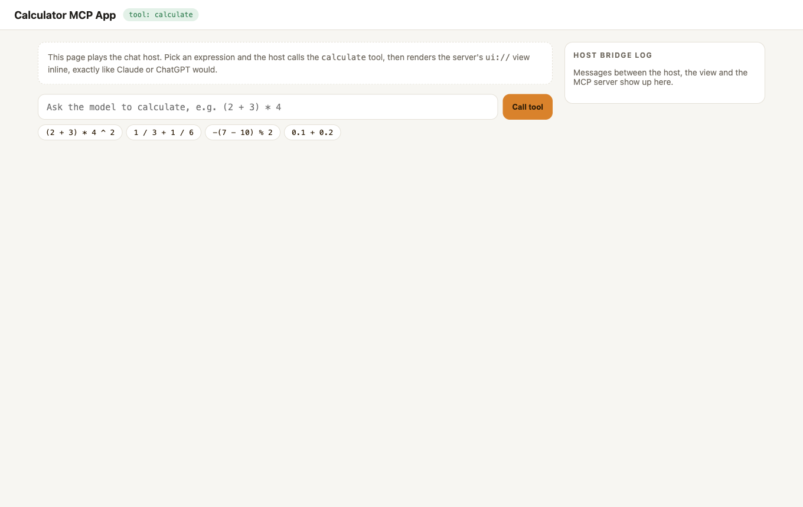
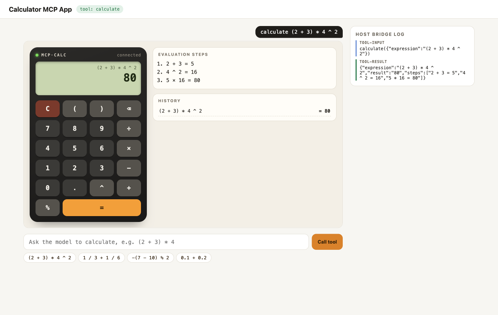
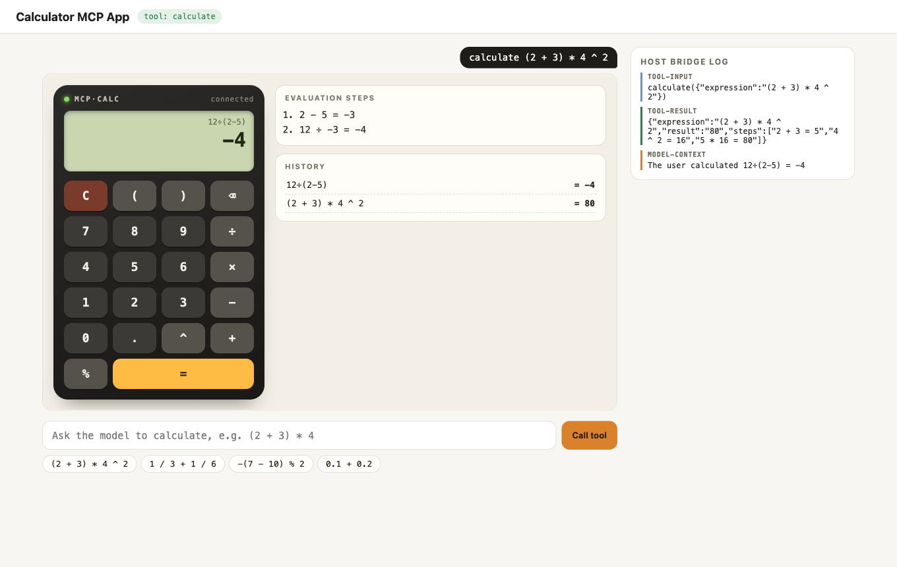
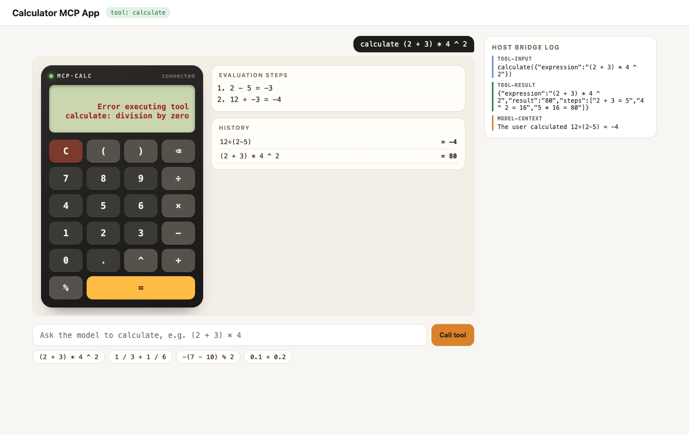

# Calculator MCP App

A visual calculator built as an [MCP App](https://apps.extensions.modelcontextprotocol.io/api/). The MCP server is Python 3.15 on [Granian](https://github.com/emmett-framework/granian). It exposes a `calculate` tool linked to a `ui://` resource, and that resource is a React 19 + TypeScript calculator. When ChatGPT (or any MCP Apps host) calls the tool, it renders the calculator inline in the chat. The keypad then calls the server itself through the host.

## How it Works

1. `tools/list` returns `calculate` with `_meta.ui.resourceUri = ui://calculator/view.html`.
2. The host reads that resource. It is one self-contained HTML file served as `text/html;profile=mcp-app`.
3. The host renders the HTML in a sandboxed iframe and runs the `ui/initialize` handshake over `postMessage`.
4. The host calls `calculate`, then sends `ui/notifications/tool-input` and `ui/notifications/tool-result` to the view.
5. The view shows the result, every evaluation step, and a history.
6. Pressing `=` on the keypad sends `tools/call` from the view, and the host proxies it to the server.
7. After each keypad calculation the view sends `ui/update-model-context`, so the model knows what the user computed.
8. The server evaluates with an exact `Fraction` parser (no `eval`), so `0.1 + 0.2` is `0.3`.

## Architecture



## Features

- **MCP Apps standard UI**: uses `_meta.ui.resourceUri` and `text/html;profile=mcp-app`, so the same view runs in ChatGPT, Claude and any other MCP Apps host.
- **Works as a ChatGPT custom MCP server**: Tailscale Funnel gives the local server a public HTTPS URL, and nothing is deployed.
- **Two-way app**: the model calls the tool to open the calculator, and the user's keypad calls the same tool back through the host.
- **Model context updates**: keypad results reach the model through `ui/update-model-context`.
- **Evaluation steps**: the server returns each binary operation in evaluation order, so precedence is visible.
- **Exact arithmetic**: decimals are parsed as `Fraction`, so totals do not drift.
- **Safe parser**: a hand-written lexer and precedence-climbing parser. Anything that is not arithmetic is rejected with a position.
- **Graceful errors**: division by zero or bad input comes back as a tool error and shows on the LCD.
- **Local host page**: `/` acts as a chat host with a bridge log, so you can see the whole protocol without ChatGPT.
- **Auto-resize**: the view reports `ui/notifications/size-changed`, and the host resizes the iframe.

## Stack

- **Python 3.15**: the backend runtime, with `type` aliases, `match` and `TypedDict` structured output.
- **Granian 2.8**: Rust ASGI server running the Starlette app that the MCP SDK builds.
- **mcp 2.3 (Python SDK)**: `MCPServer` plus the built-in `mcp.server.apps.Apps` extension for MCP Apps.
- **ty**: type checks `src` and `tests`.
- **pytest**: unit, MCP in-process and HTTP tests.
- **uv**: Python environment and lock file.
- **React 19 + TypeScript 7**: the calculator view and the local host page.
- **@modelcontextprotocol/ext-apps 2.0**: `useApp` in the view, and `AppBridge` + `PostMessageTransport` in the host.
- **@modelcontextprotocol/client 2.3**: the host's streamable HTTP MCP client.
- **Vite 8 + vite-plugin-singlefile**: bundles each page into one HTML file, because an MCP App resource is a single document.
- **bun**: installs packages and runs the frontend tests.
- **Tailscale Funnel**: public HTTPS for ChatGPT, on its own port 8443.

## Contracts / APIs

| Endpoint | What |
|---|---|
| `POST /mcp` | MCP streamable HTTP endpoint |
| `GET /` | Local MCP Apps host page |
| `GET /health` | `{"status": "UP"}` |

Tool `calculate`:

```json
{
  "name": "calculate",
  "inputSchema": { "type": "object", "properties": { "expression": { "type": "string" } }, "required": ["expression"] },
  "_meta": { "ui": { "resourceUri": "ui://calculator/view.html", "visibility": ["model", "app"] } }
}
```

Result `structuredContent`:

```json
{ "expression": "(2 + 3) * 4 ^ 2", "result": "80", "steps": ["2 + 3 = 5", "4 ^ 2 = 16", "5 * 16 = 80"] }
```

Supported syntax: numbers with decimals, `+ - * / % ^`, parentheses, and unary minus. The aliases `× ÷ − x` are also accepted. `^` is right-associative and needs a whole-number exponent between -1000 and 1000.

Resource `ui://calculator/view.html`: `text/html;profile=mcp-app`, with `_meta.ui.prefersBorder = true`.

## Key Design Decisions

- **Native SDK Apps extension**: `Apps.tool(resource_uri=...)` stamps `_meta.ui` and checks at startup that the resource exists. That way the protocol is not hand-rolled.
- **The resource is a `FileResource`**: the HTML is read from `frontend/dist/view.html` on every `resources/read`, so a rebuild shows up without restarting the server. Tests pass in a temporary folder.
- **AST, then evaluator**: `tokens.py`, `parser.py` (frozen dataclasses `Number`, `Negate`, `Binary`) and `evaluator.py` are separate. The steps tape falls out of the post-order walk.
- **Pure keypad logic**: `keypad.ts` has no React, so its rules are unit tested. Those rules are: no dangling operators, one dot per number, and a leading `.` becomes `0.`.
- **Host allowlist plus CORS**: DNS-rebinding protection allows only localhost and `MCP_PUBLIC_HOST`. CORS allows only local origins and exposes `mcp-session-id`.
- **Funnel on 8443**: port 443 may already carry other tailnet services. Using 8443 publishes only this app.

## How to Run

```bash
./scripts/setup.sh
./scripts/start-all.sh
./scripts/ui.sh
./scripts/test-all.sh
./scripts/stop-all.sh
```

Tests: 39 backend (pytest) plus 16 frontend (bun test). `ty` and `tsc` also run.

## ChatGPT Step by Step

1. Install Tailscale, sign in, and check that `tailscale status` works. Funnel is included in the free Personal plan.
2. Run `./scripts/funnel.sh on`. It reads your MagicDNS name and writes it to the gitignored `scripts/tailscale.env` as `MCP_PUBLIC_HOST`. It then opens Funnel on 8443, restarts the server with that host allowed, and prints the URL. On the first run, Tailscale asks you to approve Funnel in the admin console.
3. In ChatGPT, go to **Plugins > + > Add custom MCP server** and use `https://<your-mac>.<your-tailnet>.ts.net:8443/mcp` with no authentication.
4. Check that the `calculate` tool is discovered, then ask: *"use the calculator to compute (2 + 3) * 4 ^ 2"*. ChatGPT renders the calculator inline, and the keypad works inside the chat.
5. When you are done, run `./scripts/funnel.sh off`.

| Symptom | Fix |
|---|---|
| `Failed to fetch` | ChatGPT cannot reach `localhost`. Use the Funnel URL. |
| `Couldn't reach the MCP server` | Public DNS has no record for the Funnel host yet. `dig +short @1.1.1.1 <your-mac>.<your-tailnet>.ts.net` must print an IP. Tailscale says this can take up to 10 minutes. Retry once it resolves. |
| `421 Misdirected Request` in `.run/logs/calculator.log` | `MCP_PUBLIC_HOST` is missing. Run `./scripts/funnel.sh on` again. |
| ChatGPT times out | `./scripts/status.sh` shows `funnel DOWN` or `calculator DOWN`. |

Funnel is public, so anyone with the URL can call `calculate`. That is fine for a calculator, but add authentication before you expose tools that touch files or data.

## Printscreens

### Host ready



The local host page connected over MCP, listed the tools, found `calculate` with its `ui://` resource, and is waiting for a prompt.

### Tool call renders the app



The host called `calculate("(2 + 3) * 4 ^ 2")` and rendered the React view in a sandboxed iframe. The view received `tool-input` and `tool-result` and shows `80` with the three evaluation steps. The bridge log shows both notifications.

### Keypad calls the server



The user typed `12÷(2−5)=` on the keypad. The view sent `tools/call` through the host, got `-4` with its steps, added it to the history, and sent `ui/update-model-context` (the orange `model-context` entry in the log).

### Error from the server



`1 ÷ 0` comes back from the server as a tool error, and the LCD shows the reason instead of a stale number.

## Scripts

All scripts live in `scripts/` and run from any directory of the repository.

| Script | What it does |
|---|---|
| `./scripts/setup.sh` | Installs dependencies and builds the view and host pages |
| `./scripts/start-all.sh` | Starts Granian and prints the full link of each endpoint |
| `./scripts/status.sh` | Shows the calculator and funnel ports as UP or DOWN |
| `./scripts/test-all.sh` | Runs ty, pytest, tsc and bun test |
| `./scripts/ui.sh` | Opens the local host page in the browser |
| `./scripts/funnel.sh on\|off` | Opens or closes the Tailscale Funnel for ChatGPT |
| `./scripts/stop-all.sh` | Stops every service |

Ports are declared in `scripts/ports.env` (`calculator=8710`, `funnel=8443`).

```bash
./scripts/setup.sh
./scripts/start-all.sh
./scripts/status.sh
./scripts/ui.sh
./scripts/stop-all.sh
```
