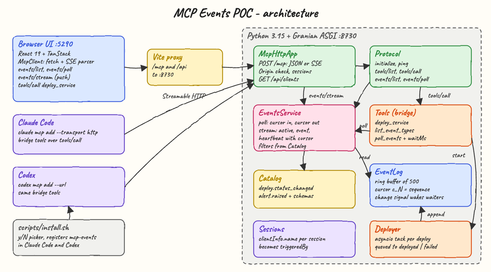
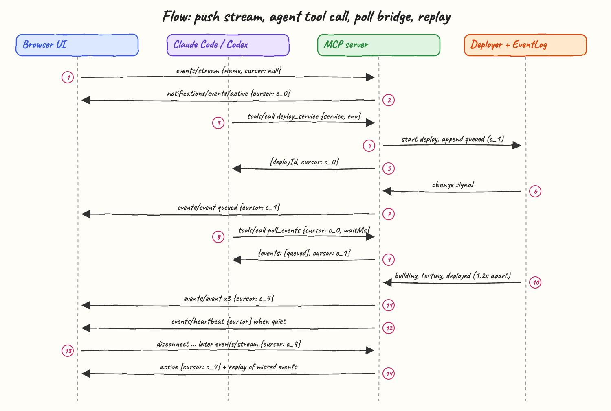
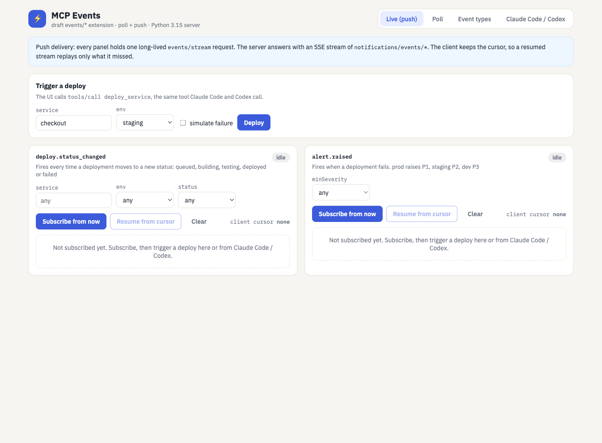
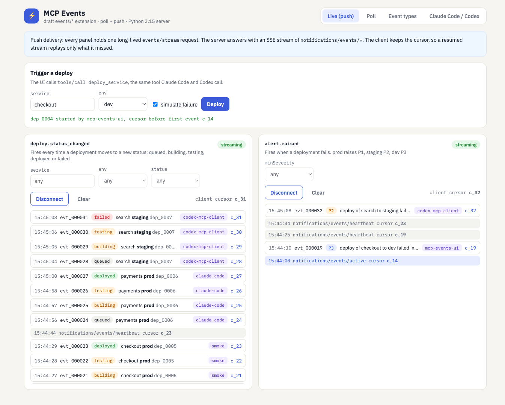
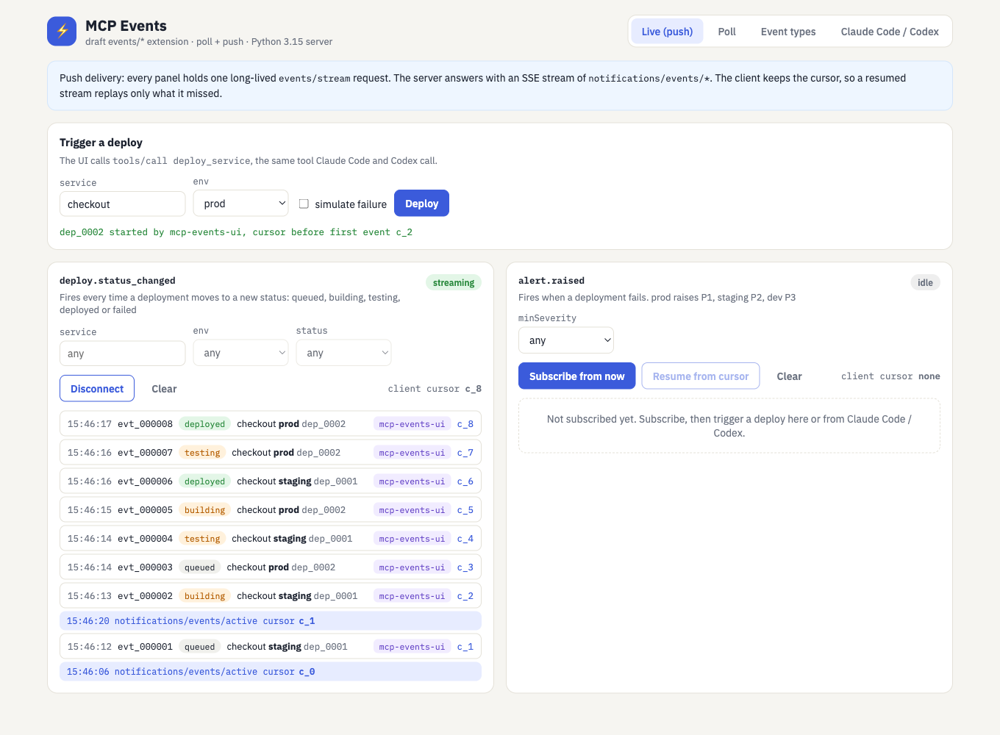
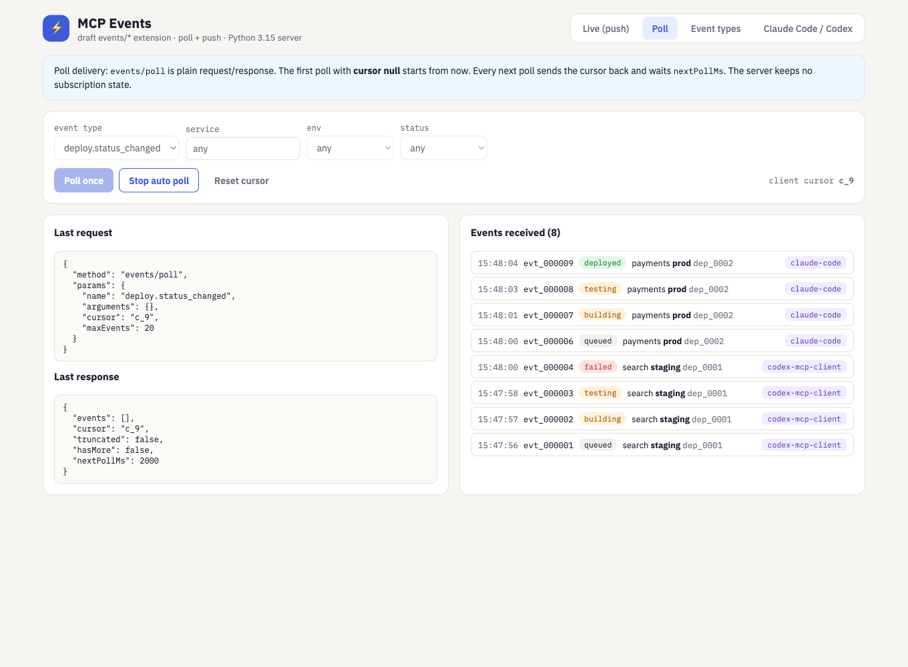
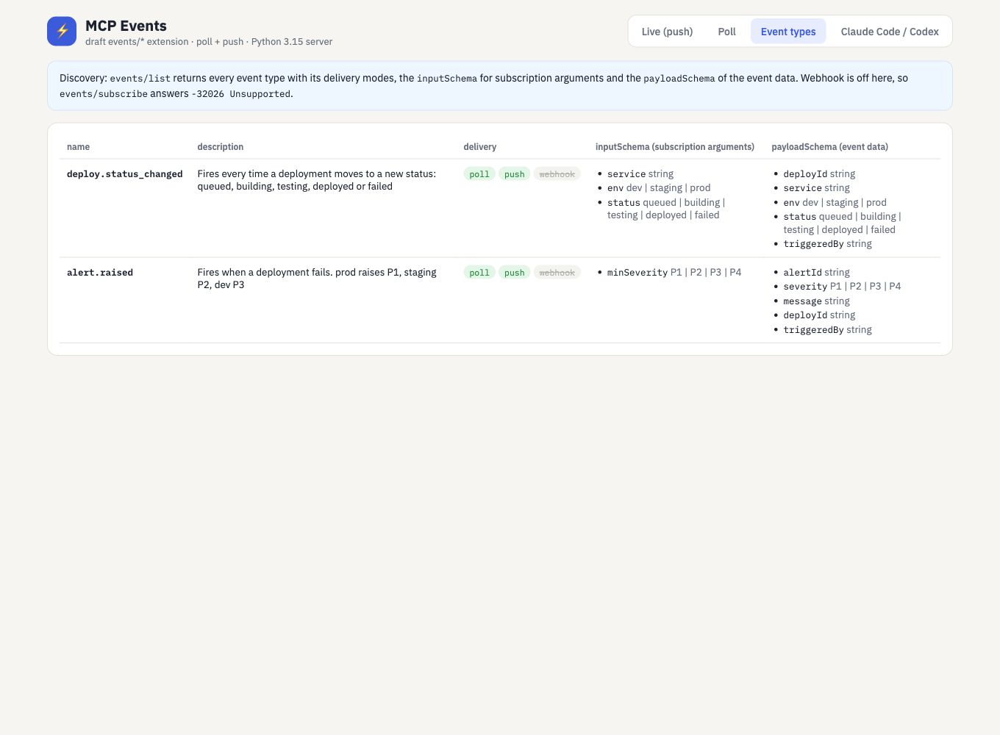
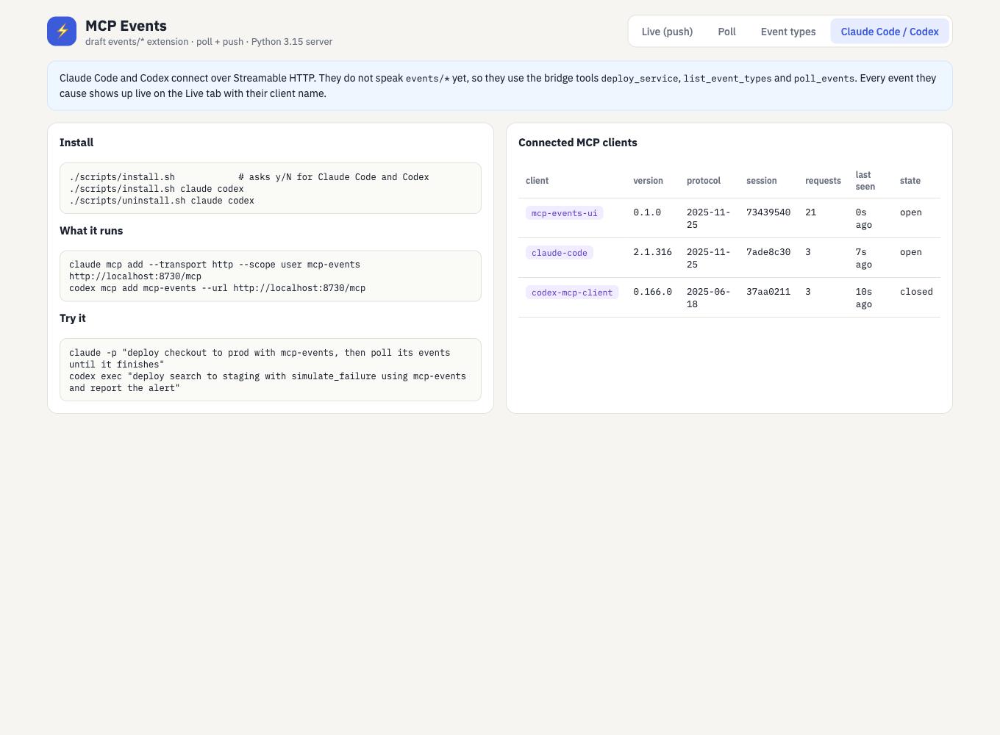

# MCP Events (Python 3.15 + TypeScript)

A working POC of the **MCP Events** extension that the MCP
[Tasks and Events Working Group](https://modelcontextprotocol.io/community/working-groups/tasks-events) is designing.
A Python 3.15 MCP server (Granian, no MCP SDK) implements the draft `events/*` methods: `events/list`,
`events/poll` (poll delivery) and `events/stream` (push delivery over SSE), with cursors, replay, heartbeats and the draft
error codes. The domain is a small deploy pipeline. A deploy emits `deploy.status_changed` events, and a failed deploy also emits `alert.raised`.

A React + TypeScript UI is a raw MCP client that subscribes to those events live. **Claude Code** and **Codex** connect to the same
server through `./scripts/install.sh`. Every event they cause shows up in the UI in real time, tagged with the client that triggered it.

## How it works

1. The server announces `capabilities.events` in `initialize`, and `events/list` describes each event type (delivery modes, `inputSchema`, `payloadSchema`).
2. Every event is appended to an in-memory `EventLog`. Its sequence number is the opaque cursor (`c_N`).
3. **Poll:** the client sends `{name, arguments, cursor}` and gets back `{events, cursor, truncated, hasMore, nextPollMs}`. The server keeps no state.
4. **Push:** the client opens one long-lived `events/stream` POST per subscription. The server answers with an SSE stream of
   `notifications/events/active`, then `notifications/events/event` for every match, and a `notifications/events/heartbeat` carrying the cursor when quiet.
5. The client owns the cursor. Reconnecting with it replays only what was missed. `eventId` lets the client drop duplicates.
6. Claude Code and Codex do not speak `events/*` yet, so they call bridge tools: `deploy_service` returns a cursor, and
   `poll_events` is `events/poll` behind `tools/call` (plus `waitMs` so the agent does not busy loop).
7. Every MCP session stores `clientInfo.name`. That name becomes `triggeredBy` in each event, so the UI shows who did what.

## What are MCP Events?

Today an MCP server can only answer when it is asked (`tools/call`, `resources/read`). A few narrow notifications exist
(`notifications/resources/updated`, `*/list_changed`), but they only work while a connection is held open, carry no payload, have no
filter and no resume. **MCP Events** is a new primitive that lets a client *subscribe to things happening in an upstream system* (a new
email, a GitHub push, a PagerDuty incident, a deploy finishing), so an agent can react without a human prompting it.

The working group's draft ([design sketch](https://github.com/modelcontextprotocol/experimental-ext-triggers-events/blob/main/docs/design-sketch-proposal.md),
status *draft*, SEP "Events in MCP v1" in ideation) defines:

| Piece | What it is |
|---|---|
| `events/list` | Discovery. Each event type has a `name`, `description`, `delivery` (any subset of `poll`, `push`, `webhook`), an `inputSchema` for subscription arguments (filters) and a `payloadSchema` for the event `data`. |
| `EventOccurrence` | `{eventId, name, timestamp, data, cursor?}`. `eventId` is for client-side dedup. |
| Cursor | Opaque, server-defined position. The **client** persists it and sends it back. `null` means "start from now". `maxAgeMs` bounds how far back replay goes. `truncated: true` says events were skipped. |
| Poll delivery | `events/poll {name, arguments, cursor}` returns `{events[], cursor, truncated, hasMore, nextPollMs}`. Stateless on the server. |
| Push delivery | `events/stream`: a long-lived JSON-RPC request answered with an SSE stream of `notifications/events/active`, `event`, `heartbeat`, `error` and `terminated`, routed by `_meta["io.modelcontextprotocol/subscriptionId"]`. |
| Webhook delivery | `events/subscribe` registers an `https` callback plus a client `whsec_` secret. Deliveries are signed per Standard Webhooks. The TTL is negotiated with `ttlMs` / `refreshBefore`, and `events/unsubscribe` cleans up early. |
| Errors | `-32602` InvalidParams, `-32023` NotFound, `-32024` Forbidden, `-32025` ResourceExhausted, `-32026` Unsupported, `-32027` CallbackEndpointError. |

### How this POC maps to the draft

| Draft feature | This POC |
|---|---|
| `capabilities.events` | yes |
| `events/list` | yes, two event types |
| `events/poll` with `cursor`, `maxAgeMs`, `maxEvents`, `hasMore`, `truncated`, `nextPollMs` | yes |
| `events/stream` with `active`, `event`, `heartbeat` (cursor in every frame), `_meta.subscriptionId` | yes |
| Replay from cursor and `truncated` on evicted events | yes (ring buffer of 500) |
| `events/subscribe` / `events/unsubscribe` (webhook) | **not built**: answers `-32026 Unsupported` (`deliveryMode: webhook`) |
| `notifications/events/list_changed`, `error`, `terminated` | **not built**: the catalog is static and the upstream cannot fail |

### Pros

* **Agents become reactive.** An event wakes the agent, so it does not have to keep calling tools to ask "is it done yet?".
* **Filtering happens on the server.** `inputSchema` arguments (`env=prod`, `minSeverity=P2`) cut the stream down before it reaches the LLM.
* **Resumable.** Client-owned cursors plus `eventId` dedup give at-least-once delivery when the upstream is durable.
* **Works in any topology.** Poll works everywhere (even serverless), push suits local and stdio, and webhook suits remote servers with no held connection.
* **Same mental model as tools.** `inputSchema` + `arguments` mirrors `tools/list` + `tools/call`.

### Cons

* **About three times the protocol surface.** Three delivery modes mean two cursor placements, two subscription lifecycles, and more SDK and test work.
* **No ordering or exactly-once guarantee** at the protocol level. Clients must tolerate duplicates and out-of-order webhook deliveries.
* **Push holds a connection per subscription.** On HTTP/1.1 that is one TCP socket each, so many subscriptions effectively need HTTP/2.
* **Webhook is the hard part:** SSRF hardening, endpoint verification, HMAC secrets and TTL refresh.
* **Payloads are untrusted input.** Event data reaches the LLM, so prompt-injection rules apply just like for tool results.
* **Draft only.** No host ships it yet. Claude Code and Codex need a bridge (here `poll_events`), and the method names can still change.

## Architecture



* **Browser UI**: React 19 with TanStack. `McpClient` speaks raw JSON-RPC over `fetch`, parses SSE frames itself, and keeps the cursor per subscription.
* **Vite proxy**: forwards `/mcp` and `/api` to the backend, so the browser stays same-origin.
* **McpHttpApp**: a plain ASGI app. `POST /mcp` answers JSON, except `events/stream`, which answers `text/event-stream`. It rejects non-localhost `Origin` headers to block DNS rebinding.
* **Protocol**: `initialize`, `ping`, `tools/*` and `events/*` dispatch.
* **EventsService**: poll and stream logic on top of `EventLog`, with filters built from the `Catalog` `inputSchema`.
* **EventLog**: an append-only ring buffer. A sequence number is the cursor, and an `asyncio.Event` swaps on every append to wake waiting streams and polls.
* **Deployer**: one asyncio task per deploy that walks `queued → building → testing → deployed | failed` and raises an alert on failure.
* **Sessions**: `Mcp-Session-Id` mapped to `clientInfo.name`, exposed at `GET /api/clients` for the UI.

## Flow



1. The UI opens a push subscription with `events/stream {name: deploy.status_changed, cursor: null}` (start from now).
2. The server confirms with `notifications/events/active {cursor: c_0}`.
3. Claude Code (or Codex) calls `tools/call deploy_service`.
4. The `Deployer` appends `queued` to the `EventLog` (`c_1`) and starts an asyncio task.
5. The tool returns `{deployId, cursor: c_0}`: the position *before* the first event, so the agent cannot miss it.
6. The append swaps the `EventLog` change signal, which wakes every waiting stream and long poll.
7. The UI stream receives `notifications/events/event` for `queued`, with `cursor: c_1`.
8. The agent calls `poll_events {cursor: c_0, waitMs}`, the `events/poll` bridge.
9. The agent gets `{events: [queued], cursor: c_1}` and keeps the new cursor for its next call.
10. The `Deployer` appends `building`, `testing`, `deployed` (or `failed` plus `alert.raised`) 1.2 s apart.
11. Each one is pushed to the UI as it happens. The agent picks them up on its next poll.
12. When nothing happens, the stream sends `notifications/events/heartbeat {cursor}` (every 15 s by default), so the client cursor keeps advancing.
13. The UI disconnects, more events happen, and the UI reconnects with `events/stream {cursor: c_4}`.
14. The server sends `active {cursor: c_4}` and replays exactly the missed events, then keeps streaming.

## Features

* **Poll delivery** (`events/poll`): stateless, cursor in and cursor out, `hasMore` drains a backlog, and `nextPollMs` sets the pace.
* **Push delivery** (`events/stream` over SSE): one stream per subscription, with heartbeats carrying the cursor.
* **Replay from cursor**: reconnecting with the last cursor delivers only what was missed. Evicted or too-old events set `truncated: true`.
* **Server-side filters**: `service`, `env` and `status` for deploys, and `minSeverity` for alerts, all validated against the `inputSchema`.
* **Draft error codes**: unknown event `-32023`, bad arguments or cursor `-32602`, webhook `-32026`.
* **Claude Code and Codex support**: an `install.sh` with a y/N picker, plus bridge tools so agents can use events today.
* **`waitMs` long poll** in the bridge tool, so an agent waits for the next event instead of looping.
* **Client attribution**: every event carries the `triggeredBy` MCP client, and the UI lists the connected sessions.
* **Duplicate drop in the UI** by `eventId`, as the draft recommends.

## Stack

* **Python 3.15**: the backend language, per the python stack.
* **uv**: dependency and venv management.
* **Granian**: a Rust ASGI server. It streams SSE without buffering.
* **ty**: the type checker for `src` and `tests`.
* **No MCP SDK**: the SDKs do not ship `events/*` yet, and a small hand-written JSON-RPC layer keeps the protocol visible. The only runtime dependency is `granian`.
* **pytest**: backend tests that drive the ASGI app in-process, SSE streams included.
* **TypeScript 7 + Vite 8 + React 19.3**: the UI.
* **TanStack Router, Query, Table and Form**: tabs, `events/list` caching, the event types table and the deploy form.
* **Bun**: package manager and `bun test`.

## Contracts / APIs

The `/mcp` endpoint speaks JSON-RPC 2.0 over Streamable HTTP and returns `Mcp-Session-Id` on `initialize`.

| Method | Params | Result |
|---|---|---|
| `initialize` | `protocolVersion`, `clientInfo` | `capabilities: {tools, events}`, `serverInfo`, `instructions` |
| `tools/list` | | `deploy_service`, `list_event_types`, `poll_events` |
| `tools/call deploy_service` | `service`, `env` (`dev`/`staging`/`prod`), `simulate_failure?` | `{deployId, service, env, triggeredBy, cursor}` |
| `tools/call poll_events` | `name`, `arguments?`, `cursor?`, `maxEvents?`, `waitMs?` (max 30000) | same as `events/poll` |
| `events/list` | | `{events: [EventDescriptor]}` |
| `events/poll` | `name`, `arguments?`, `cursor?`, `maxAgeMs?`, `maxEvents?` | `{events, cursor, truncated, hasMore, nextPollMs}` |
| `events/stream` | `name`, `arguments?`, `cursor?`, `maxAgeMs?` | SSE: `notifications/events/active`, `event`, `heartbeat` |
| `events/subscribe`, `events/unsubscribe` | | error `-32026 Unsupported` |

```json
{"jsonrpc":"2.0","method":"notifications/events/event","params":{
  "eventId":"evt_000002","name":"deploy.status_changed","timestamp":"2026-11-02T23:38:05.600809Z",
  "data":{"deployId":"dep_0001","service":"checkout","env":"prod","status":"building","triggeredBy":"claude-code"},
  "cursor":"c_2","_meta":{"io.modelcontextprotocol/subscriptionId":9}}}
```

| Event type | Arguments (`inputSchema`) | Data (`payloadSchema`) |
|---|---|---|
| `deploy.status_changed` | `service?`, `env?`, `status?` | `deployId`, `service`, `env`, `status`, `triggeredBy` |
| `alert.raised` | `minSeverity?` (`P1` is the most urgent) | `alertId`, `severity` (prod P1, staging P2, dev P3), `message`, `deployId`, `triggeredBy` |

Plain HTTP routes: `GET /health` and `GET /api/clients` (the MCP sessions seen, for the UI).

## Key data structures and design decisions

* **`EventLog`** (`backend/src/mcp_events/event_log.py`): a `deque(maxlen=500)` of frozen `EventOccurrence` plus a monotonic `head`.
  `read(after, accept, limit, not_before)` returns events, the new position, `truncated` and `has_more`. The position also advances past non-matching events, so a quiet filtered subscription never holds a stale cursor.
* **Cursor = sequence number** encoded as `c_N` (`cursors.py`). It is opaque to clients. A cursor ahead of `head` (for example after a server restart) is clamped to now with `truncated: true` instead of failing.
* **Change signal**: `EventLog` swaps a fresh `asyncio.Event` on every append. Streams and `waitMs` polls grab the current signal *synchronously, before awaiting*, so an append between read and wait is never missed.
* **On replay, `active` carries the start position**, not the end of the backlog. A client that persists it and crashes mid-replay will not skip events.
* **`deploy_service` returns the cursor taken before the first event**, so an agent can poll from there and see the full lifecycle.
* **Client-owned state**: the server keeps no subscription for poll, and push state lives only as long as the request. This matches the draft.
* **Single Granian worker**: the event log is in memory, so all clients must hit the same process. Durable storage is out of scope.
* **Bridge tools rather than host changes**: Claude Code and Codex reach the event model through `tools/call` today. The real `events/*` path is shown by the UI.

## How to run

Requirements: `uv`, Python 3.15 (installed by uv), `bun`, and optionally the `claude` and `codex` CLIs.

```bash
./scripts/setup.sh
./scripts/start-all.sh
./scripts/ui.sh
./scripts/test-all.sh
./scripts/stop-all.sh
```

`test-all.sh` runs `ty`, 22 pytest tests, `tsc` and 6 `bun test` tests.

### Use it from Claude Code and Codex

```bash
./scripts/install.sh                 # asks y/N for Claude Code and for Codex
./scripts/install.sh claude codex    # or without the picker
./scripts/uninstall.sh claude codex
```

`install.sh` runs `claude mcp add --transport http --scope user mcp-events http://localhost:8730/mcp` and
`codex mcp add mcp-events --url http://localhost:8730/mcp`. It is idempotent (remove, then add).

Keep the UI open on the **Live** tab, subscribe to both streams, then run:

```bash
claude -p "Use the mcp-events MCP server. Deploy the service payments to prod with deploy_service. Then call poll_events for deploy.status_changed with the cursor it returned and waitMs 5000, keep the newest cursor and repeat until the status is deployed or failed." \
  --allowedTools "mcp__mcp-events__deploy_service,mcp__mcp-events__poll_events"

codex exec "Use the mcp-events MCP server tools only. Call deploy_service with service search, env staging and simulate_failure true. Then call poll_events for alert.raised with the cursor deploy_service returned and waitMs 10000, repeating with the newest cursor until you get an alert. Reply with the alert severity and message."
```

Captured answers from those runs:

```
Claude Code: The payments service deployed to prod successfully. Its deploy id is dep_0006.
             Statuses, in order: queued, building, testing, deployed. Newest cursor c_27.
Codex:       Severity: P2
             Message: deploy of search to staging failed in testing
```

## Printscreens

### 1. Live tab, before subscribing



The UI already called `events/list`, which builds one push panel per event type that supports `push`. Its filter fields come from each
`inputSchema` (enums become selects). The deploy form at the top calls `tools/call deploy_service`, the same tool the agents use.

### 2. Live events from Claude Code, Codex and the UI



Both panels hold an open `events/stream`. The left one shows the `payments → prod` lifecycle triggered by `claude-code` and the failing
`search → staging` deploy triggered by `codex-mcp-client`. The right one shows the `P2` alert Codex caused and a `P3` alert from the UI.
Every row shows its `eventId`, status and per-event cursor, and the grey rows are heartbeats carrying the cursor during quiet time.

### 3. Resume from cursor: replay



The deploy stream was disconnected after `c_1`, and a second deploy ran while it was offline. **Resume from cursor** reopened
`events/stream` with `cursor: c_1`. The server answered `active {cursor: c_1}` and replayed `c_2` to `c_8` (both deploys interleaved, in
order), then went back to live delivery.

### 4. Poll tab



Auto poll runs `events/poll` every `nextPollMs` (2000 ms, with a 1000 ms client floor) and sends the last cursor back each time. On the left are
the exact last request and response (an empty batch, still with a cursor). On the right are the events collected while Claude Code and Codex deployed.

### 5. Event types tab



The `events/list` result in a TanStack Table: delivery modes (webhook crossed out, because it is not offered), subscription arguments and payload fields.

### 6. Claude Code / Codex tab



Install commands, and the MCP sessions the server has seen, from `GET /api/clients`. `claude-code` 2.1.316 negotiated protocol `2025-11-25` and
`codex-mcp-client` 0.166.0 negotiated `2025-06-18`. Codex ends its session with `DELETE /mcp`, so it shows as `closed`.

## Scripts

All scripts live in `scripts/` and run from any directory of the repository.

| Script | What it does |
|---|---|
| `./scripts/setup.sh` | Installs dependencies and prepares the app |
| `./scripts/start-all.sh` | Starts every service and prints the full link of each one |
| `./scripts/status.sh` | Shows every service port as UP or DOWN |
| `./scripts/test-all.sh` | Runs every test suite |
| `./scripts/ui.sh` | Opens the UI in the browser |
| `./scripts/stop-all.sh` | Stops every service |
| `./scripts/install.sh` | Registers the MCP server in Claude Code and/or Codex (y/N picker or `claude` / `codex` args) |
| `./scripts/uninstall.sh` | Removes the MCP server from Claude Code and/or Codex |

Ports are declared in `scripts/ports.env` (`backend=8730`, `ui=5290`). The Vite config reads the same file.

```bash
./scripts/setup.sh
./scripts/start-all.sh
./scripts/status.sh
./scripts/ui.sh
./scripts/stop-all.sh
```
