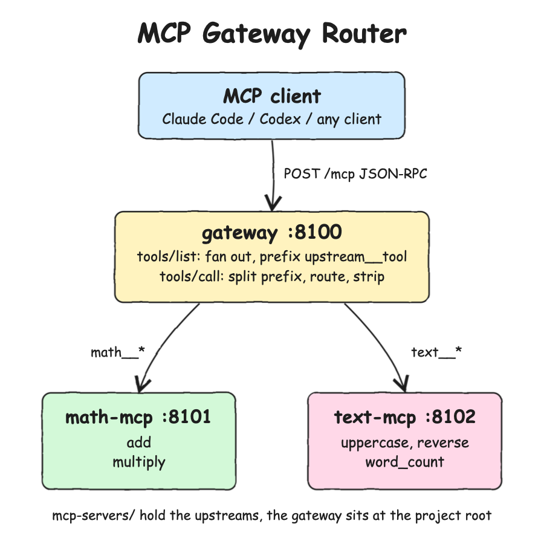

# MCP Server Gateway Router POC

One MCP server that acts as a gateway and router in front of two other MCP servers. An MCP client such as Claude Code or Codex is configured with the gateway only. The gateway shows the tools of every upstream as one catalog and forwards each tool call to the upstream that owns it.

* `mcp-servers/math-mcp`: upstream MCP with `add` and `multiply`.
* `mcp-servers/text-mcp`: upstream MCP with `uppercase`, `reverse` and `word_count`.
* `gateway.js` + `router.js` (project root): the gateway and router MCP.

## How it Works

1. The client sends JSON-RPC `initialize` to the gateway at `POST /mcp`, and the gateway answers as a tools server.
2. On `tools/list` the gateway calls `tools/list` on every upstream in parallel.
3. Each upstream tool gets its upstream name as a prefix, `<upstream>__<tool>`, for example `math__add` or `text__word_count`.
4. On `tools/call` the gateway splits the name at the first `__`, finds the upstream, removes the prefix and forwards the call.
5. The upstream result (including `isError` tool errors) goes back to the client unchanged.
6. An upstream that is down drops out of `tools/list`, and a call to it returns a JSON-RPC error naming the unreachable URL.
7. The upstreams are plain MCP servers. They know nothing about the gateway and can be used directly.

## Architecture



## Features

* **Single entry point**: clients register one MCP server, and new upstreams need no client change.
* **Tool namespacing**: the `<upstream>__<tool>` names keep two upstreams with the same tool name from colliding.
* **Prefix routing**: routing is decided by the tool name alone, with no lookup table to keep in sync.
* **Graceful listing, loud calls**: one dead upstream does not hide the others, but calling it fails clearly.
* **Config by env**: `UPSTREAMS=math=http://localhost:8101/mcp,text=http://localhost:8102/mcp`.
* **Zero dependencies**: only Node built-ins, so there is nothing to install and no SDK drift.

## Stack

* **Node.js 24**: built-in `fetch`, `node:http`, `node:test` and `import.meta.main` cover everything.
* **MCP Streamable HTTP (JSON response mode)**: the simplest spec transport that HTTP MCP clients can call and that `fetch` can reach.
* **JSON-RPC 2.0**: the MCP wire format, implemented by hand in `lib/`.
* **node:test**: the built-in test runner, so no test framework is needed.

## Contracts / APIs

All three servers expose the same two endpoints.

| Server | Method | Path | Purpose |
|---|---|---|---|
| gateway :8100 | POST | `/mcp` | `initialize`, `ping`, `tools/list` (aggregated), `tools/call` (routed) |
| math-mcp :8101 | POST | `/mcp` | `initialize`, `ping`, `tools/list`, `tools/call` |
| text-mcp :8102 | POST | `/mcp` | `initialize`, `ping`, `tools/list`, `tools/call` |
| all | GET | `/health` | `{"status":"UP"}` |

Tools exposed by the gateway:

| Tool | Routed to | Arguments |
|---|---|---|
| `math__add` | math-mcp `add` | `{ "a": number, "b": number }` |
| `math__multiply` | math-mcp `multiply` | `{ "a": number, "b": number }` |
| `text__uppercase` | text-mcp `uppercase` | `{ "text": string }` |
| `text__reverse` | text-mcp `reverse` | `{ "text": string }` |
| `text__word_count` | text-mcp `word_count` | `{ "text": string }` |

Call through the gateway:

```json
{"jsonrpc":"2.0","id":2,"method":"tools/call","params":{"name":"math__multiply","arguments":{"a":6,"b":7}}}
```

```json
{"jsonrpc":"2.0","id":2,"result":{"content":[{"type":"text","text":"42"}]}}
```

Error codes: `-32601` unknown method, `-32602` unknown tool or upstream, `-32603` upstream unreachable, `-32700` parse error. Notifications such as `notifications/initialized` get `202 Accepted` with no body.

## Key Data Structures and Design Decisions

* **Tool registry** (`lib/mcp-server.js`): a `Map` from tool name to `{ name, description, inputSchema, handler }`. Handler errors become `isError: true` tool results, so the model can see them and correct itself.
* **Dispatcher**: a table from method name to function. The gateway and the upstreams use the same dispatcher and differ only in their `listTools` and `callTool`.
* **Router** (`router.js`): a `Map` from upstream name to URL. `listTools` uses `Promise.allSettled` so one failure does not fail the whole list.
* **Separator `__`**: MCP tool names allow `[A-Za-z0-9_-]`, and single `_` is common (`word_count`), so the gateway splits on the first `__` and rejects upstream names that contain it.
* **Stateless**: no `Mcp-Session-Id`, no SSE. Every request stands alone, which keeps the gateway trivially horizontally scalable.
* **Trade-offs**: one extra hop per call, the gateway is a single point of failure, `tools/list` is not cached, and only the tools part of MCP is implemented. See `design-doc.md`.

## MCP Gateway Router Discovery of MCPs

The gateway finds its upstream MCPs from configuration read once at startup. It finds their tools by asking each upstream on every `tools/list`. There is no service registry and no file scanning.

### Where the upstream MCPs are

1. Ports are declared in `scripts/ports.env`:
   ```
   math=8101
   text=8102
   gateway=8100
   ```
2. `scripts/start-all.sh` builds the `UPSTREAMS` env var from those ports when it starts the gateway:
   ```bash
   start_service gateway env UPSTREAMS="math=$(service_url math),text=$(service_url text)" node gateway.js
   ```
   `service_url` in `scripts/common.sh` turns a name into a URL, so the value becomes:
   ```
   math=http://localhost:8101/mcp,text=http://localhost:8102/mcp
   ```
3. `gateway.js` reads it at startup with `parseUpstreams(process.env.UPSTREAMS)`. `parseUpstreams` in `router.js` splits it into `{name, url}` pairs. The gateway exits with an error if `UPSTREAMS` is missing or malformed.
4. `createRouter` in `router.js` keeps those pairs in a `Map` from upstream name to URL. This map is how `math__add` finds the math upstream.

To move an upstream or add a new one, change `UPSTREAMS` and restart the gateway. The gateway code has no upstream names or URLs in it.

### Which tools each MCP has

1. When a client sends `tools/list`, the router sends `tools/list` to every upstream in parallel.
2. Each upstream answers from its own `tools.js` (`mcp-servers/math-mcp/tools.js`, `mcp-servers/text-mcp/tools.js`) with the name, description and input schema of each tool.
3. The router adds the prefix `<upstream>__` to each name and `[<upstream>]` to each description, then joins all the lists into one.
4. An upstream that fails is skipped, so its tools are missing from that list.

Nothing is cached, so a tool added to an upstream shows up on the next `tools/list` without a gateway change. Clients such as Claude Code fetch the list once per session, so they see a new tool only after reconnecting.

### How a call finds its MCP

`callTool` in `router.js` splits `math__add` at the first `__` into `math` and `add`, looks up the math URL in the map, and sends `tools/call` with the name `add`.

## How to Run

```bash
./scripts/setup.sh
./scripts/start-all.sh
claude mcp add --transport http gateway http://localhost:8100/mcp
```

Then ask Claude Code something like "use the gateway to multiply 6 by 7 and reverse the word gateway". It calls `math__multiply` and `text__reverse` on the one gateway server.

## How to Test

```bash
./scripts/test-all.sh
```

16 tests:
* tool logic of both upstreams
* router unit tests: namespacing, prefix splitting, unknown upstream, upstream down
* end-to-end tests: real HTTP servers for both upstreams and the gateway, with calls routed through the gateway

## Scripts

All scripts live in `scripts/` and run from any directory of the repository.

| Script | What it does |
|---|---|
| `./scripts/setup.sh` | Checks Node 24+ (there are no dependencies to install) |
| `./scripts/start-all.sh` | Starts math-mcp, text-mcp and the gateway and prints the full link of each one |
| `./scripts/status.sh` | Shows every service port as UP or DOWN |
| `./scripts/test-all.sh` | Runs every test suite |
| `./scripts/stop-all.sh` | Stops every service |

Ports are declared in `scripts/ports.env`: gateway `8100`, math `8101`, text `8102`.

```bash
./scripts/setup.sh
./scripts/start-all.sh
./scripts/status.sh
./scripts/stop-all.sh
```
