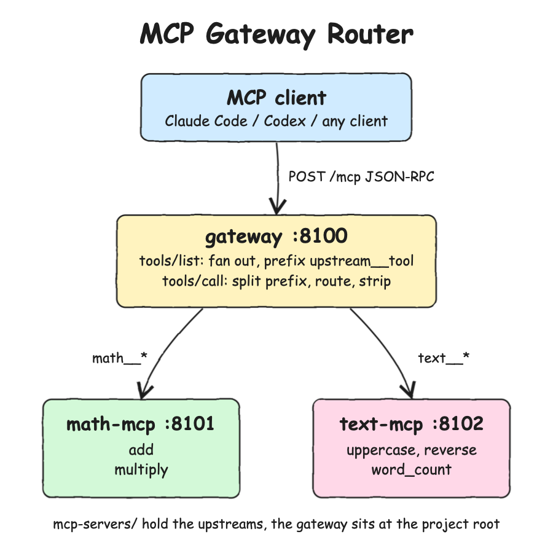

# Design Doc

## Architecture Principles

* One entry point: an MCP client is configured with the gateway only and never talks to the upstream MCP servers directly.
* Upstreams are independent MCP servers. They do not know the gateway exists and can be used on their own.
* Zero dependencies: Node.js built-ins only (`node:http`, `fetch`, `node:test`).
* Stateless: every request is a self-contained JSON-RPC message, no sessions are kept on any server.
* Fail loud: an unknown tool, an unknown upstream or an upstream that is down returns a JSON-RPC error that names the cause.

## Features

* `math-mcp` (in `mcp-servers/math-mcp`): tools `add` and `multiply`.
* `text-mcp` (in `mcp-servers/text-mcp`): tools `uppercase`, `reverse` and `word_count`.
* `gateway` (at the project root): MCP server that aggregates the tools of every upstream and routes each `tools/call` to the upstream that owns the tool.
* Namespacing: the gateway exposes each upstream tool as `<upstream>__<tool>` (`math__add`, `text__reverse`), so two upstreams can ship a tool with the same name without collisions.
* Upstreams are configured with one env var: `UPSTREAMS=math=http://localhost:8101/mcp,text=http://localhost:8102/mcp`.

## Overall Diagram



## TradeOffs

Pros
* The client is configured once. Adding or removing an upstream is a gateway config change, and no client needs to change.
* Namespaced tool names keep upstreams isolated and make the routing deterministic: the prefix picks the upstream.
* No libraries means no supply chain and no SDK version drift, and the whole protocol path can be read in a few files.

Cons
* Extra network hop on every tool call.
* The gateway is a single point of failure for every tool behind it.
* `tools/list` fans out to every upstream on every call (no cache), so listing is as slow as the slowest upstream.
* Only the subset of MCP needed for tools is implemented: no resources, prompts, sampling, SSE streaming or sessions.
* A hand-written protocol layer has to be kept in sync with the MCP spec by hand.

## Decisions

* Transport is MCP Streamable HTTP in plain JSON response mode (`Content-Type: application/json`, no SSE). It is the simplest spec-compliant transport that an HTTP client like Claude Code can call, and it lets the gateway reach upstreams with `fetch`.
* Separator `__` between upstream and tool name, because MCP tool names allow `[A-Za-z0-9_-]` and a single `_` already shows up in tool names such as `word_count`.
* An upstream that is down during `tools/list` is skipped and the gateway still lists the tools of the healthy upstreams. A `tools/call` to a down upstream returns a JSON-RPC error. Listing should degrade while calls should fail loud.
* One shared `lib/` holds the MCP server and client code, so all three servers speak the protocol in exactly the same way.
* Ports live in `scripts/ports.env`, and the processes receive them through `PORT` and `UPSTREAMS` env vars. Code never hardcodes a port.

## How to Run

```bash
./scripts/setup.sh
./scripts/start-all.sh
claude mcp add --transport http gateway http://localhost:8100/mcp
./scripts/stop-all.sh
```

## How to Test

```bash
./scripts/test-all.sh
```

## All REST Endpoints

| Server | Method | Path | Purpose |
|---|---|---|---|
| gateway :8100 | POST | `/mcp` | JSON-RPC: `initialize`, `ping`, `tools/list` (aggregated), `tools/call` (routed) |
| gateway :8100 | GET | `/health` | `{"status":"UP"}` |
| math-mcp :8101 | POST | `/mcp` | JSON-RPC: `initialize`, `ping`, `tools/list`, `tools/call` |
| math-mcp :8101 | GET | `/health` | `{"status":"UP"}` |
| text-mcp :8102 | POST | `/mcp` | JSON-RPC: `initialize`, `ping`, `tools/list`, `tools/call` |
| text-mcp :8102 | GET | `/health` | `{"status":"UP"}` |
