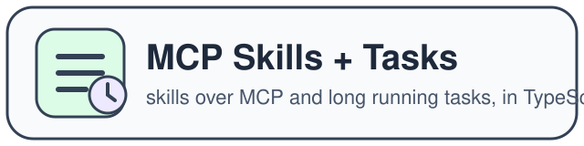
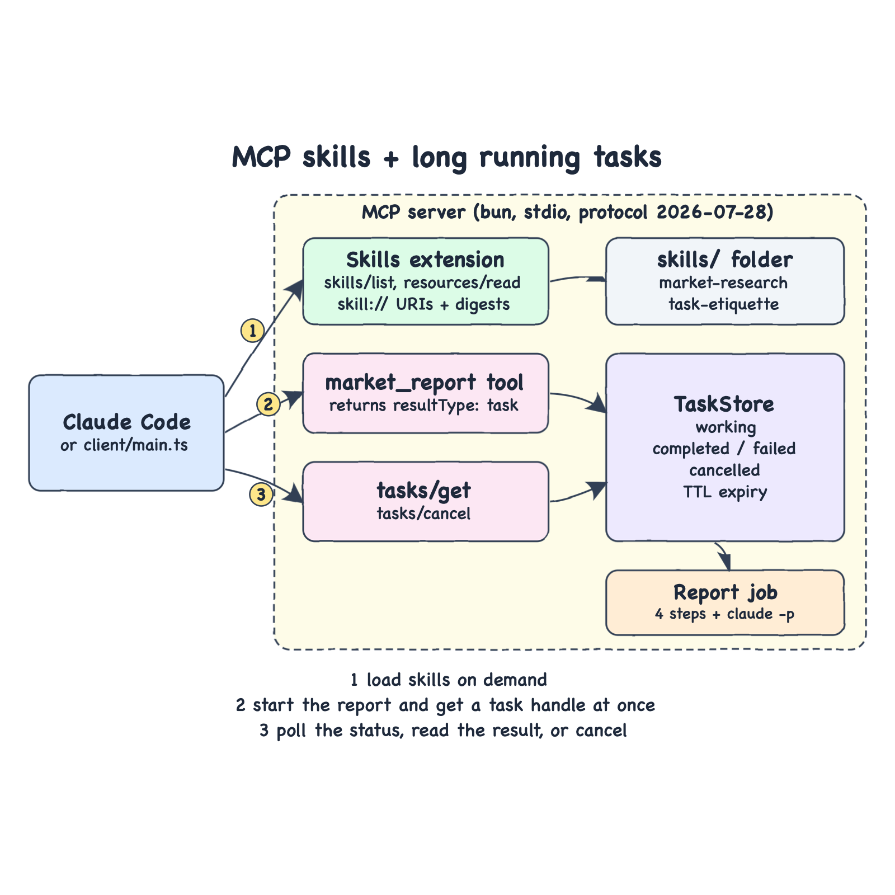

<p align="center"></p>

# mcp-skills-long-running-task-poc

An MCP server in TypeScript that ships **skills** next to its tools and runs a slow tool as a **long running task**, following [MCP servers can now ship skills, run tasks, and more](https://claude.com/resources/articles/skills-over-mcp-tasks-and-more). It uses the MCP Skills extension (`io.modelcontextprotocol/skills`, SEP-2640) and the Tasks extension (`io.modelcontextprotocol/tasks`) on protocol revision `2026-07-28`.

## How it Works?

1. The server loads every folder under `skills/` and publishes it as `skill://<name>/SKILL.md` with digests, through the SDK Skills extension.
2. A client lists the skills and reads only the one it needs, verified against the published digest.
3. The client calls the `market_report` tool with the Tasks capability in the request `_meta`.
4. The server answers at once with `resultType: "task"`, a `taskId`, `ttlMs` and `pollIntervalMs`, and runs the job in the background.
5. The client polls `tasks/get` and shows the `statusMessage` (step 2/4 ...) until the task is `completed`, `failed` or `cancelled`.
6. `tasks/cancel` aborts the job through an `AbortSignal`.
7. With `REPORT_AGENT_MODEL` set, the last step runs a real agent through the local `claude -p` CLI. No API key is needed.
8. A client without the Tasks capability (a 2025-11-25 client) gets the same report synchronously.

## Architecture



## Features

- **Skills over MCP**: the playbook for the tool ships with the server, so there is nothing separate to install.
- **Verified skill files**: every `SKILL.md` and reference file is checked against its size and digest on read.
- **Task handle on tools/call**: the slow tool returns in milliseconds, so the caller keeps working.
- **Polling with progress**: `statusMessage` says which step runs, `pollIntervalMs` paces the client.
- **Cancellation**: `tasks/cancel` aborts the job; a late result never overwrites a cancellation.
- **TTL expiry**: finished tasks leave the in-memory store after `ttlMs`, so it cannot grow forever.
- **Agent step without API keys**: the report can call `claude -p --model <id>`, the same way the agents-sdks project drives CLIs.
- **Legacy fallback**: clients without the Tasks extension still get a synchronous result.

## Stack

- TypeScript 7 with `strict`: typed task states as a discriminated union.
- Bun 1.4: runs TypeScript directly, `bun test` for tests, `Bun.spawn` for the agent CLI.
- `@modelcontextprotocol/server` and `@modelcontextprotocol/client` 2.4: MCP protocol, stdio, Skills extension.
- `@modelcontextprotocol/ext-tasks` 0.2: official Tasks v2 wire schemas used to validate every task message.
- zod 4: tool input validation.

## Contracts/APIs

| Method | Direction | What it does |
|---|---|---|
| `skills/list` | client to server | Lists the published skills with URIs and digests |
| `resources/read` `skill://...` | client to server | Reads `SKILL.md` or a reference file |
| `resources/directory/read` | client to server | Lists the files of a skill folder |
| `tools/call` `market_report` | client to server | Input `{ topic: string(2..120), depth: "quick" \| "deep" }`. Returns a task handle when the request carries the Tasks capability, otherwise the report |
| `tasks/get` | client to server | `{ taskId }` returns `status`, `statusMessage`, and `result` or `error` when terminal |
| `tasks/cancel` | client to server | `{ taskId }` cancels a working task |

Task handle returned by `tools/call`:

```json
{ "resultType": "task", "taskId": "<task-id>", "status": "working", "statusMessage": "queued", "ttlMs": 600000, "pollIntervalMs": 500, "createdAt": "...", "lastUpdatedAt": "..." }
```

Configuration (environment of the server):

| Variable | Default | Meaning |
|---|---|---|
| `REPORT_STEP_MS` | `1500` | Duration of each report step |
| `TASK_TTL_MS` | `600000` | How long a task is kept |
| `TASK_POLL_INTERVAL_MS` | `500` | Poll interval suggested to clients |
| `REPORT_AGENT_MODEL` | empty | When set, e.g. `claude-sonnet-5`, the report adds a brief written by `claude -p` |

## Key data structures and design decisions

- `Task` is a discriminated union (`working`, `completed`, `failed`, `cancelled`); only `working` can transition, so a finished or cancelled task never changes again.
- `TaskStore` owns one `AbortController` per task; clock, id generator and logger are injected so tests are deterministic.
- The job is a plain function `(signal, report) => Promise<output>`; the MCP layer only maps it to the wire.
- The SDK 2.4 has no runtime for the Tasks extension on the server, so `tasks/get` and `tasks/cancel` are registered with the SDK custom-schema handler and the task wire shape is built by hand.
- The SDK client rejects `resultType: "task"`, so the client sends task traffic through a small raw JSON-RPC dispatcher on the same stdio transport and validates every response with the `ext-tasks` v2 schemas. Skills go through the SDK `SkillsClient`.
- The server runs with `serveStdio`, which negotiates `2026-07-28` and still serves 2025 clients.
- Logs are JSON on stderr, since stdout is the MCP channel.

## How to run the app/tests

```bash
./scripts/setup.sh
./scripts/test-all.sh
./scripts/run-client.sh "electric bikes"
./scripts/run-agent.sh "electric bikes" claude-sonnet-5
```

Use it from Claude Code: `.mcp.json` registers the server as `market-research`, so opening Claude Code in this folder loads it.

Client output:

```
protocol 2026-07-28
skills published by the server: 2
  skill://market-research/SKILL.md
  skill://task-etiquette/SKILL.md
loaded skill://market-research/SKILL.md verified=true
# Market research

1. Pick the topic in 2 to 6 words, such as "electric bikes europe".
task <task-id> status=working pollIntervalMs=500
  working: step 2/4: analyzing trends
  working: step 4/4: drafting report
  completed: done
{
  "content": [
    {
      "type": "text",
      "text": "# Market report: electric bikes\ndepth: deep\n\n1. collecting sources: ok\n2. analyzing trends: ok\n3. scoring competitors: ok\n4. drafting report: ok"
    }
  ],
  "isError": false
}
task <task-id> after cancel: cancelled
```

## Scripts

All scripts live in `scripts/` and run from any directory of the repository. The server talks stdio and is spawned by its client, so there is no port to start, stop or watch.

| Script | What it does |
|---|---|
| `./scripts/setup.sh` | Installs dependencies and typechecks |
| `./scripts/test-all.sh` | Typechecks and runs every test |
| `./scripts/run-client.sh [topic]` | Spawns the server, loads a skill, runs a task to completion and cancels another |
| `./scripts/run-agent.sh [topic] [model]` | Same, with the agent step running `claude -p` |
