<p align="center">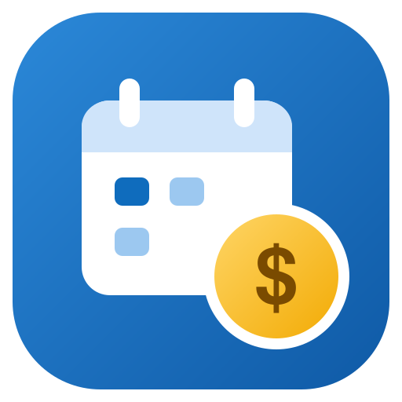</p>

# Meeting Limiter

An Outlook 365 style calendar where meetings cost real money. Everyone has a weekly wallet sized by role. Booking a meeting charges the organizer and every attendee. When anyone on the invite cannot pay, the booking is refused until their wallet refills next Monday. It runs as a web app, on an iPhone sized screen, and as a macOS Electron app.

## How it Works

1. Every person has a role: engineer (5h of meetings a week), manager (10h) or director/VP (15h).
2. Each role has an hourly rate: engineer $100, manager $150, director/VP $250. Weekly wallet = hours x rate.
3. A meeting costs each participant `minutes x their rate / 60`. The meeting cost is the sum over the organizer and all attendees.
4. While you fill the New meeting form, the UI asks the API for a quote and shows each person's cost and balance before and after.
5. If any participant would go below $0, the quote turns red, names who is short, and the "Pay and send" button is disabled.
6. The API checks again on booking and answers `402 Payment Required` with the quote, so no client can overspend.
7. Balances are derived from the meetings of the week, so cancelling refunds everyone and every Monday starts with a full wallet.
8. An engineer with 5h of meetings has $0 left. A 6th hour is refused until next week.

## Architecture

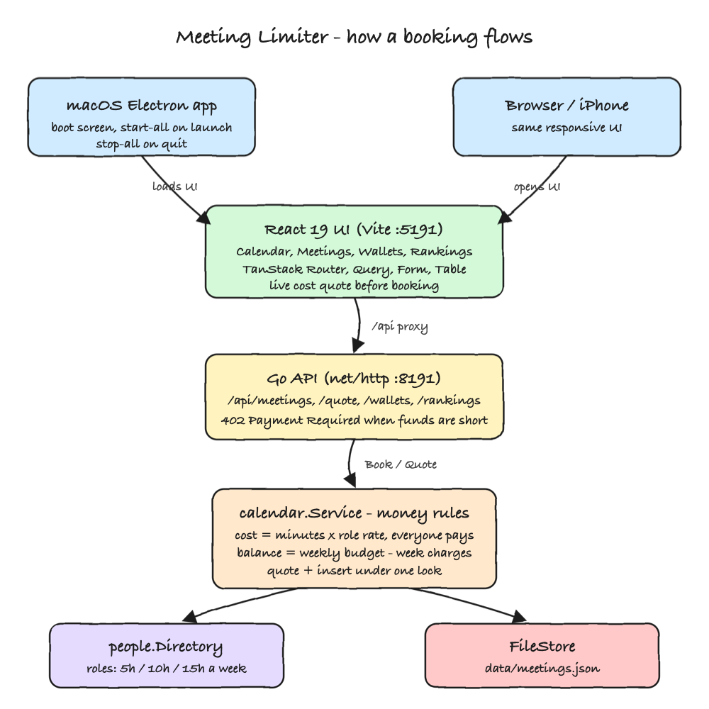

* `backend/` Go standard library API. `calendar` holds the money rules, `people` holds roles and rates, `httpapi` maps HTTP to the service and errors to status codes, `logx` is the only logger.
* `frontend/` React 19 + TanStack UI served by Vite, which proxies `/api` to the Go API.
* `desktop/` Electron shell: boot screen, runs `scripts/start-all.sh` on launch and `scripts/stop-all.sh` on quit.
* `scripts/` ops scripts, every port lives in `scripts/ports.env`.

## Features

* Week calendar in the Outlook 365 style - click any empty slot to book a meeting there.
* Live cost quote - see what a meeting costs each person before you send it.
* Funds limit - meeting creation is blocked when any participant has no funds, with who is short and by how much.
* Weekly refill - wallets are full again every Monday, so a bad week does not carry over.
* Cancel and refund - cancelling a meeting returns the money to every participant.
* Meetings tab - every meeting of the week with its total cost.
* Wallets tab - budget, spent, balance and hours used per person, plus totals and empty wallets.
* Rankings tab - most expensive meetings, who spends the most money and who spends the most time, for this week, this month or all time.
* Acting as - switch who is the organizer without a login.
* Command palette (⌘K) - jump to tabs, people, meetings and actions.
* Shortcuts modal (⌘/) - every shortcut grouped by color, with a live filter.
* Panels - every panel and modal can expand to almost full screen or hide into a docked tab on the nearest edge, and the hidden state survives a restart.
* Tooltips - hover any button with a shortcut to see its keys.
* macOS app - single instance, remembers its window position, double click the title bar to maximize, ⌘P saves a screenshot to the Desktop.
* Responsive - one day at a time and a bottom tab bar on phones, no horizontal scroll, 44px touch targets.

## Stack

* Go 1.26 - one static binary with `net/http`, `log/slog` and `encoding/json`, no framework.
* TypeScript 7 - strict types end to end, untrusted JSON is parsed, never cast.
* Bun 1.4 - installs and runs the UI and its tests.
* Vite 8 - dev server and `/api` proxy.
* React 19.3 - function components only.
* TanStack Router - typed file routes and the `week` and `range` search params.
* TanStack Query - all server state, invalidated after booking or cancelling.
* TanStack Form - the New meeting form.
* TanStack Table v9 - meetings, wallets and ranking tables.
* Electron 44 - the macOS desktop shell.

## Contracts / APIs

| Method | Path | Body / Query | Answer |
|---|---|---|---|
| GET | `/api/health` | | `{"status":"ok"}` |
| GET | `/api/policies` | | Role, weekly hours, hourly rate and weekly budget per role |
| GET | `/api/users` | | People with role |
| GET | `/api/meetings` | `from`, `to` RFC3339 | Meetings starting in the range, with charges and total cost |
| POST | `/api/meetings/quote` | `{title, organizerId, attendeeIds, start, end}` | Quote per participant, `allowed` |
| POST | `/api/meetings` | same as quote | `201` meeting, `402` quote when funds are short, `400` invalid input |
| DELETE | `/api/meetings/{id}` | | `204`, refunds everyone, `404` when missing |
| GET | `/api/wallets` | `week` RFC3339, any instant in the week | Budget, spent, balance and minutes used per person |
| GET | `/api/rankings` | `from`, `to` RFC3339, `limit` 1-50 | `meetings` by cost, `spenders` by money, `timeSinks` by minutes |

Money is always integer cents. A `402` looks like:

```json
{
  "error": "insufficient funds for 1 participant(s)",
  "quote": {
    "minutes": 60,
    "totalCost": 35000,
    "allowed": false,
    "lines": [
      { "user": { "id": "ana", "role": "engineer" }, "cost": 10000, "balanceBefore": 0, "balanceAfter": -10000, "allowed": false }
    ]
  }
}
```

## Key data structures and design decisions

* `Meeting` stores its `Charges` (user, amount) frozen at booking time, so the price shown never drifts.
* `Wallet` is computed, not stored: `budget - sum(charges of that week)`. Refund and weekly refill need no extra code or jobs.
* `Quote` is the same object for the live preview and for the `402` answer, so the UI renders both with one component.
* Booking runs quote and insert under one lock, so two parallel bookings cannot overspend a wallet.
* Weeks start Monday 00:00 in the server timezone, and a meeting belongs to the week of its start. Meetings are 15 minutes to 8 hours, in 15 minute steps, and cannot cross into the next week.
* Meetings persist in `data/meetings.json`, written with a temp file and rename.
* One shortcut map feeds the hotkeys, the tooltips, the command palette and the shortcuts modal, so they never disagree.
* Full tradeoffs are in [design-doc.md](design-doc.md).

## How to run

```bash
./scripts/setup.sh
./scripts/start-all.sh
./scripts/ui.sh
```

macOS app (installs one copy into Applications, removing any previous one first):

```bash
./scripts/install.sh
./scripts/uninstall.sh
```

## How to test

```bash
./scripts/test-all.sh
```

Runs gofmt, go vet, the Go tests (money rules, weekly caps, refill, 402 contract, persistence), the TypeScript type check and the Bun tests (week math, shortcuts, docking, layout).

## Printscreens

### Calendar
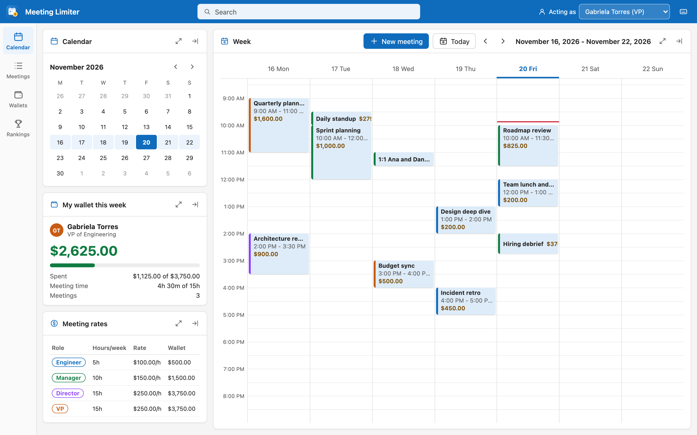
The week view with every meeting and its total cost. On the left: a mini month to jump weeks, the acting user's wallet for the week and the rates per role.

### New meeting with a live quote
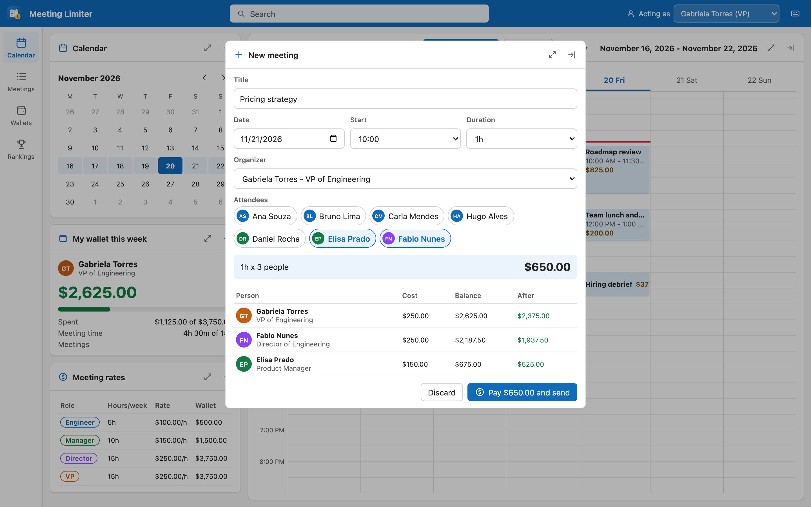
Clicking an empty slot opens the form. Gabriela, Fabio and Elisa can all pay, so the quote is blue and the button shows the total to pay.

### New meeting blocked
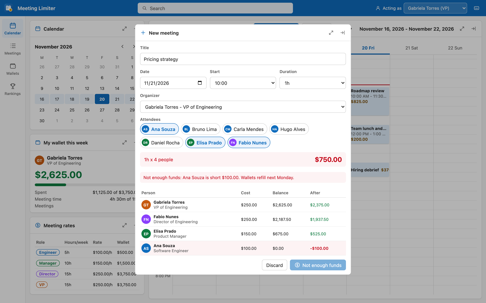
Adding Ana, who already used her 5 hours this week, turns the quote red. It names her as $100 short and the button changes to "Not enough funds".

### Meeting details
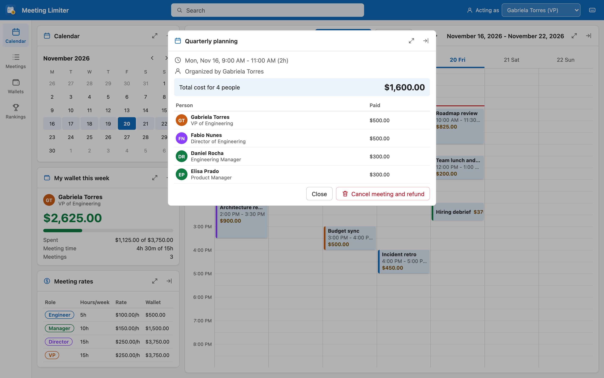
What each person paid for a meeting, with a button to cancel it and refund everyone.

### Meetings
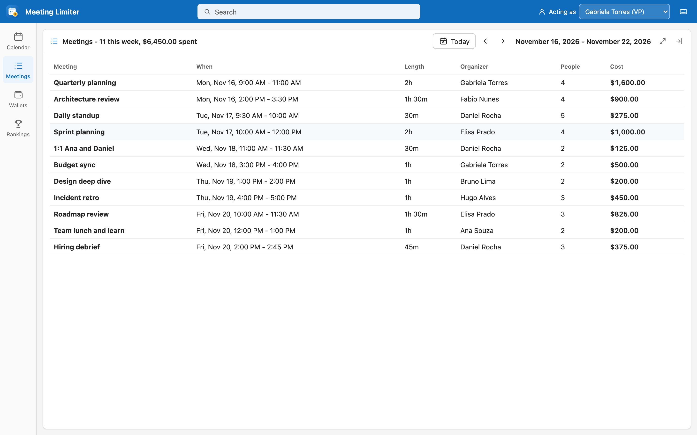
Every meeting of the week, its length, organizer, number of people and cost.

### Wallets
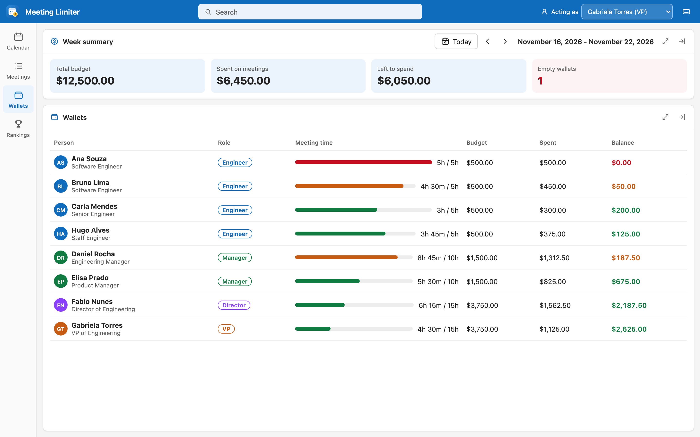
Week totals and every wallet: hours used against the cap, budget, spent and balance. Empty wallets are red.

### Rankings
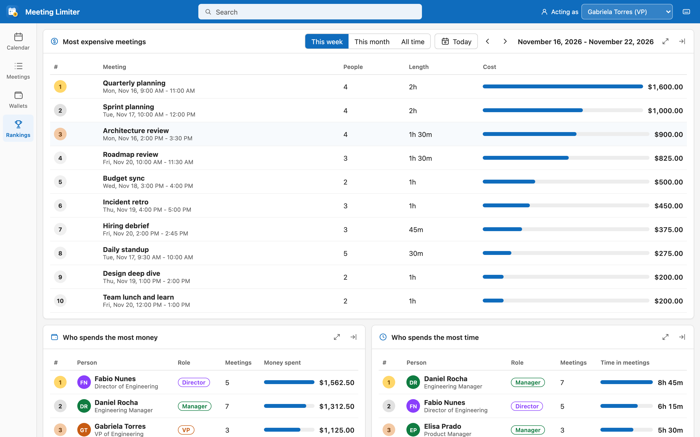
The most expensive meetings, who spends the most money and who spends the most time in meetings, for this week, this month or all time.

### Search (⌘K)
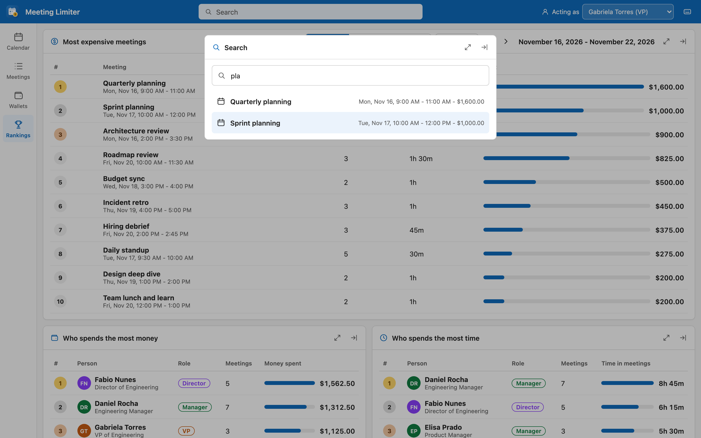
The command palette finds tabs, actions, people to act as, and meetings of the week.

### Shortcuts (⌘/)
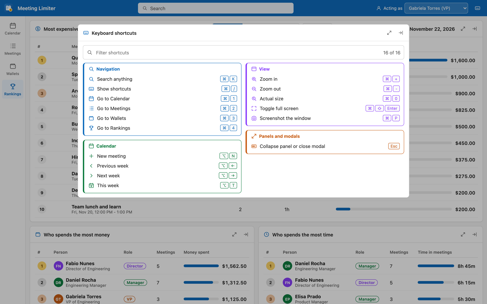
All shortcuts grouped by feature, each group with its own color and icon, with a filter on top.

### Hidden panel and tooltip
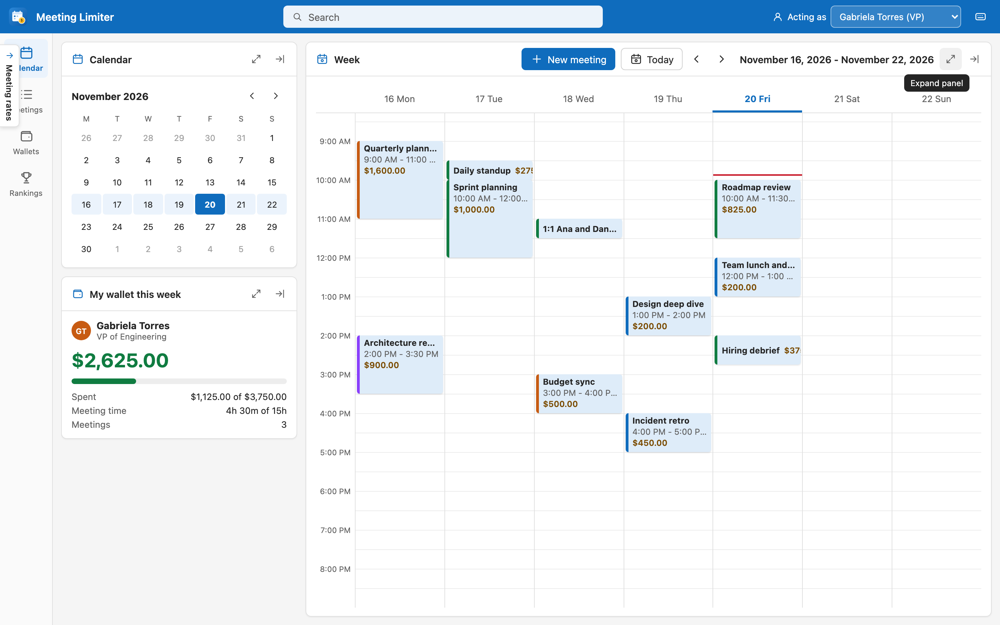
The Meeting rates panel is hidden into a docked tab on the left edge and the layout reflows. Hovering a button shows its action and shortcut.

### Expanded panel
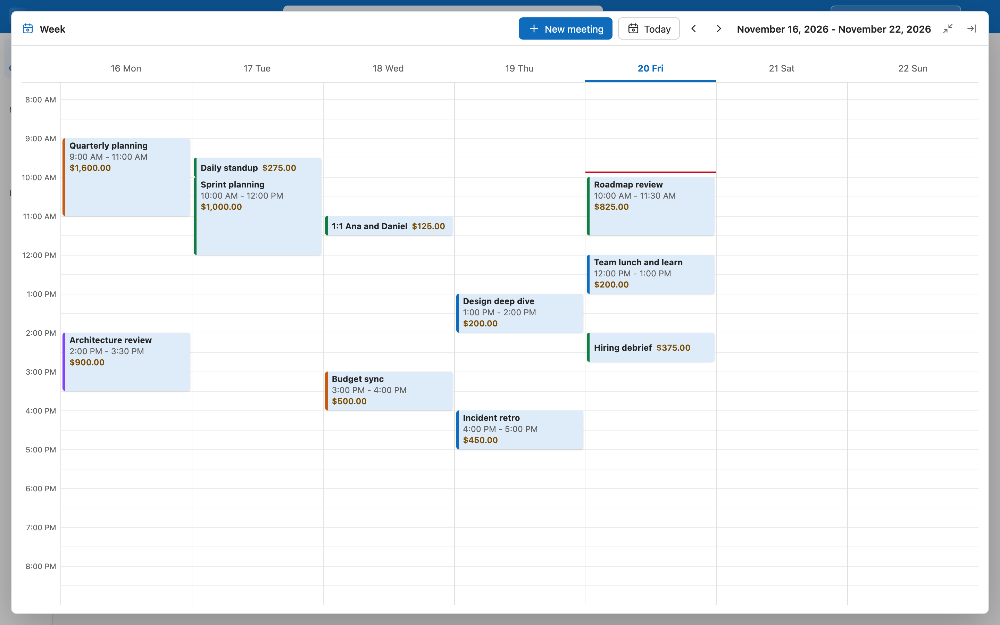
The week panel expanded to almost full screen. Esc or the same button collapses it.

### iPhone
<p>
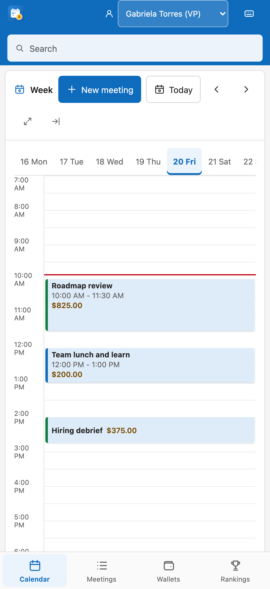
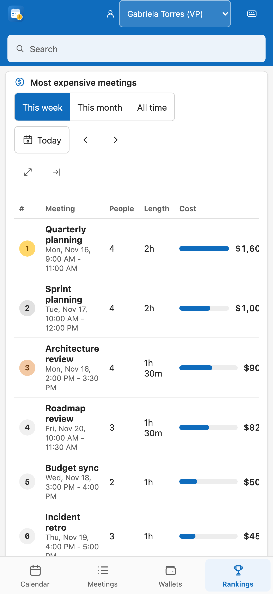
</p>

On a phone the calendar shows one day at a time with day chips on top, the tabs move to a bottom bar, and rankings stack vertically.

## Scripts

All scripts live in `scripts/` and run from any directory of the repository.

| Script | What it does |
|---|---|
| `./scripts/setup.sh` | Installs dependencies and prepares the app |
| `./scripts/start-all.sh` | Starts every service and prints the full link of each one |
| `./scripts/status.sh` | Shows every service port as UP or DOWN |
| `./scripts/test-all.sh` | Runs every test suite |
| `./scripts/ui.sh` | Opens the UI in the browser |
| `./scripts/stop-all.sh` | Stops every service |
| `./scripts/install.sh` | Builds and installs the macOS app, keeping only one copy |
| `./scripts/uninstall.sh` | Quits and removes the macOS app and stops the services |
| `./scripts/make-icon.sh` | Renders the logo into the macOS app icon |

Ports are declared in `scripts/ports.env`: api `8191`, ui `5191`.

```bash
./scripts/setup.sh
./scripts/start-all.sh
./scripts/status.sh
./scripts/ui.sh
./scripts/stop-all.sh
```
