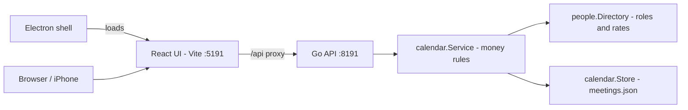

# Design Doc

Meeting Limiter is an Outlook 365 style calendar where every meeting costs money. Each person has a weekly wallet sized by role. Booking a meeting charges the organizer and every attendee. When anyone on the invite cannot pay, the booking is refused. Wallets refill at the start of the next week.

## Architecture Principles

* Separation of concerns: HTTP handlers parse and map errors, the calendar service holds the money rules, the store persists meetings.
* One owner per concern: one logger (`logx`), one config struct, one error mapper, one HTTP client in the UI (`http.ts`), one shortcut map shared by the tooltips, the command palette and the shortcuts modal.
* Charges are frozen at booking time. A meeting stores what each person paid, so the price shown never drifts.
* Balances are derived, not stored: `balance = weekly budget - sum of charges in that week`. Cancelling a meeting refunds automatically, and a new week starts full.
* Booking is atomic: quote and insert happen under one lock, so two parallel bookings cannot overspend a wallet.

## Features

* Week view calendar (Monday to Sunday, 07:00 to 20:00, 15 minute slots) in the style of Outlook 365.
* Create meetings with a title, organizer, attendees, start and end. A live quote shows the cost per person and the remaining balance before saving.
* Meeting creation is blocked when any participant has no funds. The quote shows who is short and by how much.
* Wallet per person per week: budget, spent, balance, hours used out of the weekly cap.
* Meeting list with the total cost of every meeting.
* Cancel a meeting to refund every participant.
* Rankings tab: the meetings that cost the most, and the people who spend the most money and the most time in meetings, for a week, a month or all time.
* macOS Electron app that boots the services, with a command palette, a shortcuts modal, zoom, fullscreen, screenshot and window position memory.

### Money rules

| Role | Weekly hours | Hourly rate | Weekly wallet |
|---|---|---|---|
| Engineer | 5h | $100 | $500 |
| Manager | 10h | $150 | $1,500 |
| Director | 15h | $250 | $3,750 |
| VP | 15h | $250 | $3,750 |

* Cost for one participant = meeting minutes x role rate / 60.
* Meeting cost = sum of the costs of the organizer and every attendee.
* An engineer with 5h of meetings in a week has a $0 balance. A 6th hour is refused until next Monday.
* The week is Monday 00:00 to Monday 00:00 in the server timezone. A meeting belongs to the week of its start.

## Overall Diagram



## TradeOffs

| Choice | Pro | Con |
|---|---|---|
| JSON file store instead of a database | Zero dependencies, nothing to install, easy to inspect | Single process only, whole file rewritten on each change |
| Derived balances | Refunds and weekly refill are free, no reconciliation job | Every wallet read scans the week's meetings |
| Fixed seeded people | No sign up or auth needed to use the app | People and roles are not editable from the UI |
| Charges frozen per meeting | Price history is stable | A role change would not reprice old meetings |
| Server timezone weeks | One clear rule for the week boundary | Browser and server are expected to share a timezone |

## Decisions

* Go standard library only for the backend (`net/http`, `log/slog`, `encoding/json`). No framework, no database driver.
* Money is stored as integer cents (`money.Cents`), never floats.
* `POST /api/meetings` answers `402 Payment Required` with the full quote when a wallet cannot pay, so the UI can show who is short.
* Meeting length is 15 minutes to 8 hours, in 15 minute steps, and must not cross a week boundary.
* The organizer is always a participant, attendees are deduplicated.
* No auth: the UI has an "Acting as" picker for the organizer.
* The Electron app runs `scripts/start-all.sh` on launch and `scripts/stop-all.sh` on quit.

## How to Run

```bash
./scripts/setup.sh
./scripts/start-all.sh
./scripts/ui.sh
```

macOS app:

```bash
./scripts/install.sh
```

## How to Test

```bash
./scripts/test-all.sh
```

## All REST Endpoints

| Method | Path | Body / Query | Answer |
|---|---|---|---|
| GET | `/api/health` | | `{"status":"ok"}` |
| GET | `/api/policies` | | Role, weekly hours, hourly rate and weekly budget per role |
| GET | `/api/users` | | People with role |
| GET | `/api/meetings` | `from`, `to` RFC3339 | Meetings starting in the range with charges and total cost |
| POST | `/api/meetings/quote` | `{title, organizerId, attendeeIds, start, end}` | Quote: cost per participant, balance before and after, `allowed` |
| POST | `/api/meetings` | same as quote | `201` meeting, `402` quote when funds are short, `400` invalid input |
| DELETE | `/api/meetings/{id}` | | `204`, refunds everyone, `404` when missing |
| GET | `/api/rankings` | `from`, `to` RFC3339, `limit` 1-50 | `meetings` ranked by total cost, `spenders` ranked by money, `timeSinks` ranked by minutes |
| GET | `/api/wallets` | `week` RFC3339, any instant in the week | Budget, spent, balance, minutes used per person for that week |
