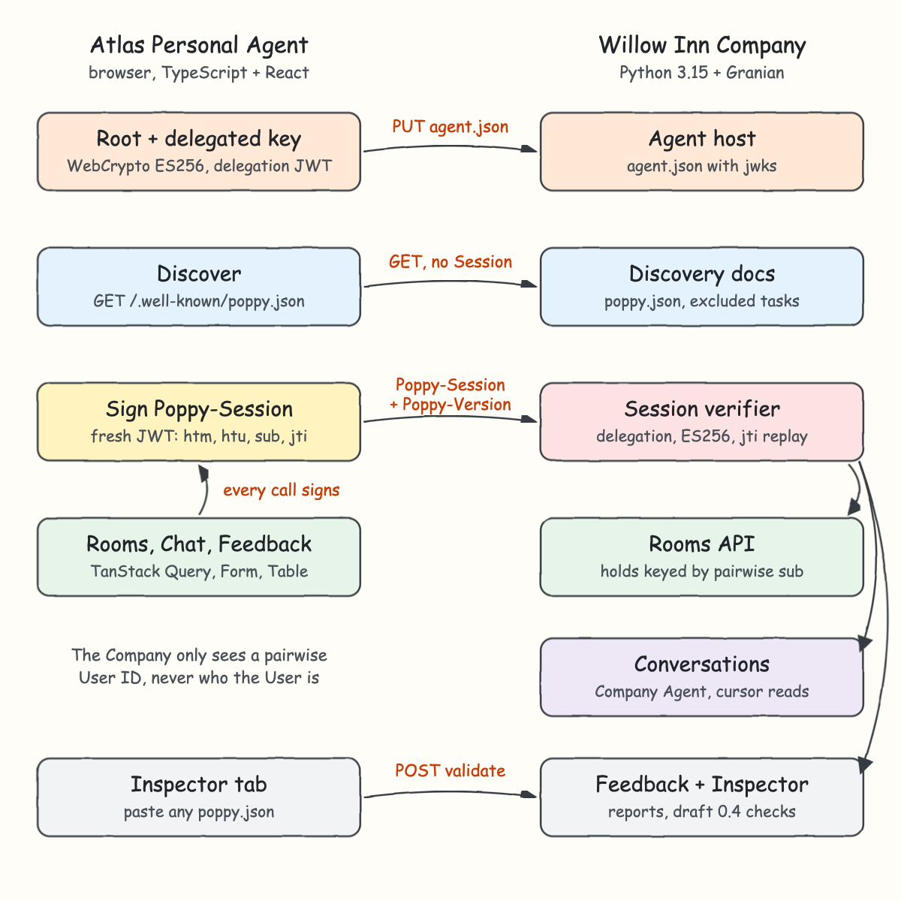
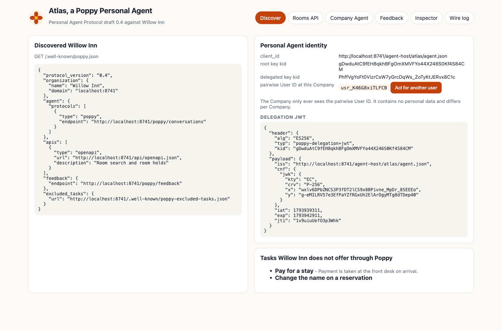
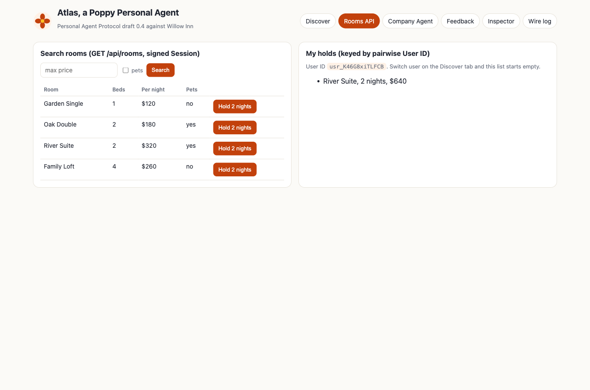
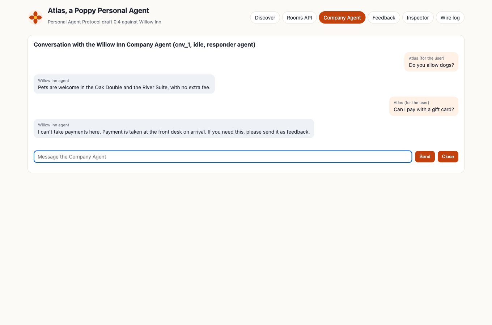
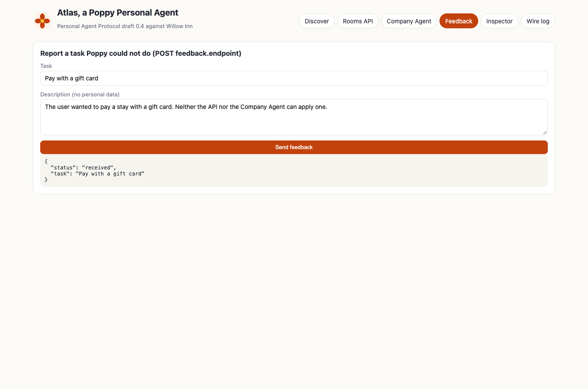
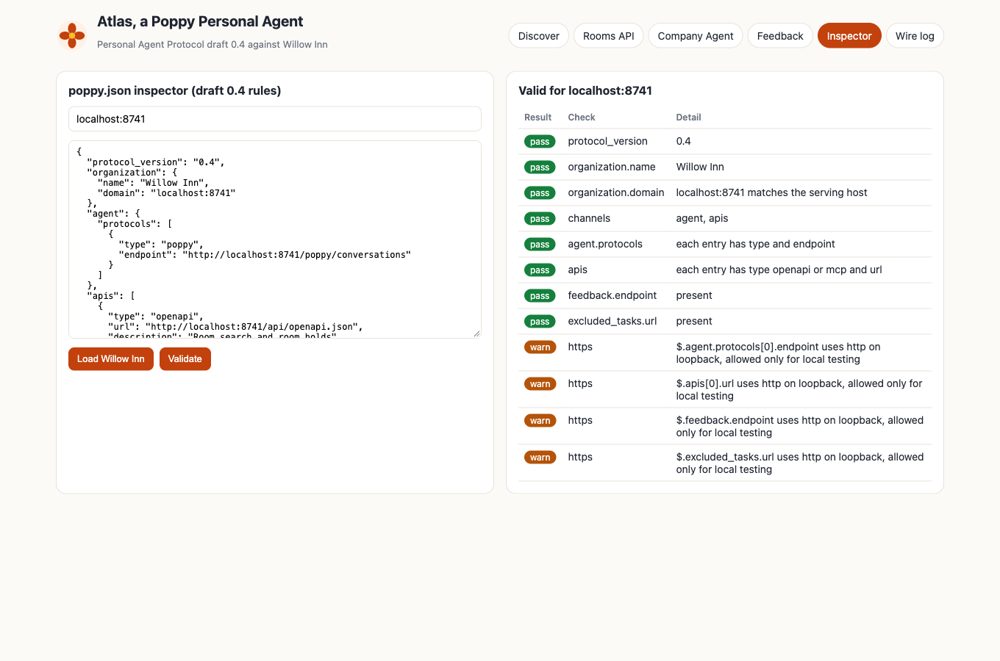
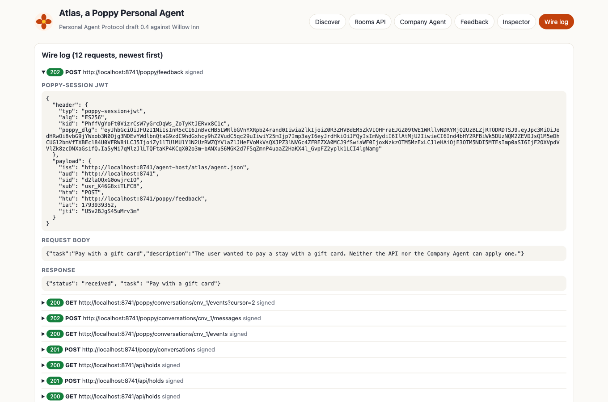

<p align="center"></p>

# Personal Agent Protocol (Poppy) POC

A working slice of the [Personal Agent Protocol](https://personalagentprotocol.org/) draft 0.4.
Willow Inn, a fictional hotel, publishes itself as a Poppy **Company** (Python 3.15 + Granian).
Atlas, a browser **Personal Agent** (TypeScript + React + TanStack), discovers it, opens a
pseudonymous Session signed with real ES256 keys, searches and holds rooms through the API, talks to
the Company Agent, and reports a task it couldn't do. A `poppy.json` inspector checks any discovery
document against the draft rules.

## What is Poppy?

Personal Agent Protocol, "Poppy" for short, is an open protocol for how a person's own AI agent
(a Personal Agent) works with a company on that person's behalf. Today it is all or nothing: the
company blocks the agent, or the agent signs in with the person's password and can do anything
they can. Poppy adds the points in between, so a hotel can say "any agent can search rooms,
signed-in agents can see reservations, booking needs the user's approval", and the user can say
"my agent may see my trips but not change them".

### How Poppy works

1. **Discovery.** The company publishes `/.well-known/poppy.json`: its name and domain, the
   channels it offers (OpenAPI or MCP APIs, a Company Agent conversation endpoint, its website),
   sign-in details, feedback and excluded tasks.
2. **Identity.** The Personal Agent publishes client metadata (`agent.json`) with its public keys.
   It signs short-lived **delegations** that vouch for delegated keys, and signs a fresh
   **Session JWT** (`Poppy-Session` header) for every request, bound to the method and URL.
3. **Pseudonymous users.** The Session carries a **pairwise User ID**: stable at one company so it
   recognizes a returning user, different at every company so companies can't correlate people,
   and never derived from personal data.
4. **Account access.** When the user wants more, they sign in on the company's own page through
   standard OAuth and pick the scopes. Signed-out use needs no OAuth at all.
5. **Channels.** One Session spans API calls, browsing and conversations with the Company Agent,
   which can hand off to a person. Both sides say whether a human or an AI is speaking.
6. **Task coverage.** Companies list tasks they don't offer, with alternatives, and collect feedback
   when an agent hits a gap. Extensions add things like operation approvals.

It reuses OAuth, JWT, HTTPS, OpenAPI and MCP, and defines something new only where nothing exists.

### Pros

* Middle ground between blocking agents and handing them the user's password.
* Users keep control: they sign in on the company's page and grant scopes, revocable at any time.
* Privacy by design: companies see a pairwise ID until the user signs in.
* Companies stop playing bot detection games and can see agent traffic as a real channel.
* One protocol for every company, so an agent integrates once.
* Progressive adoption: start with only a website, only APIs or only an agent.
* Built on standards teams already run (OAuth, JWT, OpenAPI, MCP).

### Cons

* Draft (0.4). Until 1.0 any revision can break compatibility.
* Real crypto work: delegated keys, per-request signatures, replay caches, thumbprints.
* Payments, push notifications and signed approvals are still open topics.
* Value depends on adoption on both sides.
* Companies still decide policy; a user can't force a company to allow an agent.

### Who uses it

The draft is developed with listed design partners, among them Personal Agents such as OpenAI,
Meta and Instinct; companies such as Bank of America, Walmart, Target, United Airlines, PayPal and
Venmo, Wells Fargo, Hertz and Nordstrom; and technology providers such as Cloudflare, Okta,
Stripe, Visa, Mastercard, Shopify, Zendesk and 1Password. The full list is on the
[Path to 1.0](https://personalagentprotocol.org/docs/path-to-1) page.

### Use cases

* Return or exchange an order through the retailer's agent, with the user's approval.
* Search flights anonymously, then sign in to see and change trips.
* Search and hold hotel rooms (this POC).
* Ask an insurer, bank or telco agent a question, with handoff to a human.
* Tell a company which tasks users wanted but couldn't do through agents.

## How it Works

1. On load, Atlas generates a root key and a delegated key with WebCrypto and signs a one hour
   delegation JWT with the root key.
2. It fetches Willow Inn's `poppy.json` and publishes its `agent.json` (with `jwks`) to the agent host.
3. Every API, conversation and feedback call carries a new Session JWT: `iss`, `aud`, `sid`,
   pairwise `sub`, `htm`, `htu`, `iat`, random `jti`, and the delegation in `poppy_dlg`.
4. Willow Inn checks `Poppy-Version`, verifies the delegation against the agent's published key,
   checks `kid` is the delegated key's thumbprint, verifies the ES256 signature, then the claims,
   and rejects a reused `jti`.
5. Room holds are stored under the pairwise User ID, so "Act for another user" gets an empty list.
6. The Company Agent answers from rules and sends payment questions to the feedback channel.

## Architecture



The browser talks to the Company directly (CORS for localhost origins), because the Personal Agent
signs the exact Company URL it read from `poppy.json` into `htu`.

## Features

* **Discovery** - `/.well-known/poppy.json`, excluded tasks and an OpenAPI document, so an agent knows what Willow Inn offers.
* **Session verification** - delegation chain, ES256, thumbprint `kid`, `aud`, `htm`/`htu`, `iat` window and `jti` replay, so a stolen or replayed token is useless.
* **Rooms API** - search with filters and hold a room; holds are per pairwise User ID to show recognition without identity.
* **Company Agent conversations** - start, send, read with cursor, close; idempotent message IDs and `message_id_conflict`.
* **Feedback** - report a task Poppy couldn't do, length checked like the draft.
* **Inspector** - validate any `poppy.json`: version, domain matches host, channels, entries, HTTPS (loopback only warns).
* **Wire log** - every request with its decoded Session JWT, to see the protocol on the wire.

## Stack

* **Python 3.15 + uv** - backend runtime and dependency manager.
* **Granian** - ASGI server; the app itself is a small stdlib ASGI router.
* **cryptography** - ES256 verification; the stdlib has no ECDSA.
* **ty + pytest** - type checking and tests.
* **TypeScript 7 + Bun + Vite** - frontend language, runtime/test runner and dev server.
* **React 19.3** - UI.
* **TanStack Router, Query, Form, Table** - tabs, server state, forms and tables.
* **WebCrypto** - ES256 keys and signatures in the browser, no crypto library.

## Contracts / APIs

| Method | Path | Session | Purpose |
|---|---|---|---|
| GET | `/health` | no | liveness |
| GET | `/.well-known/poppy.json` | no | Poppy discovery document |
| GET | `/.well-known/poppy-excluded-tasks.json` | no | tasks not offered through Poppy |
| GET | `/api/openapi.json` | no | OpenAPI for the rooms API |
| PUT / GET | `/agent-host/{name}/agent.json` | no | Personal Agent client metadata (simulated agent domain) |
| GET | `/api/rooms?max_price=&pets=` | yes | search rooms |
| POST / GET | `/api/holds` | yes | hold a room / list this User's holds |
| POST | `/poppy/conversations` | yes | start a conversation with its first message |
| POST | `/poppy/conversations/{id}/messages` | yes | send another message |
| GET | `/poppy/conversations/{id}/events?cursor=` | yes | read events after a cursor |
| POST | `/poppy/conversations/{id}/close` | yes | close a conversation |
| POST | `/poppy/feedback` | yes | report a task that couldn't be done |
| POST | `/inspector/validate` | no | validate a `poppy.json` (`{document, host}`) |

Session routes need `Poppy-Session` and `Poppy-Version: 0.4`. Errors are
`{"error", "error_description"}`: `invalid_session` (401), `version_unsupported` (400),
`invalid_request` (400), `conversation_not_found` (404), `conversation_closed` (409),
`message_id_conflict` (409), `invalid_cursor` (400).

Session JWT sent by Atlas:

```json
{
  "header": { "typ": "poppy-session+jwt", "alg": "ES256", "kid": "<delegated key thumbprint>", "poppy_dlg": "<delegation JWT>" },
  "payload": { "iss": ".../agent-host/atlas/agent.json", "aud": "<company>", "sid": "...", "sub": "usr_...", "htm": "POST", "htu": "<company>/api/holds", "iat": 1793939352, "jti": "..." }
}
```

## Key data structures and design decisions

* `Session(client_id, sid, sub)` is all the Company learns about a request; everything else is keyed off it.
* Holds are `dict[sub, list[Hold]]` and conversations are owned by `(client_id, sub)`, so another user gets `conversation_not_found`.
* The `jti` cache is a dict pruned on each request, with entries living twice the 120 second `iat` window.
* ES256 signatures are raw `r||s` in JWS; WebCrypto produces that directly, Python converts to DER.
* POC shortcuts, on purpose: HTTP on localhost instead of HTTPS, `agent.json` hosted by the Company process with inline `jwks`, no OAuth sign-in, no browser join, no handoff, no streaming, rule based Company Agent. See [design-doc.md](design-doc.md).

## How to run

```bash
./scripts/setup.sh
./scripts/start-all.sh
./scripts/ui.sh
```

## How to test

```bash
./scripts/test-all.sh
```

Runs `ty` and 26 pytest tests on the backend (session verifier attacks, pairwise isolation,
conversations, inspector) and `tsc` plus 6 bun tests on the frontend (base64url, thumbprints,
ES256, pairwise IDs, request bound Session JWTs, delegation chain).

## Printscreens

**Discover** - Atlas fetched `poppy.json`, generated its keys and published them. The right side shows
its client_id, key thumbprints, the pairwise User ID, the decoded delegation JWT and the excluded tasks.



**Rooms API** - room search and a 2 night hold on the River Suite, both signed Session calls. The
holds list is keyed by the pairwise User ID.



**Company Agent** - a Poppy conversation. The agent answers the pet question and points the gift card
payment to feedback. The title shows the conversation ID, status and responder.



**Feedback** - the unsupported gift card task reported to `feedback.endpoint`, accepted with 202.



**Inspector** - Willow Inn's own `poppy.json` passes every rule; HTTPS checks warn because it runs
on loopback HTTP.



**Wire log** - every request, newest first. The open entry is the feedback POST with its decoded
Session JWT: delegated `kid`, `poppy_dlg`, pairwise `sub`, and `htm`/`htu` bound to this request.



## Scripts

All scripts live in `scripts/` and run from any directory of the repository.

| Script | What it does |
|---|---|
| `./scripts/setup.sh` | Installs dependencies and prepares the app |
| `./scripts/start-all.sh` | Starts every service and prints the full link of each one |
| `./scripts/status.sh` | Shows every service port as UP or DOWN |
| `./scripts/test-all.sh` | Runs every test suite |
| `./scripts/ui.sh` | Opens the UI in the browser |
| `./scripts/stop-all.sh` | Stops every service |

Ports are declared in `scripts/ports.env`.

```bash
./scripts/setup.sh
./scripts/start-all.sh
./scripts/status.sh
./scripts/ui.sh
./scripts/stop-all.sh
```
