<p align="center">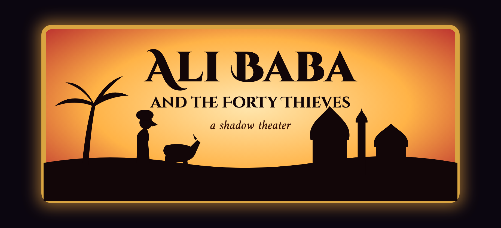</p>

# Ali Baba and the Forty Thieves - A Shadow Theater

<p align="center">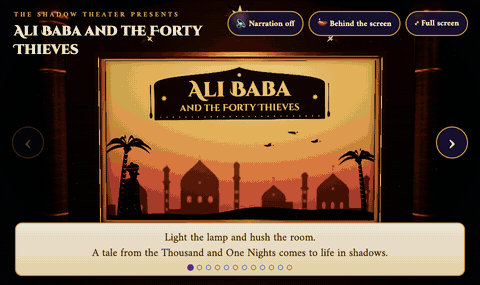</p>

The tale of *Ali Baba and the Forty Thieves* (One Thousand and One Nights) played in English as a 3D shadow theater, rendered with three.js in the browser.
The fifth pop-up book of the collection, and nothing like the other four: you never see the puppets, only their shadows. Leather cutouts with lace-like punched holes stand between a brass oil lamp and a paper screen, and the shadows are real projections from the lamp.
Color comes only from a filter glass in front of the lamp (sunset, teal for the magic cave, gold for the treasure, indigo for the night street, magenta for the dance). Moving the lamp makes the shadows grow, shrink, slide and blur, so the captain looms over Kassim and the jars swing when Morgiana carries her light.
Scenes change like a real show: the lamp gutters out, the set is swapped in the dark, and the flame flares back as the new cutouts pop up from the sill.

## How it Works

1. TanStack Router maps `#/page/$page` to one of 12 scenes. Arrows, dots, the keyboard, a swipe and the URL all navigate.
2. Every cutout has two meshes: a visible leather mesh, and a shadow mesh on a separate layer with a multiply shader.
3. Each frame the `Stage` renders that shadow layer from the lamp's point of view into a mask texture. `lampFrustum()` builds an off-axis frustum that frames exactly the paper screen.
4. The screen shader multiplies the mask by the filter color and the lamp falloff (distance and angle), so shadows scale with `shadowScale()` exactly like a real lamp.
5. Cutouts deeper behind the screen sample their alpha at a higher mip level, so they get a soft penumbra, while puppets pressed against the paper stay crisp.
6. 3D props (jars with lids, a boulder, tumbling coins, a lattice cage around the lamp) cast shadows through the same mask, so their 3D shape shows in the shadow.
7. `changeFrame()` is the scene change: the lamp dims and sputters, the old set folds flat, the scene is swapped only while the lamp is dark, then the flame flares back and the new set rises.
8. Scene timelines are pure functions (`doorMarks`, `doorOpen`, `wrongWord`, `lidLift`, `lanternX`, `danceOrbit`), so the story rules are unit tested.
9. The narrator reads the page sentence by sentence with the Web Speech API and the most natural English voice on the device.

## Architecture

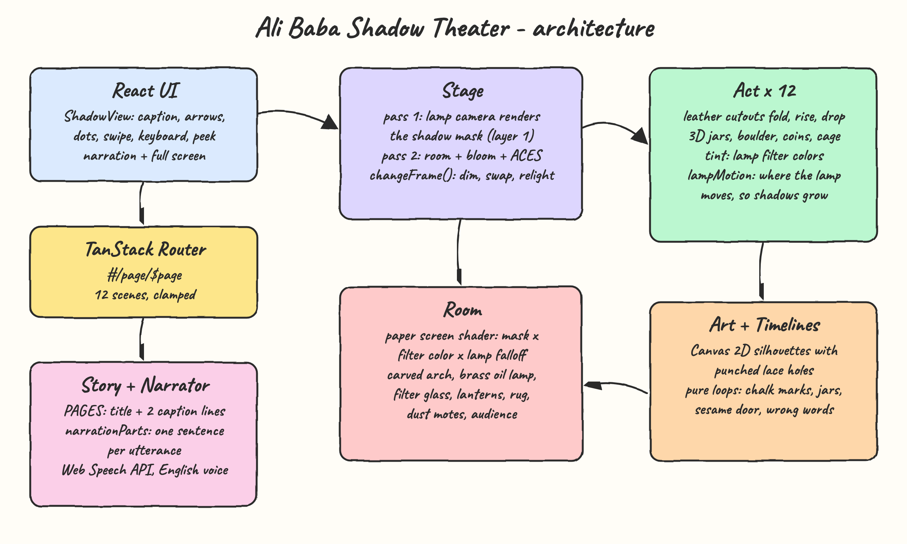

## Features

* **Real projected shadows** - a second render pass from the lamp turns leather cutouts and 3D props into shadows on a paper screen.
* **Light-only color** - every scene gets its color from the lamp filter only, and the room, the arch stars, the filter glass and the dust motes take that color too.
* **A moving lamp** - each scene scripts the lamp (it leans in for "Open, Sesame!", orbits during the dance, follows Morgiana's lantern), and the mouse or a drag moves it too.
* **Depth you can see** - near layers are crisp and true size, far layers are bigger, softer and lighter, like haze over the city.
* **Lace cutouts** - Canvas 2D silhouettes with punched stars, crescents, dots and windows, so light shines through robes, turbans, domes and doors.
* **Lamp scene changes** - the flame gutters out, the set swaps in the dark, the flame flares back and the cutouts fold, rise or drop into place.
* **Behind the screen** - a toggle swings the camera behind the paper to show the brass oil lamp, the filter glass, the puppets on their rods and the lattice cage.
* **A lattice lamp cage** - in the treasure cave and the wedding, a rotating star-lattice cylinder around the flame sweeps big soft stars across the screen.
* **Living scenes** - wood chips fly, forty riders gallop in dust, the stone rolls away, coins tumble in 3D, chalk crosses appear on doors, thieves peek from jars and whisper, Morgiana spins with a veil.
* **A theater room** - carved arch with glowing star windows, gold trim, pillars, hanging lanterns, a Persian rug and an audience in the dark.
* **Narration and full screen** - one toggle reads every page aloud, another puts the theater in full screen.
* **Works on mobile** - swipe to turn scenes, the camera fits portrait screens, and narration unlocks on the first tap.
* **Deep links** - `#/page/9` opens straight on the jars in the courtyard.

## Stack

* **three.js** - WebGL renderer, render targets for the shadow mask, custom shaders, bloom and ACES tone mapping.
* **React 19** - the UI shell: captions, buttons, dots and narration state.
* **TanStack Router** - hash routes so every scene has a link and works on GitHub Pages.
* **TypeScript** - typed engine, art and scenes.
* **Vite** - dev server and static build.
* **Bun** - installs and runs the unit tests.
* **Canvas 2D** - draws every silhouette at runtime, so there are no image assets for the art.
* **Web Speech API** - narration with the device voices.

## Contracts

There is no backend. The only contract is the URL:

| Route | What it shows |
|---|---|
| `#/` | redirects to `#/page/1` |
| `#/page/$page` | scene `$page`, clamped to 1..12 |

## Key Data Structures and Design Decisions

* `StoryPage { scene, title, lines }` in `src/story/pages.ts` is the script of the show: one entry per scene, two caption lines each.
* `Act` (`src/engine/act.ts`) is one scene: its pieces (fold, rise, drop or grow), its filter colors (`top`, `bottom`), its `lampMotion` and `levelAt`, and a scene-local `clock` that restarts each time the scene appears.
* `Sil` (`src/engine/silhouette.ts`) is one cutout: a leather mesh for the camera and a shadow mesh for the lamp, sharing one geometry, with optional frames for animation (horse gallop, chalk marks, the wrong words).
* The shadow is a multiply mask (white = light passes, black = blocked), so overlapping cutouts and semi-transparent veils combine like real layers.
* Real shadow theaters lose the characters in front of black buildings, so far layers use a lower `density`, a dark gray that keeps the black puppets readable.
* The shadow math (`projectToScreen`, `shadowScale`, `penumbra`, `lampFrustum`) is pure and lives in `src/engine/shadow.ts`.

## How to Run

```bash
./scripts/setup.sh
./scripts/start-all.sh
./scripts/ui.sh
```

Then open `http://localhost:5278`. Run the tests with:

```bash
./scripts/test-all.sh
```

The test script runs the TypeScript check, 33 unit tests (lamp scene change, shadow projection, chalk marks, the sesame door, the jars, the story order, navigation and narration) and the production build.

## Printscreens

### 1. The title

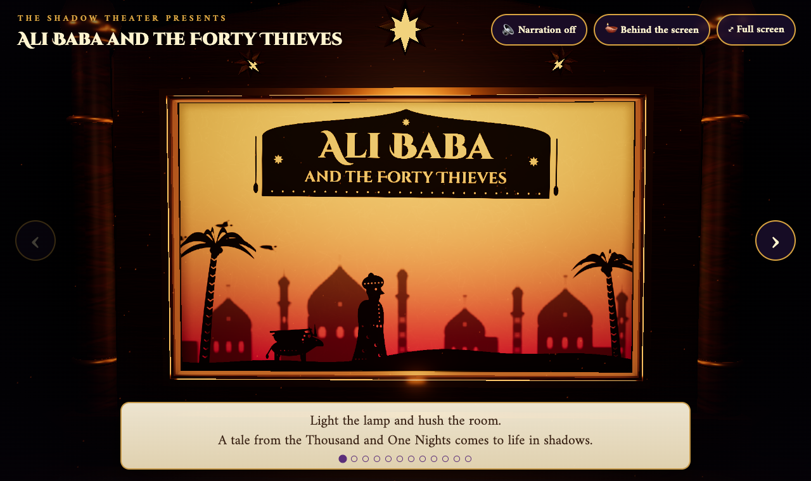

A sunset filter. The title banner has its letters cut out so the lamp shines through. A city skyline sits deep behind the screen, so it is bigger and softer than the palms.

### 2. The poor woodcutter

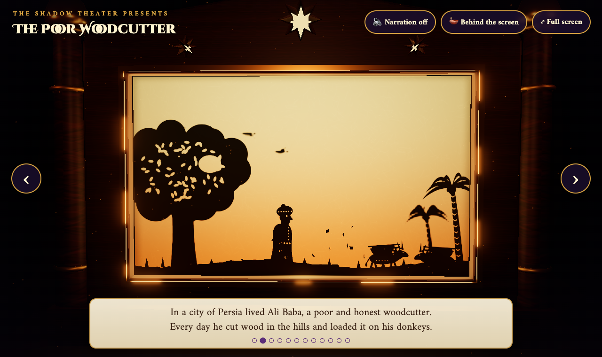

Ali Baba swings his axe and wood chips fly as tiny shadows. The big tree's leaves are punched holes, and his donkeys wait with their loads.

### 3. Forty riders

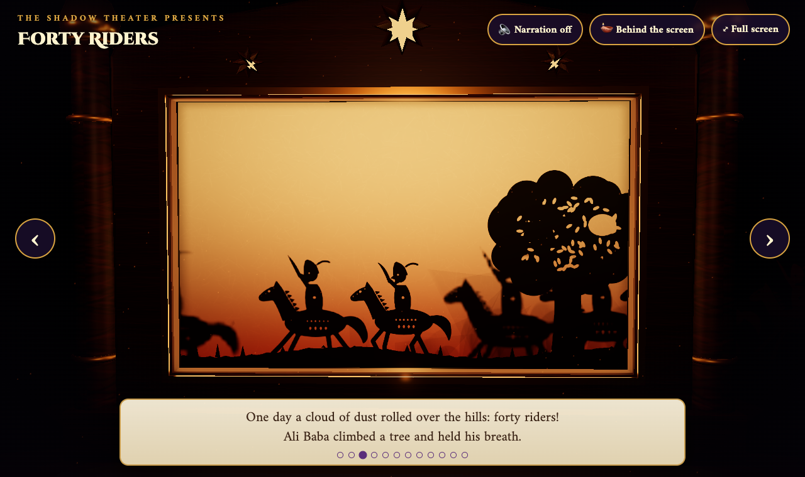

Horsemen gallop at different depths: the near ones are crisp, the far ones huge and blurred in a cloud of dust. The lamp shakes with the rumble.

### 4. Open, Sesame!

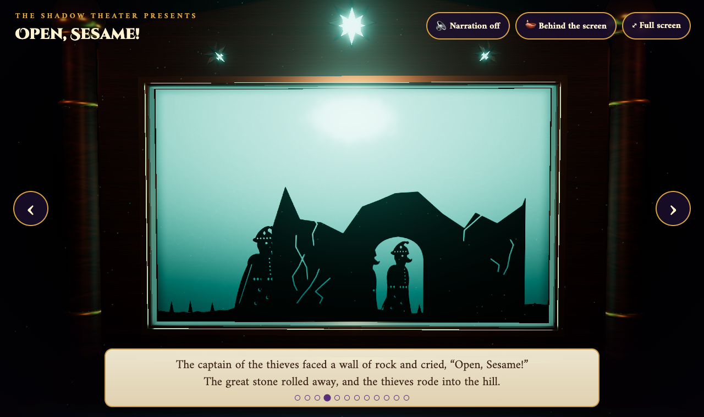

A teal filter. The captain shouts, the lamp leans in so the rock looms, the 3D boulder rolls away and the thieves walk through the glowing doorway. The cracks in the rock let the light through.

### 5. The treasure cave

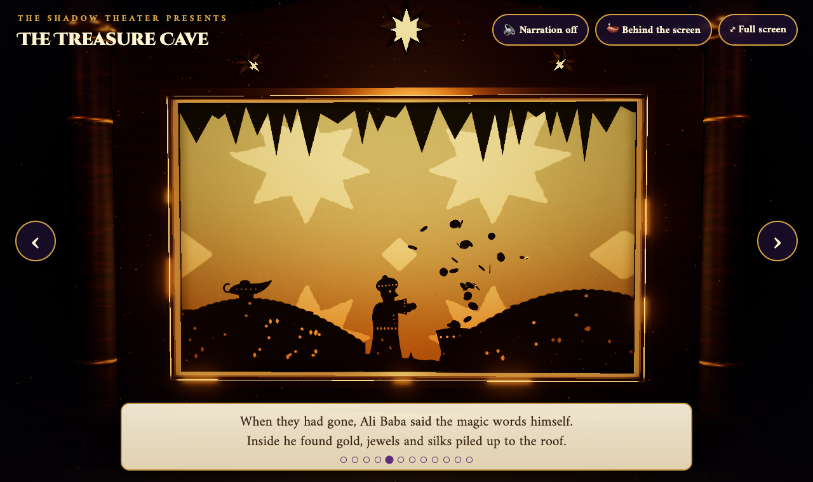

A gold filter. The rotating lattice cage around the lamp sweeps big soft stars over the cave while 3D coins tumble out of the chest, each one a flipping ellipse in shadow.

### 6. Kassim forgets the word

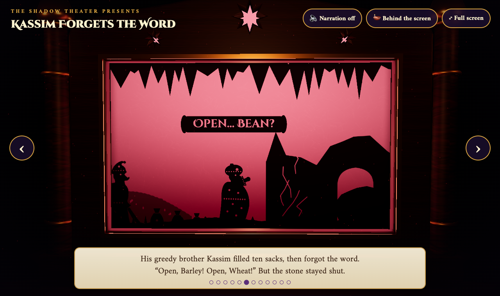

A red filter that pulses like a heartbeat. Kassim stomps and tries "Open, Barley!", "Open, Wheat!", "Open, Rice!". Meanwhile the captain's shadow grows and blurs as he moves toward the lamp.

### 7. The chalk mark

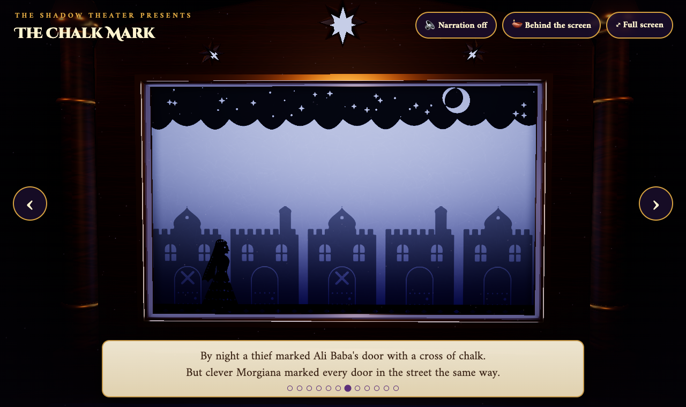

An indigo night under a starry banner with a crescent moon. A thief marks Ali Baba's door, then Morgiana marks every door, each chalk cross a cut that lets the light through.

### 8. The oil merchant

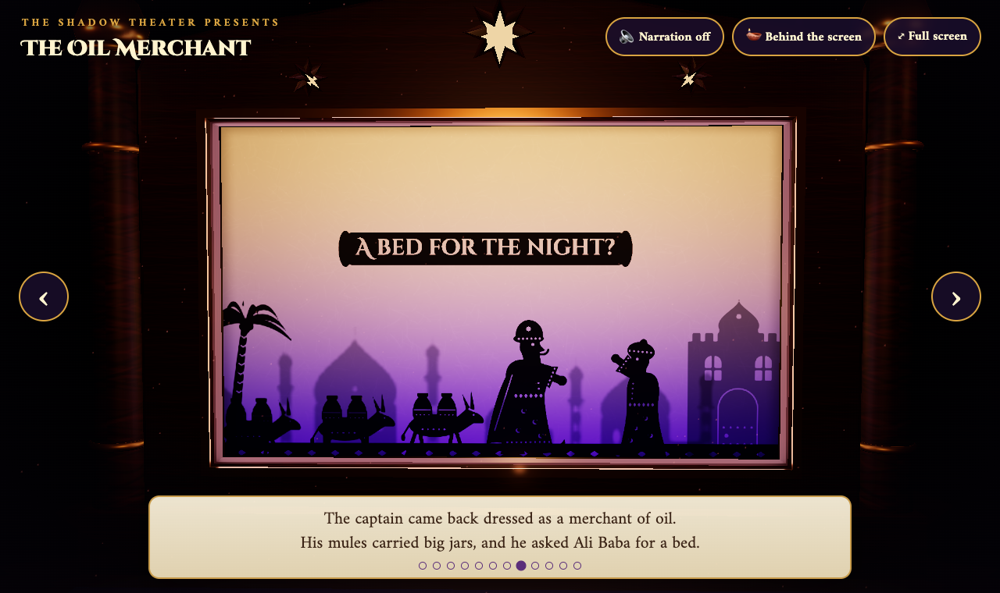

A dusk filter from orange to violet. The disguised captain leads mules with jars of oil to Ali Baba's house and asks for a bed.

### 9. The jars in the courtyard

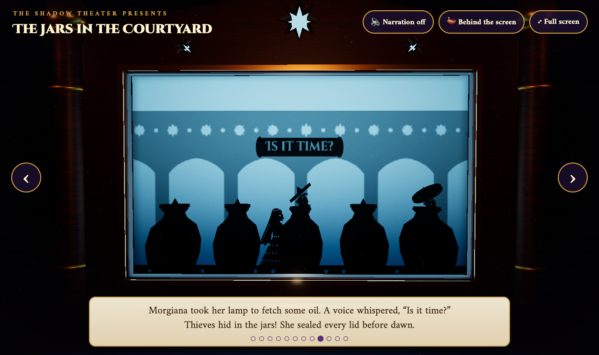

The lamp follows Morgiana's lantern, so the shadows of the 3D jars swing as she walks. Lids lift, thieves peek out and whisper "Is it time?", and every jar she passes stays sealed.

### 10. Morgiana's dance

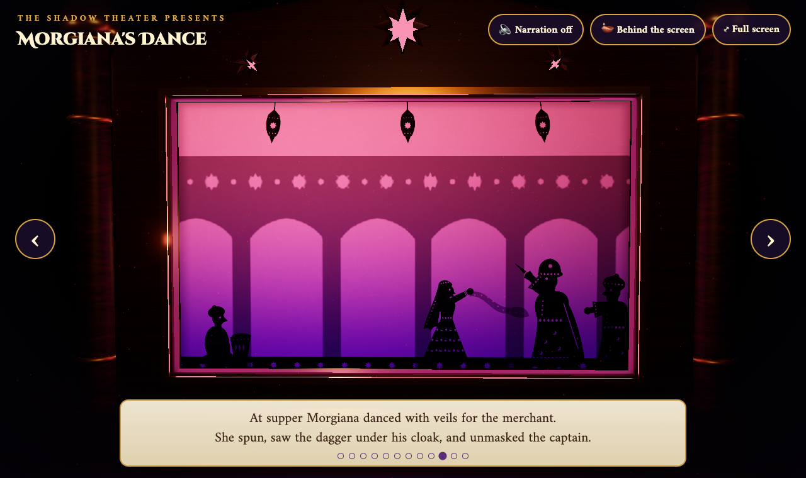

A magenta filter. The lamp orbits so the shadows sway and breathe. Morgiana spins (the cutout turns in 3D and thins to a line), her veil is half transparent, and the filter flashes red when the dagger shows.

### 11. The wedding feast

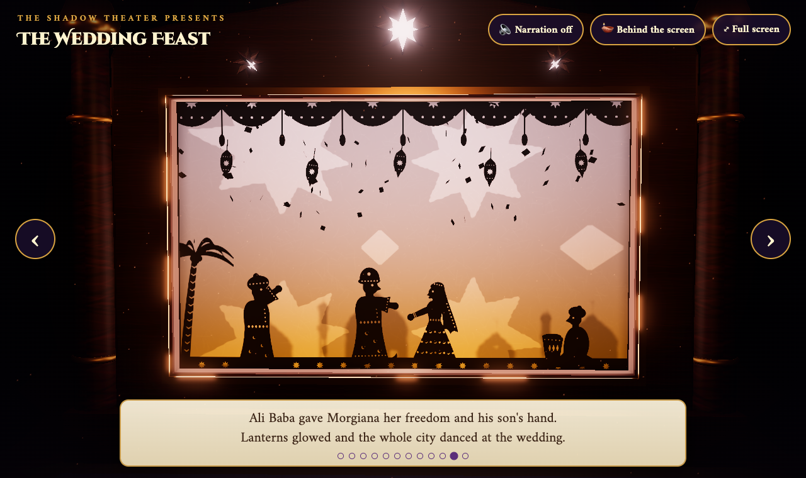

A rose-gold filter, a scalloped canopy, swinging lanterns, falling confetti and the lattice cage throwing festive stars. The couple dances while Ali Baba blesses them.

### 12. The end

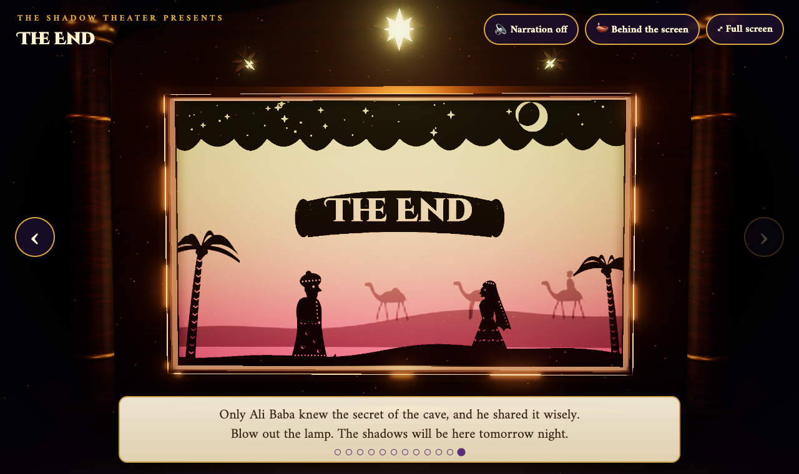

A dawn filter. A caravan of camels walks along a far, hazy dune while Ali Baba and Morgiana bow under a "The End" banner.

### 13. Behind the screen

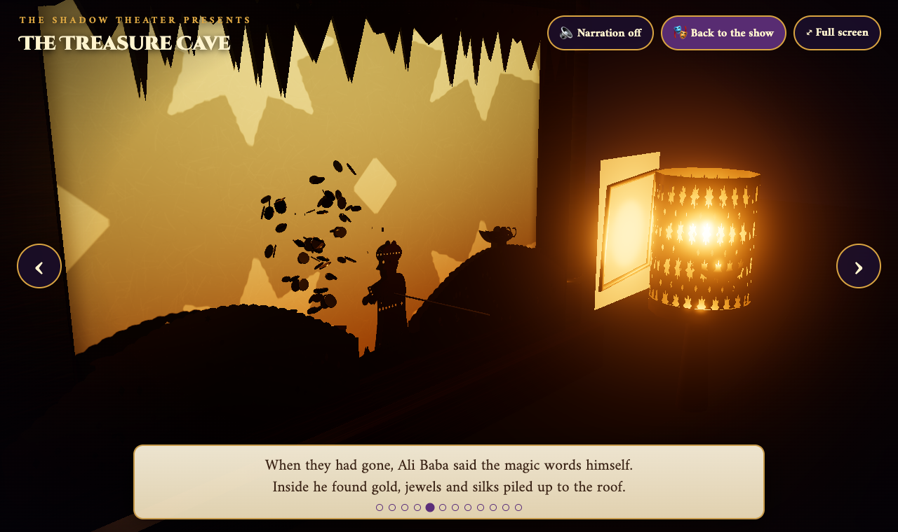

The "Behind the screen" toggle swings the camera behind the paper. You see the brass oil lamp inside its glowing lattice cage, the gold filter glass, the 3D coins in the air and Ali Baba's leather cutout on its rod.

### 14. Mobile

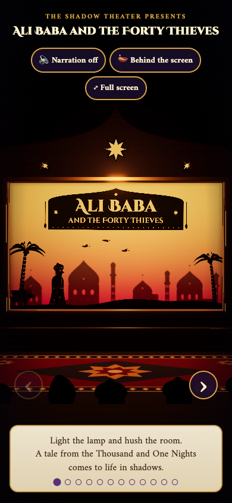
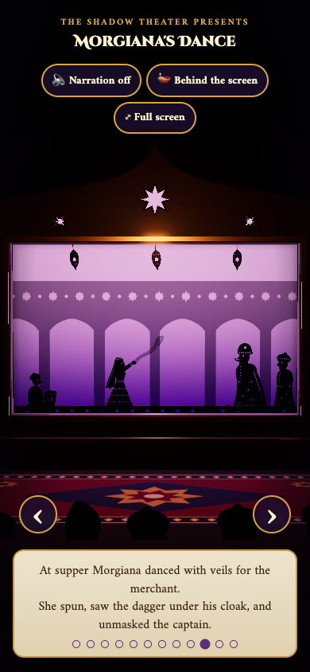

On a phone the camera fits the screen width, the buttons wrap under the title, the audience and the rug fill the space below, and a swipe turns the scene.

## Scripts

All scripts live in `scripts/` and run from any directory of the repository.

| Script | What it does |
|---|---|
| `./scripts/setup.sh` | Installs dependencies and prepares the app |
| `./scripts/start-all.sh` | Starts every service and prints the full link of each one |
| `./scripts/status.sh` | Shows every service port as UP or DOWN |
| `./scripts/test-all.sh` | Runs every test suite |
| `./scripts/ui.sh` | Opens the UI in the browser |
| `./scripts/stop-all.sh` | Stops every service |

Ports are declared in `scripts/ports.env`.

```bash
./scripts/setup.sh
./scripts/start-all.sh
./scripts/status.sh
./scripts/ui.sh
./scripts/stop-all.sh
```
