<p align="center">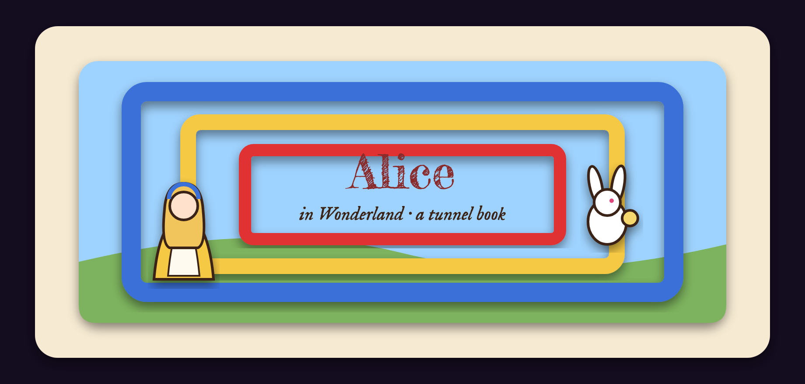</p>

# Alice in Wonderland - A Tunnel Book

<p align="center">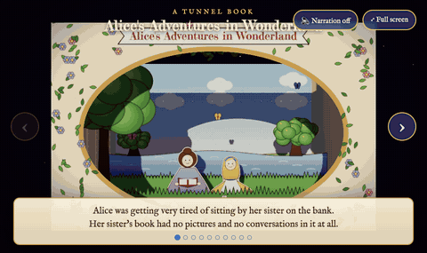</p>

*Alice's Adventures in Wonderland* (Lewis Carroll, 1865) told in English as a 3D tunnel book, rendered with three.js in the browser.
The sixth pop-up book of the collection. A tunnel book is a peep show: layers of cut paper stand one behind the other inside a box with pleated paper sides, and you look through the front window.
Here the whole story is one long tunnel. Turning a page pushes the camera forward through the paper layers of the current chamber into the next one, whose layers spring open like an accordion being pulled.
Falling down the rabbit hole is the camera going deeper through an endless shaft of earth rings, cupboards, clocks and jars. "Drink Me" and "Eat Me" change the scale of the whole set around Alice, so she shrinks and grows.

## How it Works

1. TanStack Router maps `#/page/$page` to one of 10 chambers. Arrows, dots, the keyboard, a swipe and the URL all navigate.
2. Every chamber is a `Tunnel` placed deeper along the same axis (`sceneZ()`). It holds paper layers at depths from the front frame (`z = 0`) to the backdrop (`z = -7`), cutouts, 3D props and two pleated side walls.
3. The `Stage` moves one camera between chambers with `travelFrame()`. Layers fade with `layerFade()` just before the camera pushes through them.
4. While the camera travels, the next chamber opens: `accordionZ()` moves every layer from flat against the back to its own depth with a springy overshoot, and the pleats stretch with it.
5. A warm key light with soft shadow maps makes each paper layer cast a real shadow on the layers behind it. Cutouts use an alpha-tested depth material so their shadows keep their cut shapes.
6. `scaleSet()` scales the set in width and height around a pivot at Alice's feet: the hall grows while Alice stays (Drink Me), and the room shrinks while Alice grows (Eat Me).
7. Each chamber has clipping planes at the box edges, so a grown set never spills outside the book.
8. The fall recycles 12 earth rings and floating 3D objects toward the camera forever, so the camera never stops going deeper.
9. Scene timelines are pure functions (`rabbitX`, `shrinkSet`, `growAlice`, `catBody`, `catGrin`, `seatShift`, `roseRed`), so the story rules are unit tested.
10. The narrator reads the page sentence by sentence with the Web Speech API and the most natural English voice on the device.

## Architecture

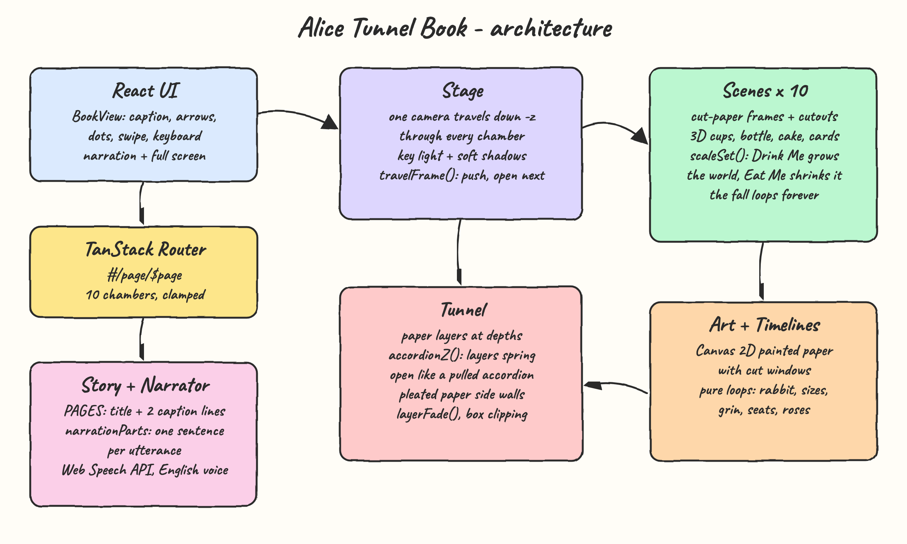

## Features

* **A real tunnel book** - cut-paper frames stand one behind the other inside a box with pleated paper sides, and each layer casts a soft shadow on the next.
* **Through the layers** - turning a page flies the camera through the paper of the current chamber into the next, deeper in the same tunnel.
* **Accordion opening** - the next chamber starts folded flat and springs open as you arrive, pleats and all.
* **Down the rabbit hole** - an endless fall through rings of earth, past maps, shelves, clocks, marmalade jars, books and cards, with Alice floating in her skirt.
* **Shrink and grow** - "Drink Me" makes the hall grow around a tiny Alice, and "Eat Me" makes the room shrink until her head hits the roof.
* **Parallax** - moving the mouse or dragging shifts the camera, so you can look past the front frame into the depth of each chamber.
* **Living scenes** - the White Rabbit runs to his hole, smoke rings rise from the Caterpillar, the Cheshire Cat fades until only its grin is left, teacups hop one place on, cards paint the roses red and a pack of 3D cards swirls into the sky.
* **3D props** - teacups and a teapot whose lid lets the Dormouse peek out, a glass table with a "DRINK ME" bottle and a golden key, an "EAT ME" cake in a glass box, spotted mushrooms, clocks and cards.
* **Narration and full screen** - one toggle reads every page aloud, another puts the book in full screen.
* **Works on mobile** - swipe to turn pages, the camera fits portrait screens, and narration unlocks on the first tap.
* **Deep links** - `#/page/7` opens straight on the Cheshire Cat.

## Stack

* **three.js** - WebGL renderer, soft shadow maps, clipping planes, bloom and ACES tone mapping.
* **React 19** - the UI shell: captions, buttons, dots and narration state.
* **TanStack Router** - hash routes so every chamber has a link and works on GitHub Pages.
* **TypeScript** - typed engine, art and scenes.
* **Vite** - dev server and static build.
* **Bun** - installs and runs the unit tests.
* **Canvas 2D** - paints every paper layer and character at runtime, so there are no image assets for the art.
* **Web Speech API** - narration with the device voices.

## Contracts

There is no backend. The only contract is the URL:

| Route | What it shows |
|---|---|
| `#/` | redirects to `#/page/1` |
| `#/page/$page` | chamber `$page`, clamped to 1..10 |

## Key Data Structures and Design Decisions

* `StoryPage { scene, title, lines }` in `src/story/pages.ts` is the script: one entry per chamber with two caption lines.
* `Tunnel` (`src/engine/tunnel.ts`) is one chamber: a `group` placed at its depth, a scalable `set`, the registered items with their base depth (for the accordion), the paper meshes (for the fade) and a chamber-local `clock`.
* Items live either in the `set` (they scale with Drink Me and Eat Me) or directly in the chamber (the front frame and Alice, which keep their size).
* Scaling only width and height, never depth, keeps every layer at its place in the tunnel, so a grown set does not crash through the front frame.
* A paper layer's opacity is `layerFade(distance to camera) x userData.alpha`, so the Cheshire Cat can fade on its own while the camera fade still works.
* The travel and accordion math (`sceneZ`, `stationZ`, `travelFrame`, `accordionZ`, `layerFade`, `fitDistance`) is pure and lives in `src/engine/timeline.ts`.

## How to Run

```bash
./scripts/setup.sh
./scripts/start-all.sh
./scripts/ui.sh
```

Then open `http://localhost:5279`. Run the tests with:

```bash
./scripts/test-all.sh
```

The test script runs the TypeScript check, 28 unit tests (the camera travel, the accordion, the fade, the rabbit, shrinking and growing, the Cheshire grin, the tea party seats, the roses, the story order, navigation, narration and voice choice) and the production build.

## Printscreens

### 1. The riverbank

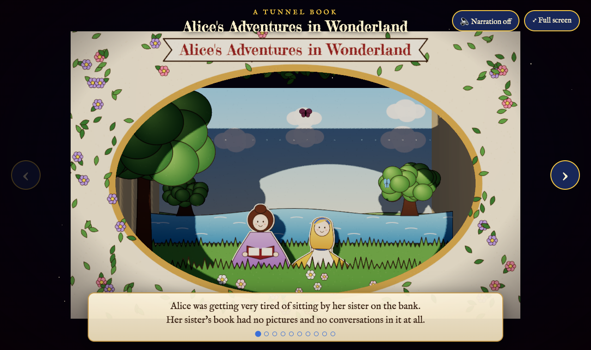

An oval front frame with vines and the title, a tree layer, Alice and her sister on the bank, the river and the sky. Every layer casts a shadow on the one behind it, and a pleated side wall shows at the right.

### 2. The White Rabbit

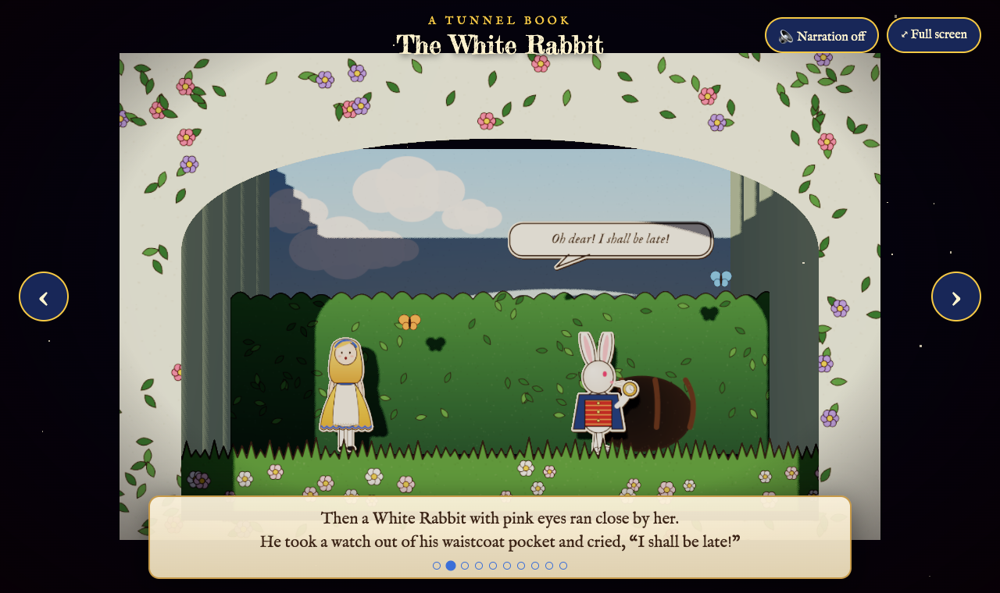

The White Rabbit in his waistcoat runs to the hole under the hedge with his pocket watch, crying "Oh dear! I shall be late!", and Alice follows him.

### 3. Down the rabbit hole

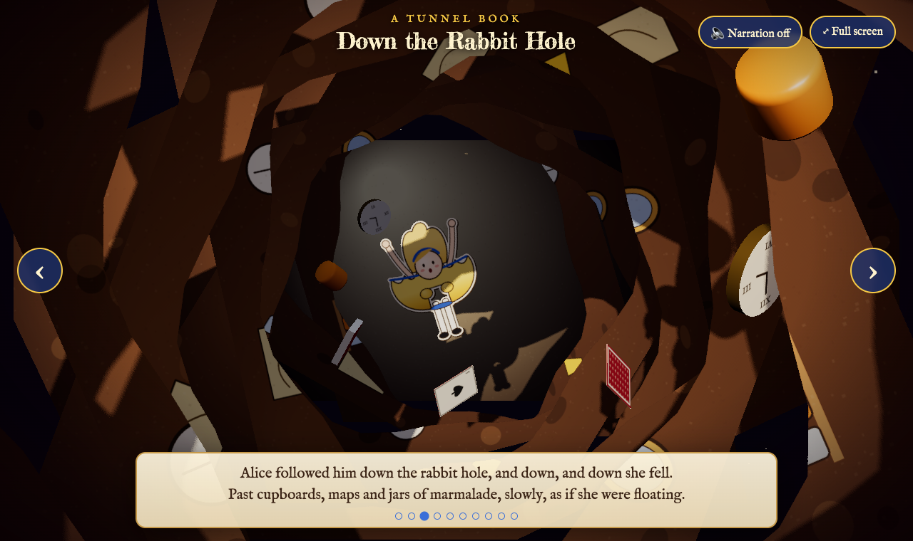

The camera keeps falling through rings of earth while clocks, marmalade jars, books and cards tumble past and Alice floats with her arms up.

### 4. Drink Me

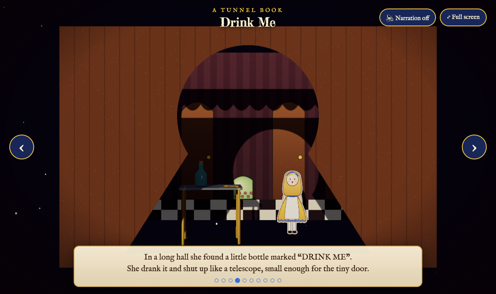
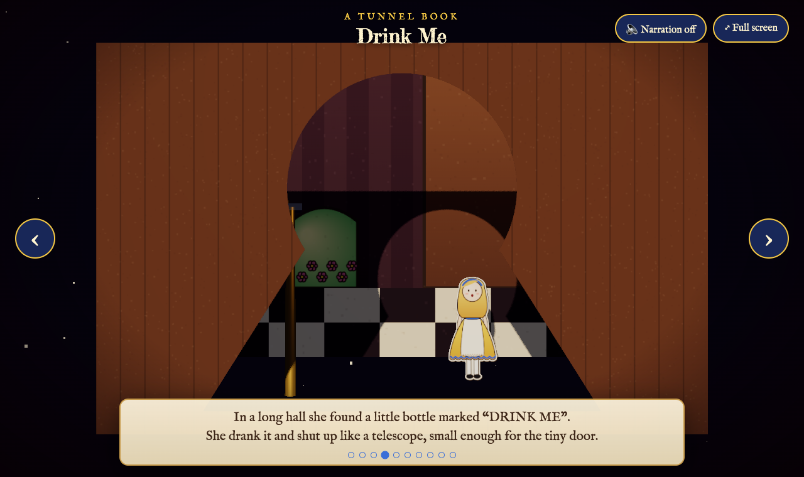

Through a keyhole frame: a glass table with a "DRINK ME" bottle and a golden key, and the tiny door to the garden. Then the hall grows around Alice until the door is her size.

### 5. Eat Me

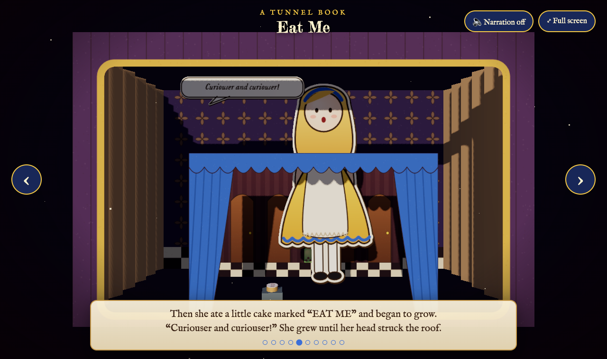

Alice eats the "EAT ME" cake: the room shrinks while she grows until her head hits the roof. "Curiouser and curiouser!"

### 6. Advice from a Caterpillar

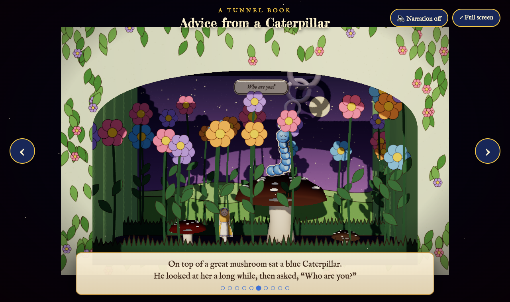

A tiny Alice beside 3D spotted mushrooms. The blue Caterpillar sits on top, blows rings and asks "Who are you?" under a starry dusk sky.

### 7. The Cheshire Cat

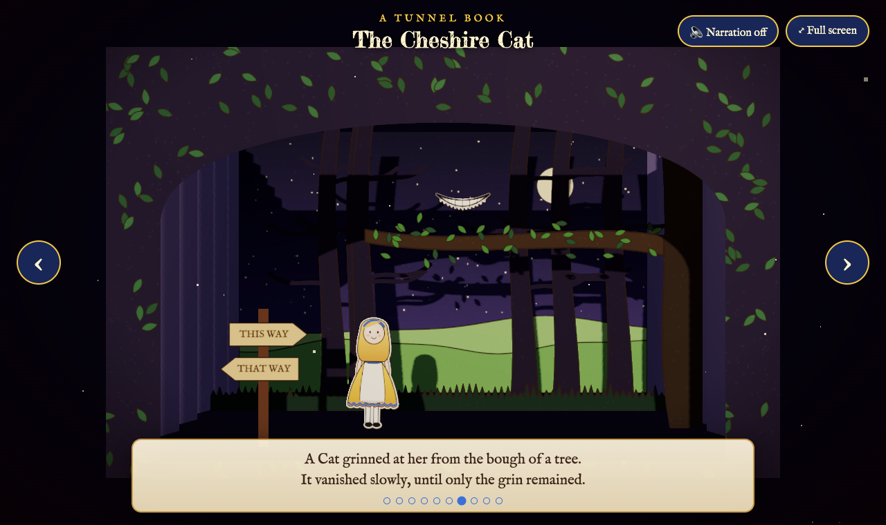

In a moonlit forest beside a "THIS WAY / THAT WAY" sign, the ginger Cheshire Cat fades away on its branch until only the grin is left.

### 8. A Mad Tea-Party

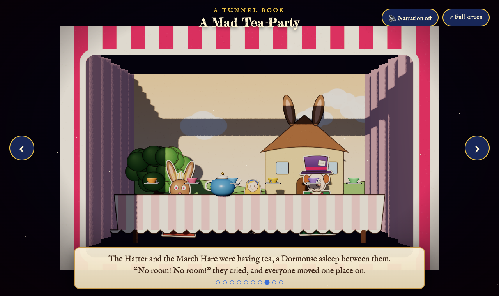

The Hatter, the March Hare and Alice at the long table in front of the March Hare's house with its ear chimneys. The 3D teacups hop one place on and the Dormouse peeks out of the teapot.

### 9. The Queen's Croquet

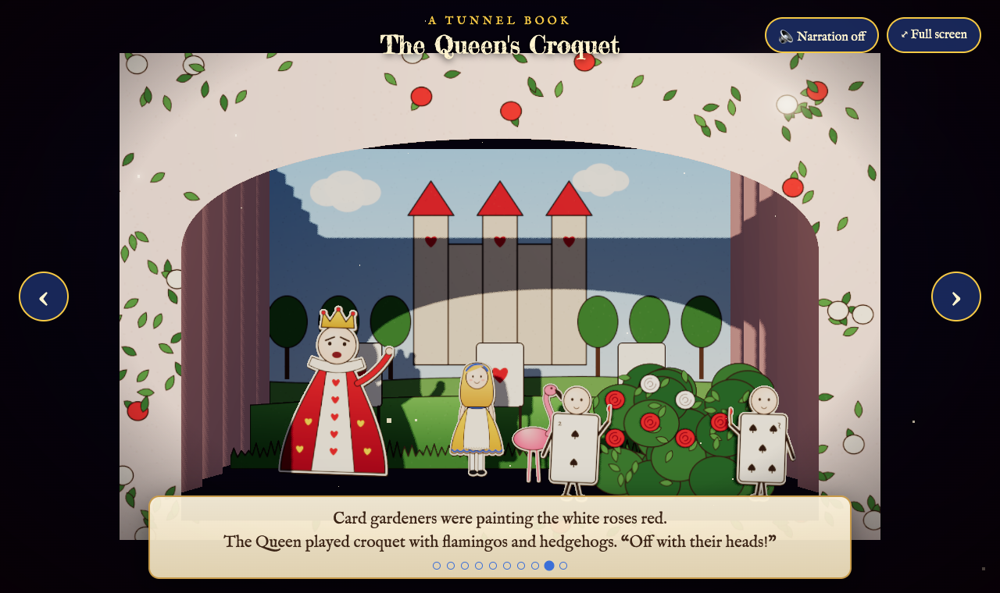

Card gardeners paint the white roses red one by one, the Queen of Hearts shouts "Off with their heads!", and a hedgehog ball rolls past the flamingo.

### 10. Only a pack of cards

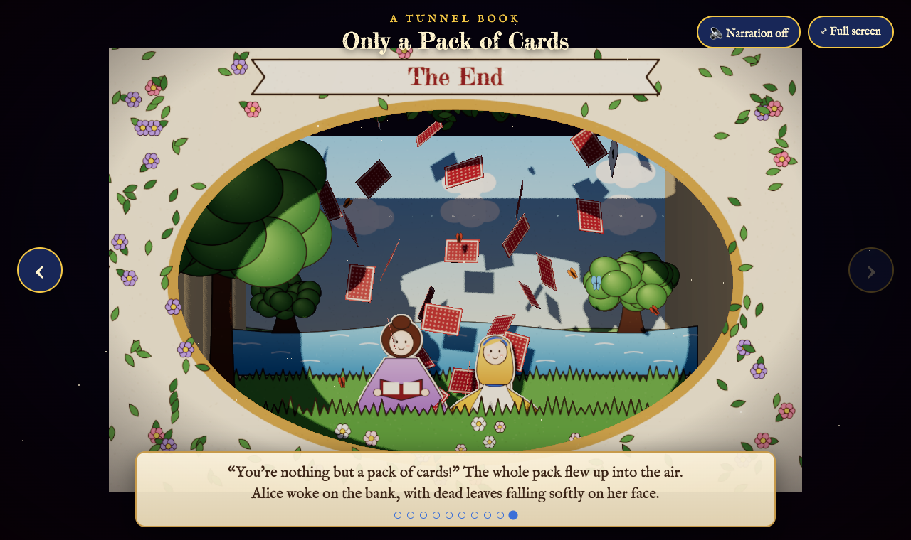

Back on the riverbank under "The End": a pack of 3D cards swirls up into the sky while leaves fall and Alice wakes beside her sister.

### 11. Mobile

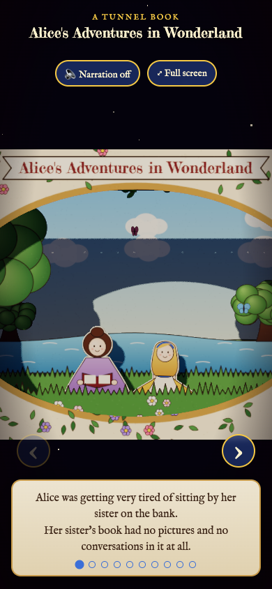
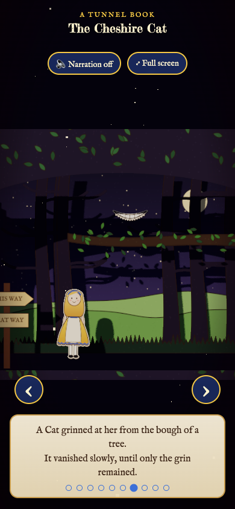

On a phone the camera fits the book to the screen, the buttons sit under the title, and a swipe turns the page.

## Scripts

All scripts live in `scripts/` and run from any directory of the repository.

| Script | What it does |
|---|---|
| `./scripts/setup.sh` | Installs dependencies and prepares the app |
| `./scripts/start-all.sh` | Starts every service and prints the full link of each one |
| `./scripts/status.sh` | Shows every service port as UP or DOWN |
| `./scripts/test-all.sh` | Runs every test suite |
| `./scripts/ui.sh` | Opens the UI in the browser |
| `./scripts/stop-all.sh` | Stops every service |

Ports are declared in `scripts/ports.env`.

```bash
./scripts/setup.sh
./scripts/start-all.sh
./scripts/status.sh
./scripts/ui.sh
./scripts/stop-all.sh
```
