<p align="center">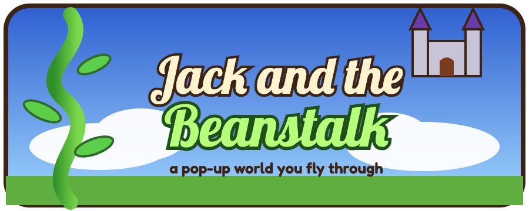</p>

# Jack and the Beanstalk - A Pop-up World

A pop-up story of *Jack and the Beanstalk* in English, rendered with three.js in the browser.
There is one book, and it travels. It starts open on a meadow. When you turn the page, the pop-up folds flat, the book lifts off and flies through a 3D world, and the page curls over inside the same book while it flies.
It lands at the place where the next page happens: the cottage, the road to market, a cloud island above the sky, the giant's kitchen, a giant leaf halfway down the beanstalk, and back to the ground. Then the new scene springs up.
On page 5 a single beanstalk, 34 units tall, bursts out of the ground in a spray of dirt and grows in real time. The camera rides its tip up through the clouds into a starry sky while birds circle it.
On page 10 Jack chops that same beanstalk and it crashes down in a huge dust cloud, shaking the camera.

## How it Works

1. TanStack Router maps `/page/$page` to a station. Arrows, dots, the keyboard, a swipe and the URL all navigate.
2. `World` builds the sky, the lights, a paper forest, stars, shooting stars and an instanced sea of 3D clouds. The sky color follows the camera altitude and the time of day.
3. `STATIONS` gives every page a landing spot in the world (x, y, z), a base (meadow, cloud island or a leaf of the beanstalk) and a day or night mood. One `Book` flies between them.
4. Every scene is a `PopupScene` riding inside the book. 2D cutouts fold on hinges and stand on a folded paper tab with a soft contact shadow. 3D models grow out of the paper.
5. The `Stage` runs a phase machine: **depart** (the pop-up folds), **fly** (the book and the camera arc to the next spot, the book banks and the page curls over mid-flight), **arrive** (the new pop-up unfolds).
6. `departOpenness()`, `leafAt()`, `arriveOpenness()` and `bank()` are pure functions, so the transition rules are unit tested: the pop-up is flat at takeoff, the page has turned before landing, and the book lands level.
7. `StalkWorld` owns the giant beanstalk. It grows by draw range, opens its leaves only after the stalk passes them, throws a dirt burst and swirling leaves while it grows, and spreads a dust cloud when it falls.
8. The image goes through MSAA, a bloom pass for glowing things (beans, eggs, windows, sparkles, fireworks), SMAA and an ACES tone-mapping output pass.
9. The narrator reads the page with the Web Speech API and picks the most natural English voice the device has.

## Architecture

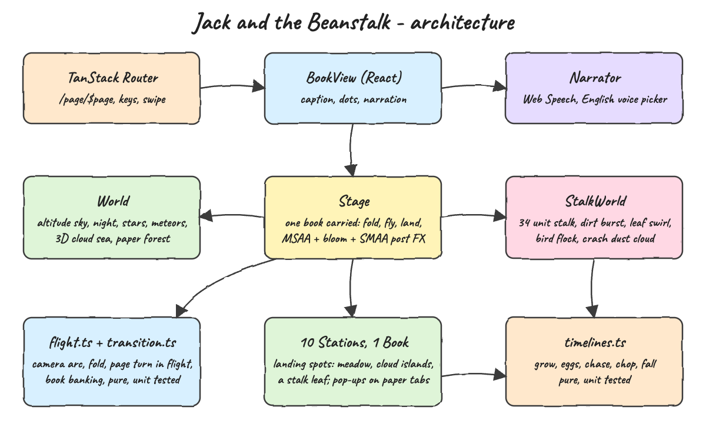

## Features

* **One flying book** - the same book carries the story from the meadow up to the clouds and back down. Pages turn inside it while it flies and banks.
* **A world to travel** - 10 landing spots on the ground, on cloud islands and on a leaf of the beanstalk, with the camera pulling back on long trips so it never brushes the scenery.
* **The beanstalk really grows** - one 34 unit stalk erupts with a dirt burst while the camera rides its tip through the clouds.
* **Fully 3D giant** - a jointed 3D giant stomps and roars in the castle (each step shakes the camera and kicks up dust), sleeps and breathes in the treasure room, and climbs down the stalk in the chase.
* **3D golden hen** - squats and lays glowing golden eggs on the giant's table, and pecks the ground at the end.
* **Grounded pop-ups** - every cutout stands on a folded paper tab with a soft contact shadow that shrinks when it hops, like a real pop-up book.
* **The chase on the real stalk** - Jack and the giant climb along the actual 3D beanstalk spiral, under dark clouds, with a bird flock circling.
* **The chop and the crash** - three axe swings, then the beanstalk falls with gravity-like speed into a dust cloud, then the chest opens, fireworks burst and "The End" appears.
* **Altitude sky** - light blue at the ground, deep blue with stars and shooting stars above the clouds, dark night for the window scene.
* **Rainbow castle** - a 3D rainbow arches over the castle on its cloud island.
* **Smooth image** - MSAA, alpha-to-coverage cutout edges, SMAA and soft shadows remove the jagged edges. Bloom makes the magic glow.
* **English narration** - prefers natural voices (Microsoft Jenny/Aria Natural, Google US English, Ava/Samantha Premium) and never picks the novelty macOS voices.
* **Works on mobile** - the camera moves back on portrait screens, toggles sit under the title, and you can swipe to turn pages.
* **Full screen and deep links** - `/page/5` opens straight on the growing beanstalk.

## Stack

* **TypeScript 7** - typed scene builders, painters, world and engine.
* **Bun 1.4.4** - package manager and test runner.
* **Vite 8** - dev server and production bundle.
* **React 19.3** - the overlay UI: caption, arrows, page dots, narration and full screen toggles.
* **TanStack Router 1.x** - one route per page, so every station has a URL.
* **three.js 0.187** - WebGL, shadows, instancing, tube geometry, sprites and the post-processing passes that ship with it (EffectComposer, UnrealBloomPass, SMAAPass, OutputPass). No other 3D library.
* **Web Speech API** - narration with the voices already on the device, no server and no API key.

## Assets

* Grass, brick and sparkle sprite textures come from the three.js repository examples (`examples/textures`).
* Fonts come from Google Fonts: Lobster (titles), Fredoka (speech bubbles), IM Fell English (captions).
* All characters and props are drawn in code on Canvas 2D (`src/art`). All 3D models (giant, hen, castle, oven, table, chest, rainbow, clouds, stalk, birds) are built from three.js primitives.

## Key Data Structures and Design Decisions

* `StoryPage { scene, title, lines }` in `src/story/pages.ts` is the only place the story text lives.
* `STATIONS: Record<SceneId, Station>` in `src/scenes/stations.ts` places each landing spot in the world. Moving one is a one line change.
* One `Book` and every `PopupScene` live in a single `carrier` group. Flying the book is moving that group; the page curl is the `Leaf` with the old right page on its front and the new left page on its back.
* `Phase` in the stage is `arrive | rest | depart | fly`. Turning the page during an arrival starts the departure from wherever the pop-up is, so there is no jump.
* `Shot { pos, look }` is a camera framing. `flightShot(from, to, progress)` blends two shots with an ease and an arc, so the camera never dips into the ground.
* `PopupScene.since` is the time since the scene stood up. One-shot events (stalk growth, the chop, the crash) read it instead of a loop, so they play once per visit.
* `stalkPoint(t)` is the shared formula of the beanstalk spiral. The world stalk is built from it and the chase puts Jack and the giant on it.
* Free 3D actors (chase climbers, eggs) are gated by `PopupScene.openness`, so nothing floats in the air while the book is in flight.
* The chase leaf is a child of the beanstalk: it only appears once the stalk has grown past it, and it falls with the stalk at the end.
* Earlier versions: page turns on a table (like the other two pop-up books), then a world of paper slabs, then one book per page. The final design keeps one book and makes it travel.

## Contracts / APIs

There is no backend and no REST API. The only contract is the route:

| Route | What it shows |
|---|---|
| `/` | Redirects to `/page/1` |
| `/page/$page` | Station `$page` (1 to 10). A bad value falls back to the nearest valid page |

## How to Run

```bash
./scripts/setup.sh
./scripts/start-all.sh
./scripts/ui.sh
```

Turn pages with the arrow buttons, the dots, the left and right arrow keys, or a swipe on a phone.

## How to Test

```bash
./scripts/test-all.sh
```

This runs the typecheck, the unit tests (`bun test src`) and the production build.
The tests cover the story (10 pages, caption length, plot order, English text), navigation, narration, the English voice picker,
the pop-up fold, the book transition (flat at takeoff, page turned before landing, forward-only page, level landing),
the camera flight (no jump, exact landing, arc above the ground, pull back, bounded duration),
and the story timelines (stalk growth and leaves, golden eggs, chase distance, chops before the fall, the fall speeding up and staying down).

```
 56 pass
 0 fail
 6821 expect() calls
Ran 56 tests across 6 files.
```

## Printscreens

**Cover** - the book open on the meadow at night, the banner swaying over a small pop-up beanstalk that carries the castle on a cloud.
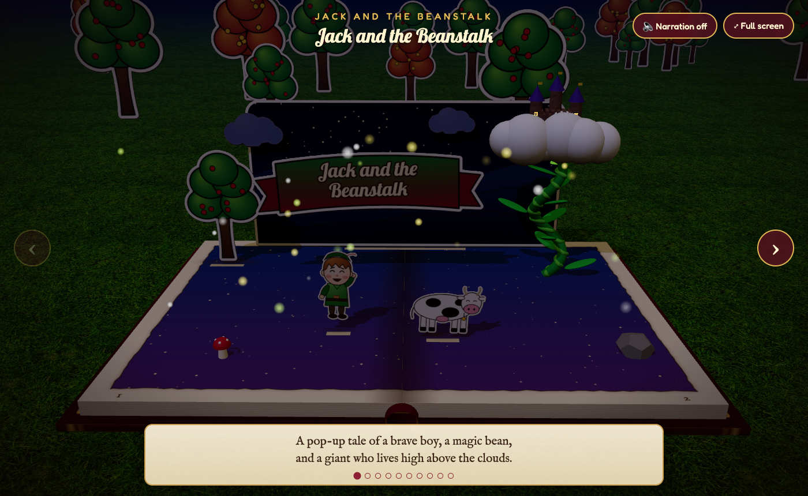

**A Poor Little Cottage** - the 3D thatched cottage smokes, Jack, his mother and Milky-White stand on paper tabs with soft contact shadows.
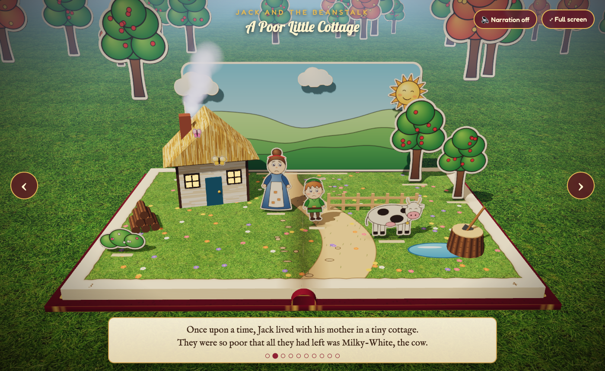

**Page turn in flight** - the pop-up has folded and the book lifts off, banking, while the page curls over inside it.
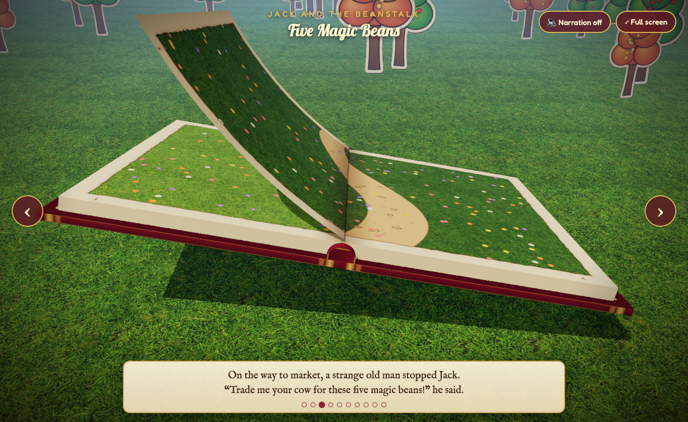

**Five Magic Beans** - the book has landed on the road to market. The old man holds out five glowing 3D beans that circle above his hand.
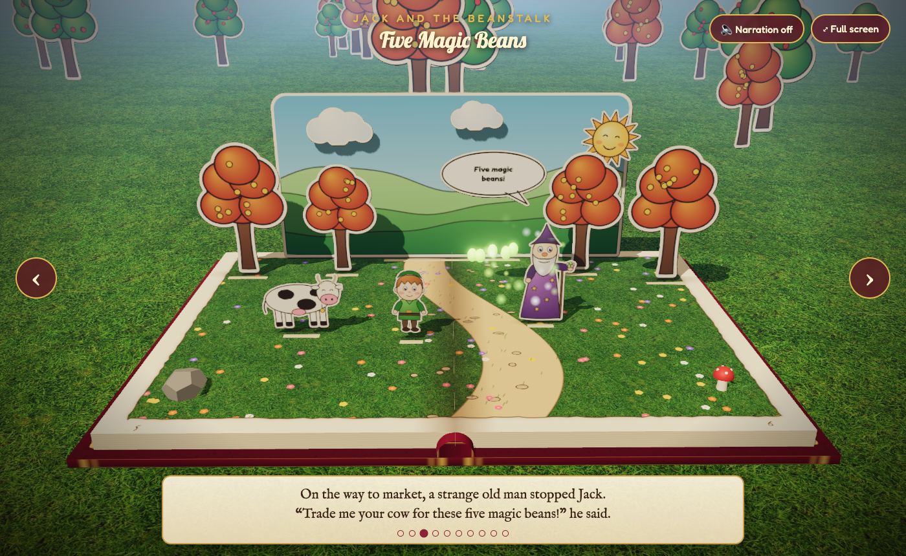

**Out the Window** - the world turns to night. The angry mother throws the beans and they arc out across the grass, glowing.
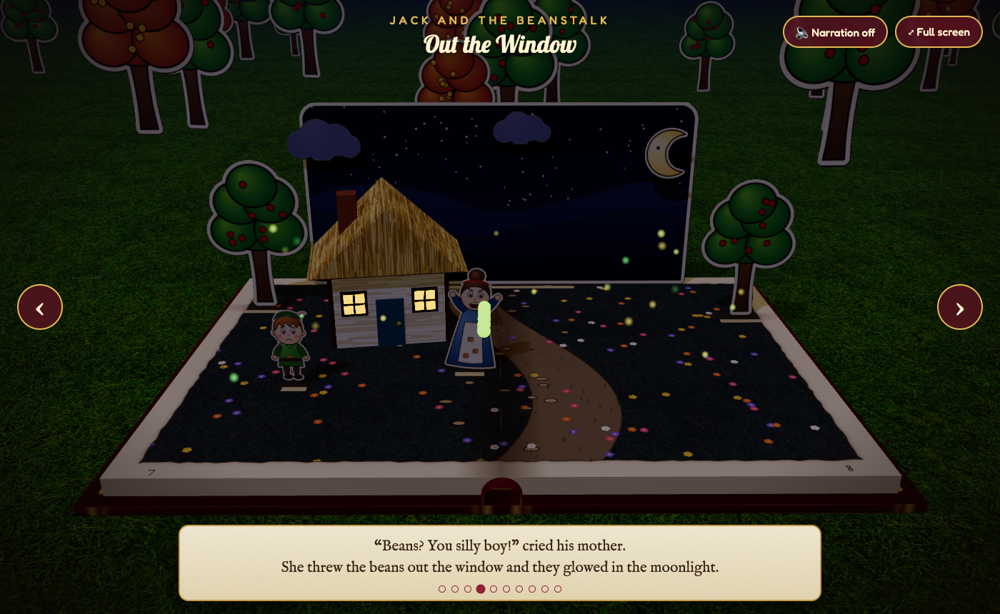

**The Beanstalk Grows** - the stalk rises next to the book and the camera follows its pointed bud up toward the cloud sea.


**Through the clouds** - the stalk tip breaks through the cloud sea into a starry blue sky, with the empty cloud islands waiting for the book.
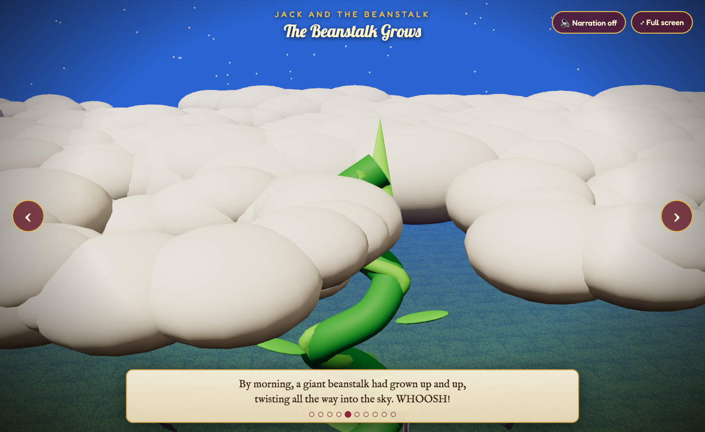

**Lifting off for the sky** - the page has turned to the cloud spread as the same book takes off from the meadow toward the clouds.
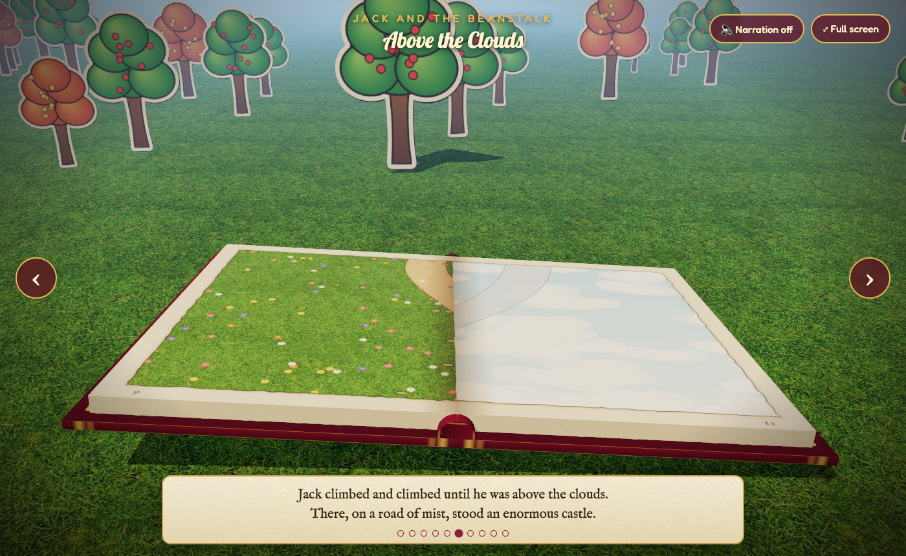

**Above the Clouds** - the book has landed on a cloud island. A 3D rainbow arches over the castle, the door swings open and Jack walks up to it.
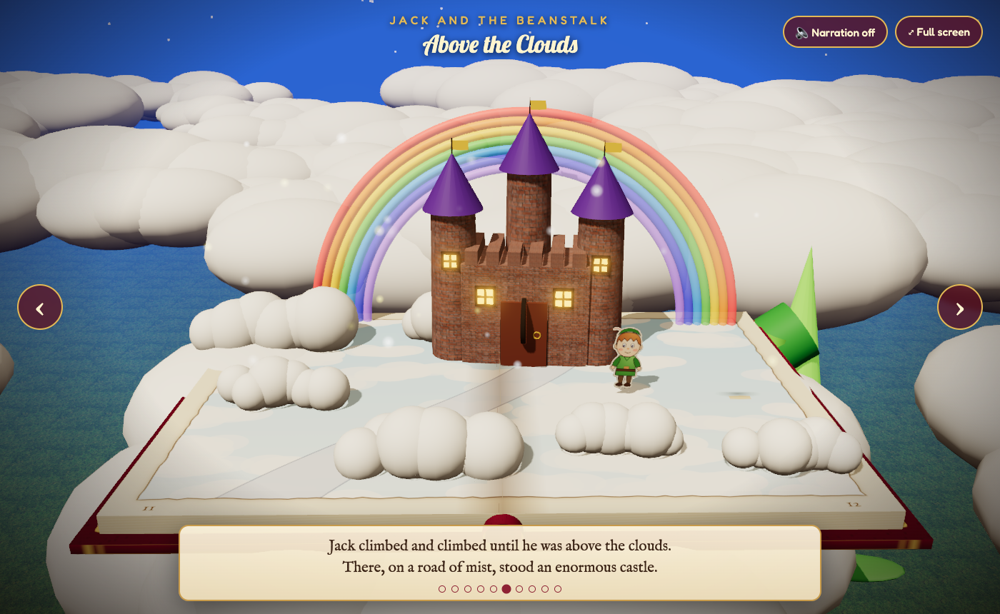

**Fee-Fi-Fo-Fum!** - the fully 3D giant stomps and roars with his arms up. Every step kicks up dust and shakes the camera, while Jack hides behind the oven.
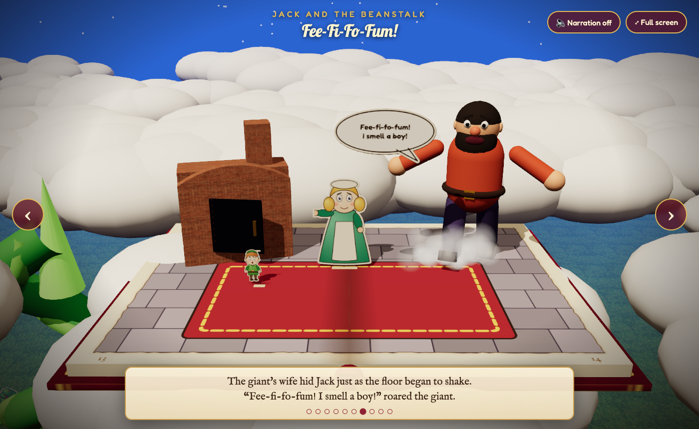

**The Golden Hen** - the 3D hen sits on the giant's table laying golden eggs, the harp plays floating notes, and the 3D giant sleeps sitting on the floor, snoring "Zzz...".
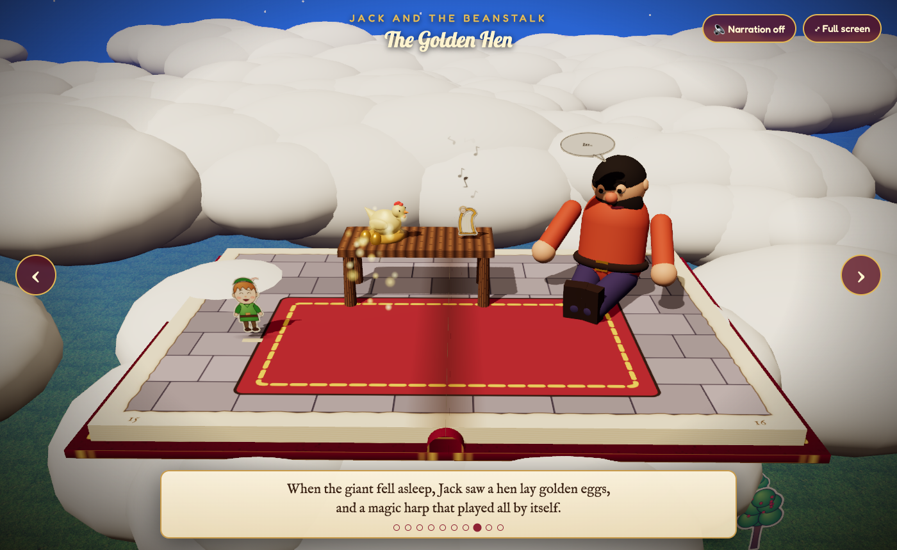

**The Great Chase** - the book rests on a leaf of the beanstalk below. Under dark clouds and a circling bird flock, the 3D giant climbs down the real stalk after Jack.
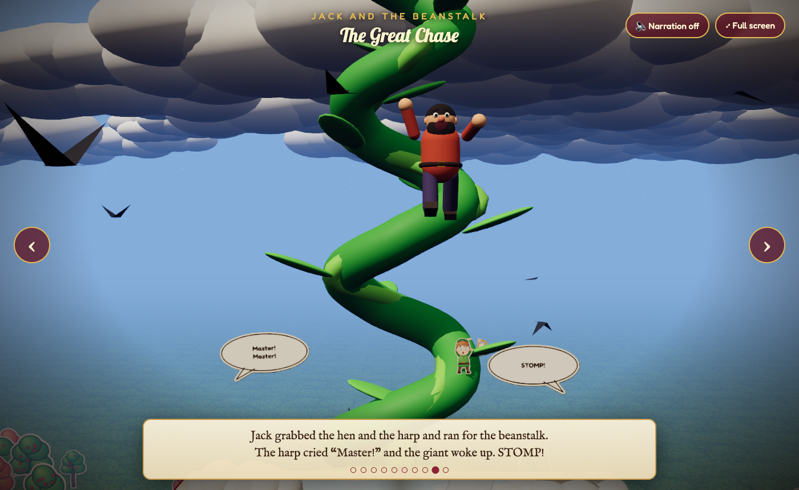

**Diving back down** - the camera follows the book down along the beanstalk toward the ground for the ending.
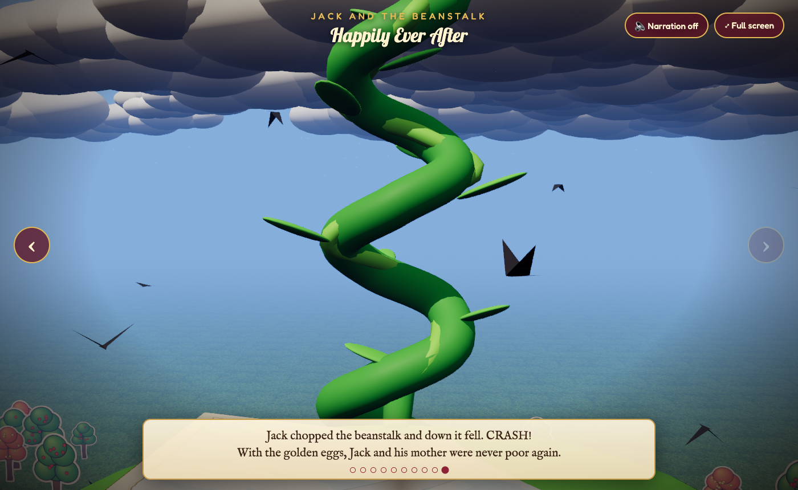

**Happily Ever After** - back on the meadow. After three chops the beanstalk lies fallen behind the book, the chest swings open on gold, the 3D hen pecks, hearts float, and "The End" appears.
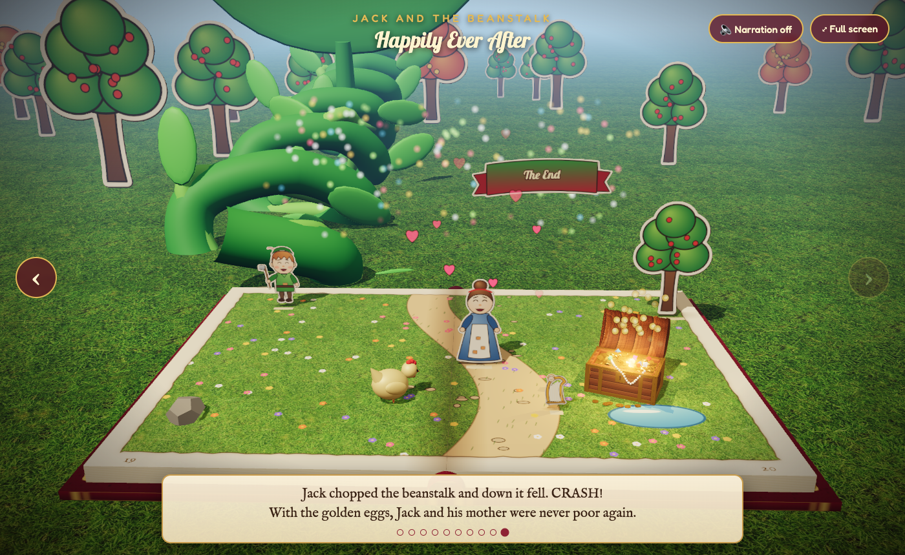

**Mobile** - on a phone the camera moves back so the book on its cloud fills the width, the toggles sit under the title, and pages turn with a swipe.
<p>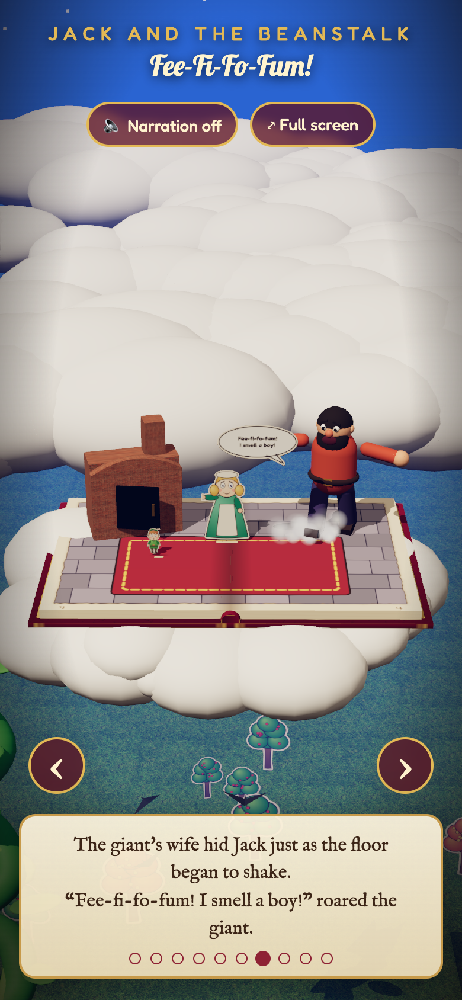</p>

## Scripts

All scripts live in `scripts/` and run from any directory of the repository.

| Script | What it does |
|---|---|
| `./scripts/setup.sh` | Installs dependencies and prepares the app |
| `./scripts/start-all.sh` | Starts every service and prints the full link of each one |
| `./scripts/status.sh` | Shows every service port as UP or DOWN |
| `./scripts/test-all.sh` | Runs every test suite |
| `./scripts/ui.sh` | Opens the UI in the browser |
| `./scripts/stop-all.sh` | Stops every service |

Ports are declared in `scripts/ports.env`.

```bash
./scripts/setup.sh
./scripts/start-all.sh
./scripts/status.sh
./scripts/ui.sh
./scripts/stop-all.sh
```
