<p align="center">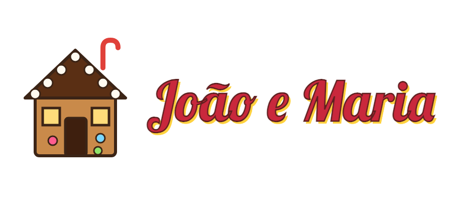</p>

# João e Maria - Livro Pop-up

<p align="center">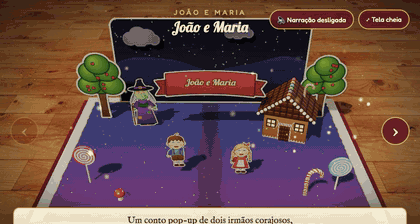</p>

A 3D pop-up book of *João e Maria* (Hansel and Gretel), written and narrated in Brazilian Portuguese and rendered with three.js in the browser.
The book lies open on an enchanted forest floor at dusk: moss, fallen autumn leaves, the white pebbles of the trail and fireflies. Each spread mixes 2D paper cutouts (João, Maria, the witch, the woodcutter, birds, an owl, trees, speech bubbles)
with real 3D models (a gingerbread house with a chocolate roof, lollipops, candy canes, an iron cage, a brick oven with a swinging door, a treasure chest full of coins and gems).
When you turn a page the cutouts fold flat, the page curls over the spine, and the next scene springs up in layers.
Every scene plays its own loop: birds eat the bread crumbs, an owl blinks, the witch opens her door, Maria pushes her into the oven.
The story runs for 10 spreads, each with a 2 line caption in Portuguese.

## How it Works

1. TanStack Router maps `#/page/$page` to the spread to show. Arrows, dots, the keyboard, a swipe and the URL all navigate.
2. `Stage` owns the three.js renderer, lights, soft shadows, the forest floor (painted at runtime on Canvas 2D) and a camera that follows the mouse and fits phone screens.
3. Every scene is a `PopupScene`. A 2D cutout sits on a hinge at its base and folds with the page; 3D models grow out of the page.
4. A page turn has 3 phases set by the pure `turnFrame()`: fold the old scene, curl the leaf, unfold the new scene.
5. All characters, props and backdrops are painted at runtime on Canvas 2D, with a white paper border and a drop shadow.
6. Scene loops are driven by pure timeline functions (`timelines.ts`), so the story rules (birds eat only dropped crumbs, the oven door closes only after the witch is inside) are unit tested.
7. The narrator reads the page with the Web Speech API, picks the most natural Brazilian voice the device has, and speaks sentence by sentence.

## Architecture

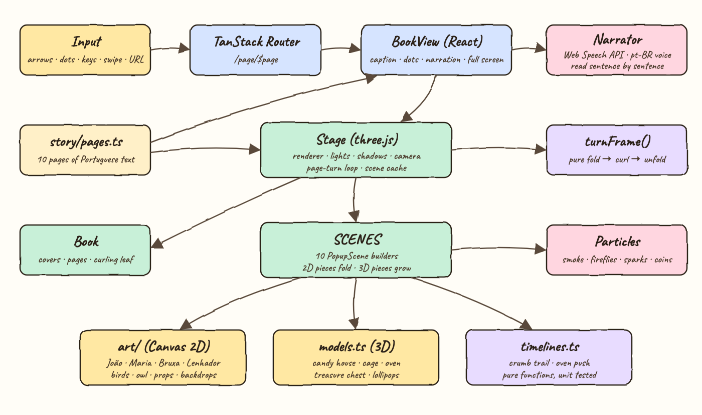

## Features

* **10 illustrated spreads** - the whole tale, from the woodcutter's house to the happy ending with the witch's treasure.
* **All in Portuguese** - titles, captions, speech bubbles, buttons and narration are in Brazilian Portuguese.
* **Real pop-up mechanics** - cutouts fold on hinges with a springy overshoot, like paper that bounces when it stands up.
* **2D + 3D mix** - flat paper characters stand next to lit, shadowed 3D models, so the page reads as a pop-up book, not a game.
* **Curling page turn** - the page bends over the spine and shows the next spread on its back.
* **Animated scenes** - crumbs fall from João's hand and the birds peck them up, fireflies float, the candy house door swings open, Maria sweeps, the oven door slams shut with sparks.
* **Native narration** - prefers natural pt-BR voices (Google português do Brasil, Microsoft Francisca/Thalita/Antonio, Luciana Premium) and never picks the robotic novelty voices macOS lists for pt-BR (Eddy, Flo, Reed, Rocko, Sandy, Shelley, Grandma, Grandpa).
* **Works on mobile** - narration is unlocked by the tap on the toggle (required by iOS and Android), the camera moves in on portrait screens, and you can swipe to turn pages.
* **Full screen** - a toggle next to narration puts the book in full screen (Fullscreen API).
* **Deep links** - `#/page/9` opens straight on the oven scene.

## Stack

* **TypeScript 7** - typed scene builders, painters and engine.
* **Bun 1.4.4** - package manager and test runner.
* **Vite 8** - dev server and production bundle.
* **React 19.3** - the overlay UI: caption, arrows, page dots, narration and full screen toggles.
* **TanStack Router 1.x** - one route per page, so every spread has a URL.
* **three.js 0.187** - WebGL rendering, shadows, sprites and geometry. No other 3D library.
* **Web Speech API** - narration with the voices already on the device, no server and no API key.

## Assets

* Brick, grass and sparkle sprite textures come from the three.js repository examples (`examples/textures`).
* Fonts come from Google Fonts: Lobster (titles), Fredoka (speech bubbles), IM Fell English (captions).
* All characters and props are drawn in code on Canvas 2D (`src/art`). All 3D models are built from three.js primitives (`src/scenes/models.ts`).

## Key Data Structures and Design Decisions

* `StoryPage { scene, title, lines }` in `src/story/pages.ts` is the only place the story text lives.
* `SCENES: Record<SceneId, SceneBuilder>` maps every page to the function that builds its pop-up scene. Scenes are built lazily and cached.
* `PopupScene` keeps a list of pieces (`fold` for 2D, `grow` for 3D) plus update callbacks. `setOpenness(0..1)` drives every piece at once.
* `timelines.ts` holds pure functions of the loop time: `joaoX`, `birdX`, `crumbShowing`, `push`, `doorClose`, `witchShowing`. Scenes only read them.
* `narrationParts(page)` splits the page into sentences, lowers shouted words (`PLAFT` is read as a word) and drops quote marks. Short utterances avoid Chrome cutting long speech and read better on phones.
* `pickVoice(voices)` scores Portuguese voices: natural/neural/premium/network markers first, then known good names, then pt-BR over pt-PT.
* `Particles` is a small pool of reused sprites with spawn, gravity, drag, growth and fade. There is no particle library.

## Contracts / APIs

There is no backend and no REST API. The only contract is the route:

| Route | What it shows |
|---|---|
| `/` | Redirects to `#/page/1` |
| `#/page/$page` | Spread `$page` (1 to 10). A bad value falls back to the nearest valid page |

## How to Run

```bash
./scripts/setup.sh
./scripts/start-all.sh
./scripts/ui.sh
```

Turn pages with the arrow buttons, the dots, the left and right arrow keys, or a swipe on a phone.
For the best narration on a Mac or iPhone, download a Portuguese (Brazil) Premium or Enhanced voice in the system Spoken Content settings; the book picks it up automatically.

## How to Test

```bash
./scripts/test-all.sh
```

This runs the typecheck, the unit tests (`bun test src`) and the production build.
The tests cover the story rules (10 pages, caption length, plot order, Portuguese text), navigation clamping, the page turn timeline,
the crumb trail and oven timelines, narration text and chunking, and the pt-BR voice picker.

```
 43 pass
 0 fail
 3799 expect() calls
Ran 43 tests across 4 files.
```

## Printscreens

**Capa** - a starry title spread. The banner sways, João and Maria bounce, the witch peeks from behind a tree, and a small 3D candy house waits on the right.
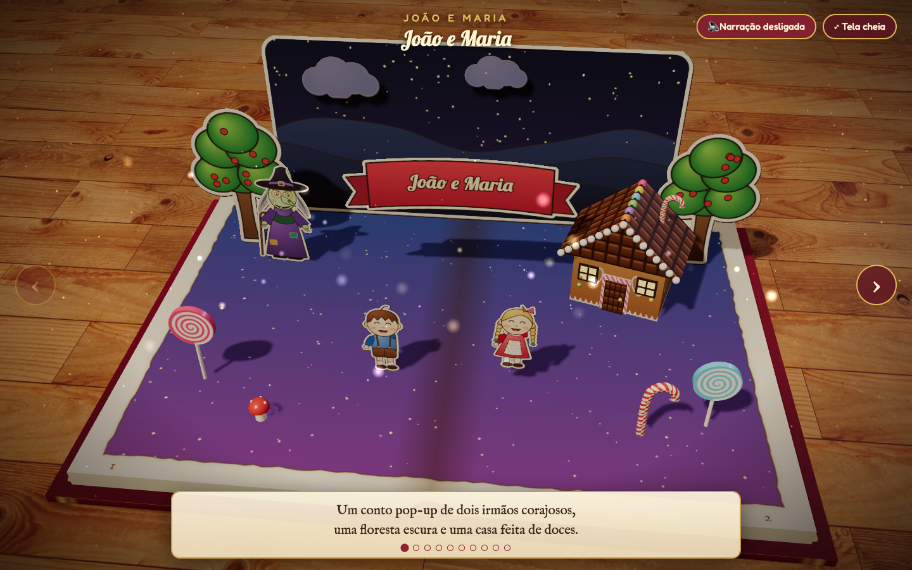

**A Casa do Lenhador** - the 3D thatched cottage with smoke from the chimney, a stump with an axe, a log pile, and the woodcutter swinging.
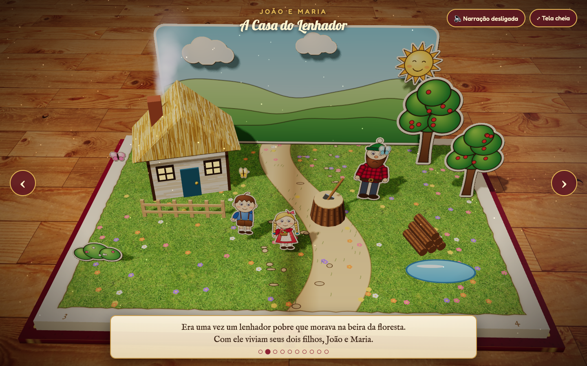

**Migalhas de Pão** - João walks through the pines dropping 3D bread crumbs, and two birds follow behind and peck every crumb away.
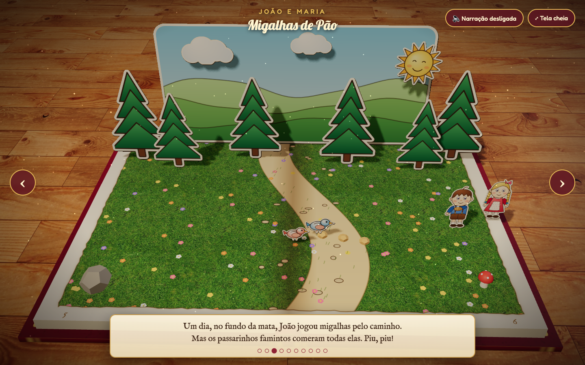

**Perdidos na Floresta** - night falls, the owl blinks on its branch, glowing mushrooms and fireflies light the scared children.
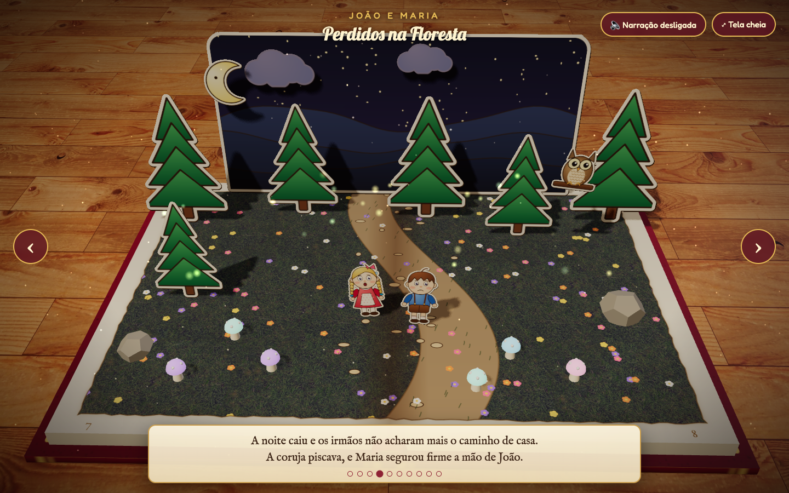

**A Casa de Doces** - the 3D gingerbread house with a chocolate roof, icing, gumdrops and a candy cane chimney, surrounded by lollipops.
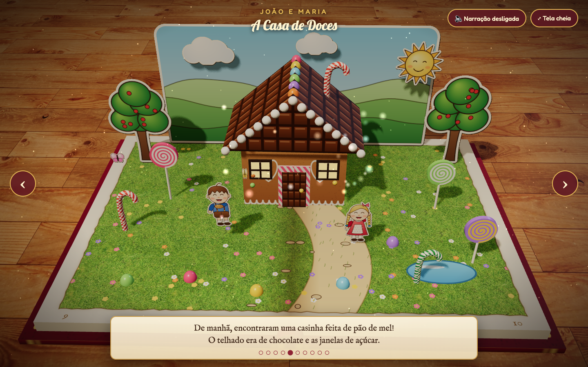

**A Bruxa** - the chocolate door swings open, the witch invites the children in with a lollipop, then turns wicked behind their backs.
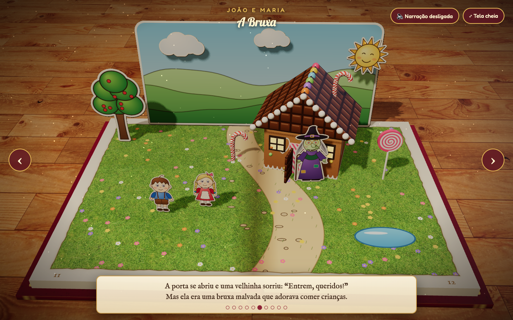

**João na Gaiola** - João is locked in a 3D iron cage while the witch's cauldron bubbles over a flickering fire and Maria sweeps.
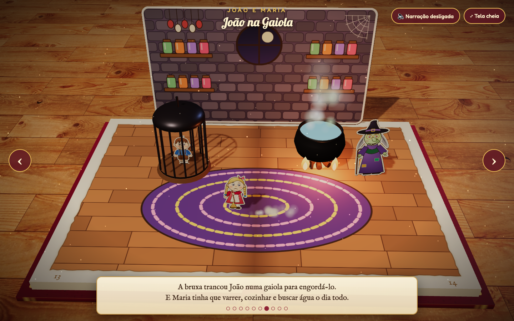

**O Osso de Galinha** - speech bubbles pop up in turn: the half-blind witch asks for João's finger, he shows a bone, and she sighs that he is still too thin.
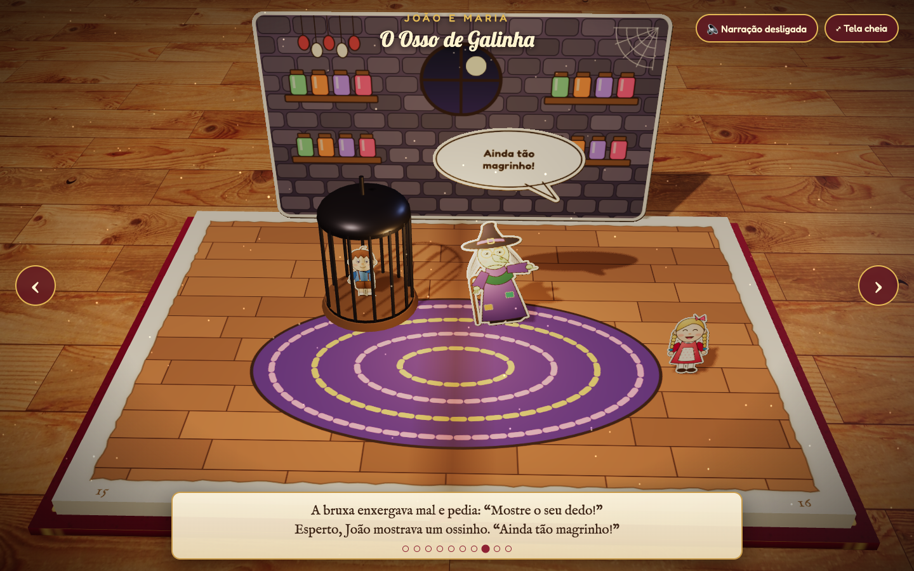

**O Forno** - Maria runs in and pushes the witch into the glowing 3D oven; the iron door slams shut and sparks burst from the chimney.
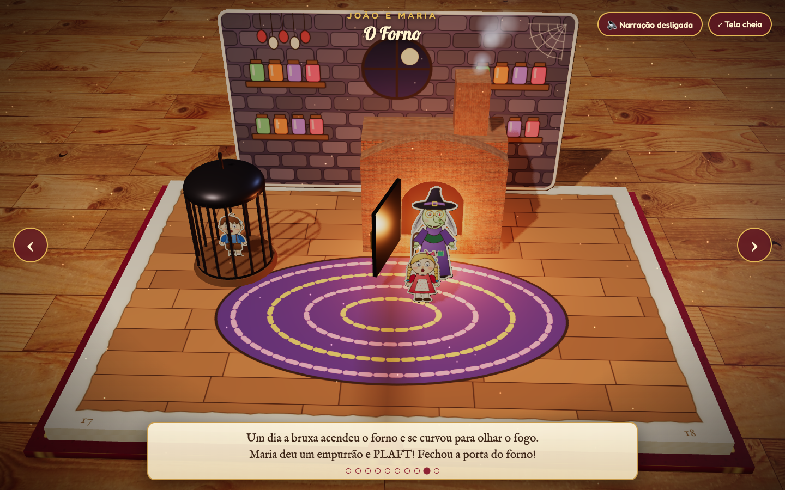

**Felizes Para Sempre** - the woodcutter opens his arms, the children dance, and the witch's 3D treasure chest (plank wood, gold trims, curved lid) swings open on a glowing heap of coins, gems and a pearl necklace, under fireworks and hearts.
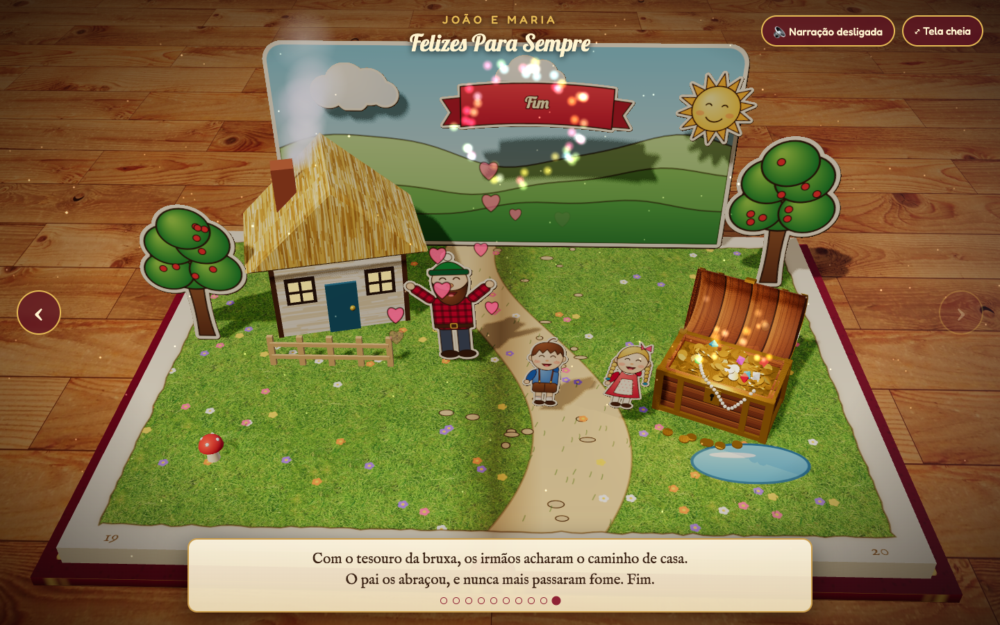

**Mobile** - on a phone the camera moves in so the book fills the width, the toggles sit under the title, and pages turn with a swipe.
<p>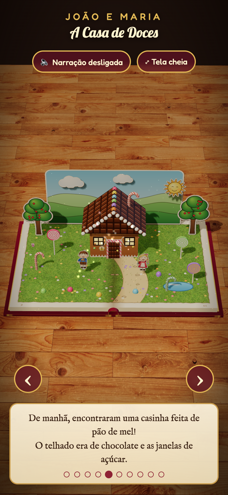</p>

## Scripts

All scripts live in `scripts/` and run from any directory of the repository.

| Script | What it does |
|---|---|
| `./scripts/setup.sh` | Installs dependencies and prepares the app |
| `./scripts/start-all.sh` | Starts every service and prints the full link of each one |
| `./scripts/status.sh` | Shows every service port as UP or DOWN |
| `./scripts/test-all.sh` | Runs every test suite |
| `./scripts/ui.sh` | Opens the UI in the browser |
| `./scripts/stop-all.sh` | Stops every service |

Ports are declared in `scripts/ports.env`.

```bash
./scripts/setup.sh
./scripts/start-all.sh
./scripts/status.sh
./scripts/ui.sh
./scripts/stop-all.sh
```
