<p align="center">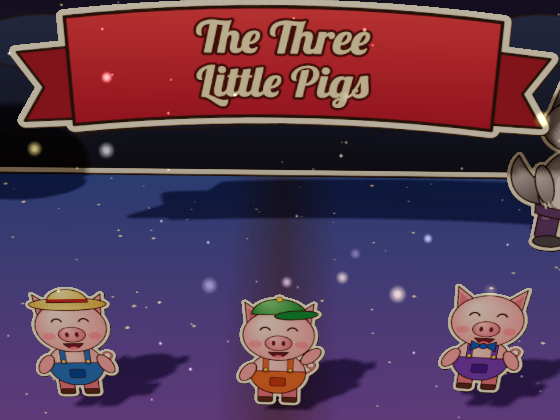</p>

# The Three Little Pigs - Pop-up Book

A 3D pop-up book of *The Three Little Pigs and the Big Bad Wolf*, rendered with three.js in the browser.
The book lies open on a wooden table. Each spread mixes 2D paper cutouts (pigs, wolf, trees, sky panels,
speech bubbles) with real 3D models (houses of straw, sticks and bricks, a fireplace, a cauldron).
When you turn a page the cutouts fold flat, the page curls over the spine, and the next scene springs
up in layers. Every scene plays its own loop: the wolf huffs and puffs, straw flies, a pot boils, fireworks go off.
The story runs for 12 spreads, each with a 2 line caption at the bottom.

## How it Works

1. TanStack Router maps `/page/$page` to the spread to show. Arrows, dots, the keyboard and the URL all navigate.
2. `Stage` owns the three.js renderer, the lights, the soft shadows, the wooden table and the camera that follows the mouse.
3. Every scene is a `PopupScene`. A 2D cutout sits on a hinge at its base, and its fold angle comes from the page openness.
4. 3D pieces (houses, rocks, logs) grow out of the page with an overshoot instead of folding.
5. Pieces near the back of the page rise first, so the scene unfolds from back to front.
6. A page turn has 3 phases, set by the pure `turnFrame()` function: fold the old scene, curl the leaf, unfold the new scene.
7. The leaf is a strip mesh bent every frame. Its front shows the old right page and its back shows the new left page.
8. All characters, props and page backdrops are painted at runtime on Canvas 2D, with a white paper border and a drop shadow.
9. Each scene registers update callbacks that drive its animation loop and its particles (wind, debris, smoke, steam, splash, sparks, hearts).

## Architecture

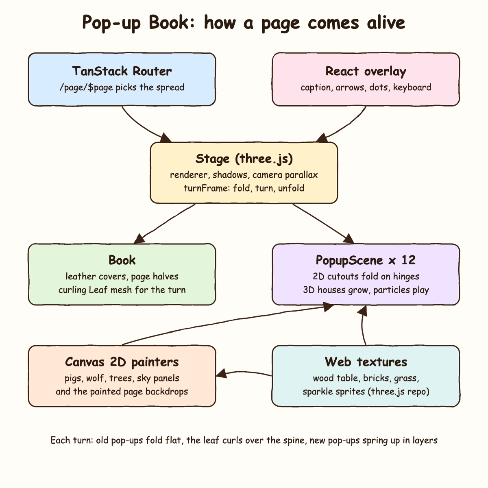

## Features

* **12 illustrated spreads** - the whole tale, from Mother Pig's goodbye to the happy ending.
* **Real pop-up mechanics** - cutouts fold on hinges with a springy overshoot, like paper that bounces when it stands up.
* **2D + 3D mix** - flat paper characters stand next to lit, shadowed 3D houses, so the page reads as a pop-up and not a game.
* **Curling page turn** - the page bends over the spine and shows the next spread on its back.
* **Animated scenes** - the wolf puffs his cheeks, wind streaks fly, straw and sticks scatter, the brick house only shakes.
* **Short captions** - each page has a 2 line caption in a storybook font, so the picture tells most of the story.
* **Deep links** - `/page/7` opens straight on the huff and puff scene.
* **Mouse parallax** - the camera drifts with the mouse, so you can look at the scene from slightly different angles.

## Stack

* **TypeScript 7** - typed scene builders, painters and engine.
* **Bun 1.4.4** - package manager and test runner (the stack names Bun 2.x, which is not released yet; 1.4.4 is the latest stable).
* **Vite 8** - dev server and production bundle.
* **React 19.3** - the overlay UI: caption, arrows, page dots.
* **TanStack Router 1.x** - one route per page, so every spread has a URL.
* **three.js 0.187** - WebGL rendering, shadows, sprites and geometry. No other 3D library.

## Assets

* Wood table, brick wall, grass and sparkle sprite textures come from the three.js repository examples (`examples/textures`).
* Fonts come from Google Fonts: Lobster (titles), Fredoka (speech bubbles), IM Fell English (captions).
* All characters and props are drawn in code on Canvas 2D (`src/art`).

## Key Data Structures and Design Decisions

* `StoryPage { scene, title, lines }` in `src/story/pages.ts` is the only place the story text lives.
* `SCENES: Record<SceneId, SceneBuilder>` maps every page to the function that builds its pop-up scene. Scenes are built lazily and cached.
* `PopupScene` keeps a list of pieces (`fold` for 2D, `grow` for 3D) plus update callbacks. `setOpenness(0..1)` drives every piece at once.
* `turnFrame(elapsed)` is pure and tested: the old pop-ups are fully flat before the leaf moves, so the leaf never cuts through them.
* `Particles` is a small pool of reused sprites with spawn, gravity, drag, growth and fade. There is no particle library.
* The page backdrop is one canvas per spread. Cloned textures with `repeat` and `offset` show its left half, right half, or mirrored left half on the back of the leaf.

## Contracts / APIs

There is no backend and no REST API. The only contract is the route:

| Route | What it shows |
|---|---|
| `/` | Redirects to `/page/1` |
| `/page/$page` | Spread `$page` (1 to 12). A bad value falls back to the nearest valid page |

## How to Run

```bash
./scripts/setup.sh
./scripts/start-all.sh
./scripts/ui.sh
```

Turn pages with the arrow buttons, the dots, or the left and right arrow keys.

## How to Test

```bash
./scripts/test-all.sh
```

This runs the typecheck, the unit tests (`bun test src`) and the production build.
The tests cover the story rules (at least 10 pages, 2 to 3 caption lines, story order), navigation clamping and the page turn timeline.

```
 17 pass
 0 fail
 147 expect() calls
Ran 17 tests across 2 files.
```

## Printscreens

**Cover** - a starry title spread. The banner sways, the three pigs bounce, and the wolf peeks from behind the tree.
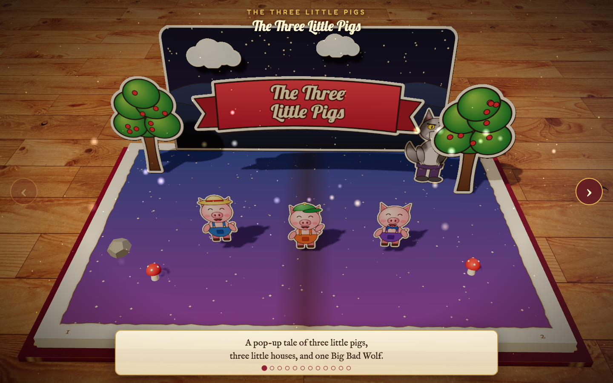

**Off Into the World** - Mother Pig waves goodbye from her 3D cottage, smoke rises from the chimney, the pigs walk down the path.
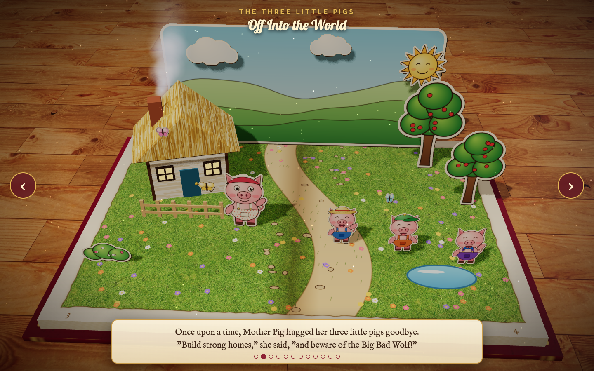

**The House of Straw** - a 3D straw hut with hay bales, butterflies and a hopping pig.
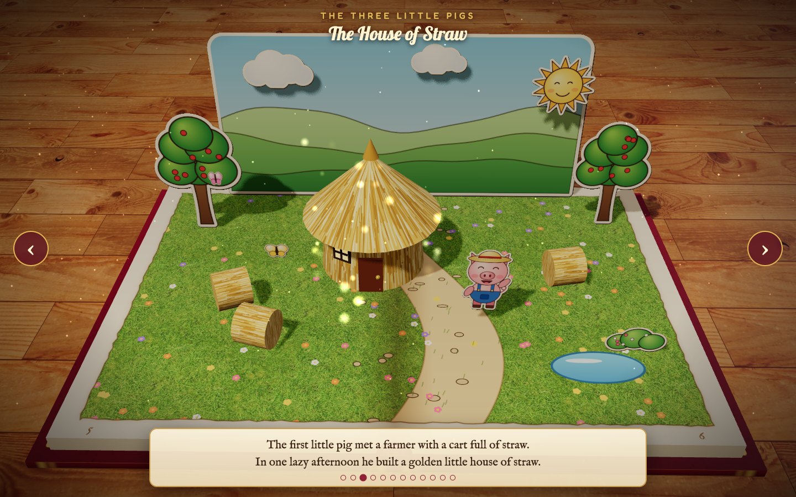

**Page turn** - the cutouts have folded flat and the page curls over the spine, showing the next spread on its back.
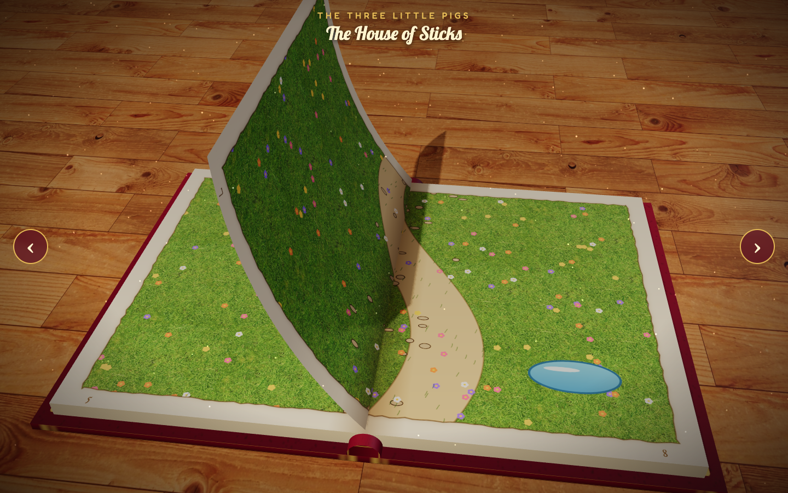

**The House of Bricks** - the brick house with a tiled roof and glowing windows, brick stacks, and the brothers laughing.
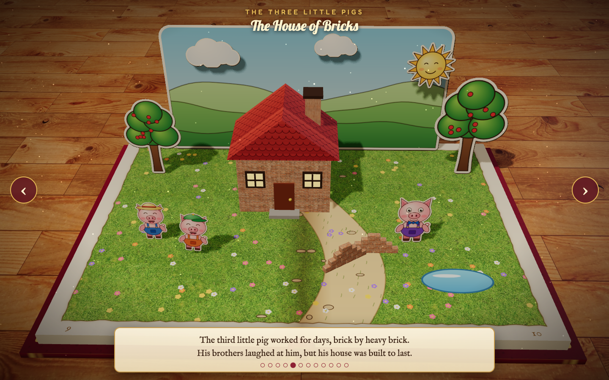

**Knock, Knock** - speech bubbles pop up in turn: the wolf asks to come in, the trembling pig says no.
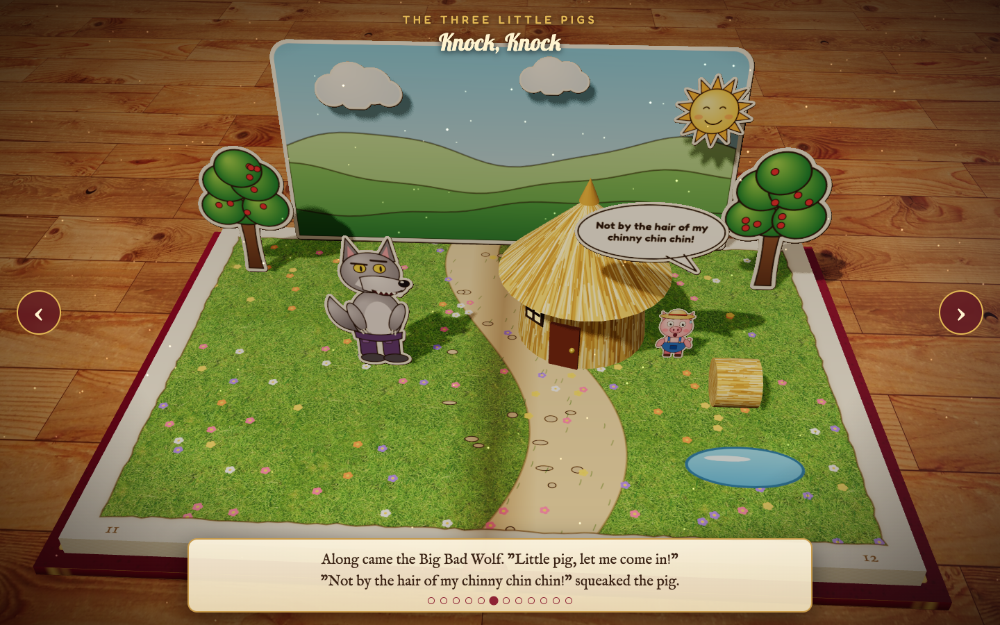

**Huff and Puff** - the wolf puffs his cheeks, wind streaks blow, straw flies off the house and the pig runs away.
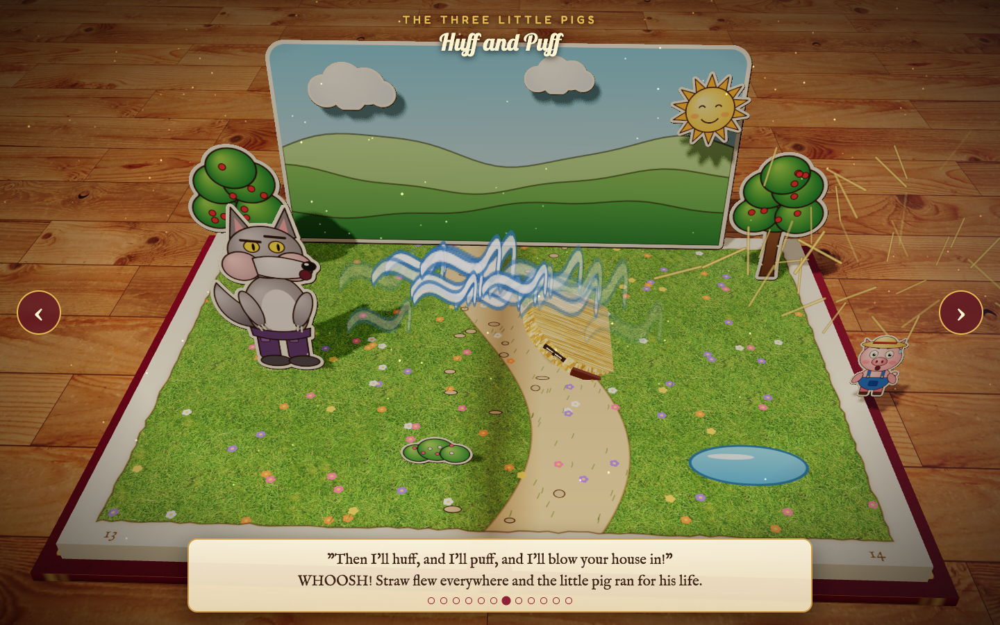

**Up on the Roof** - at night the wolf walks along the ridge to the chimney, under a paper moon.
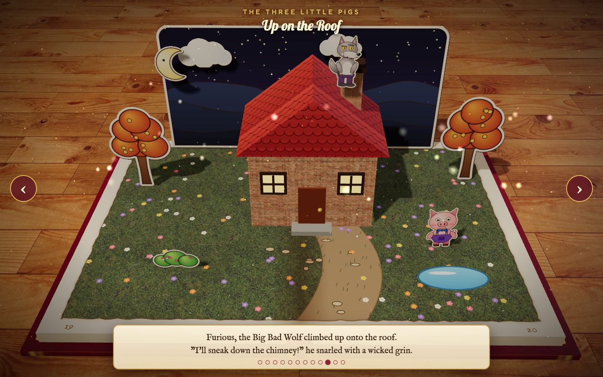

**The Boiling Pot** - inside the house a 3D fireplace flickers and lights the room. The wolf drops into the pot, splashes and shoots back up.
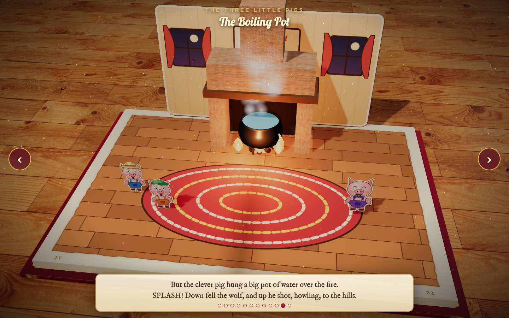

**The End** - the three pigs dance in front of their brick house while fireworks burst and hearts float up.
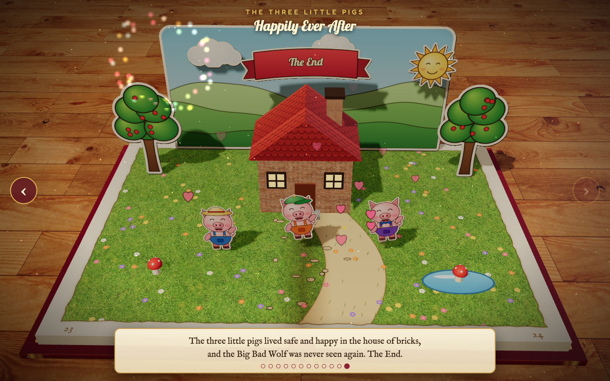

## Scripts

All scripts live in `scripts/` and run from any directory of the repository.

| Script | What it does |
|---|---|
| `./scripts/setup.sh` | Installs dependencies and prepares the app |
| `./scripts/start-all.sh` | Starts every service and prints the full link of each one |
| `./scripts/status.sh` | Shows every service port as UP or DOWN |
| `./scripts/test-all.sh` | Runs every test suite |
| `./scripts/ui.sh` | Opens the UI in the browser |
| `./scripts/stop-all.sh` | Stops every service |

Ports are declared in `scripts/ports.env`.

```bash
./scripts/setup.sh
./scripts/start-all.sh
./scripts/status.sh
./scripts/ui.sh
./scripts/stop-all.sh
```
