<p align="center">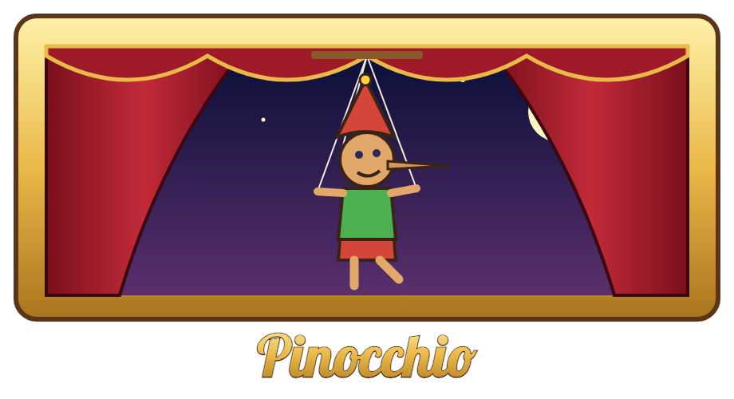</p>

# Pinocchio - A Pop-up Puppet Theater

<p align="center">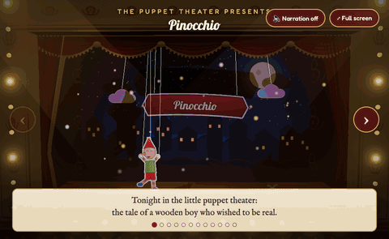</p>

The tale of *Pinocchio* (Carlo Collodi, 1883) played in English on a little 3D puppet theater, rendered with three.js in the browser.
The fourth pop-up book of the collection: instead of turning pages, red velvet curtains close, the scenery is swapped in the dark and the curtains open on the next of 12 scenes.
Every scene mixes 2D and 3D: hand-drawn Canvas 2D puppets hang from marionette strings and fold up from the stage floor like pop-up flats, while 3D models (a workbench, a carousel, a shark with real jaws, a candle that lights the belly of the shark) grow out of the boards.
Follow spots chase the action, the marquee bulbs chase each other, the footlights throw the puppets' shadows onto the painted backdrops, and an audience bobs in the front rows.

## How it Works

1. TanStack Router maps `#/page/$page` to one of 12 scenes. Arrows, dots, the keyboard, a swipe and the URL all navigate.
2. `Theater` builds the proscenium, the valance, the marquee with chasing bulbs, the footlights, two follow spots with visible light cones, a footlight spot, the audience and the two velvet curtain halves.
3. Each curtain half is a 56 x 18 plane whose vertices are rebuilt every frame: pleats along the width, a tie-back gather when open, a sway, and a billow driven by the curtain speed.
4. `changeFrame()` is the scene change: the curtains close while the old pop-ups fold down, the backdrop and scene are swapped only while the curtains are fully shut, then the curtains open and the new set rises.
5. Every scene is a `PopupScene`: 2D cutouts stand on hinges at the stage floor, 3D models grow out of it, marionette strings run from the puppets' head and hands up into the fly loft.
6. Each scene sets a `mood` (spot colors and ambient light) and a `focus` (where the follow spots aim). The theater blends toward them every frame.
7. Scene timelines are pure loop functions (`noseLength`, `earGrowth`, `jawOpen`, `swimX`, `foxX`, `sneezeSwell`), so the story rules are unit tested.
8. The image goes through a bloom pass for the bulbs, the candle and the sparkles, then ACES tone mapping.
9. The narrator reads the page sentence by sentence with the Web Speech API and the most natural English voice on the device.

## Architecture

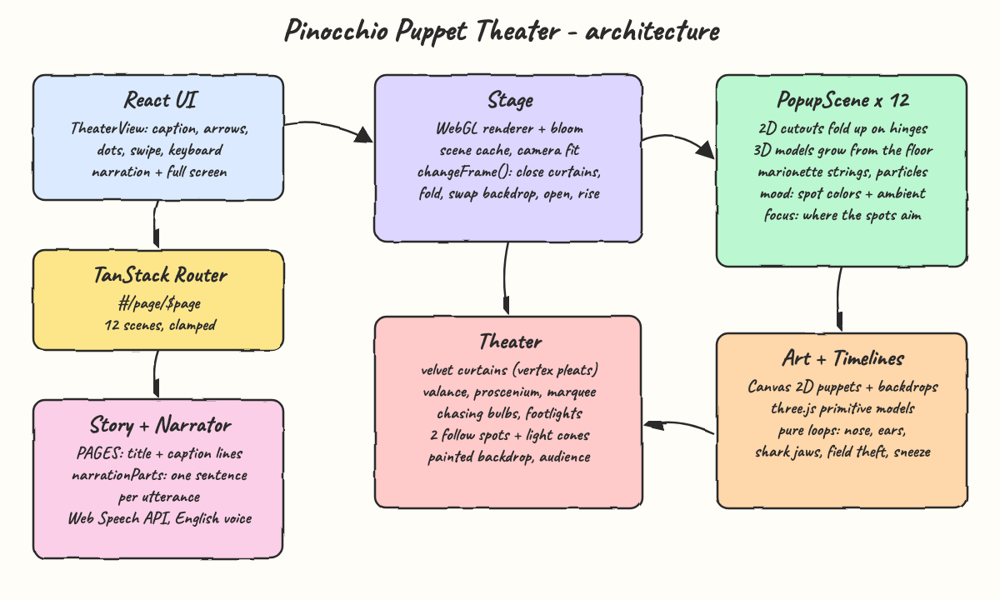

## Features

* **Curtain scene changes** - the curtains close, the set folds, the scenery swaps in the dark and the curtains open on a new world, like a real show.
* **Cloth-like curtains** - pleated velvet with gold fringe, gathered to the sides by a tie-back and billowing as it moves.
* **Theater lights** - two follow spots with light cones track the action, footlights cast big shadows on the backdrop, marquee and pillar bulbs chase.
* **Marionettes** - every puppet hangs from strings that follow its head and hands as it hops, dances and bows.
* **12 painted backdrops** - starry village, workshop, sunroom, kitchen hearth, circus tent, sunset road, moonlit field, fairy grove, carnival, storm at sea, shark belly and a rainbow sunrise.
* **A nose that really grows** - Pinocchio's nose is a 3D cone on the 2D puppet. It stretches when he lies and woodpeckers land on it.
* **Donkey ears** - in the Land of Toys two ears sprout from his head while a 3D carousel spins and balloons float up.
* **The terrible shark** - a 3D shark with hinged upper and lower jaws swallows Pinocchio under lightning flashes, between swaying 3D seaweed.
* **Inside the shark** - 3D ribs arch over the stage and a flickering candle point light shows Geppetto.
* **Living scenes** - wood chips fly from Geppetto's mallet, the Fire-Eater sneezes a burst of gold coins, a dream tree of gold grows and the Fox steals the coins.
* **The real boy** - in the finale a star burst turns the wooden puppet into a real boy while confetti and hearts fall.
* **English narration** - prefers natural voices, never picks the novelty macOS voices, and unlocks speech inside the tap so it works on iOS and Android.
* **Works on mobile** - the camera fits the stage on portrait screens, toggles sit under the title, and you swipe to change scenes.
* **Full screen and deep links** - `#/page/10` opens straight on the shark.

## Stack

* **TypeScript 7** - typed scene builders, painters, theater and engine.
* **Bun 1.4.4** - package manager and test runner.
* **Vite 8** - dev server and production bundle.
* **React 19.3** - the overlay UI: caption, arrows, scene dots, narration and full screen toggles.
* **TanStack Router 1.x** - one route per scene, so every scene has a URL.
* **three.js 0.187** - WebGL, spot light shadows, sprites, and the post-processing passes that ship with it (EffectComposer, UnrealBloomPass, OutputPass). No other 3D library.
* **Web Speech API** - narration with the voices already on the device, no server and no API key.

## Assets

* The sparkle and disc sprites come from the three.js repository examples (`examples/textures`).
* Fonts come from Google Fonts: Lobster (titles and marquee), Fredoka (speech bubbles), IM Fell English (captions).
* Every puppet, backdrop, curtain, frame and prop texture is drawn in code on Canvas 2D (`src/art`). Every 3D model is built from three.js primitives (`src/scenes/models.ts`).

## Key Data Structures and Design Decisions

* `StoryPage { scene, title, lines }` in `src/story/pages.ts` is the only place the story text lives.
* `Figure { canvas, at }` is a painted puppet plus named anchor points (`nose`, `head`, `handL`, `handR`, `earL`, `earR`) in texture space. `actor()` turns anchors into mesh coordinates, so strings, the 3D nose and the ears attach to the drawing.
* `ChangeFrame { curtain, oldOpenness, newOpenness, swapped, done }` describes every moment of a scene change. The tests prove the swap only happens behind closed curtains.
* If the reader clicks several times during a change, the swap jumps straight to the latest target, so the curtains never run a queue of scenes.
* `PopupScene.mood` and `PopupScene.focus` let each scene light itself without knowing about the theater lights.
* Scene loops (`NOSE_LOOP`, `EARS_LOOP`, `SHARK_LOOP`, `FIELD_LOOP`, `SNEEZE_LOOP`) are pure functions of time, so they are tested without WebGL.
* The design follows the other pop-up books (cutouts on hinges, 3D models that grow, Canvas 2D art) but replaces the book with a stage and the page turn with curtains.

## Contracts / APIs

There is no backend and no REST API. The only contract is the route:

| Route | What it shows |
|---|---|
| `/` | Redirects to `#/page/1` |
| `#/page/$page` | Scene `$page` (1 to 12). A bad value falls back to the nearest valid scene |

## How to Run

```bash
./scripts/setup.sh
./scripts/start-all.sh
./scripts/ui.sh
```

Change scenes with the arrow buttons, the dots, the left and right arrow keys, or a swipe on a phone.

## How to Test

```bash
./scripts/test-all.sh
```

This runs the typecheck, the unit tests (`bun test src`) and the production build.
The tests cover the story (12 scenes, caption length, Collodi's plot order, English text), navigation, narration, the English voice picker,
the curtain change (swap only behind closed curtains, old set flat before the curtains meet, new set flat until they part, no flutter),
the pop-up fold, and the scene timelines (birds only on a long nose, HEE-HAW only with full ears, the shark only swallows inside its open mouth,
the coins buried before the dream and stolen only once the Fox reaches the hole, one sneeze per loop).

```
 48 pass
 0 fail
 2372 expect() calls
Ran 48 tests across 4 files.
```

## Printscreens

**Cover** - the marquee glows, the "Pinocchio" banner and two clouds hang on strings, and Pinocchio dances across the stage under the follow spots.
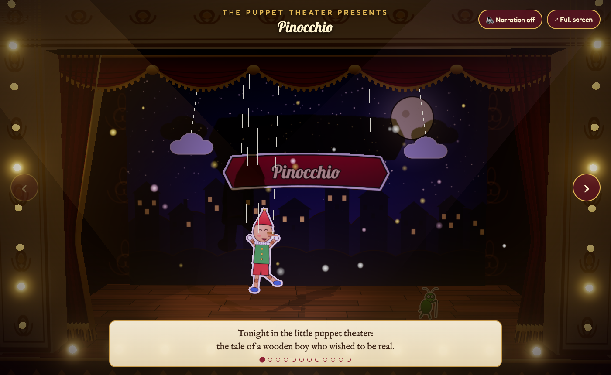

**Geppetto's Workshop** - Geppetto swings his mallet at the 3D log on the workbench and wood chips fly, while the footlights throw his shadow on the clock wall.
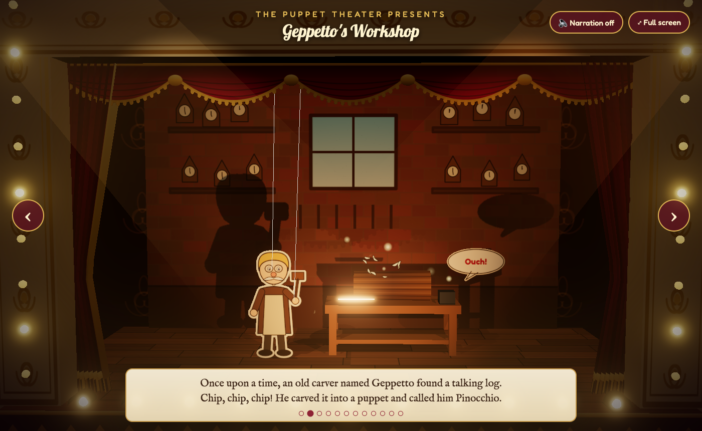

**The Puppet Comes Alive** - Pinocchio hops in circles, switching between a kick and a stand, while star bursts and music notes rise and Geppetto shakes in surprise.
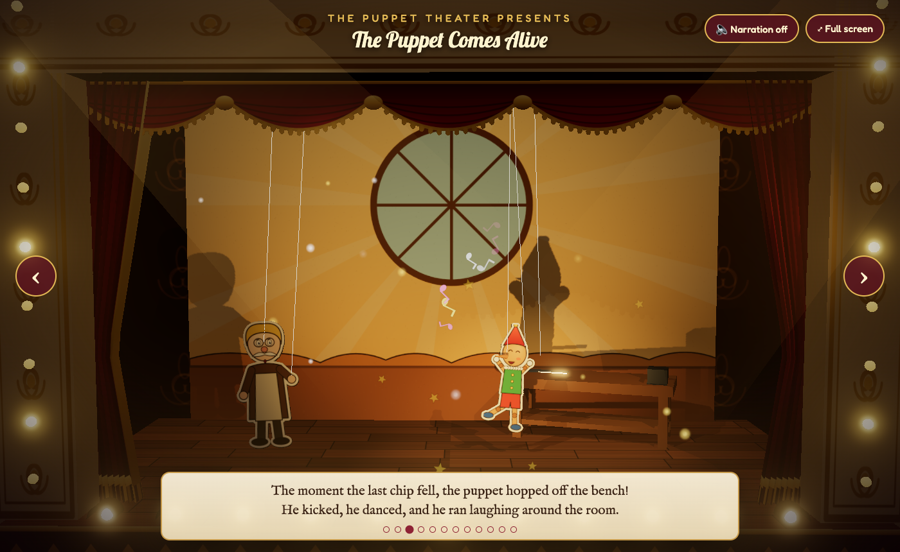

**The Talking Cricket** - the cricket chirps on its stool by the hearth and says "Go to school!", while Pinocchio covers his ears and shakes his head.
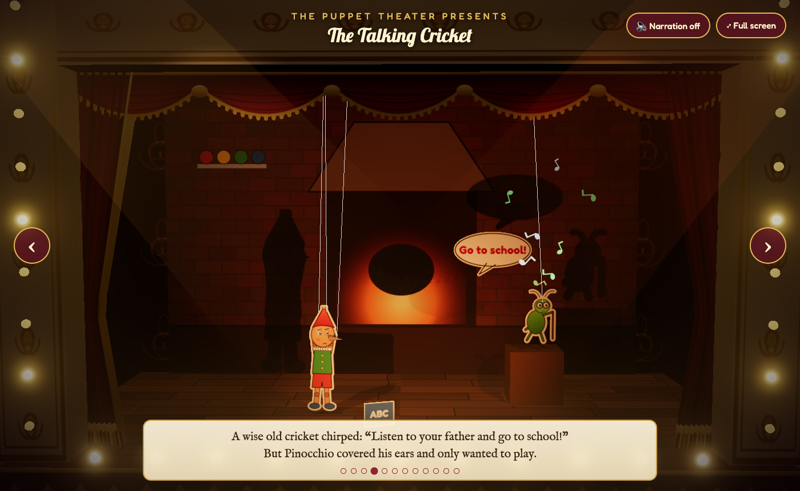

**The Great Puppet Show** - a small theater inside the theater with Harlequin and Punch dancing. The Fire-Eater swells, sneezes "AH-CHOO!" and a burst of gold coins flies out.
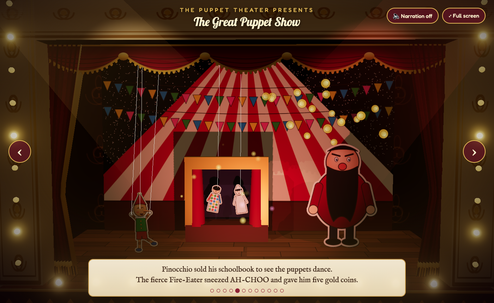

**The Fox and the Cat** - on the sunset road the Fox limps on his cane and the Cat sways behind dark glasses, while five 3D gold coins orbit Pinocchio's hand.
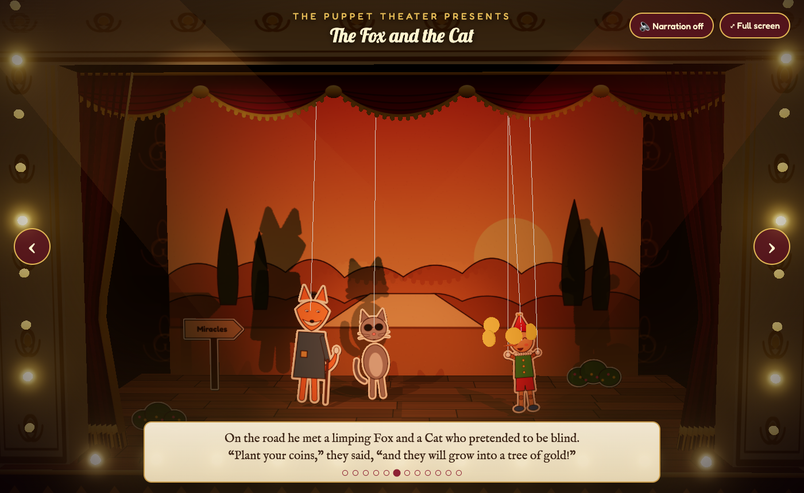

**The Field of Miracles** - after burying his coins Pinocchio dreams of a 3D tree of gold, while the Fox waits at the edge of the stage to sneak in and steal them.
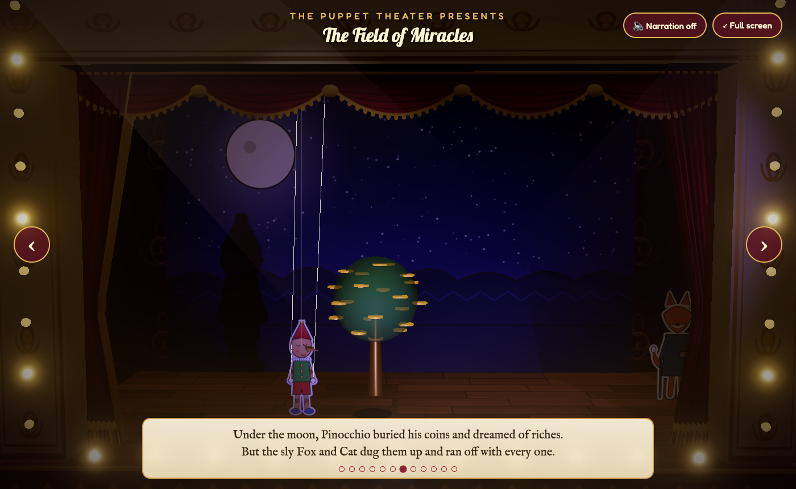

**The Growing Nose** - the blue-haired Fairy floats with her wand. Pinocchio's 3D nose has grown long and a woodpecker sits on it.
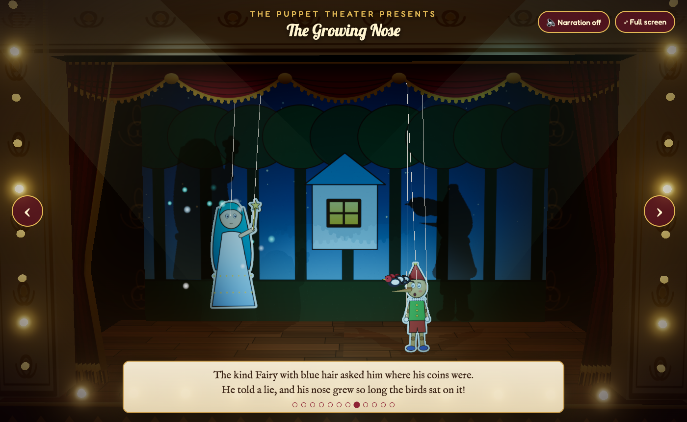

**The Land of Toys** - the 3D carousel spins with bobbing horses, balloons float up and confetti falls, just before the donkey ears sprout.
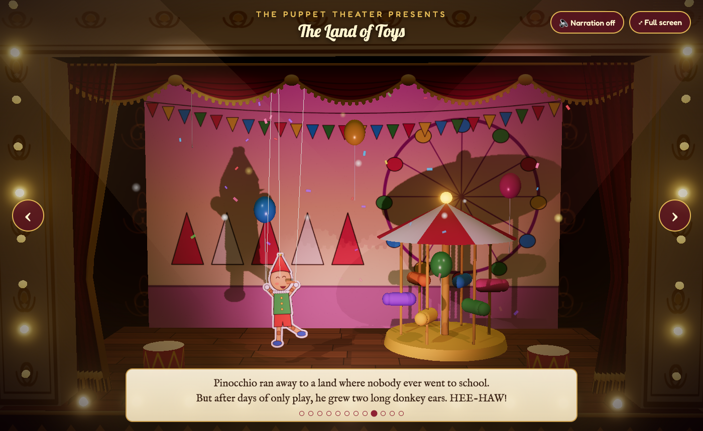

**The Terrible Shark** - the shark opens its hinged 3D jaws full of teeth while Pinocchio swims toward it over the waves, under a painted lightning bolt.
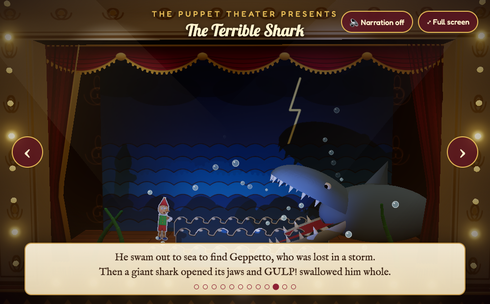

**Inside the Shark** - 3D ribs arch over the stage, a candle flickers on a little table, and Geppetto lights up with hearts when his son arrives.
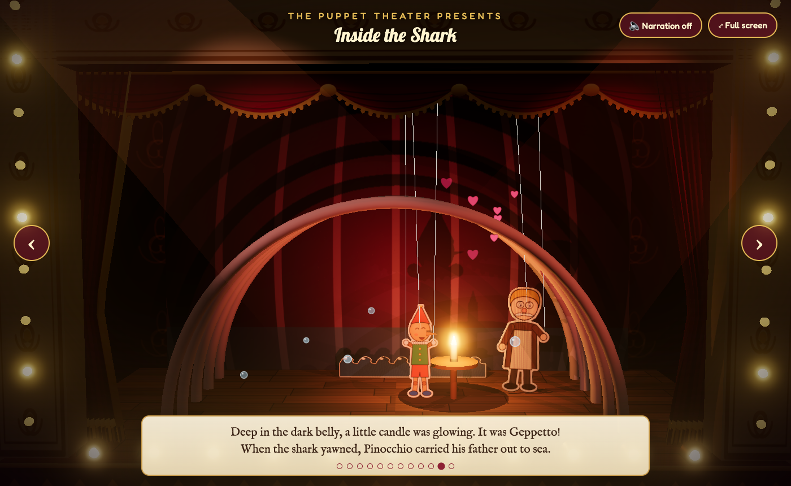

**A Real Boy** - under a rainbow, Pinocchio is now a real boy. Geppetto dances, the Fairy and the cricket watch, and "The End" hangs over them.
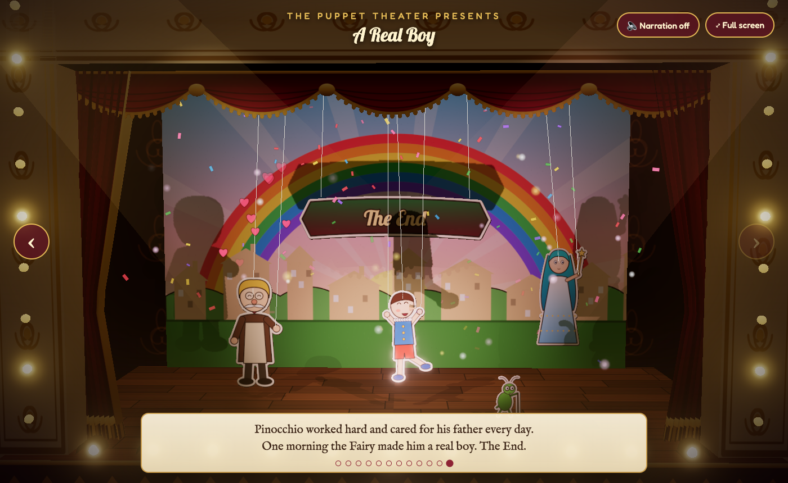

**Scene change** - the velvet curtains meet in the middle with a gold fringe while the next scenery is swapped behind them.
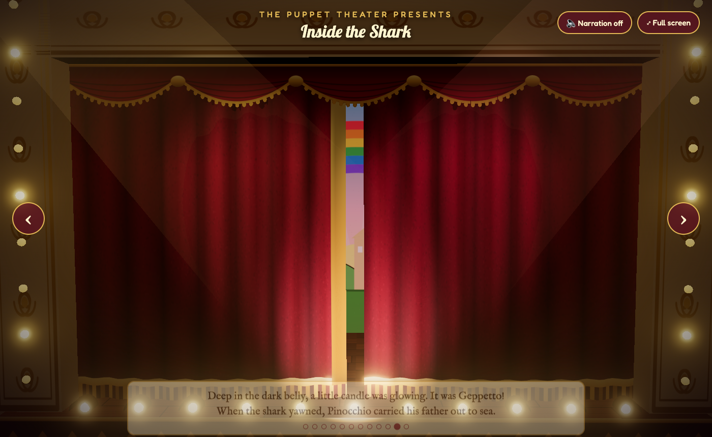

**Mobile** - on a phone the camera fits the whole stage, the toggles sit under the title, and you swipe to change scenes.
<p>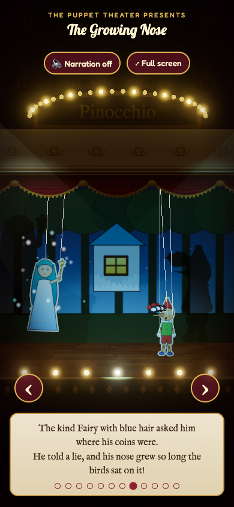</p>

## Scripts

All scripts live in `scripts/` and run from any directory of the repository.

| Script | What it does |
|---|---|
| `./scripts/setup.sh` | Installs dependencies and prepares the app |
| `./scripts/start-all.sh` | Starts every service and prints the full link of each one |
| `./scripts/status.sh` | Shows every service port as UP or DOWN |
| `./scripts/test-all.sh` | Runs every test suite |
| `./scripts/ui.sh` | Opens the UI in the browser |
| `./scripts/stop-all.sh` | Stops every service |

Ports are declared in `scripts/ports.env`.

```bash
./scripts/setup.sh
./scripts/start-all.sh
./scripts/status.sh
./scripts/ui.sh
./scripts/stop-all.sh
```
