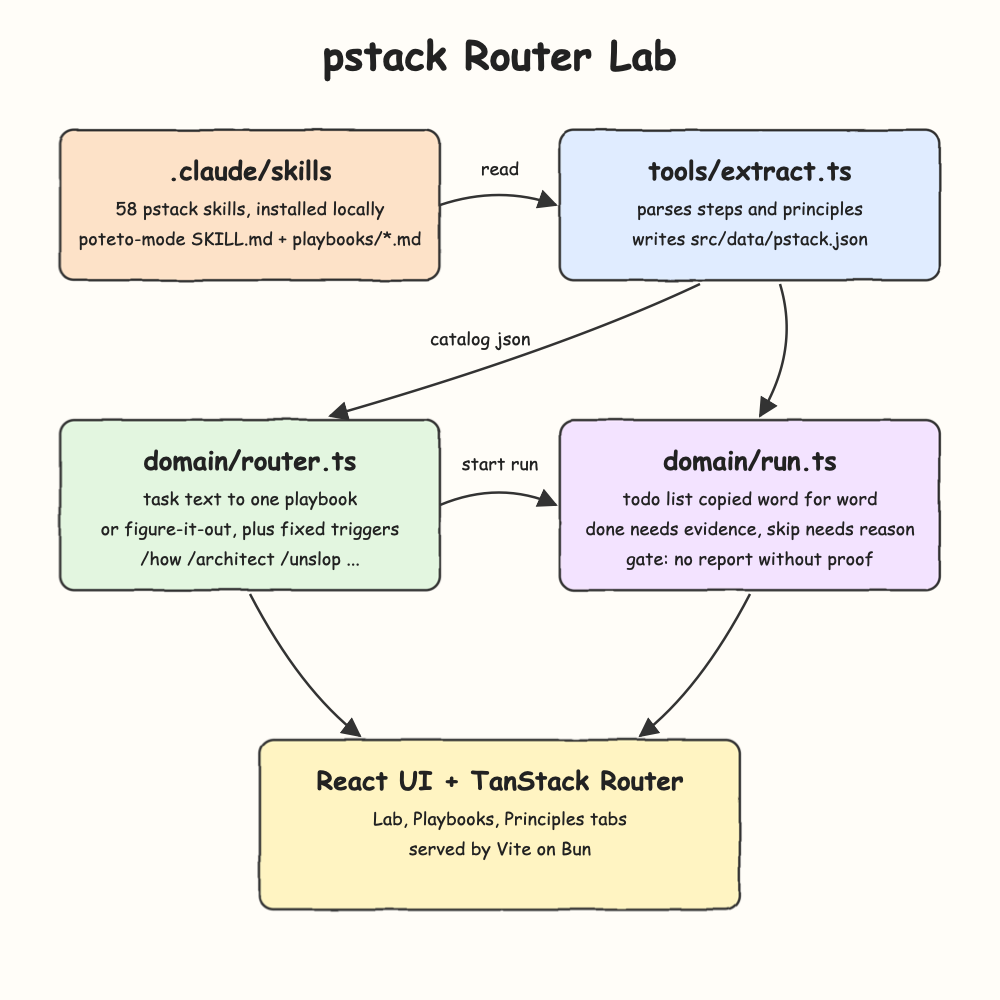
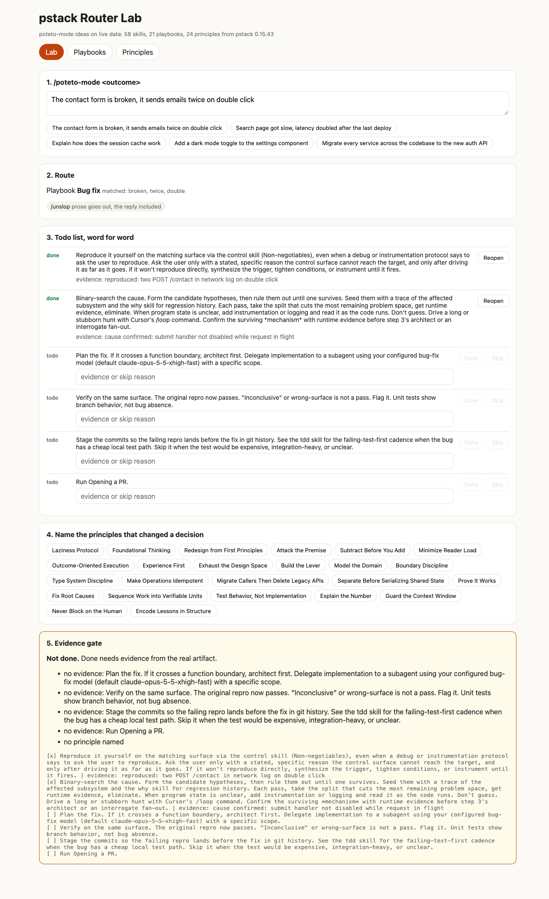
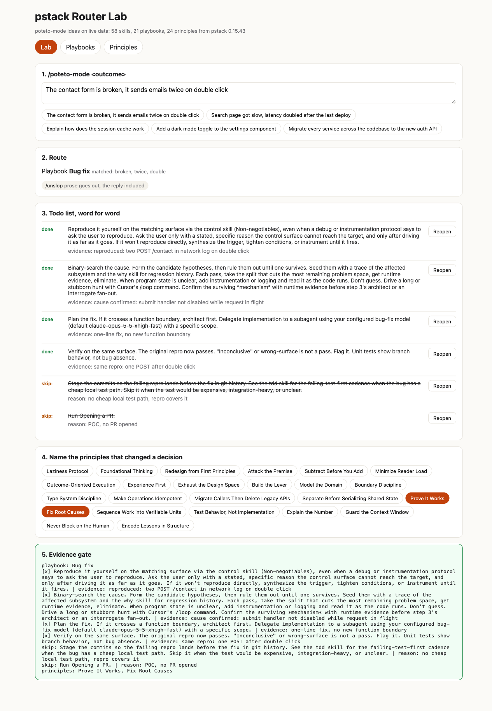
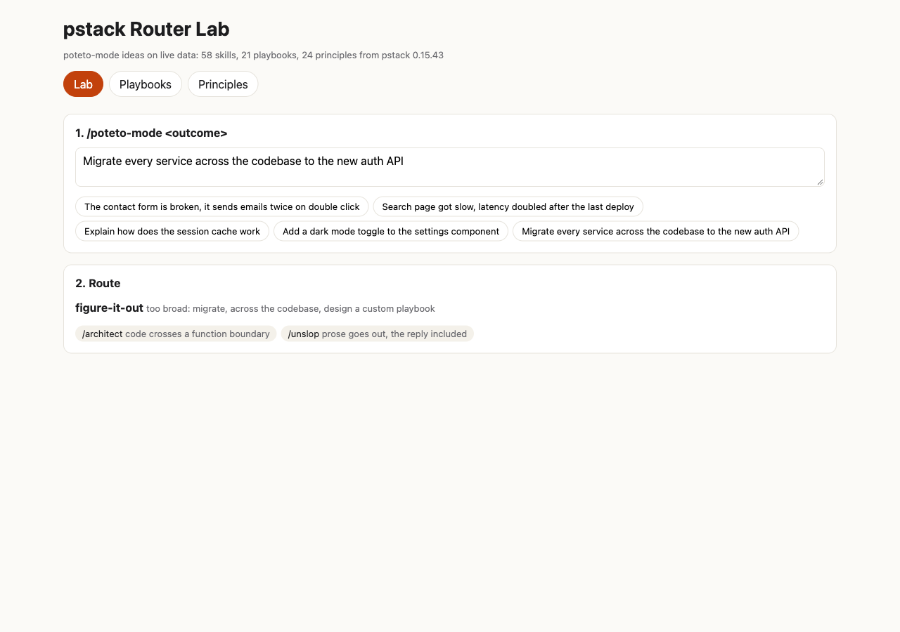
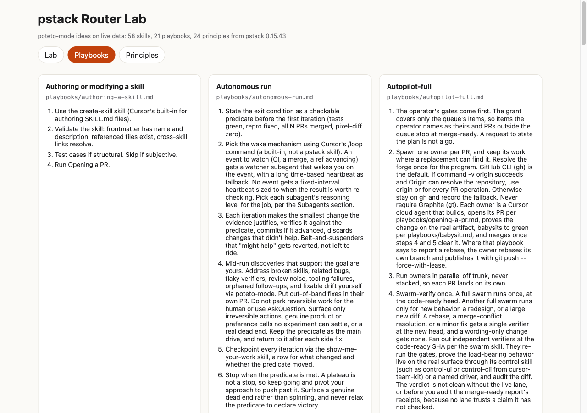
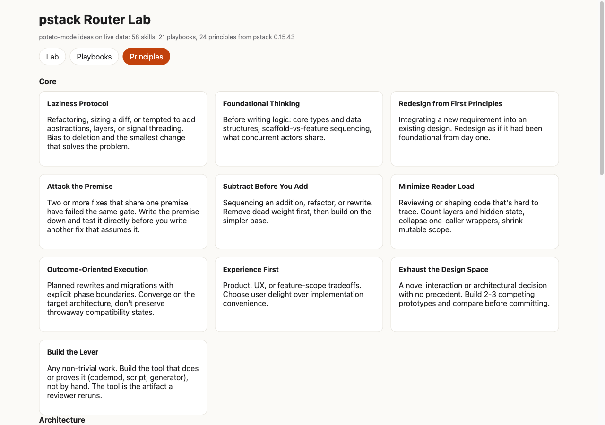

<p align="center"></p>

# pstack Router Lab

A small app that shows the ideas of [pstack](https://github.com/cursor/plugins/tree/main/pstack), Lauren Tan's (poteto) agent stack, working on its own files. You type an outcome the way you would type `/poteto-mode <outcome>`. The app routes it to one playbook, copies that playbook's steps into a todo list word for word, and refuses to report "done" until every step has evidence or a visible `skip:` reason and at least one principle is named.

The pstack skills are installed in this folder only (`.claude/skills` and `.claude/agents`), not in the global Claude config. Claude Code picks them up when you work inside this folder.

## How it Works

1. `.claude/skills` holds pstack 0.15.43 (MIT): 58 skills, including `poteto-mode` with its 22 playbooks and principle index.
2. `tools/extract.ts` parses those markdown files and writes `src/data/pstack.json`. Nothing is copied by hand, so the UI shows what the installed skills actually say ("Build the Lever").
3. `domain/router.ts` matches the task against a keyword table and picks one playbook. Broad work (migrate, rewrite, across the codebase) or a task no playbook fits goes to `figure-it-out`, as poteto-mode does.
4. The same file fires the fixed triggers: `/how` for nontrivial changes, `/architect` across a boundary, `/interrogate` for contested design, `benchmark-checklist` for numbers, `unslop` always.
5. `domain/run.ts` models each step as a typed state: `todo`, `done` with evidence, or `skipped` with a reason.
6. The gate blocks the report while any step is `todo` or no principle is named. The final report keeps skipped steps with a `skip:` prefix, so shortcuts stay visible.

## Architecture



## Features

* **Local skill install**: pstack lives in `.claude/` of this POC, so it does not leak into other projects.
* **Router, not a menu**: one sentence picks one playbook, the central pstack idea.
* **Word-for-word todo list**: steps come straight from `playbooks/*.md`, nothing paraphrased.
* **Evidence gate**: "Prove It Works" as code. No evidence means no report.
* **Visible skips**: a skip needs a reason and stays in the report as `skip:`.
* **Principle citation**: the report names the principles that changed a decision, as poteto-mode requires.
* **Fixed triggers**: shows which pstack skills a task would call before any code is written.
* **Playbooks and Principles tabs**: browse all 21 parsed playbooks and 24 principles.

## Stack

* **TypeScript 7.0.2**: typed domain, branded ids, discriminated unions for step state.
* **Bun 1.4.4**: runtime, package manager and test runner in one tool (Bun 2.x does not exist yet).
* **Vite 8.3.8**: dev server and build.
* **React 19.3.1**: UI.
* **TanStack Router 1.170**: the three tabs. Query, Form and Table are not used because the data is a static JSON file.

## Contracts

There is no HTTP API. The contract is the extracted catalog in `src/data/pstack.json`:

```ts
type Catalog = {
  version: string;
  skills: string[];
  playbooks: { id: PlaybookId; title: string; steps: string[] }[];
  principles: { name: string; group: "Core" | "Architecture" | "Verification" | "Delegation" | "Meta"; when: string }[];
};
```

## Key data structures and design decisions

* `Step` is a union: `{ state: "todo" } | { state: "done"; evidence } | { state: "skipped"; reason }`. A "done" step without evidence cannot exist ("Type System Discipline").
* Routing is a table of rules, not nested ifs ("Model the Domain"). Ties keep the first rule, and keywords match whole words only.
* Playbooks with numbered steps use those steps. Playbooks written as bullets (Babysit) use the bullets. `Opening a PR` has neither, so it is left out of the catalog (21 of 22).
* Run state changes are pure functions (`complete`, `skip`, `reopen`, `gate`, `report`), so the tests cover the logic without a browser.

## How to run

```bash
./scripts/setup.sh
./scripts/start-all.sh
./scripts/ui.sh
./scripts/test-all.sh
./scripts/stop-all.sh
```

`bun run extract` regenerates the catalog after you update the skills in `.claude/skills`.

To use pstack itself, open Claude Code in this folder and run `/poteto-mode <outcome>`. Run `/setup-pstack` first if you want to pick models per role.

## Printscreens

**Lab, gate blocked.** The bug report routed to Bug fix. Two steps have evidence. The gate lists the four steps still missing evidence and the missing principle.



**Lab, verified.** Four steps have evidence and two are skipped with reasons, shown struck through and as `skip:` lines. With Prove It Works and Fix Root Causes named, the gate turns green and prints the report.



**Lab, figure-it-out.** "Migrate every service across the codebase" is too broad for one playbook, so the router sends it to figure-it-out and fires `/architect` and `unslop`.



**Playbooks.** All 21 playbooks parsed from the installed skill, with their steps in order.



**Principles.** The 24 principles grouped as in poteto-mode, each with when it applies.



## Scripts

All scripts live in `scripts/` and run from any directory of the repository.

| Script | What it does |
|---|---|
| `./scripts/setup.sh` | Installs dependencies and extracts the pstack catalog |
| `./scripts/start-all.sh` | Starts the UI and prints its full link |
| `./scripts/status.sh` | Shows the UI port as UP or DOWN |
| `./scripts/test-all.sh` | Runs the typecheck and the unit tests |
| `./scripts/ui.sh` | Opens the UI in the browser |
| `./scripts/stop-all.sh` | Stops the UI |

Ports are declared in `scripts/ports.env`.

```bash
./scripts/setup.sh
./scripts/start-all.sh
./scripts/status.sh
./scripts/ui.sh
./scripts/stop-all.sh
```
