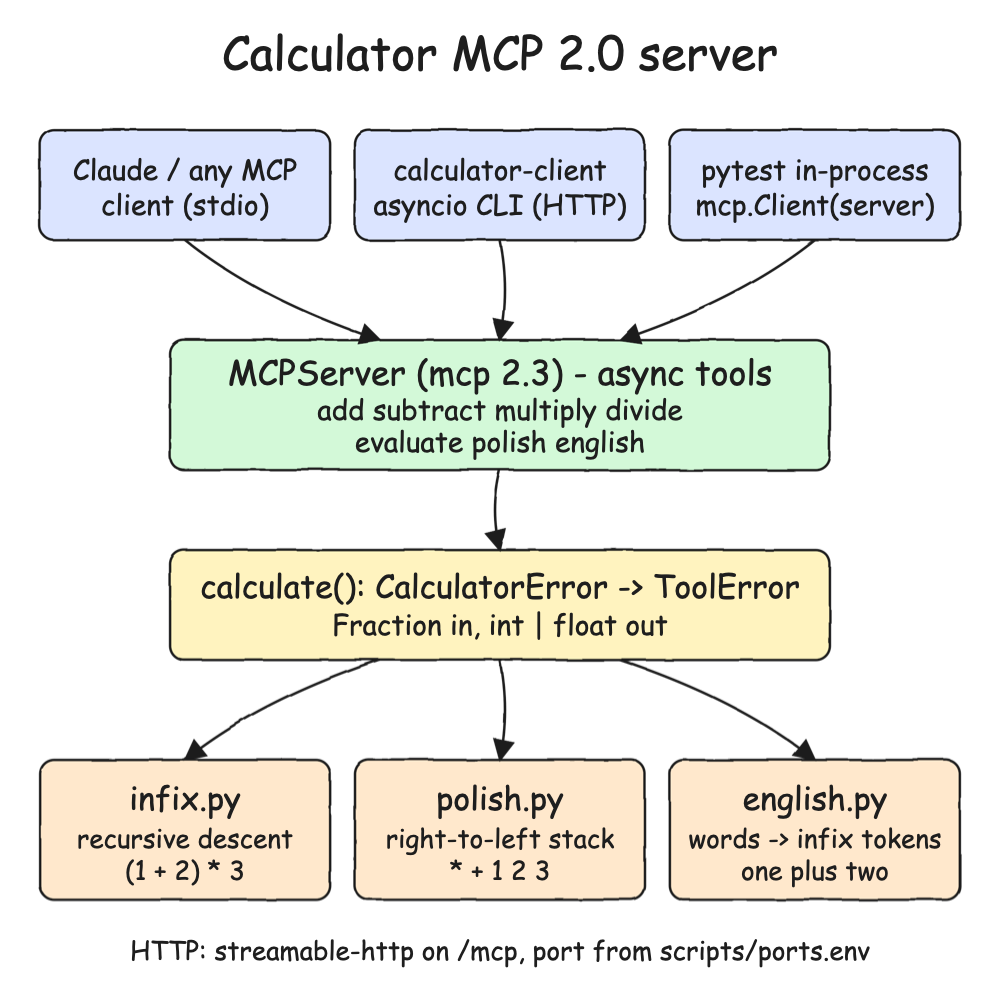
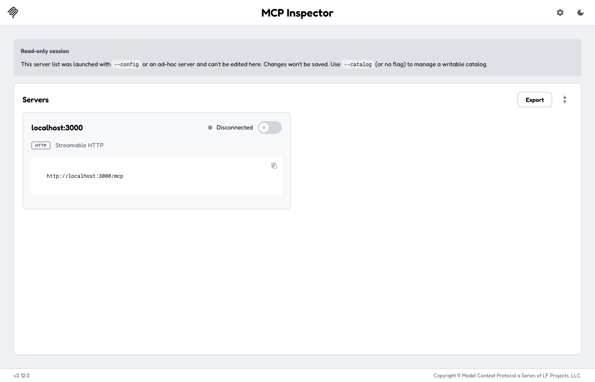
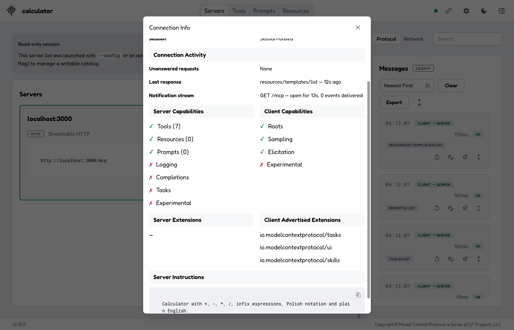
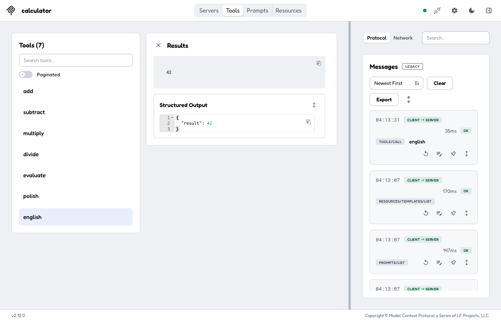
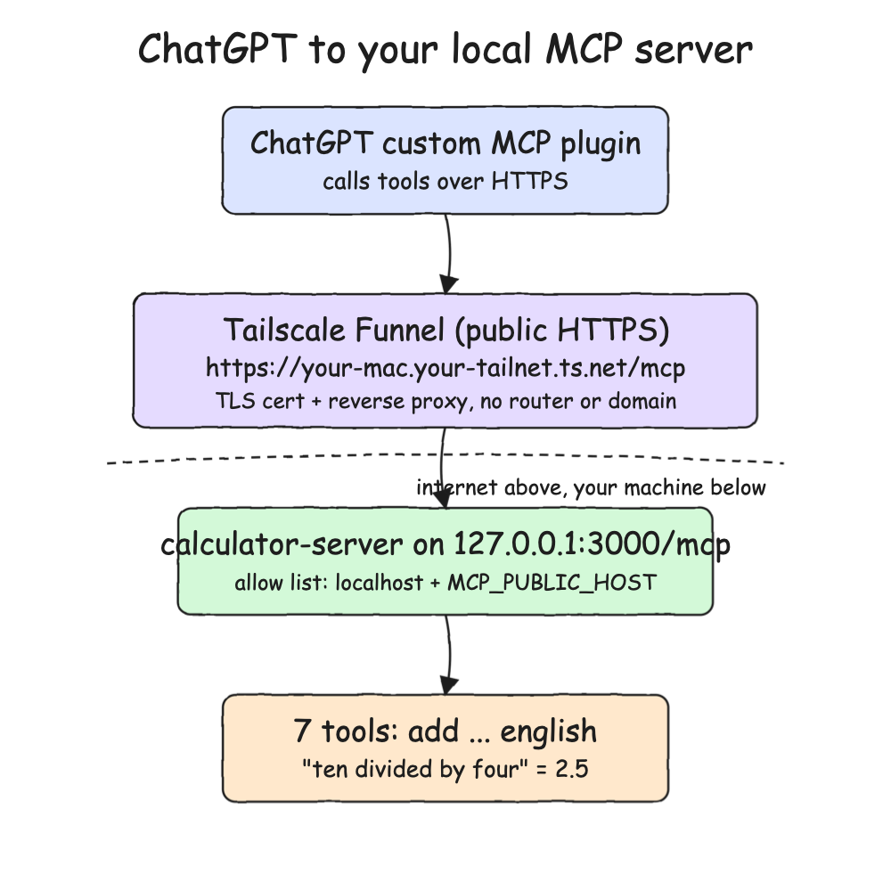
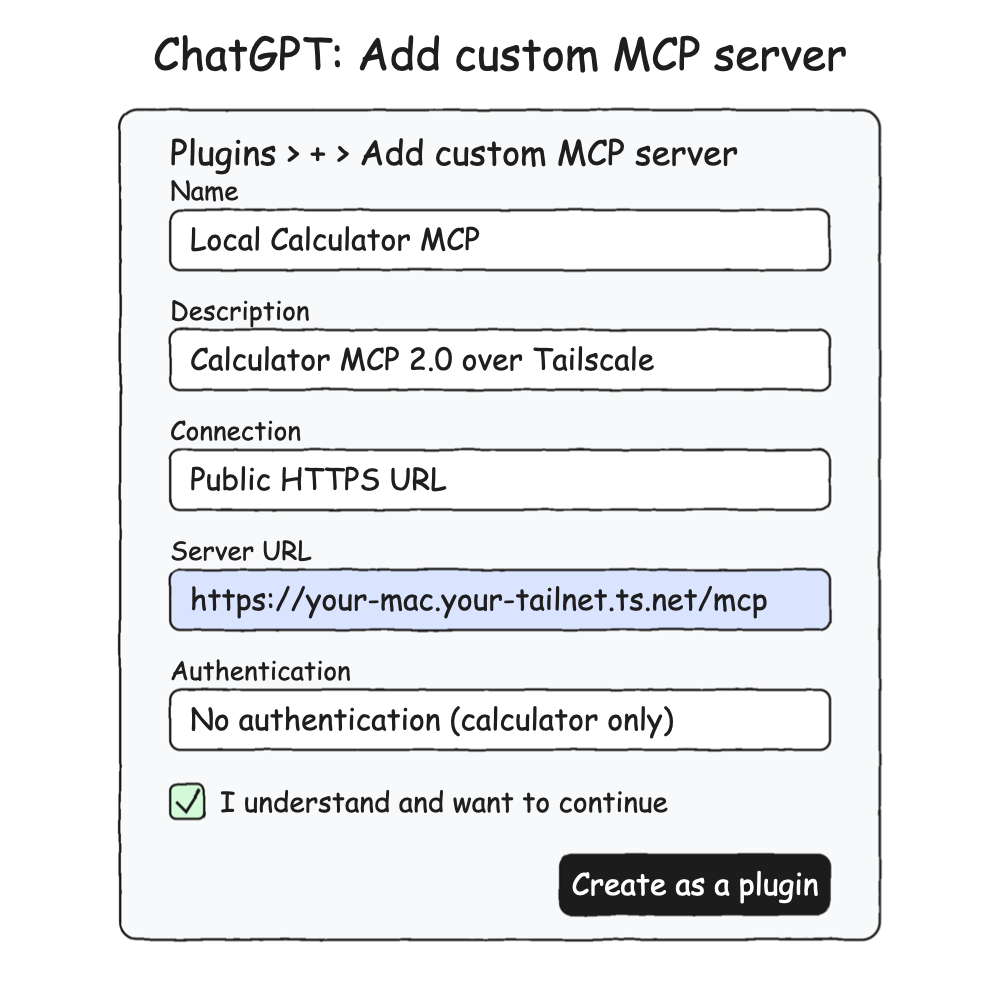
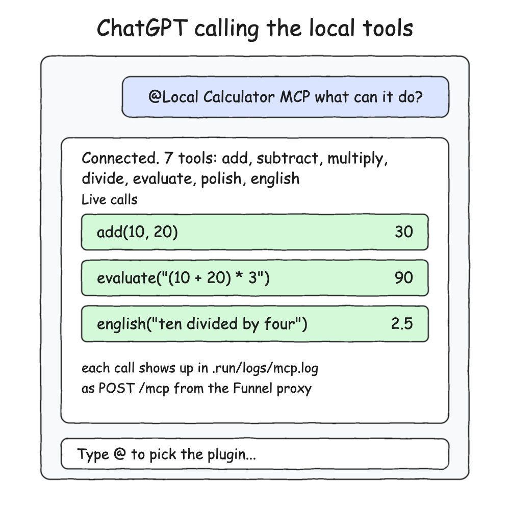

# Calculator MCP 2.0 Server

An MCP server built on the `mcp` 2.x Python SDK (`MCPServer`) that works as a calculator. It supports `+`, `-`, `*`, `/`, infix expressions with parentheses, Polish (prefix) notation, and basic English such as `one plus two`. It is written in Python 3.15 with full type hints, async tools and asyncio, type-checked with `ty`, and managed with `uv`.

## How it Works

1. `MCPServer` registers seven `async` tools: `add`, `subtract`, `multiply`, `divide`, `evaluate`, `polish` and `english`.
2. Every tool goes through `calculate()`, which runs the math on `Fraction` values. This keeps the math exact, so `0.1 + 0.2` returns `0.3`.
3. `infix.py` is a recursive descent parser: `+ -` bind weaker than `* /`, operators are left associative, and unary minus and parentheses are supported.
4. `polish.py` reads prefix tokens right to left using a stack. `- 10 3` is `10 - 3`.
5. `english.py` turns words into infix tokens (`twenty-one times two` becomes `21 * 2`) and reuses the infix parser, so English follows the same precedence rules.
6. Errors such as division by zero or bad input raise `CalculatorError`, which becomes an MCP `ToolError`. The client gets `is_error=True` with a readable message and the session stays alive.
7. The server runs over streamable HTTP on `/mcp`, or over stdio with `--stdio` for desktop MCP clients.

## Architecture



## Features

- **Four basic operations as tools**: `add`, `subtract`, `multiply` and `divide` give an LLM typed, single-purpose calls.
- **Infix expressions**: `evaluate` handles `(1 + 2) * 3` with correct precedence and unary minus.
- **Polish notation**: `polish` evaluates prefix expressions such as `* + 1 2 3`.
- **Basic English**: `english` understands `one plus two`, `ten divided by four` and `one hundred and five plus five`. It also accepts digits mixed with words.
- **Exact math**: `Fraction` avoids float noise, so `1 / 3 * 3` is `1`.
- **Readable errors**: the MCP error result carries the reason (`division by zero`, `unknown word: 'banana'`) instead of crashing.
- **Two transports**: streamable HTTP for the CLI client and stdio for desktop MCP clients.
- **Async throughout**: async tools and an asyncio client. A test runs 20 concurrent calls on one session.

## Stack

- **Python 3.15**: uses PEP 695 `type` aliases, PEP 758 unparenthesized `except A, B`, and `match`.
- **mcp 2.3 (MCP 2.0 SDK)**: `MCPServer` and `Client` from the current major version of the official SDK.
- **asyncio / anyio**: async tool handlers, the async client, and async pytest tests.
- **ty**: fast type checker from Astral that checks `src` and `tests`.
- **uv**: Python, virtualenv, dependencies and build backend (`uv_build`) in one tool.
- **pytest**: unit tests for the parsers and in-process MCP tests.

## Contracts / APIs

Endpoint: `http://localhost:3000/mcp` (MCP streamable HTTP). Each tool returns a number (`int` when the result is whole, `float` otherwise).

| Tool | Arguments | Request | Result |
|---|---|---|---|
| `add` | `a: number, b: number` | `{"a": 1, "b": 2}` | `3` |
| `subtract` | `a: number, b: number` | `{"a": 1, "b": 2}` | `-1` |
| `multiply` | `a: number, b: number` | `{"a": 1.5, "b": 4}` | `6` |
| `divide` | `a: number, b: number` | `{"a": 1, "b": 4}` | `0.25` |
| `evaluate` | `expression: string` | `{"expression": "(1 + 2) * 3"}` | `9` |
| `polish` | `expression: string` | `{"expression": "* + 1 2 3"}` | `9` |
| `english` | `text: string` | `{"text": "one plus two"}` | `3` |

Errors return `is_error: true` with a message such as `Error executing tool divide: division by zero`.

English vocabulary:

- **Numbers**: `zero` to `nineteen`, `twenty` to `ninety`, `hundred`, `thousand`, `million`, `billion`, plus digits.
- **Operators**: `plus`, `add`, `minus`, `subtract`, `less`, `negative`, `times`, `multiplied by`, `multiply`, `divided by`, `divide`, `over`.
- **Ignored filler**: `what is`, `and`, `the`, `equals`, `?`.

## Key Design Decisions

- **One `Fraction` core, three front ends**: all parsers produce a `Fraction`, and `to_number` converts it only at the MCP edge.
- **English reuses the infix parser**: English is translated into tokens, not evaluated separately, so precedence lives in one place.
- **`NumberBuilder`** combines number words (`two thousand three hundred` gives `2300`) and rejects invalid sequences such as `one two`.
- **The core does not depend on MCP**: `CalculatorError` is a plain `ValueError`. Only `server.py` maps it to `ToolError`, because MCP 2.x hides the message of any other exception as an unexpected crash.
- **The public hostname is not in the code**: `server.py` always allows `localhost` and `127.0.0.1`, and adds the Tailscale host and its `https://` origin only when `MCP_PUBLIC_HOST` is set. `start-all.sh` reads it from the gitignored `scripts/tailscale.env`.
- **Ports come only from `scripts/ports.env`**: the server and client read `MCP_PORT`, and the scripts set it.

## How to Run

```bash
./scripts/setup.sh
./scripts/start-all.sh
./scripts/calc.sh
./scripts/calc.sh add 1 2
./scripts/calc.sh evaluate "(1 + 2) * 3"
./scripts/calc.sh polish "* + 1 2 3"
./scripts/calc.sh english "what is twenty-one times two?"
./scripts/test-all.sh
./scripts/stop-all.sh
```

To use it from a desktop MCP client over stdio, register this command:

```json
{
  "mcpServers": {
    "calculator": {
      "command": "uv",
      "args": ["run", "--directory", "<path-to-this-project>", "calculator-server", "--stdio"]
    }
  }
}
```

`test-all.sh` runs `ty check`, the 47 pytest tests (parsers and in-process MCP), and, when the server is running, live HTTP calls through the client:

```
============================== 47 passed in 0.42s ==============================
live add 1 2 = 3
live evaluate (1 + 2) * 3 = 9
live polish * + 1 2 3 = 9
live english one plus two = 3
all tests passed
```

## MCP Inspector Step by Step

The MCP Inspector is the official web UI for testing an MCP server. Use it to confirm the tools work before you connect anything else.

**1. Start the inspector.**

```bash
./scripts/inspector.sh
```

The script starts the server if it is down. Then it runs `npx @modelcontextprotocol/inspector@latest --web --transport http --server-url http://localhost:3000/mcp` on port 6274 and prints a link like `http://127.0.0.1:6274/?MCP_INSPECTOR_API_TOKEN=<token>`. The token is new each time and acts as the login to the inspector, so do not share or commit it. Press Ctrl+C to stop.

**2. Open the link. The calculator is already in the server list.**



The server was passed with `--server-url`, so the list is read-only and contains only `localhost:3000` over Streamable HTTP. If the list is empty on the first load, reload the page.

**3. Turn on the switch to connect.**



The card shows **Connected**, the header shows the server name `calculator`, and the **Messages** panel on the right logs the JSON-RPC handshake (`tools/list`, `prompts/list`, `resources/templates/list`).

**4. Open the Tools tab, pick a tool, fill the form, and click Execute Tool.**



All 7 tools are listed. Running `english` with `what is twenty-one times two?` returns `42` as text and as structured output `{"result": 42}`. The `tools/call` shows up in Messages as `OK`.

To test the public Tailscale URL from the next section, start the inspector without arguments (`npx @modelcontextprotocol/inspector@latest`), choose Streamable HTTP, and enter `https://<your-mac>.<your-tailnet>.ts.net/mcp`.

## ChatGPT via Tailscale Step by Step

This exposes the local server to ChatGPT as a custom MCP plugin. Your code stays on your machine and nothing is deployed to the cloud. The pictures are illustrations with placeholder names, not screenshots of a real account.



ChatGPT calls a public HTTPS URL. Tailscale Funnel terminates TLS and forwards the request to `127.0.0.1:3000/mcp`. The server checks that the `Host` header is on its allow list, then runs the tool.

**1. Install Tailscale and sign in.** The free Personal plan includes Funnel. Install the macOS app, approve the network extension, sign in, then check that the CLI works:

```bash
tailscale status
```

**2. Find your MagicDNS name.** It is `<machine-name>.<tailnet-name>.ts.net`. You can see it in the Tailscale admin console under Machines, or in `tailscale status --json` under `Self.DNSName`. It stays the same across reboots, network changes, and IP changes. It changes only if you rename the machine, re-add it to the tailnet, or change the tailnet DNS name in the admin console.

**3. Tell the server about that name.** Without this, requests through Funnel are rejected with `421 Misdirected Request`, because the `Host` header is not on the allow list. Create the gitignored file:

```bash
echo "MCP_PUBLIC_HOST=<your-mac>.<your-tailnet>.ts.net" > scripts/tailscale.env
./scripts/stop-all.sh
./scripts/start-all.sh
```

**4. Check the server locally** (the MCP Inspector section above is the full check):

```bash
./scripts/calc.sh english "one plus two"
```

**5. Open the Funnel.** On the first run, Tailscale asks you to approve Funnel and HTTPS certificates in the admin console.

```bash
tailscale funnel --bg 3000
tailscale funnel status
```

Your MCP URL is now `https://<your-mac>.<your-tailnet>.ts.net/mcp`. `tailscale serve` is not enough, because it is reachable only inside your tailnet and ChatGPT is not on it. Funnel is public, so anyone with the URL can call the tools. That is fine for a calculator, but add authentication before you expose tools that touch files, shells, or databases.

**6. Add the plugin in ChatGPT.** Go to **Plugins > + > Add custom MCP server** and fill in the form:



| Field | Value |
|---|---|
| Name | any name, such as `Local Calculator MCP` |
| Connection | Public HTTPS URL |
| Server URL | `https://<your-mac>.<your-tailnet>.ts.net/mcp` |
| Authentication | No authentication (this server has none) |

Tick **I understand and want to continue**, click **Create as a plugin**, check that the 7 tools are discovered, and install it. Menu names and availability depend on your ChatGPT plan and workspace. If you do not see **Add custom MCP server**, your account does not offer custom MCP plugins yet.

**7. Call it from a chat.** Start a new chat, type `@`, pick the plugin, and ask something such as `what can it do?` or `add 10 and 20`.



ChatGPT lists the 7 tools and calls them. Every call reaches your machine and shows up in `.run/logs/mcp.log` as a `POST /mcp` line.

**8. Close the Funnel when you are done.**

```bash
tailscale funnel reset
tailscale funnel status
```

| Problem | What to check |
|---|---|
| `421 Misdirected Request` in `.run/logs/mcp.log` | `MCP_PUBLIC_HOST` is missing or wrong in `scripts/tailscale.env`. Restart the server after fixing it. |
| `403 Forbidden` | The request `Origin` is not `https://<MCP_PUBLIC_HOST>` |
| ChatGPT times out | `tailscale funnel status` shows no Funnel, or the server is down (`./scripts/status.sh`) |
| No tools discovered | Test the public URL in the MCP Inspector first |

## Scripts

All scripts live in `scripts/` and run from any directory of the repository.

| Script | What it does |
|---|---|
| `./scripts/setup.sh` | Installs dependencies and prepares the app |
| `./scripts/start-all.sh` | Starts the MCP server and prints its full link |
| `./scripts/status.sh` | Shows the server port as UP or DOWN |
| `./scripts/test-all.sh` | Runs ty, pytest and live HTTP checks |
| `./scripts/inspector.sh` | Opens the MCP Inspector web UI connected to the server |
| `./scripts/calc.sh` | Calls a tool on the running server, or lists tools when called with no arguments |
| `./scripts/stop-all.sh` | Stops the server |

Ports are declared in `scripts/ports.env` (`mcp=3000`, `inspector=6274`).

```bash
./scripts/setup.sh
./scripts/start-all.sh
./scripts/status.sh
./scripts/stop-all.sh
```
