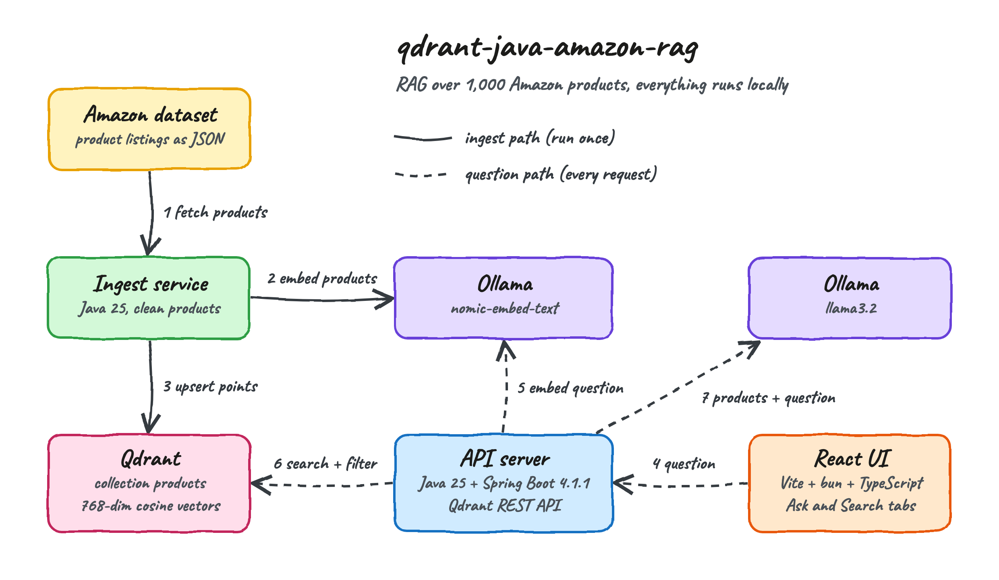
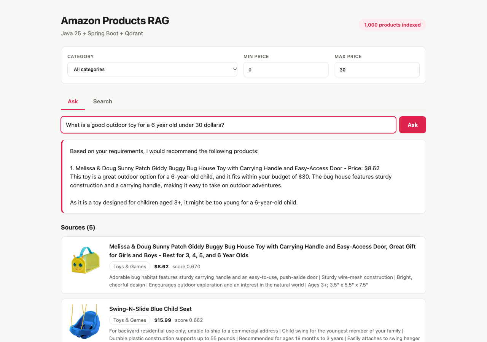
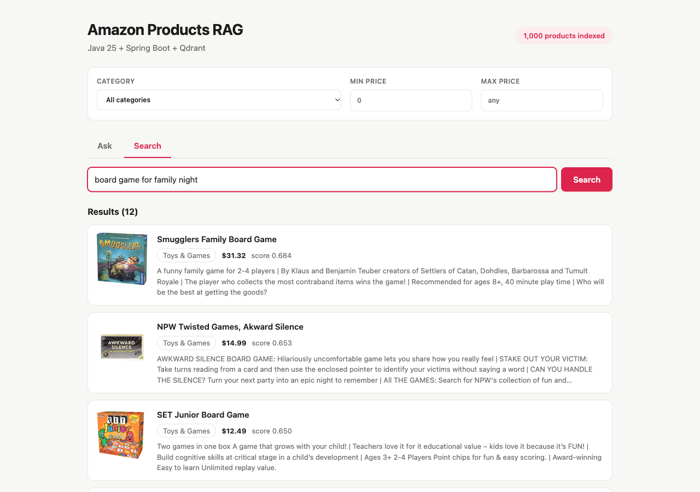
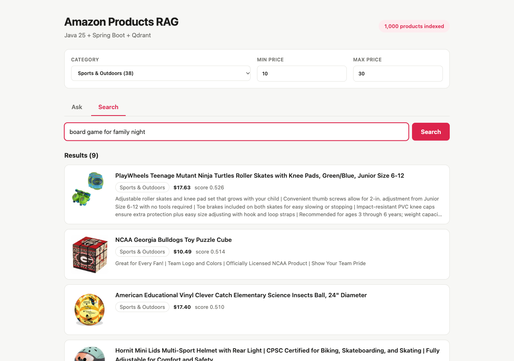
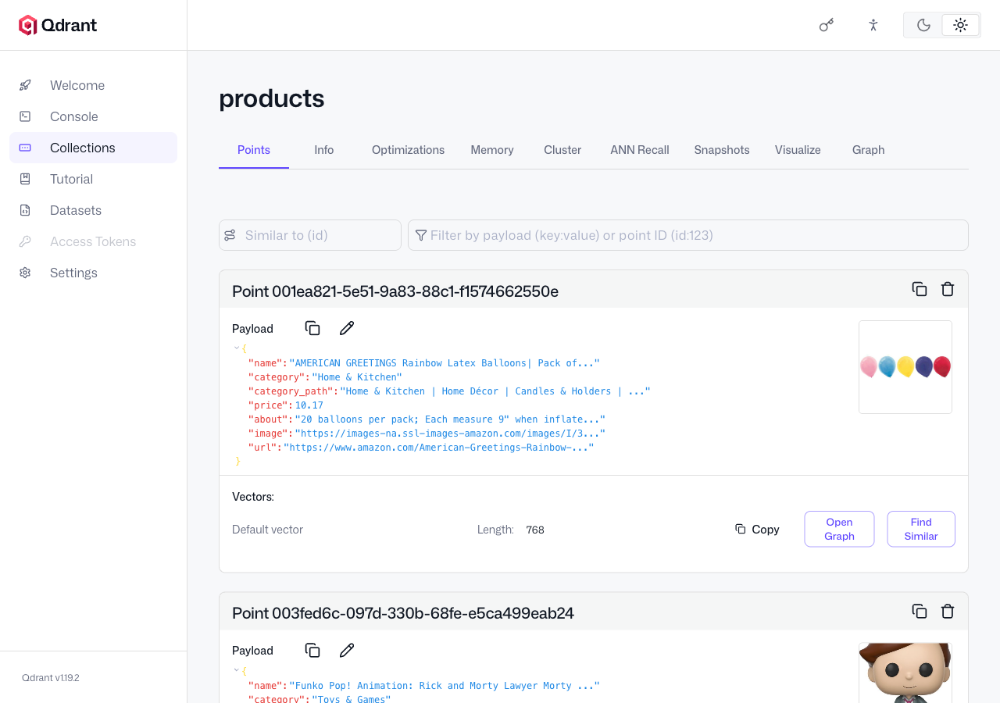

# qdrant-java-amazon-rag

A RAG (Retrieval-Augmented Generation) over generic products sold on Amazon, built with Java 25, Spring Boot 4.1.1 and
[Qdrant](https://qdrant.tech/). Describe what you are shopping for and get a recommendation written only from the
products that Qdrant retrieved, with every source product listed. Everything runs locally: Qdrant in a container,
embeddings and answers on Ollama, no cloud API key.

## How it Works?

1. `ingest` downloads real Amazon product listings, 100 per page, from a public Hugging Face dataset (1,000 by default).
2. Each product is cleaned: HTML entities unescaped, top-level category extracted, price parsed, boilerplate removed.
3. Ollama `nomic-embed-text` turns name + category + description into a 768-number vector.
4. Each product is stored in Qdrant as a point: the vector plus a payload with name, category, price, about, image, url.
5. A question is embedded with the same model and Qdrant returns the nearest products by cosine similarity.
6. The category and price range filters run inside Qdrant, on indexed payload fields, during the vector search.
7. **Ask** sends the 5 best products plus the question to Ollama `llama3.2`, which recommends only from them.
8. **Search** shows the nearest products directly, with their similarity score.

### How Qdrant works

[Qdrant](https://qdrant.tech/) is an open-source vector database written in Rust. This POC talks to it through its
plain REST API, so every call is visible in `QdrantClient.java`:

| Concept | What it is | REST call used here |
|---|---|---|
| Collection | A named set of points sharing one vector size and distance | `PUT /collections/products`, 768 dimensions, cosine |
| Point | An id, a vector and a JSON payload | `PUT /collections/products/points`, id is the dataset id as a UUID |
| HNSW index | A graph that finds approximate nearest neighbours without scanning every vector | Built automatically by Qdrant |
| Payload index | An index on a payload field so filters are fast and are applied while walking the graph | `PUT /collections/products/index` for `category` (keyword) and `price` (float) |
| Query API | Nearest-neighbour search with an optional filter | `POST /collections/products/points/query` |
| Filter | Conditions on the payload: exact match and numeric range | `must: [{key: category, match}, {key: price, range}]` |
| Facets | Counts points per value of an indexed field | `POST /collections/products/facet` for the category dropdown |

Qdrant does not create embeddings and does not write answers. It stores vectors and finds the closest ones very fast;
the embedding model and the chat model are separate pieces, here both served by Ollama.

## Architecture



Solid arrows are the ingest path, run once by `./scripts/ingest.sh`. Dashed arrows are the path of every question.

## Features

* **Ask for a recommendation** - the answer is grounded on retrieved products, so the model cannot invent a product.
* **Listed sources** - every answer shows the products it was built from, with image, price and link.
* **Semantic search** - "board game for family night" finds matching products even when the words differ.
* **Category filter with counts** - the dropdown is filled by Qdrant facets, so it always matches what is indexed.
* **Price range filter** - a numeric range condition applied by Qdrant during the search, not after it.
* **Real data cleaning** - prices like `$10.99 - $15.99`, escaped categories and boilerplate bullets are normalized.
* **Idempotent ingest** - point ids come from the dataset id, so a re-run overwrites instead of duplicating.
* **Fully local** - no API key; the only outside call is the dataset download during ingest.

## Stack

* **Java 25** with records for every DTO - the backend language.
* **Spring Boot 4.1.1** with `spring-boot-starter-webmvc` - the HTTP API, the only runtime dependency.
* **Spring `RestClient`** - calls Qdrant, Ollama and the dataset API over REST, no Qdrant client library.
* **Qdrant 1.19.2** - the vector database, run with podman-compose.
* **Ollama** - `nomic-embed-text` for embeddings and `llama3.2` for answers.
* **React 19, TypeScript 7, Vite 8, bun** - the UI, with no other UI library.
* **Maven** - builds and tests the backend.

## Contracts/APIs

All routes are JSON under `/api`.

| Method | Path | Request body | Response |
|---|---|---|---|
| GET | `/api/stats` | - | `{"products", "collection"}` |
| GET | `/api/categories` | - | `[{"name", "count"}]` sorted by count |
| POST | `/api/search` | `{"query", "limit"?, "category"?, "minPrice"?, "maxPrice"?}` | `{"hits": [Hit]}` |
| POST | `/api/ask` | `{"question", "category"?, "minPrice"?, "maxPrice"?}` | `{"answer", "sources": [Hit]}` |
| POST | `/api/ingest` | `{"limit"?}` | `{"indexed", "skipped"}` |

`Hit` is `{"id", "score", "name", "category", "price", "about", "image", "url"}`.
A blank `query` or `question` returns `400 {"error"}`. A failure of Qdrant or Ollama returns `502 {"error"}`.

## Key data structures and design decisions

* **Point payload** - `{name, category, category_path, price, about, image, url}`. `price` is left out when it cannot be
  parsed, so a price filter never matches a product with an unknown price.
* **Top-level category as the filter field** - the dataset has deep category paths; the first segment gives 20 useful
  groups, the full path is kept in `category_path`.
* **REST instead of a client library** - `RestClient` plus maps keeps the dependency list to one starter and shows the
  exact Qdrant requests.
* **Pure functions for the logic** - `ProductCleaner`, `SearchService.filter` and `RagService.prompt` are static and
  tested without Spring, Qdrant or Ollama.
* **Query and document prefixes** - `nomic-embed-text` expects `search_document:` on stored text and `search_query:` on
  questions; using both improves retrieval.
* **Empty retrieval skips the model** - when no product matches the filters, the API answers that nothing was found
  instead of letting the model guess.
* **Dataset fetched at ingest time** - no dataset file is stored in the repository.

## How to run the app/tests

Requirements: a JDK 25, Maven, `bun`, `podman` with `podman-compose`, and a running Ollama.

```bash
./scripts/setup.sh
./scripts/start-all.sh
./scripts/ingest.sh
./scripts/ui.sh
```

`ingest.sh` indexes 1,000 products. Use `PRODUCT_LIMIT=3000 ./scripts/ingest.sh` to index more.

```bash
./scripts/test-all.sh
```

Runs 30 backend tests and the TypeScript type check of the UI. The UI has no tests of its own.

## Printscreens of the UI

### Ask



The question "What is a good outdoor toy for a 6 year old under 30 dollars?" with a max price of 30. Qdrant returned the
5 closest products under that price and `llama3.2` recommended one of them by name and price. The Sources list shows the
retrieved products with image, category, price and similarity score.

### Search



A semantic search for "board game for family night" across all 1,000 products.

### Search with filters



The same search restricted to category `Sports & Outdoors` and a price between 10 and 30. Qdrant applies both conditions
during the vector search, so only 9 products remain. The counts in the category dropdown come from Qdrant facets.

### Qdrant dashboard



The dashboard that ships with Qdrant, showing the `products` collection and the payload stored with each point.

## Scripts

All scripts live in `scripts/` and run from any directory of the repository.

| Script | What it does |
|---|---|
| `./scripts/setup.sh` | Builds the backend on Java 25, installs the UI, pulls the Qdrant image and the Ollama models |
| `./scripts/start-all.sh` | Starts every service and prints the full link of each one |
| `./scripts/ingest.sh` | Indexes Amazon products into Qdrant |
| `./scripts/status.sh` | Shows every service port as UP or DOWN |
| `./scripts/test-all.sh` | Runs every test suite |
| `./scripts/ui.sh` | Opens the UI in the browser |
| `./scripts/stop-all.sh` | Stops every service, Ollama is left running |

Ports are declared in `scripts/ports.env`.

```bash
./scripts/setup.sh
./scripts/start-all.sh
./scripts/ingest.sh
./scripts/status.sh
./scripts/ui.sh
./scripts/stop-all.sh
```
