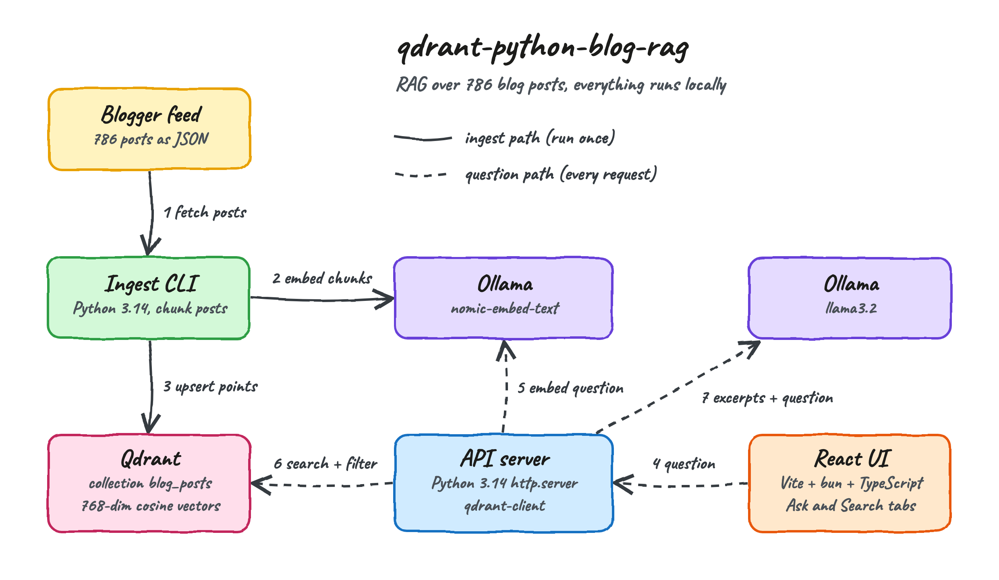
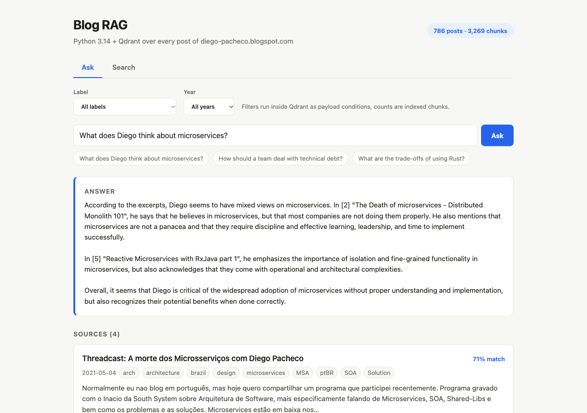
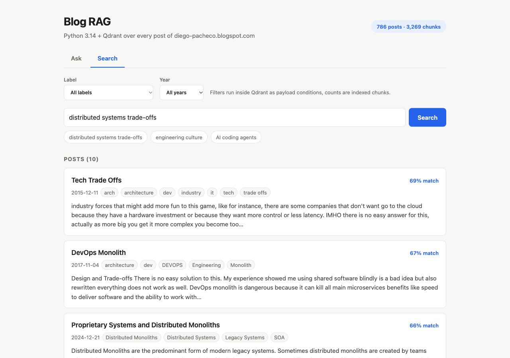
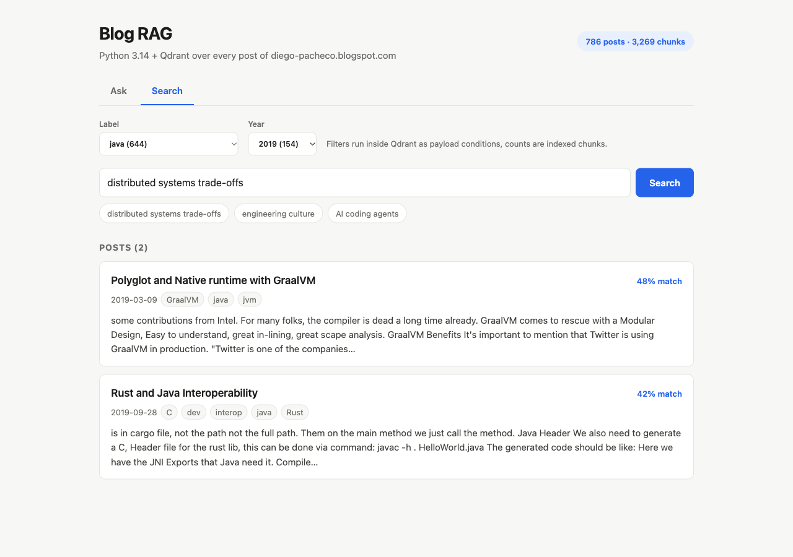
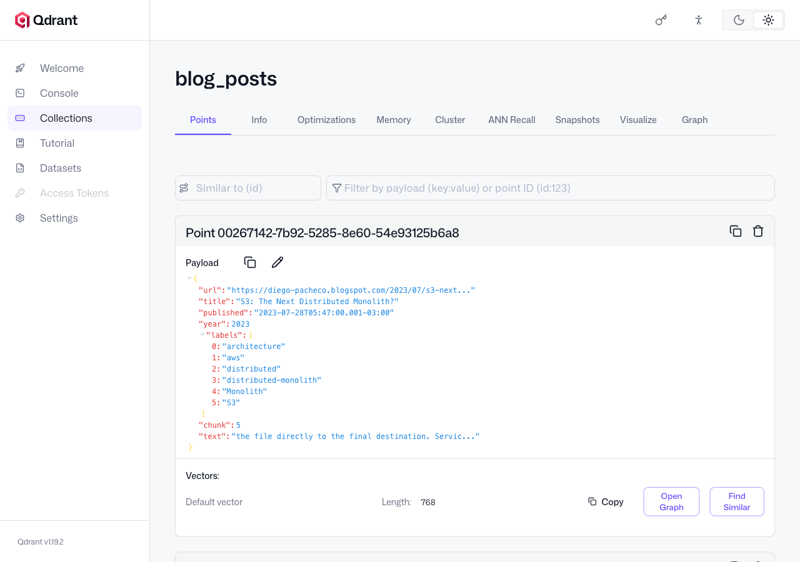

# qdrant-python-blog-rag

A RAG (Retrieval-Augmented Generation) over every post of [diego-pacheco.blogspot.com](https://diego-pacheco.blogspot.com/),
built with Python 3.14 and [Qdrant](https://qdrant.tech/). Ask a question in plain language and get an answer written
only from the posts that Qdrant retrieved, with every source post cited. Everything runs locally: Qdrant in a container,
embeddings and answers on Ollama, no cloud API key.

## How it Works?

1. `ingest` reads the public Blogger JSON feed page by page (786 posts) and strips the HTML down to prose.
2. Each post is cut into chunks of 220 words with a 40-word overlap (3,269 chunks).
3. Ollama `nomic-embed-text` turns each chunk into a 768-number vector.
4. Each chunk is stored in Qdrant as a point: the vector plus a payload with url, title, date, year, labels and text.
5. A question is embedded with the same model and Qdrant returns the nearest chunks by cosine similarity.
6. The label and year filters run inside Qdrant, on indexed payload fields, during the vector search.
7. **Ask** sends the 6 best chunks plus the question to Ollama `llama3.2`, which answers only from them.
8. **Search** asks Qdrant to group results by post url, so each post shows up once with its best chunk.

### How Qdrant works

[Qdrant](https://qdrant.tech/) is an open-source vector database written in Rust. What this POC uses:

| Concept | What it is | Where it is used here |
|---|---|---|
| Collection | A named set of points sharing one vector size and distance | `blog_posts`, 768 dimensions, cosine |
| Point | An id, a vector and a JSON payload | One per chunk, id is a UUID v5 of `url#chunk` |
| HNSW index | A graph that finds approximate nearest neighbours without scanning every vector | Built automatically by Qdrant |
| Payload index | An index on a payload field so filters are fast and are applied while walking the graph | `labels` (keyword), `year` and `chunk` (integer) |
| Query API | One endpoint for nearest-neighbour search with optional filter | `query_points` for Ask |
| Grouping | Returns the best N points per value of a payload field | `query_points_groups` by `url` for Search |
| Facets | Counts points per value of an indexed field | Label and year dropdowns |

Qdrant does not create embeddings and does not write answers. It stores vectors and finds the closest ones very fast;
the embedding model and the chat model are separate pieces, here both served by Ollama.

## Architecture



Solid arrows are the ingest path, run once by `./scripts/ingest.sh`. Dashed arrows are the path of every question.

## Features

* **Ask the blog** - a question gets an answer grounded on retrieved excerpts, so the model does not answer from memory.
* **Cited sources** - every answer lists the posts it was built from, each linking to the original post.
* **Semantic search** - finds posts by meaning, so "engineering culture" matches posts that never use those words.
* **One result per post** - Qdrant grouping collapses the many chunks of a post into a single card.
* **Label and year filters** - payload filters narrow the search inside Qdrant instead of filtering after the fact.
* **Idempotent ingest** - deterministic point ids make a re-run overwrite points instead of duplicating them.
* **Fully local** - no API key and no data leaves the machine besides reading the public blog feed.

## Stack

* **Python 3.14** with full type hints, checked by `mypy --strict` - the backend language.
* **qdrant-client 1.19** - the official Qdrant client, the only runtime dependency of the backend.
* **Python standard library** - `http.server` for the API, `urllib` for Blogger and Ollama, `html.parser` for HTML.
* **Qdrant 1.19.2** - the vector database, run with podman-compose.
* **Ollama** - `nomic-embed-text` for embeddings and `llama3.2` for answers.
* **React 19, TypeScript 7, Vite 8, bun** - the UI, with no other UI library.
* **uv** - creates the Python 3.14 environment and installs the dependencies.

## Contracts/APIs

All routes are JSON under `/api`.

| Method | Path | Request body | Response |
|---|---|---|---|
| GET | `/api/stats` | - | `{"posts", "chunks", "labels": [{"name", "count"}], "years": [{"name", "count"}]}` |
| POST | `/api/search` | `{"query", "limit"?, "label"?, "year"?}` | `{"hits": [Hit]}` one hit per post |
| POST | `/api/ask` | `{"question", "label"?, "year"?}` | `{"answer", "sources": [Hit]}` |

`Hit` is `{"url", "title", "published", "labels", "score", "text"}`.
A blank `query` or `question` returns `400 {"error"}`. A failure of Qdrant or Ollama returns `502 {"error"}`.

## Key data structures and design decisions

* **Point payload** - `{url, title, published, year, labels[], chunk, text}`. The text lives in Qdrant, so there is no
  second database to keep in sync.
* **Chunks, not whole posts** - a long post covers many ideas; one vector per post would blur them. The 40-word overlap
  keeps an idea that is cut at a chunk boundary retrievable.
* **Title in the embedded text** - each chunk is embedded as `title + chunk`, so a chunk keeps the subject of its post.
* **Query and document prefixes** - `nomic-embed-text` expects `search_document:` on stored text and `search_query:` on
  questions; using both improves retrieval.
* **Chunk search for Ask, grouped search for Search** - an answer benefits from several chunks of the same post, a result
  list does not.
* **Post count without a second collection** - posts are counted as points whose `chunk` is 0.
* **No web framework** - three routes do not justify one; `Api.dispatch` is a pure function that is tested without sockets.

## How to run the app/tests

Requirements: Python 3.14 through `uv`, `bun`, `podman` with `podman-compose`, and a running Ollama.

```bash
./scripts/setup.sh
./scripts/start-all.sh
./scripts/ingest.sh
./scripts/ui.sh
```

`ingest.sh` indexes the whole blog and takes about two minutes. Run it again any time to pick up new posts.

```bash
./scripts/test-all.sh
```

Runs `mypy --strict`, 28 backend unit tests, the TypeScript type check and 5 UI tests.

## Printscreens of the UI

### Ask



The question "What does Diego think about microservices?" was embedded, Qdrant returned the closest chunks, and
`llama3.2` wrote the answer from them. The answer names the posts it used and the Sources list shows the 4 posts behind
it, each with its match score, date and labels.

### Search



A semantic search for "distributed systems trade-offs" across the whole blog. Each card is one post, shown with the
chunk that matched best.

### Search with filters



The same search restricted to label `java` and year `2019`. Qdrant applies both conditions during the vector search,
so only 2 posts remain. The numbers in the dropdowns come from Qdrant facets.

### Qdrant dashboard



The dashboard that ships with Qdrant, showing the `blog_posts` collection and the payload stored with each point.

## Scripts

All scripts live in `scripts/` and run from any directory of the repository.

| Script | What it does |
|---|---|
| `./scripts/setup.sh` | Installs dependencies, pulls the Qdrant image and the Ollama models |
| `./scripts/start-all.sh` | Starts every service and prints the full link of each one |
| `./scripts/ingest.sh` | Indexes every blog post into Qdrant |
| `./scripts/status.sh` | Shows every service port as UP or DOWN |
| `./scripts/test-all.sh` | Runs every type check and test suite |
| `./scripts/ui.sh` | Opens the UI in the browser |
| `./scripts/stop-all.sh` | Stops every service, Ollama is left running |

Ports are declared in `scripts/ports.env`.

```bash
./scripts/setup.sh
./scripts/start-all.sh
./scripts/ingest.sh
./scripts/status.sh
./scripts/ui.sh
./scripts/stop-all.sh
```
