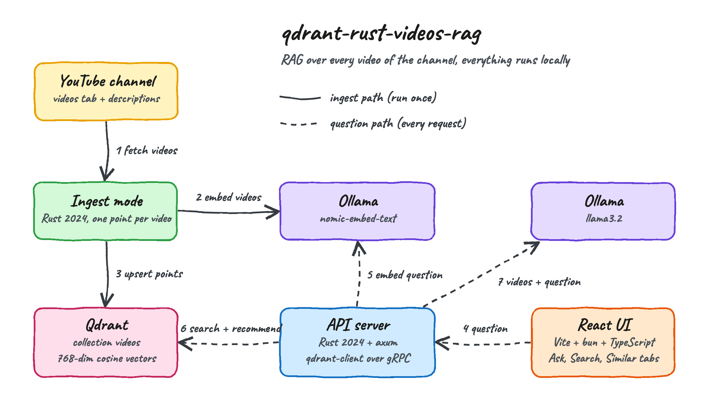
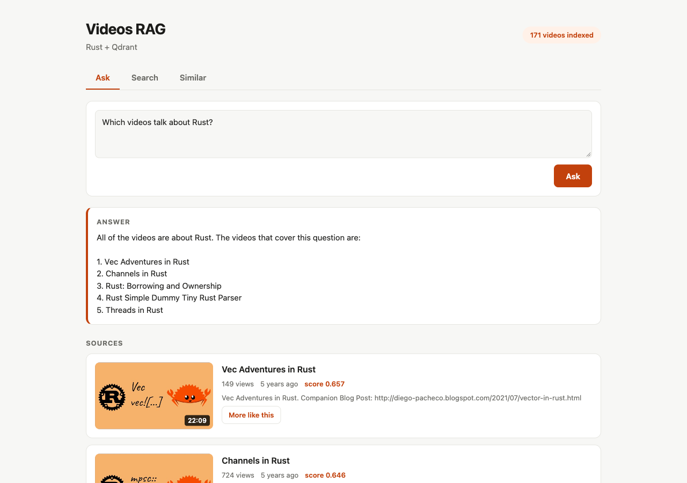
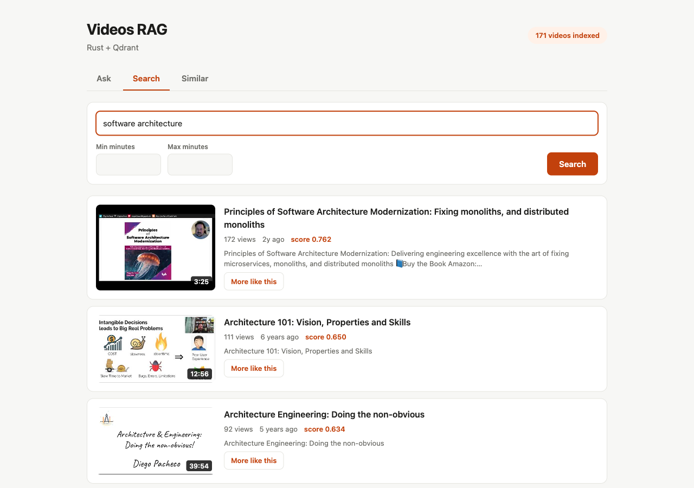
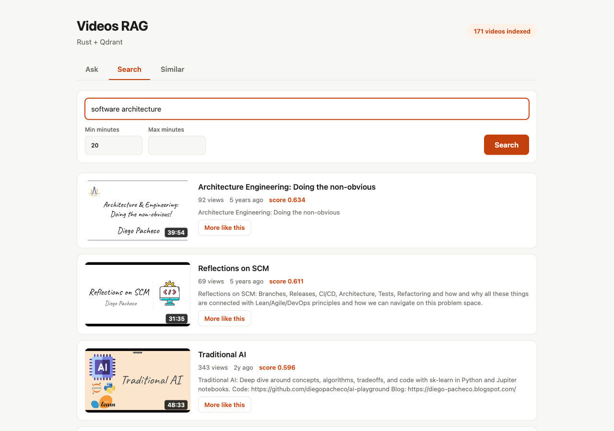
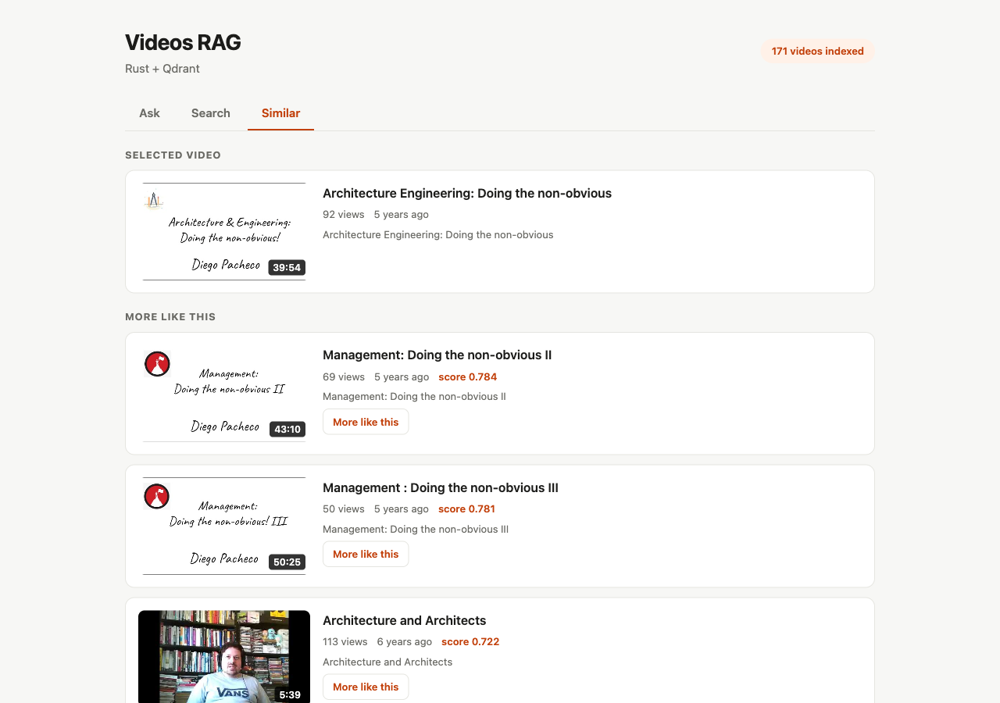
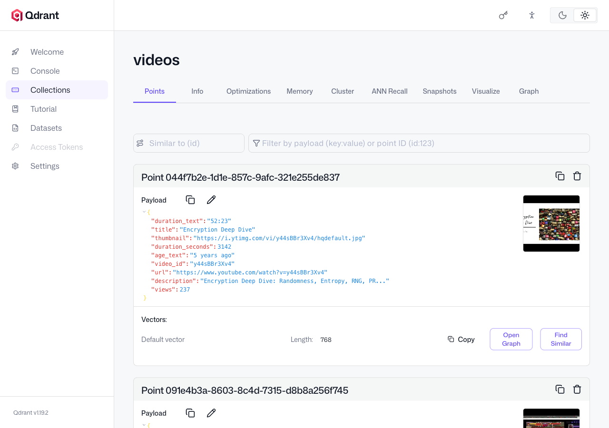

# qdrant-rust-videos-rag

A RAG (Retrieval-Augmented Generation) over every video of the
[Diego Pacheco YouTube channel](https://www.youtube.com/channel/UC81qdxTnQWQxw73_CmIZAjg), built with Rust (edition 2024)
and [Qdrant](https://qdrant.tech/). Ask a question, search videos by meaning, or pick a video and get the ones most
similar to it. Everything runs locally: Qdrant in a container, embeddings and answers on Ollama, no API key, not even
for YouTube.

## How it Works?

1. `ingest` reads the channel Videos tab page by page (171 videos) and then the description of each video.
2. Ollama `nomic-embed-text` turns title + description + keywords of each video into a 768-number vector.
3. Each video is stored in Qdrant as one point: the vector plus a payload with title, description, url, thumbnail,
   duration, views and age.
4. A question is embedded with the same model and Qdrant returns the nearest videos by cosine similarity.
5. The min and max minutes filter runs inside Qdrant, as a range on the indexed `duration_seconds` field.
6. **Ask** sends the 5 best videos plus the question to Ollama `llama3.2`, which answers only from them.
7. **Similar** needs no embedding call: Qdrant recommends neighbours of a point that is already stored.

### How Qdrant works

[Qdrant](https://qdrant.tech/) is an open-source vector database written in Rust. This POC uses the official
`qdrant-client` crate, which talks to Qdrant over gRPC:

| Concept | What it is | Where it is used here |
|---|---|---|
| Collection | A named set of points sharing one vector size and distance | `videos`, 768 dimensions, cosine |
| Point | An id, a vector and a JSON payload | One per video, id is a UUID-shaped hash of the video id |
| HNSW index | A graph that finds approximate nearest neighbours without scanning every vector | Built automatically by Qdrant |
| Payload index | An index on a payload field so filters are fast and are applied while walking the graph | `duration_seconds` (integer) |
| Query API, nearest | Nearest-neighbour search for a vector, with an optional filter | `Query::new_nearest` for Ask and Search |
| Query API, recommend | Finds points close to points you already have, by id | `Query::new_recommend` for Similar |
| Range filter | A numeric condition on the payload | `Condition::range("duration_seconds", ...)` |

Qdrant does not create embeddings and does not write answers. It stores vectors and finds the closest ones very fast;
the embedding model and the chat model are separate pieces, here both served by Ollama.

## Architecture



Solid arrows are the ingest path, run once by `./scripts/ingest.sh`. Dashed arrows are the path of every question.

## Features

* **Ask the channel** - a question gets an answer grounded on retrieved videos, so the model does not answer from memory.
* **Listed sources** - every answer shows the videos behind it, with thumbnail, duration, views and a link to YouTube.
* **Semantic search** - "software architecture" finds talks about design and trade-offs, not only matching titles.
* **Duration filter** - min and max minutes narrow the search inside Qdrant, handy to find a short or a long video.
* **More like this** - any video card opens the Similar tab with its nearest neighbours, using Qdrant recommendations.
* **No YouTube API key** - the channel is read through the same public endpoints the YouTube website uses.
* **Idempotent ingest** - point ids are derived from the video id, so a re-run overwrites instead of duplicating.

## Stack

* **Rust edition 2024** on rustc 1.98 - the backend language, one binary with `serve` and `ingest` modes.
* **qdrant-client 1.19** - the official Qdrant crate, over gRPC.
* **axum 0.8 and tokio** - the HTTP API and the async runtime.
* **reqwest 0.13** - calls YouTube and Ollama.
* **serde, serde_json and anyhow** - JSON and error handling.
* **Qdrant 1.19.2** - the vector database, run with podman-compose.
* **Ollama** - `nomic-embed-text` for embeddings and `llama3.2` for answers.
* **React 19, TypeScript 7, Vite 8, bun** - the UI, with no other UI library.

## Contracts/APIs

All routes are JSON under `/api`.

| Method | Path | Request body | Response |
|---|---|---|---|
| GET | `/api/stats` | - | `{"videos", "collection"}` |
| POST | `/api/search` | `{"query", "limit"?, "min_minutes"?, "max_minutes"?}` | `{"hits": [Hit]}` |
| GET | `/api/similar/{video_id}` | - | `{"hits": [Hit]}` |
| POST | `/api/ask` | `{"question"}` | `{"answer", "sources": [Hit]}` |

`Hit` is `{"id", "score", "video_id", "title", "description", "url", "thumbnail", "duration_text", "views", "age_text"}`.
A blank `query` or `question`, negative minutes or a min above the max returns `400 {"error"}`. A failure of Qdrant or
Ollama returns `502 {"error"}`.

## Key data structures and design decisions

* **Point payload** - `{video_id, title, description, url, thumbnail, duration_seconds, duration_text, views, age_text}`.
  Everything the UI shows lives in Qdrant, so there is no second database.
* **One point per video** - descriptions are short, so a video fits in a single vector and needs no chunking.
* **Recommend by point id** - Similar reuses the stored vector of the selected video, so it costs no embedding call.
* **Point id without a uuid crate** - a UUID-shaped FNV-1a hash of the video id keeps ids deterministic.
* **Pure JSON walkers** - the YouTube parsing functions take a `serde_json::Value` and return structs, so they are
  tested with small inline fixtures and no network.
* **Continuation token picked from the right place** - the next-page token is read from `continuationItemRenderer`,
  because other tokens in the page belong to the filter chips.
* **Query and document prefixes** - `nomic-embed-text` expects `search_document:` on stored text and `search_query:` on
  questions; using both improves retrieval.
* **Scraping is the fragile part** - the YouTube page format is not a public contract and can change; a format change
  breaks ingest, not the data already indexed.

## How to run the app/tests

Requirements: Rust 1.98 or newer, `bun`, `podman` with `podman-compose`, and a running Ollama.

```bash
./scripts/setup.sh
./scripts/start-all.sh
./scripts/ingest.sh
./scripts/ui.sh
```

`ingest.sh` indexes the whole channel. Run it again any time to pick up new videos.

```bash
./scripts/test-all.sh
```

Runs 27 Rust unit tests and the TypeScript type check of the UI. The UI has no tests of its own.

## Printscreens of the UI

### Ask



The question "Which videos talk about Rust?" was embedded, Qdrant returned the 5 closest videos and `llama3.2` listed
them. The Sources list shows each retrieved video with thumbnail, duration, views, age and similarity score.

### Search



A semantic search for "software architecture" across all 171 videos.

### Search with a duration filter



The same search with a minimum of 20 minutes. Qdrant applies the range on `duration_seconds` during the vector search,
so only long talks remain.

### Similar



"More like this" on the talk "Architecture Engineering: Doing the non-obvious". Qdrant recommends the two other talks
of the same series first, without any embedding call.

### Qdrant dashboard



The dashboard that ships with Qdrant, showing the `videos` collection and the payload stored with each point.

## Scripts

All scripts live in `scripts/` and run from any directory of the repository.

| Script | What it does |
|---|---|
| `./scripts/setup.sh` | Builds the backend, installs the UI, pulls the Qdrant image and the Ollama models |
| `./scripts/start-all.sh` | Starts every service and prints the full link of each one |
| `./scripts/ingest.sh` | Indexes every channel video into Qdrant |
| `./scripts/status.sh` | Shows every service port as UP or DOWN |
| `./scripts/test-all.sh` | Runs every test suite |
| `./scripts/ui.sh` | Opens the UI in the browser |
| `./scripts/stop-all.sh` | Stops every service, Ollama is left running |

Ports are declared in `scripts/ports.env`.

```bash
./scripts/setup.sh
./scripts/start-all.sh
./scripts/ingest.sh
./scripts/status.sh
./scripts/ui.sh
./scripts/stop-all.sh
```
