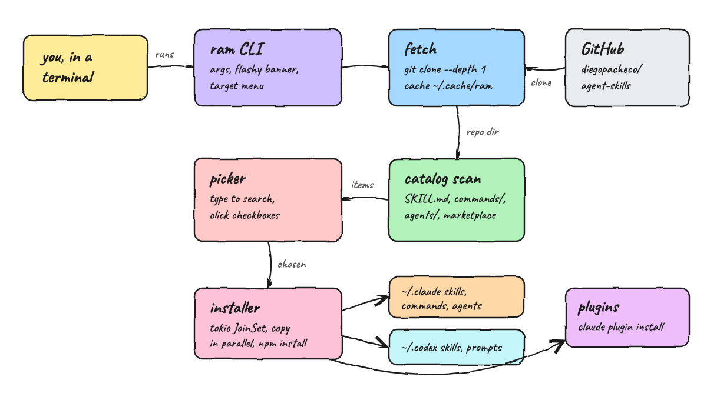
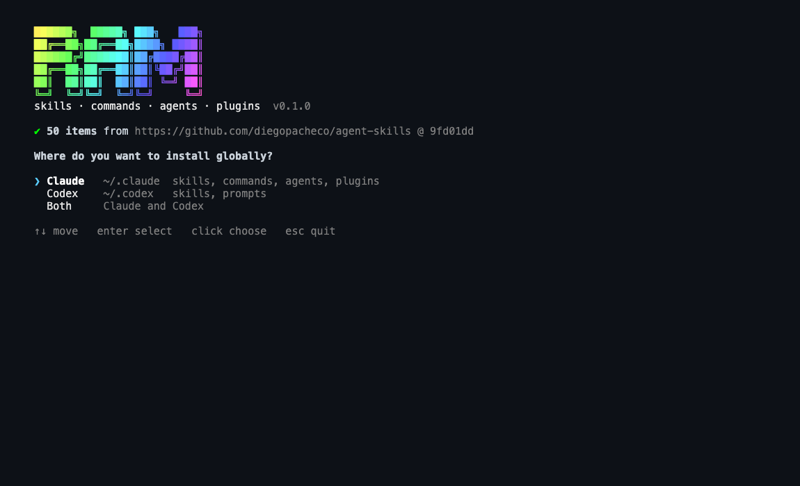
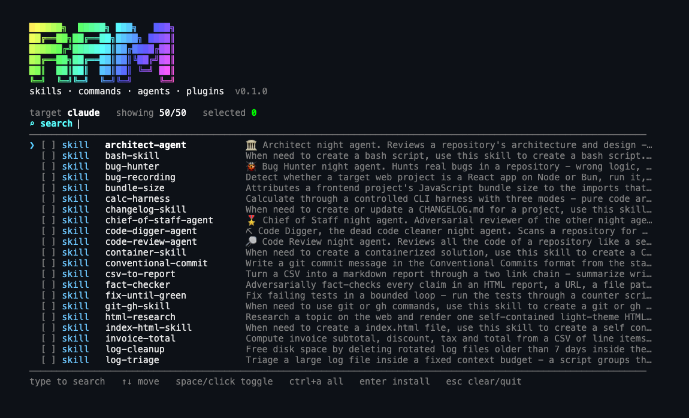
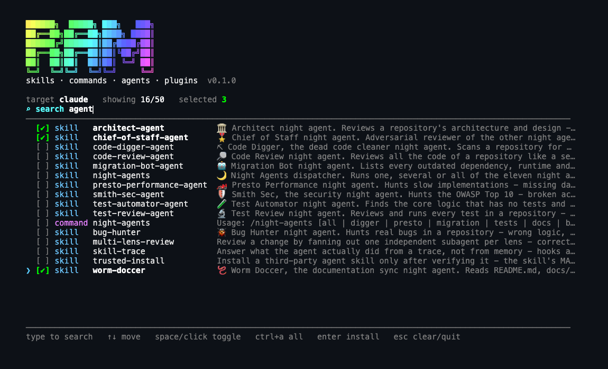
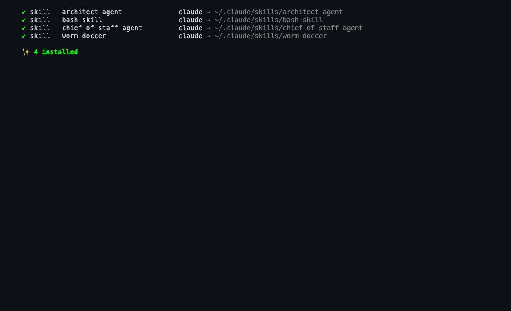

# ram

```
██████╗  █████╗ ███╗   ███╗
██╔══██╗██╔══██╗████╗ ████║
██████╔╝███████║██╔████╔██║
██╔══██╗██╔══██║██║╚██╔╝██║
██║  ██║██║  ██║██║ ╚═╝ ██║
╚═╝  ╚═╝╚═╝  ╚═╝╚═╝     ╚═╝
```

`ram` is an `npx`-style installer written in Rust. It fetches the latest
[diegopacheco/agent-skills](https://github.com/diegopacheco/agent-skills) on every run, asks whether to
install globally for Claude, Codex or both, and shows a searchable list of skills, custom commands, agents
and plugins. You check the ones you want with the keyboard or the mouse and they install in parallel.

## How it Works

1. Plays a rainbow gradient ASCII banner, then fetches the repo with `git clone --depth 1` into `~/.cache/ram`. Later runs fetch and hard reset, so you always get the newest commit.
2. Scans the checkout by convention: every folder with `SKILL.md` is a skill, every `*.md` in a `commands/` folder or a `command.md` next to a skill is a command, every `*.md` in an `agents/` folder is an agent, and every plugin listed in `.claude-plugin/marketplace.json` is a plugin.
3. Asks for the target: Claude, Codex or Both.
4. Opens a full-screen picker. Type to search, move with the arrows, toggle with space or a mouse click, select everything visible with `ctrl+a`, install with enter.
5. Installs every chosen item for every target at the same time on a tokio `JoinSet`, runs `npm install` for skills that ship a `package.json`, and prints one line per result.

## Architecture



## Features

* **Always fresh**: every run fetches the latest commit, so new skills show up with no release step.
* **Claude, Codex or both**: one choice decides where everything goes.
* **Search as you type**: filters by name, kind, repo path and description, and name matches rank first.
* **Checkboxes with mouse support**: click a row to toggle it. Selections survive changing the search.
* **Parallel installs**: copies and `npm install` runs happen concurrently, results print in the order you picked.
* **Clean reinstall**: a skill folder is replaced whole, so files removed upstream do not linger.
* **Non-interactive mode**: `ram install <name>... --target claude|codex|both` for scripts and CI.
* **Fails loud**: unknown names, unsupported targets and failed `npm`/`git`/`claude` calls exit non-zero with the reason.

## Stack

* Rust 1.99, edition 2024: a single 740 KB static binary with no runtime to install.
* tokio: async git, file copy and parallel installs.
* crossterm: raw mode, alternate screen, keys, mouse and true color for the TUI and banner.
* serde_json: reads `.claude-plugin/marketplace.json`, the only JSON input.

## Where Things Install

| Kind | Claude | Codex |
|---|---|---|
| skill | `~/.claude/skills/<name>/` | `~/.codex/skills/<name>/` |
| command | `~/.claude/commands/<name>.md` | `~/.codex/prompts/<name>.md` |
| agent | `~/.claude/agents/<name>.md` | not supported, skipped |
| plugin | `claude plugin marketplace add` + `claude plugin install <name>@<marketplace>` | not supported, skipped |

## CLI

```
ram                                      interactive picker
ram list                                 list everything in the repo
ram install <name|kind:name>... --target claude|codex|both
  --repo <url|path>                      source repo (default https://github.com/diegopacheco/agent-skills)
```

`kind:name` narrows a name used by two kinds, for example `command:night-agents` and `skill:night-agents`.

## Key Design Decisions

* **Conventions over the per-folder `install.sh`**: the upstream installers are inconsistent (some only prompt interactively), and running remote shell scripts is risky. `ram` copies files itself, so every item installs the same way.
* **The skill name comes from the frontmatter `name`**: `patterns/*/skill/` folders install as `sql-migration` and similar, not as `skill`.
* **The command name comes from the `# /name` heading**: `fact-checker/command.md` installs as `fact-check.md`, matching what users type.
* **Plugins use the real Claude mechanism**: Claude does not load a folder copied into `~/.claude/plugins`, so `ram` registers the repo as a marketplace and runs `claude plugin install`.
* **`Picker` is a pure state machine**: search, ranking, toggling and the cursor are unit tested without a terminal. `tui.rs` only draws and maps input.
* **The `Source` trait**: fetching is behind a trait with a `GitSource` implementation, so other sources can be added without touching the installer.

## Known Limits

* The repo has no agents and no plugins today, so those paths are covered only by tests on fixtures.
* `night-agents` skills copy fine, but the night agents also need the `~/.night-agents` runtime that the upstream `night-agents/install.sh` sets up.
* Requires `git`. Skills with a `package.json` also require `npm`, and plugins require the `claude` CLI.

## Printscreens

**1. Target menu**: after the banner and the fetch, `ram` shows how many items it found and at which commit, then asks where to install.



**2. Picker**: the full catalog with a colored kind, the name and a one-line description. The header shows the target and how many items are visible and selected.



**3. Search and select**: typing `agent` narrows 50 items to 16. Three are checked, one of them with a mouse click.



**4. Installed**: after enter, every pick installs in parallel and gets a line with its destination.



## Scripts

All scripts live in `scripts/` and run from any directory of the repository. `ram` is a CLI with no
services or ports, so there is no start, stop, status or ui script.

| Script | What it does |
|---|---|
| `./scripts/setup.sh` | Builds the release binary |
| `./scripts/test-all.sh` | Runs clippy with warnings as errors, then every test |
| `./scripts/run.sh` | Runs `ram` with any arguments, building first if needed |
| `./scripts/install.sh` | Installs `ram` on your PATH with `cargo install` |

```bash
./scripts/setup.sh
./scripts/test-all.sh
./scripts/run.sh
./scripts/install.sh
```
