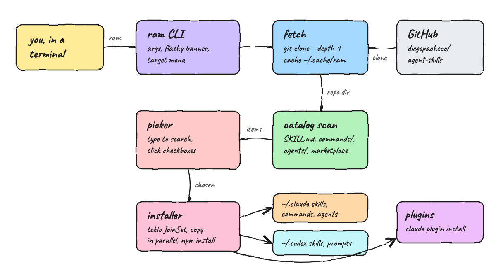

# Design Doc

## Architecture Principles
* One small binary, few crates: tokio, crossterm and serde_json only.
* Pure logic (catalog scan, picker state, cli parsing) is separate from IO (fetch, install, tui).
* Fail loud: every failed step exits non-zero with the reason.

## Features
* Fetches the latest diegopacheco/agent-skills on every run.
* Claude, Codex or both as the global target.
* Searchable checkbox picker with keyboard and mouse.
* Parallel installs of skills, commands, agents and plugins.
* Non-interactive `list` and `install` commands.

## Overall Diagram

## TradeOffs
* Installs by convention instead of running each upstream `install.sh`: consistent and safer, but extra setup steps inside those scripts (such as the night agents runtime) are not run.
* Uses the `git` binary instead of an HTTP and tar stack: zero extra crates, but `git` must be installed.
* Agents and plugins are Claude only.

## Decisions
* Skill name from the frontmatter `name`, command name from the `# /name` heading.
* Plugins install through `claude plugin marketplace add` and `claude plugin install`.
* A new search moves the cursor to the best match, and name matches rank above description matches.

## How to Run
`./scripts/run.sh` or `./scripts/run.sh install bash-skill --target claude`

## How to Test
`./scripts/test-all.sh`

## All REST Endpoints
None, this is a CLI.
