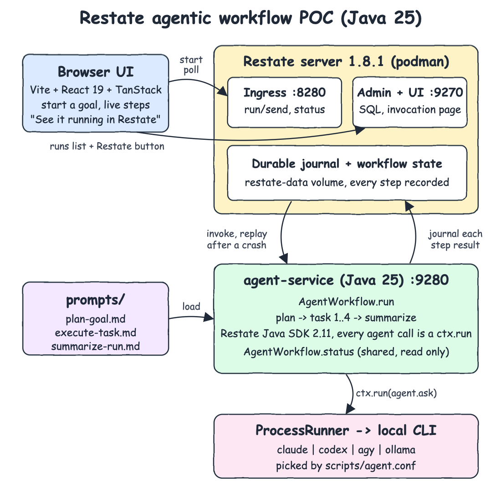
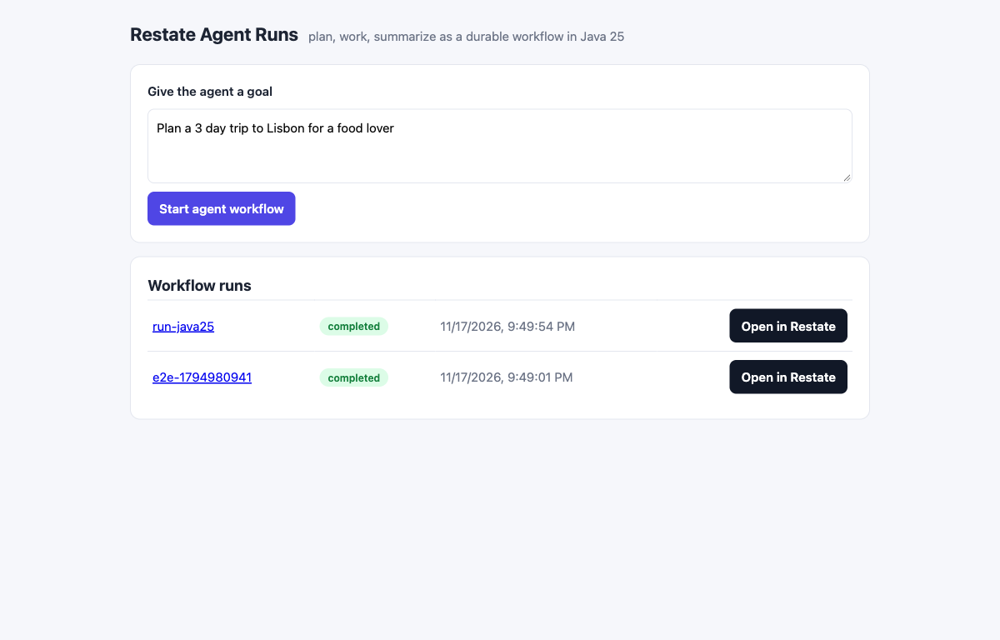
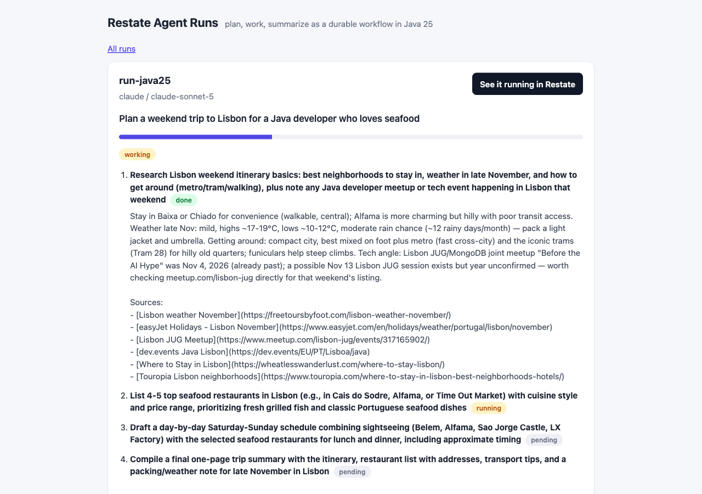
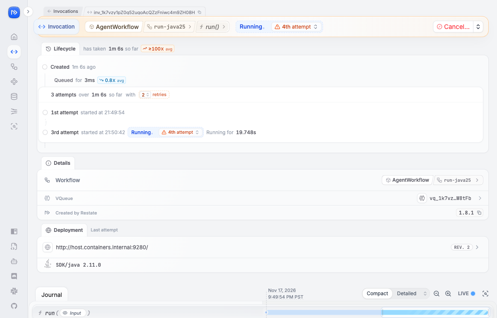
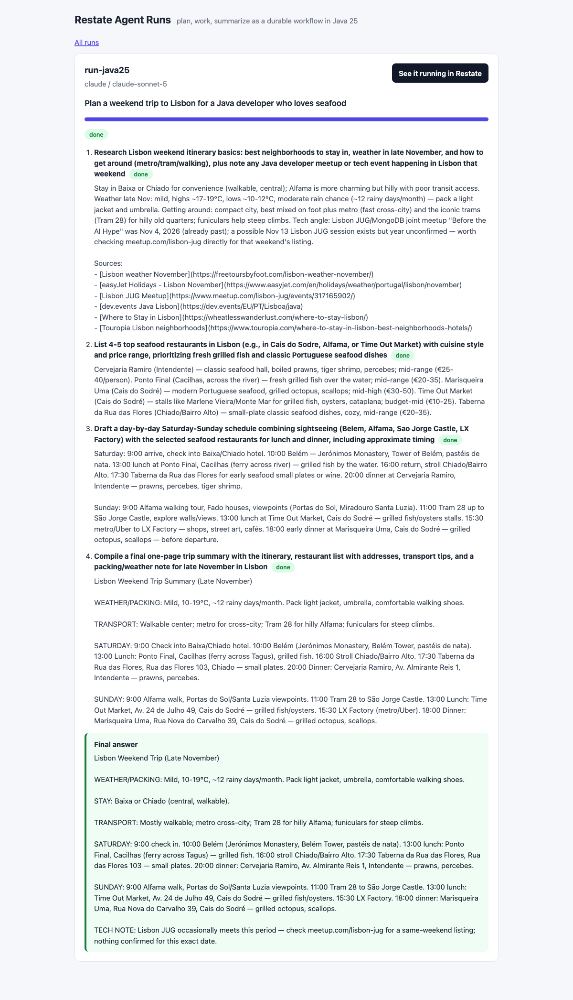
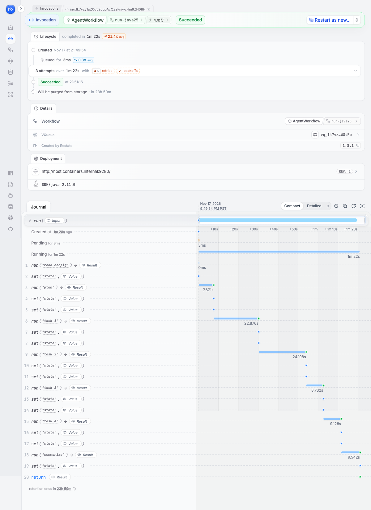

# Restate Agentic Workflow POC (Java 25)

An agentic plan-and-execute workflow that runs as a durable [Restate](https://restate.dev/) workflow, with the backend in **Java 25 + Spring Boot 4.1** and the frontend in **TypeScript + React 19**. You give the agent a goal in the UI. A planner agent splits it into 2 to 4 tasks, a worker agent completes each task, and a reviewer agent writes the final answer. Every agent call is a durable step in the Restate journal, so if the service crashes the run resumes from the last finished step instead of starting over. Each run has a **See it running in Restate** button that opens the run's invocation page in the Restate UI.

## How it Works

1. The UI starts `AgentWorkflow/<runId>/run` on the Restate ingress with `/send`, so the call returns at once with an invocation id.
2. Restate invokes the Java `agent-service` (on the host) and records every step in its journal.
3. `run` reads the agent config, then calls the agent through `ctx.run` for the plan, for each task, and for the summary.
4. After each step the workflow writes its progress with `ctx.set(STATE, ...)`.
5. The UI polls the shared, read-only `status` handler every 1.5s and renders the steps live.
6. The UI lists runs with SQL on the Restate admin API (`sys_invocation`). The Restate button links to `/ui/invocations/<invocationId>`.
7. If `agent-service` dies mid-run, Restate replays the journal when it is back: finished agent calls are not repeated and the run continues.

## Architecture



The Restate server runs in Podman. The agent service runs on the host because it calls the local `claude`, `codex`, `agy` and `ollama` CLIs, which exist only on the host. Restate reaches the service at `host.containers.internal:9280`.

## Features

* **Durable agent steps**: each LLM call is a `ctx.run` step, so a crash never reruns a finished, paid-for agent call.
* **Plan-and-execute agent**: the model decides the tasks, and each worker sees the results of earlier tasks.
* **Live progress**: workflow state plus a shared `status` handler give the UI step-by-step progress without a database.
* **See it in Restate**: a button on each run and in the runs list deep links to that invocation's journal and retries in the Restate UI.
* **Any agent CLI**: switch between Claude Code, Codex, Agy or Ollama in `scripts/agent.conf` with no code change.
* **Externalized prompts**: the three prompts live in `prompts/`, and an empty parameter fails loud.
* **Bounded retries**: each agent step retries at most 3 times with exponential backoff, then the run is marked `failed` with the error.

## Stack

* **Java 25**: records, switch expressions and `List.getFirst()` keep the domain small and typed.
* **Spring Boot 4.1.2**: wires the beans (workflow, agent caller, prompts, process runner) and starts the Restate endpoint.
* **Restate Java SDK 2.11.0** (`sdk-java-http` + `sdk-api-gen`): the `@Workflow` class and its Vert.x HTTP endpoint.
* **Maven**: build, tests and the runnable jar.
* **JUnit 5**: unit tests for the plan parser, prompts, run state, config and agent calls.
* **Restate 1.8.1** in Podman with podman-compose: durable execution, journal, state and the built-in UI.
* **Bun 1.4.4 + Vite 8 + React 19.3 + TypeScript 7**: the UI.
* **TanStack Router 1.170 + TanStack Query 5.108**: routes and polling.

## Contracts / APIs

All calls go through Restate. The UI dev server proxies `/ingress` to the Restate ingress and `/admin` to the Restate admin API.

| Call | Method + path | Body | Returns |
|---|---|---|---|
| Start a run | `POST /AgentWorkflow/{runId}/run/send` (ingress) | `{"goal": "..."}` | `{"invocationId": "inv_...", "status": "Accepted"}` |
| Run progress | `POST /AgentWorkflow/{runId}/status` (ingress) | none | `RunState` or `null` |
| List runs | `POST /query` (admin) | `{"query": "SELECT ... FROM sys_invocation ..."}` | `{"rows": [...]}` |
| Restate UI | `GET /ui/invocations/{invocationId}` (admin) | none | the invocation page |

## Key data structures and design decisions

```java
public record RunState(String goal, String provider, String model, Phase phase,
                       List<Step> steps, String summary, String error) { }

public record Step(String task, StepStatus status, String output) { }

public enum Phase { PLANNING, WORKING, SUMMARIZING, DONE, FAILED }
public enum StepStatus { PENDING, RUNNING, DONE }
```

The enums serialize lowercase with `@JsonValue`, so the JSON is the same as in the TypeScript and Rust versions and the UI is shared unchanged.

* **A Restate Workflow, not a Service**: the run id is the workflow key, so starting the same id twice runs it once, and `status` can read its state while it runs.
* **The config is journaled**: `AgentConfig.from(System::getenv)` runs inside `ctx.run`, so a replay uses the same provider and model even if `agent.conf` changed in between.
* **Immutable state transitions**: `RunState` is a record and every transition returns a new one, so the workflow reads as plan, run, done, and is unit tested without Restate.
* **The plan is parsed inside the durable step**: a model reply without a valid task list fails that step, which Restate retries, and only a valid plan is journaled.
* **Spring Boot for wiring, Restate's own HTTP server for the endpoint**: Restate's Spring Boot starter targets Spring Boot 3.5, so the app runs on Spring Boot 4.1 and starts `RestateHttpServer` from an `ApplicationRunner`.
* **The CLI prompt is one process argument**: `ProcessBuilder` gets a list, so no shell ever parses the prompt.
* **No database**: Restate stores the run state, so the stack's Postgres is not used.

## How to run

You need Podman with a running machine, podman-compose, Java 25, Maven, Bun, and the agent CLI named in `scripts/agent.conf` (default `claude` with `claude-sonnet-5`). The scripts use the sdkman Java 25 by default. Set `JAVA_HOME_25` to use another one.

```bash
./scripts/setup.sh
./scripts/start-all.sh
./scripts/ui.sh
```

To use another agent, edit `scripts/agent.conf`, such as `AGENT_PROVIDER=ollama` and `AGENT_MODEL=llama3.2`, then restart.

To see durability, start a run, then kill the service during a task and start it again:

```bash
kill -9 "$(cat .run/agent-service.pid)"
rm .run/agent-service.pid
./scripts/start-all.sh
```

The run continues from the task that was interrupted, and the Restate UI shows new attempts that replay the earlier steps from the journal.

## How to test

```bash
./scripts/test-all.sh
```

This runs the 23 agent-service JUnit tests, the UI typecheck, build and 7 unit tests, and `scripts/test-e2e.sh`. The end-to-end script starts a real workflow on the running stack, waits up to 60s for the agent to plan and finish its first task, and checks that Restate has the invocation.

## Printscreens

### Runs list



The home page: type a goal and start the agent workflow. Below, every `AgentWorkflow` run comes from the Restate admin SQL API with its status, and each row has an **Open in Restate** button.

### Run in progress



The planner agent split the goal into 4 tasks. Task 1 is `done` with its output, task 2 is `running`, and the others are `pending`. The page polls the workflow's `status` handler. The Java service was killed right after this screenshot.

### Restate UI while the agent runs, after a crash



What **See it running in Restate** opens. The Java service was killed with `kill -9` during task 2 and restarted. Restate shows the extra attempts and retries, and the deployment is `SDK/java 2.11.0`.

### Run completed



The same run after the restart: all 4 tasks are `done` with each worker agent's output, and the reviewer agent's final answer is at the bottom.

### Restate UI after the run



The invocation `Succeeded` in 1m 22s across 3 attempts. The journal shows each durable step (`read config`, `plan`, `task 1` to `task 4`, `summarize`) with the `state` writes between them. The steps from before the crash were replayed from the journal, not called again.

## Scripts

All scripts live in `scripts/` and run from any directory of the repository.

| Script | What it does |
|---|---|
| `./scripts/setup.sh` | Builds the Java jar, installs the UI and pulls the Restate image |
| `./scripts/start-all.sh` | Starts Restate, the Java service and the UI, registers the service, and prints every link |
| `./scripts/status.sh` | Shows every service port as UP or DOWN |
| `./scripts/test-all.sh` | Runs every test suite, end to end included |
| `./scripts/ui.sh` | Opens the UI in the browser |
| `./scripts/stop-all.sh` | Stops every service |

Ports are declared in `scripts/ports.env`: Restate ingress 8280, Restate admin and UI 9270, agent-service 9280, UI 5193. The agent provider and model are in `scripts/agent.conf`.
