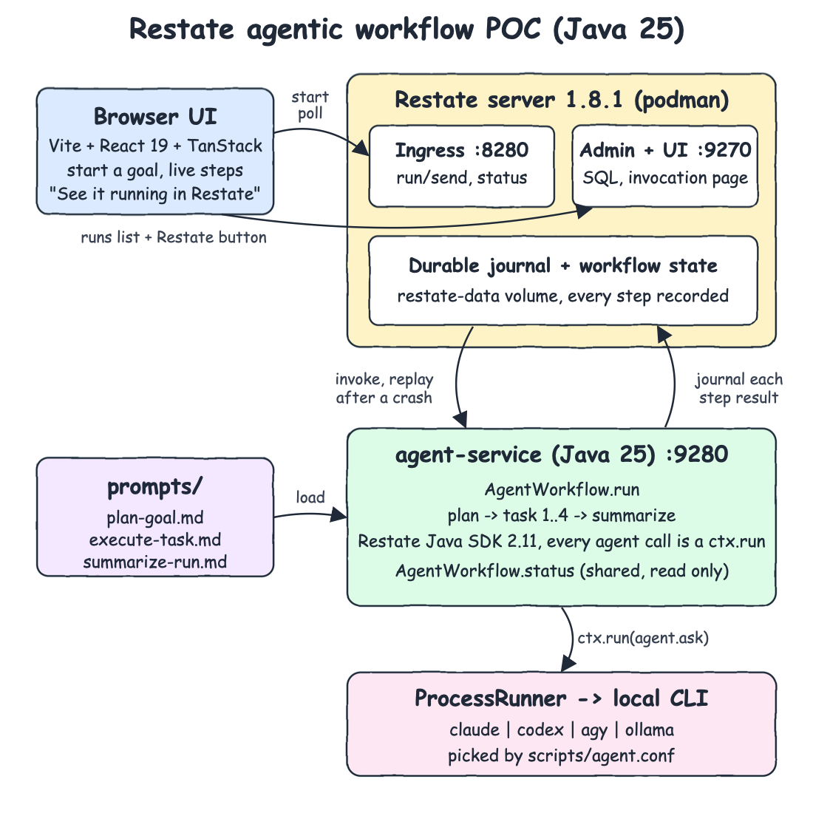

# Design Doc

## Architecture Principles

* Restate owns durability: the journal, retries and workflow state. The service code holds no state of its own.
* Every side effect, meaning every agent CLI call and the config read, goes through `ctx.run`, so a replay is deterministic.
* Small packages with one job each: `agents` (provider CLIs and process runner), `prompts` (templates), `plan` (plan parsing), `state` (immutable run state), `workflow` (orchestration), `config` (env).
* Prompts are files in `prompts/`, never strings in code.

## Features

* Plan-and-execute agent: plan, 2 to 4 tasks, summary.
* Live progress in the UI from the workflow state.
* A button that opens the invocation in the Restate UI.
* Recovery after a crash from the last journaled step.
* The provider (claude, codex, agy, ollama) and the model are set in `scripts/agent.conf`.

## Overall Diagram



## TradeOffs

* The agent service runs on the host, not in Podman, because it calls local CLIs that are logged in on the host. Only the Restate server is containerized.
* Spring Boot 4.1 wires the app, but the Restate endpoint is Restate's own Vert.x server, because the Restate Spring Boot starter 2.11 targets Spring Boot 3.5.
* The UI polls `status` every 1.5s instead of streaming. That is simple and good enough for steps that each take seconds.
* The UI has no backend: it uses the Restate ingress and admin APIs through the Vite proxy. That is fine for a POC, but in production the admin API should not be reachable from the browser.
* An LLM step that fails 3 times fails the whole run, with no partial answer.
* State is cleared when the run is purged from Restate (about 24h retention by default). There is no long-term history and no Postgres.

## Decisions

* A Restate Workflow, so the run id is the key, it runs once, and a shared `status` handler can read its state.
* `AgentConfig.from(System::getenv)` runs inside `ctx.run`, so a replay keeps the provider and model the run started with.
* The plan is parsed inside the `plan` step, so only a valid plan is journaled and a bad reply retries.
* Enums serialize lowercase with `@JsonValue`, so the JSON contract and the UI are the same as the TypeScript and Rust versions.
* Restate image pinned to 1.8.1. Restate Java SDK pinned to 2.11.0. Spring Boot pinned to 4.1.2.

## How to Run

```bash
./scripts/setup.sh
./scripts/start-all.sh
./scripts/ui.sh
```

## How to Test

```bash
./scripts/test-all.sh
```
