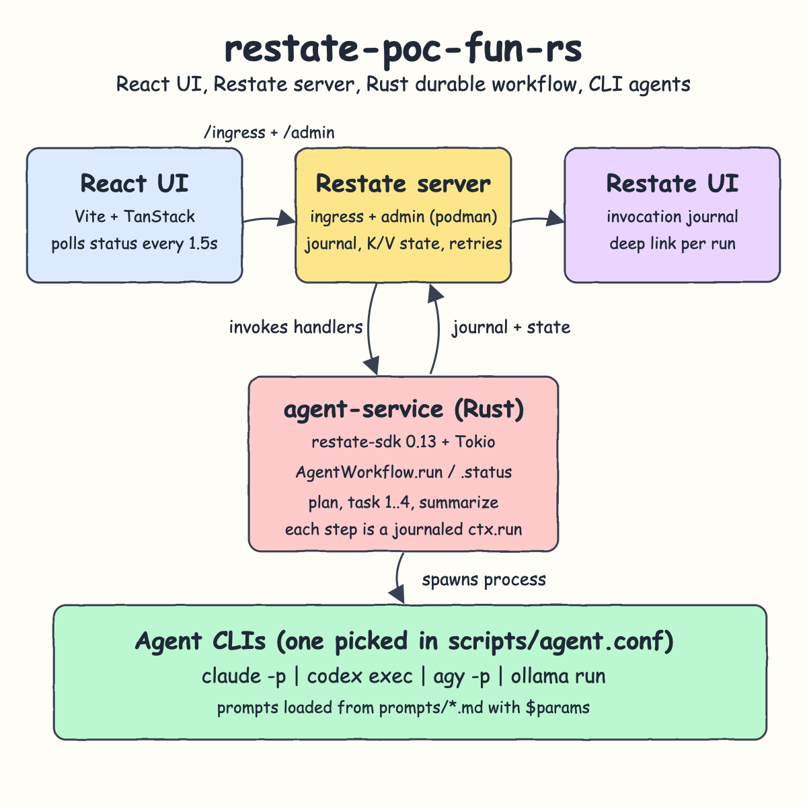
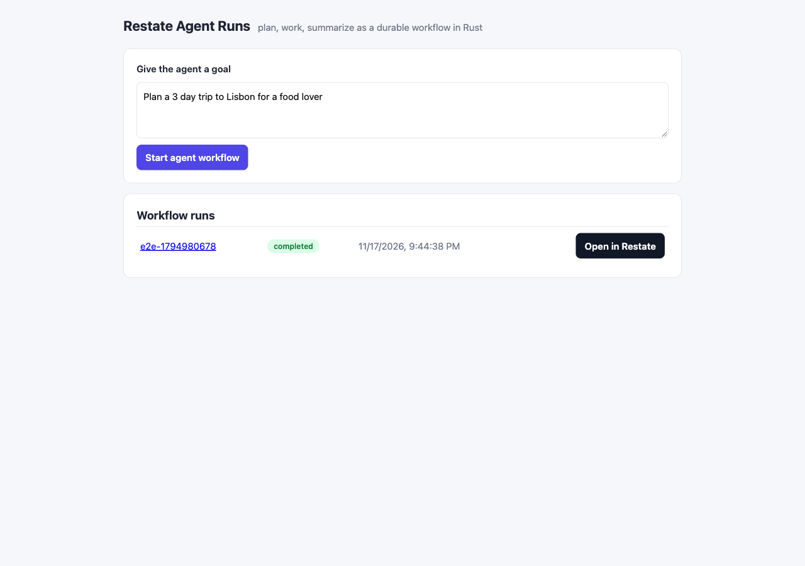
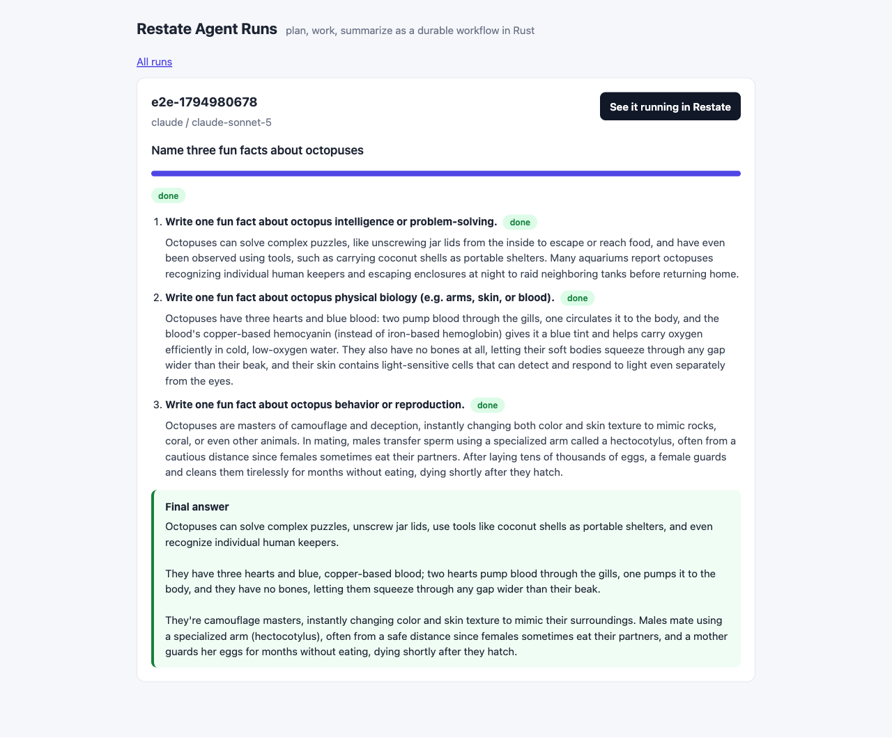
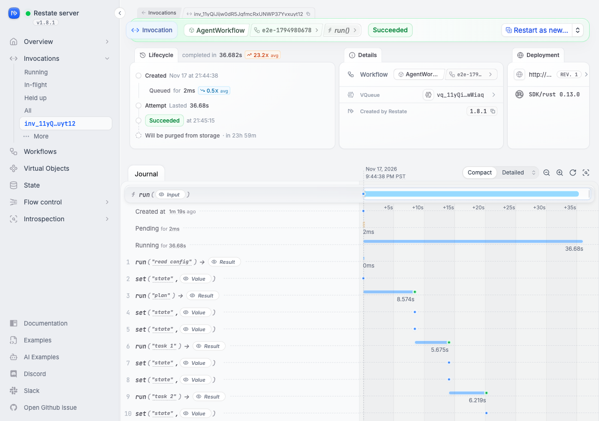

# restate-poc-fun-rs

A durable AI agent workflow on [Restate](https://restate.dev). The backend is a Rust service built with the
Restate Rust SDK; the frontend is React + TypeScript. You give the agent a goal. The workflow plans it into
2 to 4 tasks, runs each task with a coding agent CLI (Claude Code, Codex, Agy or Ollama), then writes a final
answer. Every step is journaled by Restate, so a crash or restart resumes the run where it stopped instead
of calling the model again.

This is the Rust backend port of the sibling TypeScript POC. The React UI and the Restate contract are the same.

## How it Works

1. The UI posts the goal to Restate ingress at `AgentWorkflow/<runId>/run/send` and gets an invocation id back.
2. Restate invokes the `run` handler on the Rust `agent-service`, registered as a Restate deployment.
3. `run` journals the agent config, then runs `plan`, `task 1..N` and `summarize`, each as a `ctx.run` step.
4. Each step loads a prompt from `prompts/*.md`, fills its `$params` and spawns the configured agent CLI.
5. After every step the workflow writes the run state (`phase`, `steps`, `summary`) to Restate K/V state.
6. The UI polls the shared `status` handler every 1.5s and renders progress, outputs and the final answer.
7. The run list comes from the Restate admin SQL API (`sys_invocation`), with a deep link into the Restate UI.
8. A failing step retries 3 times with backoff; then the run is marked `failed` with the error.

## Architecture



## Features

* **Durable agent workflow**: plan, work and summarize are journaled steps, so a restart replays results instead of paying for new LLM calls.
* **Pluggable agent CLIs**: `claude`, `codex`, `agy` or `ollama`, picked in `scripts/agent.conf` without code changes.
* **Externalized prompts**: every prompt is a `prompts/*.md` template with documented `$params`; a missing param fails loud.
* **Bounded plans**: the plan is parsed from the model output, blank items dropped and capped at 4 tasks.
* **Live progress UI**: progress bar, per step status and output, and the final answer.
* **Restate deep links**: every run opens its invocation journal in the Restate UI.
* **Bounded retries**: each step retries 3 times, then the run ends in `failed` with the error shown in the UI.

## Stack

* **Rust 1.100 (edition 2024)**: the backend, typed and async, release builds only.
* **restate-sdk 0.13**: Restate workflow macros, journaled `ctx.run`, K/V state and the HTTP endpoint.
* **Tokio**: async runtime and async process spawning for the agent CLIs.
* **serde / serde_json**: JSON contract with the UI and plan parsing.
* **Restate server 1.8.1**: durable execution engine, ingress, admin API and UI, run with podman-compose.
* **React 19.3 + TypeScript 7 + Vite 8**: the UI.
* **TanStack Router + Query**: routes for the run list and run page, polling with stop on final state.
* **Bun**: UI install, dev server and UI tests.

## Contracts / APIs

All calls go through Restate. The UI dev server proxies `/ingress` to Restate ingress and `/admin` to the admin API.

| Method | Path | Body | Response |
|---|---|---|---|
| POST | `/AgentWorkflow/{runId}/run/send` | `{"goal": "..."}` | `{"invocationId": "inv_..."}` |
| POST | `/AgentWorkflow/{runId}/run` | `{"goal": "..."}` | final answer as a JSON string |
| POST | `/AgentWorkflow/{runId}/status` | none, and no `content-type` header | `RunState` or `null` |
| POST | admin `/query` | `{"query": "SELECT ... FROM sys_invocation ..."}` | `{"rows": [...]}` |

`RunState`:

```json
{
  "goal": "Name three fun facts about octopuses",
  "provider": "claude",
  "model": "claude-sonnet-5",
  "phase": "planning | working | summarizing | done | failed",
  "steps": [{ "task": "...", "status": "pending | running | done", "output": "..." }],
  "summary": "...",
  "error": ""
}
```

## Key Data Structures and Design Decisions

* `RunState` (`agent-service/src/run_state.rs`) is an immutable value; each transition (`with_plan`, `step_running`, `step_done`, `finished`, `failed`) returns a new state that is saved to Restate after every step.
* `Agent` trait (`agent-service/src/agents.rs`) maps a model and a prompt to a CLI command; one struct per provider. `CommandRunner` trait runs it, so tests swap the real process runner for a recorder.
* The agent config is read inside a `ctx.run`, so a replay uses the journaled provider and model even if `agent.conf` changed.
* The `status` handler is a shared workflow handler: it reads state while `run` is still executing.
* The Rust SDK rejects `content-type: application/json` on a handler without input, so the UI sends that header only when it sends a body. A UI test locks this in.
* Ports live only in `scripts/ports.env`; podman-compose gets them through env vars.

## How to Run

Requires podman, podman-compose, cargo, bun, curl and the agent CLI named in `scripts/agent.conf`.

```bash
./scripts/setup.sh
./scripts/start-all.sh
./scripts/ui.sh
```

## How to Test

```bash
./scripts/test-all.sh
```

Runs `cargo test --release` (20 tests), the UI typecheck, build and `bun test` (9 tests), then an end to end
test that starts a real workflow through Restate, waits for the agent to finish its first task and checks the
invocation in the Restate admin API. The end to end test needs `./scripts/start-all.sh` first.

## Print Screens

### Runs page

Give the agent a goal and start a workflow. Below, every run of `AgentWorkflow` from the Restate admin SQL API, with its status and a button that opens it in the Restate UI.



### Run page

A finished run: provider and model, the goal, a full progress bar, the 3 tasks the agent planned with each output, and the final answer written by the summarize step.



### Restate UI

The same run in the Restate UI. The deployment is `SDK/rust 0.13.0`. The journal shows `read config`, `plan`, `task 1`, `task 2` as `run` steps with their timings, and the `set("state")` calls between them that the UI polls.



## Scripts

All scripts live in `scripts/` and run from any directory of the repository.

| Script | What it does |
|---|---|
| `./scripts/setup.sh` | Builds the Rust service in release, installs the UI and pulls the Restate image |
| `./scripts/start-all.sh` | Starts Restate, the agent service and the UI, registers the deployment and prints the full link of each one |
| `./scripts/status.sh` | Shows every service port as UP or DOWN |
| `./scripts/test-all.sh` | Runs every test suite, end to end included |
| `./scripts/test-e2e.sh` | Runs only the end to end test against the running stack |
| `./scripts/ui.sh` | Opens the UI in the browser |
| `./scripts/stop-all.sh` | Stops every service |

Ports are declared in `scripts/ports.env`: Restate ingress 8180, Restate admin and UI 9170, agent-service 9180, UI 5192.

```bash
./scripts/setup.sh
./scripts/start-all.sh
./scripts/status.sh
./scripts/ui.sh
./scripts/stop-all.sh
```
