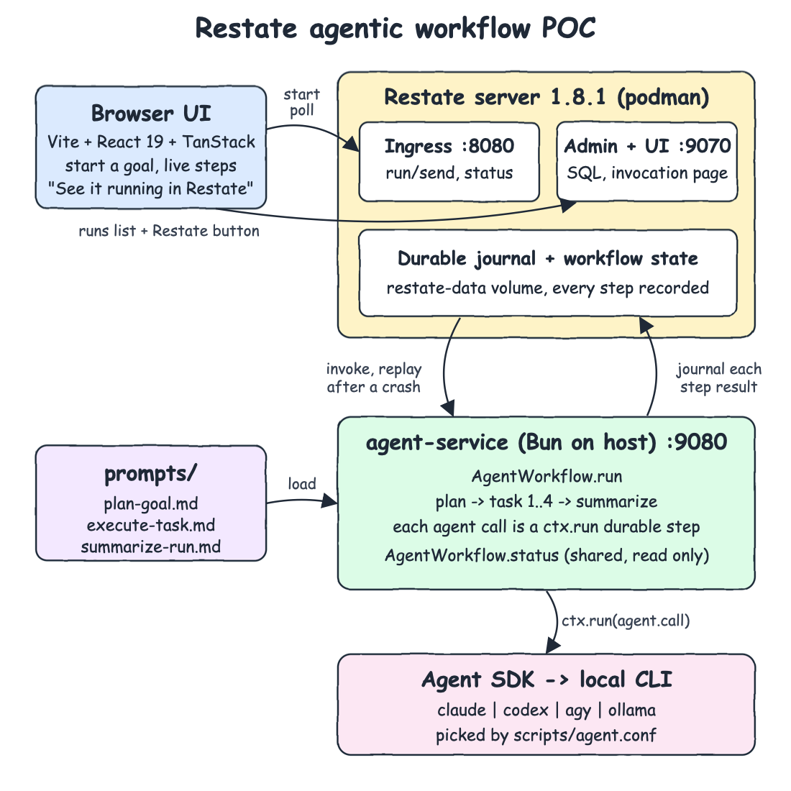

# Design Doc

## Architecture Principles

* Restate owns durability: the journal, retries and workflow state. The service code holds no state of its own.
* Every side effect, meaning every agent CLI call and the config read, goes through `ctx.run`, so a replay is deterministic.
* Small modules with one job each: `agents.ts` (provider CLIs), `prompts.ts` (templates), `plan.ts` (plan parsing), `run-state.ts` (pure state transitions), `workflow.ts` (orchestration), `config.ts` (env).
* Prompts are files in `prompts/`, never strings in code.

## Features

* Plan-and-execute agent: plan, 2 to 4 tasks, summary.
* Live progress in the UI from the workflow state.
* A button that opens the invocation in the Restate UI.
* Recovery after a crash from the last journaled step.
* The provider (claude, codex, agy, ollama) and the model are set in `scripts/agent.conf`.

## Overall Diagram



## TradeOffs

* The agent service runs on the host, not in Podman, because the agent SDK calls local CLIs that are logged in on the host. Only the Restate server is containerized.
* The UI polls `status` every 1.5s instead of streaming. That is simple and good enough for steps that each take seconds.
* The UI has no backend: it uses the Restate ingress and admin APIs through the Vite proxy. That is fine for a POC, but in production the admin API should not be reachable from the browser.
* An LLM step that fails 3 times fails the whole run, with no partial answer.
* State is cleared when the run is purged from Restate (about 24h retention by default). There is no long-term history.

## Decisions

* A Restate Workflow, so the run id is the key, it runs once, and a shared `status` handler can read its state.
* The agent SDK provider classes are copied in and their runner made async, because the original `spawnSync` blocked the event loop for the whole LLM call.
* `readConfig()` runs inside `ctx.run`, so a replay keeps the provider and model the run started with.
* The plan is parsed inside the `plan` step, so only a valid plan is journaled and a bad reply retries.
* Restate image pinned to 1.8.1. The SDK is pinned to 1.18.4.

## How to Run

```bash
./scripts/setup.sh
./scripts/start-all.sh
./scripts/ui.sh
```

## How to Test

```bash
./scripts/test-all.sh
```

## All REST Endpoints

| Endpoint | Where | Purpose |
|---|---|---|
| `POST /AgentWorkflow/{runId}/run/send` | Restate ingress :8080 | start a run with `{"goal": "..."}` |
| `POST /AgentWorkflow/{runId}/status` | Restate ingress :8080 | read the `RunState` |
| `POST /query` | Restate admin :9070 | SQL over `sys_invocation` for the runs list |
| `POST /deployments` | Restate admin :9070 | register `agent-service` (done by `start-all.sh`) |
| `GET /ui/invocations/{invocationId}` | Restate admin :9070 | the Restate UI page for one run |
