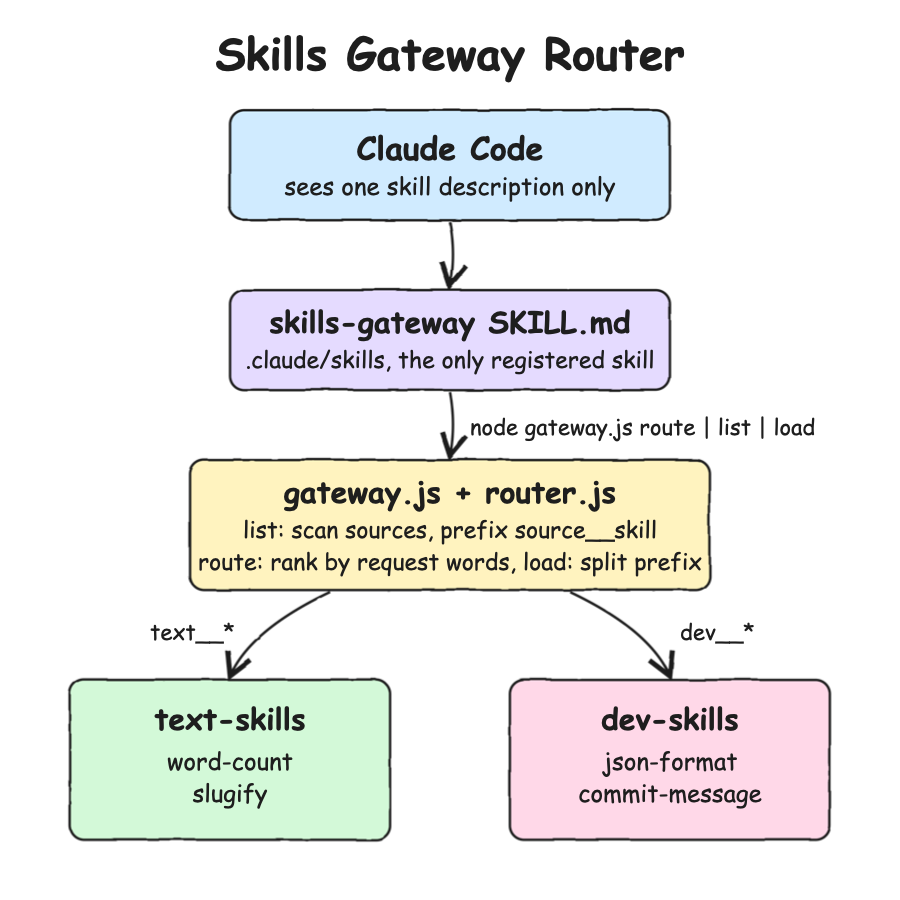

# Skills Gateway Router

One skill that acts as a gateway and router in front of other skills. Claude Code or Codex registers only `skills-gateway`. The skills behind it live in skill sources that the agent never loads. The gateway lists them as one catalog, picks the right one for a request, and loads that skill's instructions on demand. This is the same idea as an MCP gateway router, applied to skills instead of MCP tools.

* `.claude/skills/skills-gateway/SKILL.md`: the gateway skill, the only skill the agent sees.
* `gateway.js` + `router.js`: the gateway CLI and the router it calls.
* `upstream-skills/text-skills`: upstream source with `word-count` and `slugify`.
* `upstream-skills/dev-skills`: upstream source with `json-format` and `commit-message`.

## How it Works

1. The agent reads only the description of `skills-gateway`, so the skills behind it cost no context until they are needed.
2. For a task, the agent invokes the gateway skill, which tells it to run `node gateway.js route "<request>"`.
3. The router scans every skill source in `sources.env` and reads each `SKILL.md` frontmatter.
4. Each skill gets its source name as a prefix, `<source>__<skill>`, such as `text__word-count`.
5. `route` ranks skills by the words the request shares with each skill's name and description, and prints the best 3.
6. The agent runs `load <source>__<skill> <arguments>`. The router splits the name at the first `__`, finds the source, and prints that SKILL.md body.
7. The agent follows the loaded instructions as if that skill had been invoked directly.

## Architecture



## How the Gateway Detects and Routes Skills

### 1. How the agent finds the gateway

The agent knows nothing about the upstream skills. It only finds the gateway:

* In this repo, Claude Code loads `.claude/skills/skills-gateway/SKILL.md` because it is a project skill.
* After `./scripts/install.sh`, Claude Code loads it from `~/.claude/skills/skills-gateway` and Codex loads it from `~/.codex/skills/skills-gateway`, from any directory.

At startup the agent puts only the gateway `name` and `description` into its context. The description says to use it for any task a specialized skill could handle, so the agent calls it when a request looks like a skill job. The body, with the commands, is read only when the skill is invoked.

In the repo the command is `node ${CLAUDE_SKILL_DIR}/../../../gateway.js`, and Claude Code replaces `${CLAUDE_SKILL_DIR}` with the skill folder. The installed copy has the absolute path of this repo's `gateway.js` instead, because it no longer sits inside the repo and Codex has no `${CLAUDE_SKILL_DIR}`.

### 2. Where the skill sources are

`gateway.js` reads the sources from the `SKILL_SOURCES` env var, or else from `sources.env` in the project root:

```
text=upstream-skills/text-skills
dev=upstream-skills/dev-skills
```

* Each line is `<source>=<folder>`. A relative folder is resolved from the project root, not from the agent's working directory.
* Source names must match `[a-z0-9-]`. A bad name, a missing `=` or a duplicate source stops the gateway with an error.
* The env var form is comma separated: `SKILL_SOURCES=text=/abs/text-skills,dev=/abs/dev-skills`.

### 3. How skills are detected inside a source

On every command, `router.js` scans each source folder. Nothing is cached:

1. If the source folder does not exist, the source is DOWN. `list` and `route` skip it with a `warning:` on stderr, and `load` fails with exit 3.
2. Every subfolder that has a `SKILL.md` is a skill. Other files and folders are ignored. Subfolders are read in name order, so the catalog is stable.
3. `lib/skill-md.js` reads the `---` frontmatter. `name` is the skill name (the folder name if it is missing), and `description` is required.
4. A skill without frontmatter, without a description, or with a name outside `[a-z0-9-]` is skipped with a warning, and its siblings still work.
5. The skill becomes `{ name: "<source>__<skill>", description, dir, body }`.

A new skill folder dropped into a source shows up on the next `list`. Nothing has to restart.

### 4. How `route` picks a skill

`route "<request>"` scores every skill without calling a model:

1. Both the request and the skill's `name + description` are split into lowercase words. Words shorter than 3 letters and stop words such as `the`, `and`, `with` are dropped.
2. A request word matches a skill word when they are equal, or when one is a prefix of the other and both have 4+ letters (`count` matches `counts`, `format` matches `formatting`).
3. The score is the number of distinct request words that match. Skills scoring 0 are dropped.
4. The rest are sorted by score, ties by name, and the best 3 are printed as `- <source>__<skill>: <description>`.

```bash
node gateway.js route "make a url slug for this blog title"
- text__slugify: Turns a title or a sentence into a URL slug, lowercase words joined by hyphens with accents removed.
```

The agent reads the candidates and makes the final pick. If none fits, the gateway skill tells it to run `list` to see the full catalog, and then to do the task without the gateway if nothing fits there.

### 5. How `load` reaches the skill

`load text__slugify Olá Mundo`:

1. Splits the name at the first `__` into source `text` and skill `slugify`. Names cannot contain `__`, so the split is never ambiguous.
2. Looks up the `text` source (exit 2 if unknown), scans it (exit 3 if DOWN), and finds `slugify` (exit 2 if unknown).
3. Replaces `${SKILL_DIR}` in the body with the skill's absolute folder and `$ARGUMENTS` with `Olá Mundo`.
4. Prints `skill: text__slugify`, `base directory: <folder>` and the body.

The agent then runs `node <folder>/slugify.js Olá Mundo` as the body says, from whatever directory it is in.

## Install and Test in Claude Code, Step by Step

1. Check the prerequisites (Node 24+):
   ```bash
   ./scripts/setup.sh
   ```
2. Run the offline tests:
   ```bash
   ./scripts/test-all.sh
   ```
3. Install the gateway skill as a user skill:
   ```bash
   ./scripts/install.sh claude
   ```
4. Check that it is installed and that both sources are UP:
   ```bash
   ./scripts/status.sh
   ```
5. Open Claude Code in any other folder and confirm the skill is there. `/skills` lists `skills-gateway`, and only that one, not the four upstream skills.
6. Ask it something like:
   ```
   Use the skills gateway to turn 'Olá Mundo: Skills Gateway Router!' into a URL slug
   ```
   Claude invokes `skills-gateway`, runs `route` and gets `text__slugify`, runs `load text__slugify ...`, runs the upstream script, and answers `ola-mundo-skills-gateway-router`.
7. Try the other skills, such as "count the words in README.md", "pretty print package.json" or "write a commit message for my staged changes".
8. Run the automated end-to-end test through the real Claude CLI:
   ```bash
   ./scripts/e2e.sh claude
   ```
9. Remove it when done:
   ```bash
   ./scripts/uninstall.sh claude
   ```

For Codex, use `codex` instead of `claude` in steps 3, 8 and 9, and open `codex` in step 5.

Without installing, start `claude` from the project root. The project skill in `.claude/skills` is enough.

## End-to-End Test Through the Agents

`./scripts/e2e.sh [claude|codex|all]` checks the installed skill with the real CLI:

1. It fails if the CLI is missing or the gateway is not installed for that agent.
2. It creates a temp folder outside the repo with `notes.txt` holding 7 words, so only the installed skill can be used.
3. It runs `claude -p ... --output-format stream-json` or `codex exec --json --sandbox read-only` there, asking for the slug of `Olá Mundo: Skills Gateway Router!` and the word count of `notes.txt`.
4. It saves the transcript to `.run/logs/e2e-<agent>.jsonl` and passes only if the agent:
   * ran the gateway `route` command
   * loaded `text__slugify` and `text__word-count` through the gateway (the `skill: ...` lines that `load` prints)
   * answered `ola-mundo-skills-gateway-router` and `7`
5. It prints `PASS` per agent, or the failed check and the transcript path.

Both agents pass. Each run calls a real model, so it costs tokens and takes about a minute per agent.

## Features

* **Single entry point**: the agent registers one skill, and new skills or sources need no agent change.
* **Context savings**: only one skill description sits in the system prompt, while the catalog is read on demand.
* **Skill namespacing**: `<source>__<skill>` keeps two sources with the same skill name from colliding.
* **Prefix routing**: `load` is decided by the name alone, with no lookup table to keep in sync.
* **Request routing**: `route` ranks skills by word overlap, so the agent reads 3 candidates instead of the whole catalog.
* **Graceful listing, loud loads**: a dead source or a broken SKILL.md does not hide the others, but loading it fails clearly.
* **Claude Code and Codex**: one install script for both, and the same SKILL.md works in both.
* **Safe install**: install and uninstall never touch a `skills-gateway` folder that was not installed from this repo.
* **Zero dependencies**: only Node built-ins, so there is nothing to install.

## Stack

* **Node.js 24**: `node:fs`, `node:test`, `import.meta.main` and `import.meta.dirname` cover everything.
* **Agent skills**: plain `SKILL.md` files with frontmatter, the format Claude Code and Codex already understand.
* **node:test**: the built-in test runner, so no test framework is needed.
* **Bash 3.2**: the scripts run on a stock macOS.

## Contracts / APIs

The gateway is a CLI. Every command works from any directory.

| Command | Output | Exit code |
|---|---|---|
| `node gateway.js sources` | one line per source: `name UP\|DOWN <n> skills` | 0 |
| `node gateway.js list` | `- <source>__<skill>: <description>` for every skill, warnings on stderr | 0 |
| `node gateway.js route <request>` | the best 3 matches, best first, in the same format | 0, or 2 for an empty request |
| `node gateway.js load <source>__<skill> [arguments]` | `skill:` and `base directory:` lines, then the SKILL.md body | 0, 2 unknown skill or source, 3 source unreachable |

Skills behind the gateway:

| Skill | Source folder | Does |
|---|---|---|
| `text__word-count` | `upstream-skills/text-skills/word-count` | counts words, lines and characters |
| `text__slugify` | `upstream-skills/text-skills/slugify` | turns a title into a URL slug |
| `dev__json-format` | `upstream-skills/dev-skills/json-format` | validates and pretty prints JSON |
| `dev__commit-message` | `upstream-skills/dev-skills/commit-message` | writes a conventional commit message for staged changes |

An upstream skill is a folder with a `SKILL.md`:

```md
---
name: slugify
description: Turns a title or a sentence into a URL slug.
---

Request: $ARGUMENTS

Run `node ${SKILL_DIR}/slugify.js <text>` and answer with the slug it prints and nothing else.
```

To add a source, add a line to `sources.env`, such as `ops=upstream-skills/ops-skills`, with one folder per skill holding a `SKILL.md`.

## Key Data Structures and Design Decisions

* **Source map** (`router.js`): a `Map` from source name to folder, checked at startup for bad names and duplicates.
* **Skill record**: `{ name, source, skill, description, dir, body }`, read from the SKILL.md frontmatter on every call.
* **Separator `__`**: skill and source names allow `[a-z0-9-]` only, the same rule agent skill names use, so `__` can never appear inside a name.
* **Deterministic scoring**: word overlap needs no model call and is testable. The agent still makes the final pick.
* **Not registered on purpose**: the upstream skills sit outside every skills folder, so the agent never preloads them.
* **Install rewrites one line**: the installed SKILL.md points at this repo's `gateway.js` by absolute path, so the catalog stays in the repo and is never copied.
* **Stateless**: no cache and no index file. A skill added to a source shows up on the next `list`.
* **Trade-offs**: one extra step per skill (route, then load), keyword routing misses synonyms, the catalog is rescanned on every call, and upstream frontmatter other than `name` and `description` is ignored. See `design-doc.md`.

## How to Test

```bash
./scripts/test-all.sh
./scripts/e2e.sh
```

26 offline tests:
* SKILL.md frontmatter parsing, and rejection of a file without frontmatter
* router: namespacing of same name skills, prefix splitting, source validation, ranking, no match for unrelated requests, dead sources, broken skills, exit codes, `${SKILL_DIR}` and `$ARGUMENTS` substitution
* end-to-end CLI from another directory: the gateway is the only registered skill, the command in its SKILL.md resolves to `gateway.js`, every upstream skill is the top route for a request in its area, load output, exit codes, the `SKILL_SOURCES` override
* install and uninstall in temp folders: the installed command runs this repo's gateway, both scripts can run twice, a foreign `skills-gateway` folder is never touched, an unknown agent fails
* the scripts of the upstream skills

`e2e.sh` adds the live check through the real Claude Code and Codex CLIs.

## Scripts

All scripts live in `scripts/` and run from any directory of the repository. The gateway is a CLI with no services and no ports, so there is no start, stop or UI script.

| Script | What it does |
|---|---|
| `./scripts/setup.sh` | Checks Node 24+ (there are no dependencies to install) |
| `./scripts/status.sh` | Shows every skill source as UP or DOWN, and whether the gateway is installed for Claude Code and Codex |
| `./scripts/test-all.sh` | Runs every offline test suite |
| `./scripts/install.sh [claude\|codex\|all]` | Installs the gateway skill into `~/.claude/skills` and/or `~/.codex/skills` |
| `./scripts/uninstall.sh [claude\|codex\|all]` | Removes the gateway skill installed from this repo |
| `./scripts/e2e.sh [claude\|codex\|all]` | Runs the installed gateway through the real agent CLI and checks the routing |

`CLAUDE_SKILLS_DIR` and `CODEX_SKILLS_DIR` override the install folders.

```bash
./scripts/setup.sh
./scripts/test-all.sh
./scripts/install.sh
./scripts/status.sh
./scripts/e2e.sh
./scripts/uninstall.sh
```
