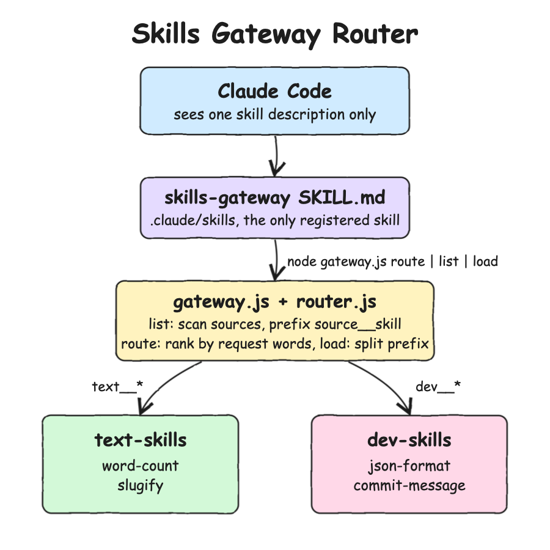

# Design Doc

## Architecture Principles

* One registered skill in front of many unregistered ones, like an MCP gateway in front of MCP servers.
* Upstream skills are plain `SKILL.md` folders that know nothing about the gateway.
* Zero dependencies and no state: every command rescans the sources.
* Fail loud on loads, degrade gracefully on listing.

## Features

* `list`: one namespaced catalog of every skill in every source.
* `route`: the best 3 skills for a request, by word overlap.
* `load`: the instructions of one skill, with `${SKILL_DIR}` and `$ARGUMENTS` filled in.
* `sources`: every source as UP or DOWN with its skill count.

## Overall Diagram



## TradeOffs

* Two steps per task (route, then load) instead of one direct skill invocation.
* Keyword routing misses synonyms. Claude still reads the candidates and can fall back to `list`.
* The catalog is rescanned on every call, which is fine for tens of skills, not for thousands.
* Upstream skill frontmatter such as `allowed-tools` or `model` is not enforced by the gateway, only the body and arguments are used.
* The installed skill points at this repo by absolute path, so moving the repo needs a reinstall.

## Decisions

* `__` separator: skill names allow `[a-z0-9-]` only, so the split is never ambiguous.
* Exit codes 2 (unknown or invalid) and 3 (unreachable) mirror the MCP gateway's invalid params and internal error codes.
* Deterministic scoring instead of an LLM call: no cost, no latency, testable, and Claude already makes the final choice.
* `${SKILL_DIR}` instead of `${CLAUDE_SKILL_DIR}` in upstream skills, because the gateway, not Claude Code, resolves their folder.

## How to Run

```bash
./scripts/setup.sh
./scripts/install.sh
claude
```

## How to Test

```bash
./scripts/test-all.sh
./scripts/e2e.sh
```

## All REST Endpoints

None. The gateway is a CLI: `sources`, `list`, `route <request>`, `load <source__skill> [arguments]`.
