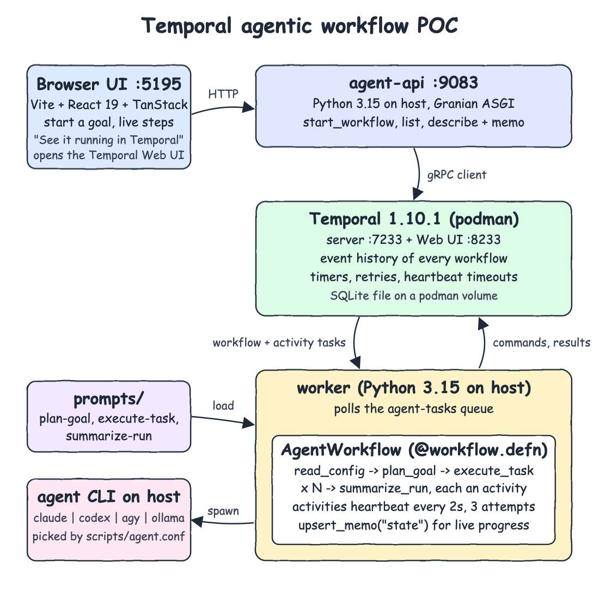
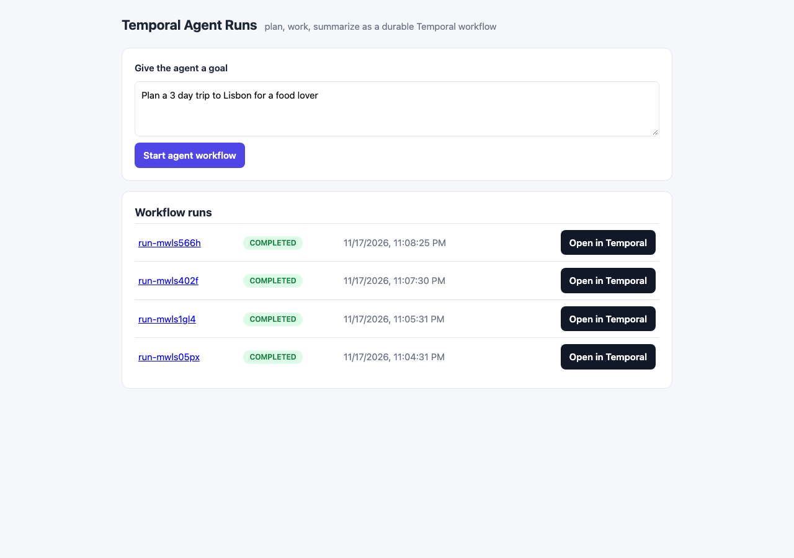
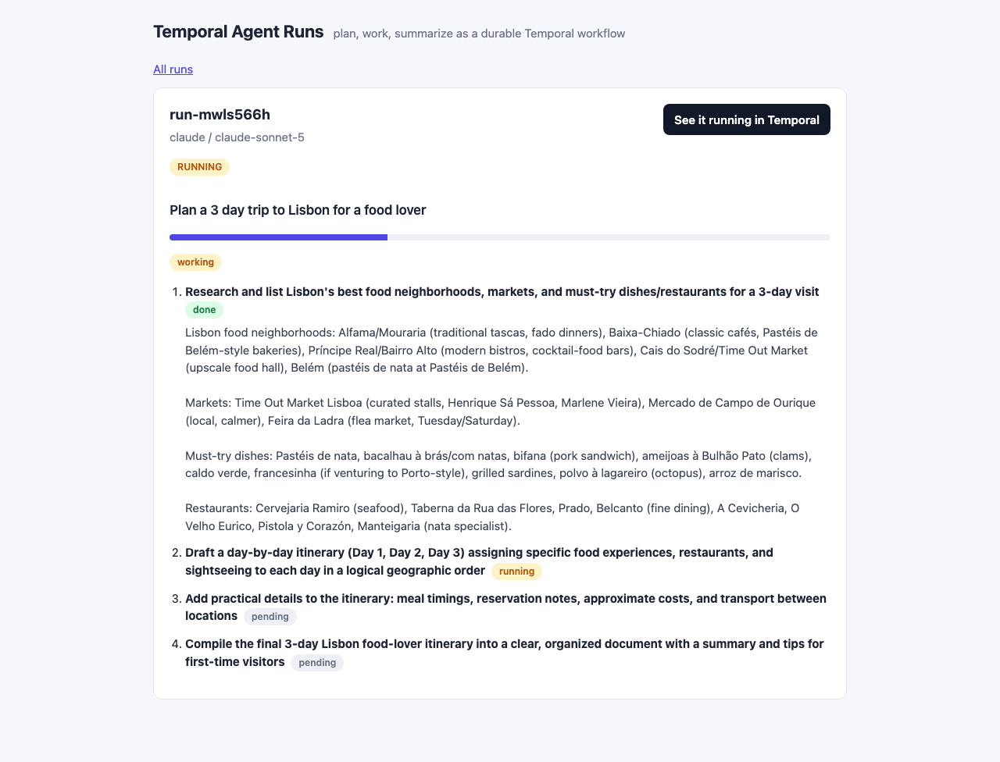
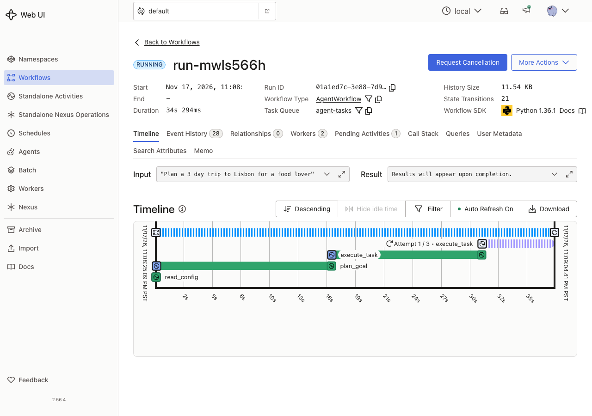
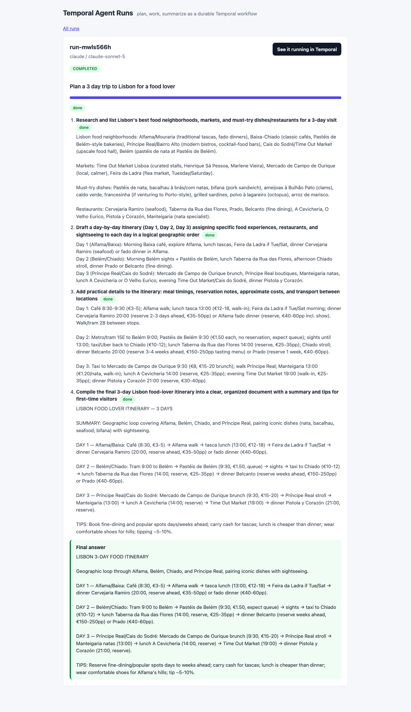
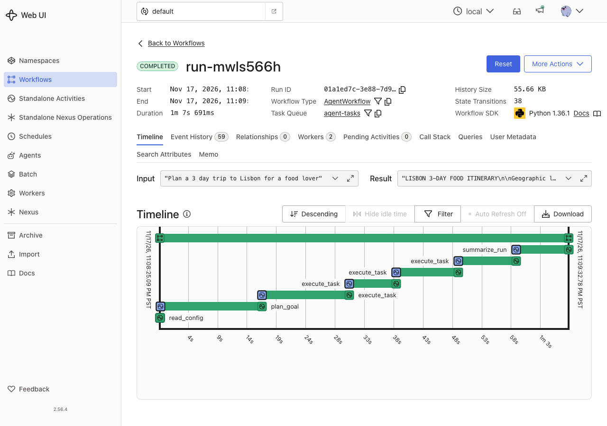
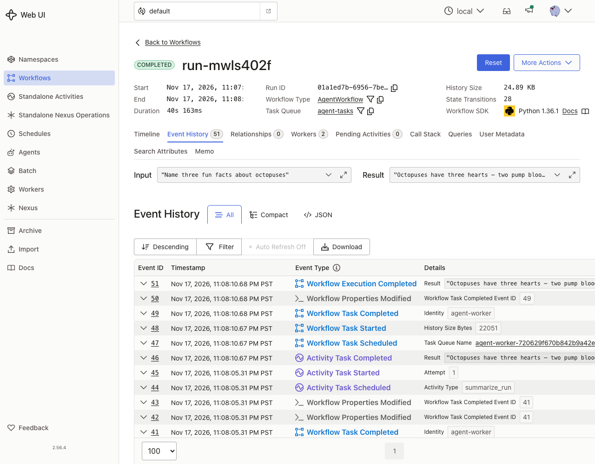

# Temporal Agentic Workflow POC (Python)

An agentic plan-and-execute workflow that runs as a durable [Temporal](https://temporal.io/) workflow. You give the agent a goal in the UI. A planner agent splits it into 2 to 4 tasks, a worker agent completes each task, and a reviewer agent writes the final answer. Every agent call is a Temporal activity recorded in the workflow's event history, so if the worker crashes a new worker replays the history and the run continues from the interrupted step instead of starting over. Each run has a **See it running in Temporal** button that opens the workflow in the Temporal Web UI.

Temporal is open source (MIT). The server and the Web UI run in one Podman container, with no account and no signup.

## How it Works

1. The UI posts the goal to `agent-api` (Python), which calls `start_workflow(AgentWorkflow.run, goal, id=runId)` on the Temporal server.
2. Temporal writes `WorkflowExecutionStarted` to the event history and puts a workflow task on the `agent-tasks` queue.
3. The worker process polls that queue and runs `AgentWorkflow`, which schedules the activities `read_config`, `plan_goal`, one `execute_task` per planned task, and `summarize_run`.
4. Each activity calls the agent CLI and heartbeats every 2s. Temporal records its result in the history and retries a failed attempt up to 3 times.
5. After each step the workflow publishes its progress with `workflow.upsert_memo({"state": ...})`.
6. The UI polls `agent-api` every 1.5s. `agent-api` reads the status and memo with `describe()`, which works even when no worker is alive.
7. If the worker dies mid-run, the running activity misses its heartbeat and times out after 10s. When a worker is back, it replays the history: finished activities are not called again, and the timed-out one runs as attempt 2.

## Architecture



The Temporal dev server (`temporal server start-dev` from the `temporalio/temporal` image) runs in Podman and keeps its state in a SQLite file on a volume. The worker and `agent-api` are two Python processes on the host. The worker must be on the host because it calls the local `claude`, `codex`, `agy` and `ollama` CLIs.

## Features

* **Durable agent steps**: each LLM call is a Temporal activity, so a crash never reruns a finished, paid-for agent call.
* **Crash recovery proven by a test**: the end-to-end test SIGKILLs the worker mid-run and checks the event history for one `plan_goal` and a second attempt on the interrupted activity.
* **Heartbeats**: a dead worker is noticed in 10s instead of the 5 minute activity timeout.
* **Plan-and-execute agent**: the model decides the tasks, and each worker sees the results of earlier tasks.
* **Live progress from the memo**: the state lives on the server, so the UI keeps showing progress while the worker is down.
* **See it in Temporal**: a button on each run and in the runs list deep links to the workflow in the Temporal Web UI.
* **Any agent CLI**: switch between Claude Code, Codex, Agy or Ollama in `scripts/agent.conf` with no code change.
* **Externalized prompts**: the three prompts live in `prompts/`, and an empty parameter fails loud.
* **Bounded retries**: each activity retries at most 3 times, then the run is marked `failed` with the error.
* **No machine identity leaks**: the worker and API connect with fixed identities (`agent-worker`, `agent-api`) instead of the default `pid@hostname`.

## Stack

* **Temporal CLI 1.10.1 dev server** in Podman with podman-compose: server, Web UI and SQLite persistence in one container.
* **temporalio 1.36.1**: the Python SDK for the workflow, activities, worker and client.
* **Python 3.15 + uv**: the service, its dependencies and its virtual env.
* **Granian 2.8.8**: the ASGI server for `agent-api`. The app is a small plain ASGI callable, so there is no web framework.
* **ty 0.0.105 + pytest 9.2**: type checking and tests, including workflow tests on a real local Temporal server.
* **Bun 1.4.4 + TypeScript 7.0.2**: UI tooling and tests (Bun 2.x does not exist yet).
* **Vite 8 + React 19.3 + TanStack Router 1.170 + TanStack Query 5.108**: the UI, routes and polling.

## Contracts / APIs

The UI dev server proxies `/api` to `agent-api`.

| Call | Method + path | Body | Returns |
|---|---|---|---|
| Start a run | `POST /runs` | `{"goal": "..."}` | `202 {"runId": "run-..."}`, `400` without a goal |
| Run view | `GET /runs/{runId}` | none | `{"run_id", "status", "temporal_url", "state": RunState or null}`, `404` if unknown |
| List runs | `GET /runs` | none | `[{"run_id", "status", "created_at", "temporal_url"}]`, newest 20 |
| Health | `GET /health` | none | `{"ok": true}` |

The worker and `agent-api` talk to Temporal over gRPC on port 7233. The Web UI deep link is `/namespaces/default/workflows/{runId}`.

## Key data structures and design decisions

```python
@dataclass(frozen=True)
class RunState:
    goal: str
    provider: str
    model: str
    phase: Literal["planning", "working", "summarizing", "done", "failed"]
    steps: tuple[Step, ...]
    summary: str
    error: str
```

* **The workflow id is the run id**: starting the same id twice runs it once, and the UI, API and Web UI all use the same id.
* **The config is an activity**: `read_config` is in the history, so a replay uses the same provider and model even if `agent.conf` changed in between.
* **The plan is parsed inside the activity**: a model reply without a valid task list fails that attempt, which Temporal retries, and only a valid plan is recorded.
* **Blocking CLI calls in a thread, heartbeats on the loop**: `with_heartbeat` runs the CLI with `asyncio.to_thread` and heartbeats while it waits.
* **Memo, not a query, for progress**: a query needs a live worker, but `describe()` reads the memo straight from the server.
* **Classic `Literal` aliases**: Temporal's data converter cannot decode PEP 695 `type X = Literal[...]` aliases, so the types shared with the workflow use `X = Literal[...]`.
* **Pure state transitions**: `run_state.py` returns new frozen dataclasses, so the workflow reads as plan, run, done and stays deterministic.

## How to run

You need Podman with a running machine, podman-compose, uv, Bun, and the agent CLI named in `scripts/agent.conf` (default `claude` with `claude-sonnet-5`). The workflow tests use the `temporal` CLI on the host when it is installed, and are skipped without it.

```bash
./scripts/setup.sh
./scripts/start-all.sh
./scripts/ui.sh
```

To use another agent, edit `scripts/agent.conf`, for example `AGENT_PROVIDER=ollama` and `AGENT_MODEL=llama3.2`, then restart.

To see durability yourself, start a run, then kill the worker during a task and start it again:

```bash
kill -9 "$(cat .run/worker.pid)"
rm .run/worker.pid
./scripts/start-all.sh
```

The run continues from the task that was interrupted. In the Web UI the interrupted activity shows a second attempt, and the earlier activities keep their original results.

## How to test

```bash
./scripts/test-all.sh
```

This runs `ty` and 28 pytest tests for the service, including 2 workflow tests on a real local Temporal server with fake activities. They check the step order, that each worker sees earlier work, and that a failing step is retried 3 times before the run is marked `failed`. Then come the UI typecheck, build and 4 unit tests, and `scripts/test-e2e.sh`. The end-to-end script starts a real workflow and waits for the first task. It then SIGKILLs the worker, restarts it, and waits for the workflow to complete. Last, it reads the event history and checks that `plan_goal` was scheduled once and that the interrupted activity finished on attempt 2.

## Printscreens

### Runs list



The home page: type a goal and start the agent workflow. Below, every `AgentWorkflow` execution comes from Temporal's visibility API with its status, and each row has an **Open in Temporal** button.

### Run in progress



The planner agent split the goal into tasks. Task 1 is `done` with the worker's output and task 2 is `running`. The page polls the workflow memo through `agent-api`.

### Temporal Web UI while the agent runs



What the button opens. The workflow is `RUNNING`: `read_config`, `plan_goal` and the first `execute_task` are finished on the timeline, and the next `execute_task` is on attempt 1 of 3.

### Run completed



All tasks are `done` with each worker agent's output, and the reviewer agent's final answer is at the bottom.

### Temporal Web UI after the run



The workflow `COMPLETED` in about a minute. The timeline shows each activity in order, with the input goal and the final answer as the result.

### Event history of the crash test run



The run from the end-to-end test, where the worker was SIGKILLed mid-run. The history shows the events the new worker replayed, and the identity is `agent-worker`, not the machine name.

## Scripts

All scripts live in `scripts/` and run from any directory of the repository.

| Script | What it does |
|---|---|
| `./scripts/setup.sh` | Installs dependencies and pulls the Temporal image |
| `./scripts/start-all.sh` | Starts Temporal, the worker, the API and the UI, and prints the link of each one |
| `./scripts/status.sh` | Shows every service as UP or DOWN, including the worker |
| `./scripts/test-all.sh` | Runs every test suite, including the crash recovery end-to-end test |
| `./scripts/ui.sh` | Opens the UI in the browser |
| `./scripts/stop-all.sh` | Stops every service |

Ports are declared in `scripts/ports.env`: Temporal 7233, Temporal Web UI 8233, agent-api 9083, UI 5195. The agent provider and model are in `scripts/agent.conf`.
