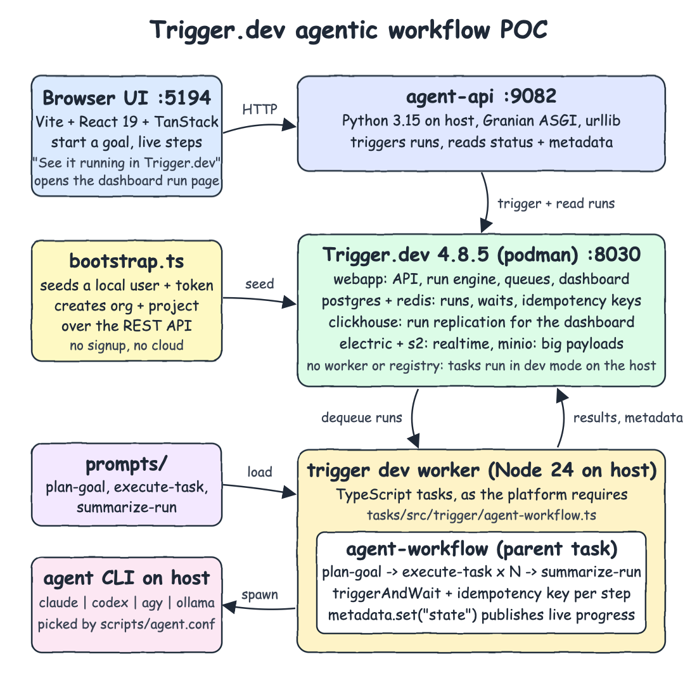
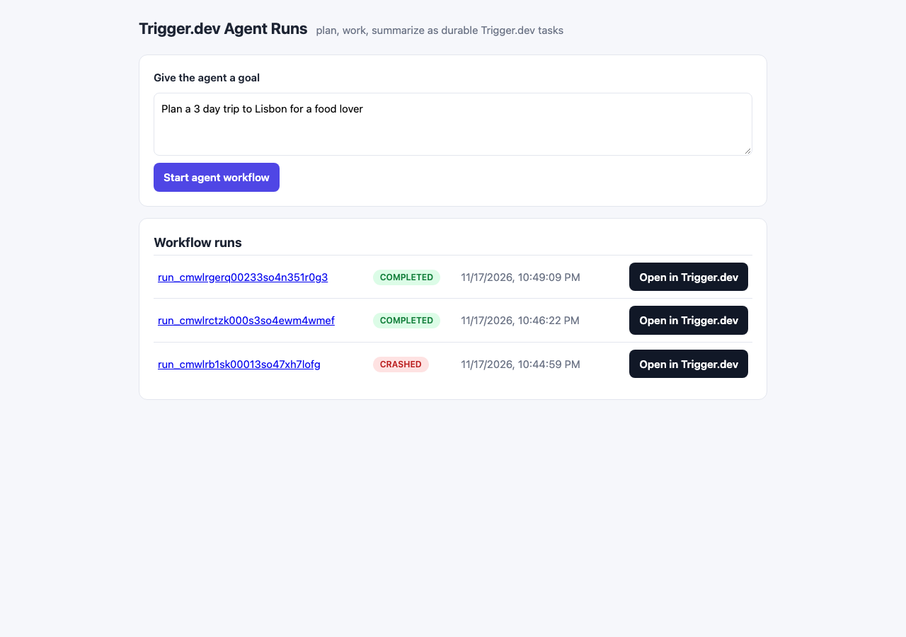
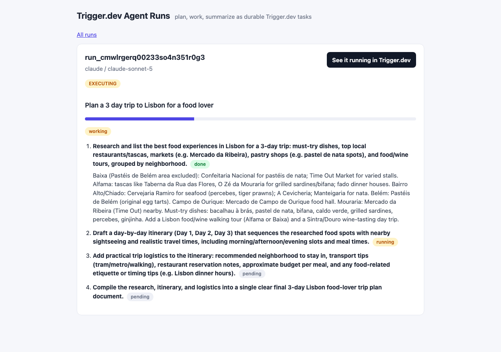
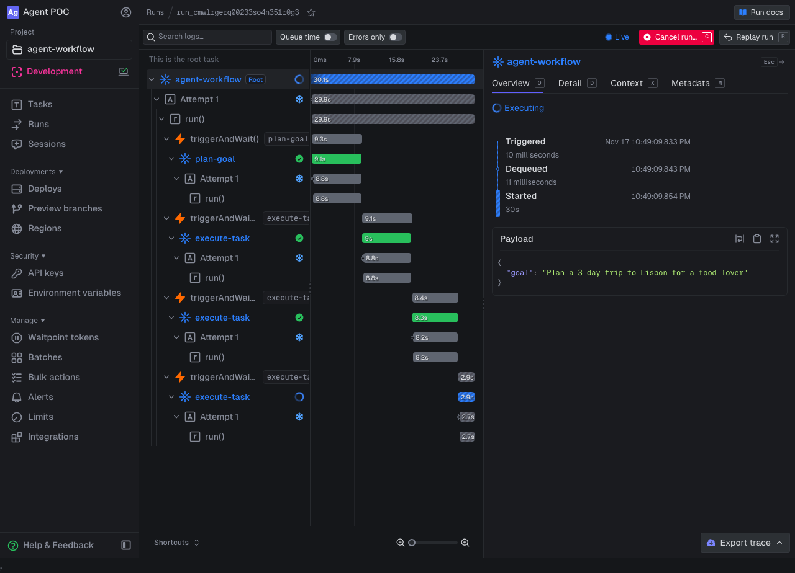
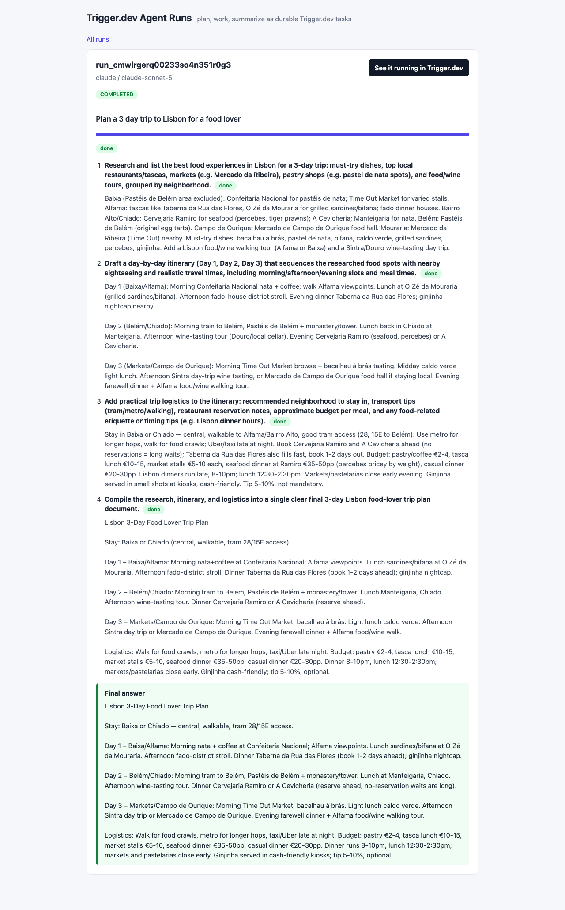
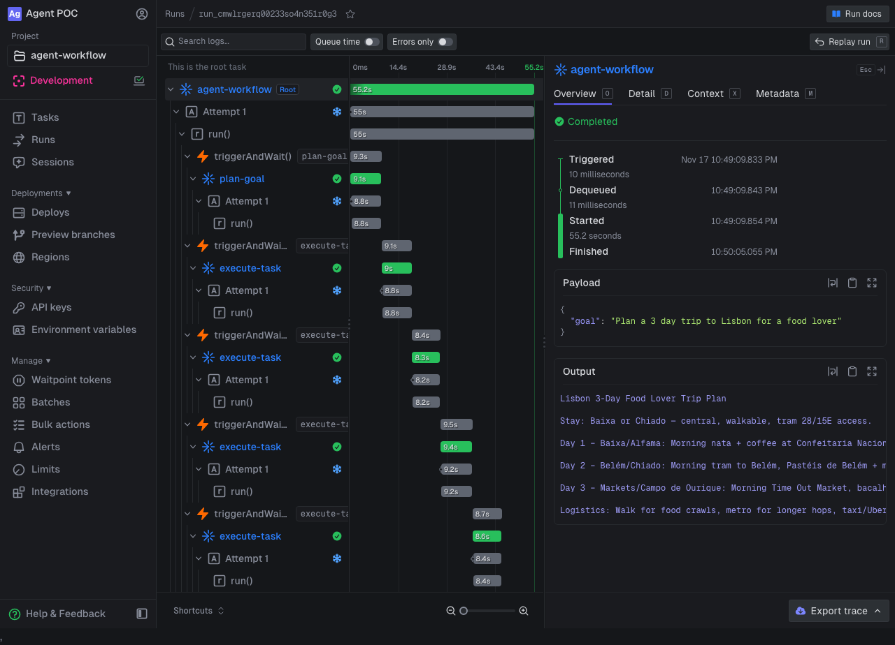

# Trigger.dev Agentic Workflow POC (Python API + TypeScript tasks)

An agentic plan-and-execute workflow that runs as durable [Trigger.dev](https://trigger.dev/) tasks on a fully self-hosted Trigger.dev v4. You give the agent a goal in the UI. A planner agent splits it into 2 to 4 tasks, a worker agent completes each task, and a reviewer agent writes the final answer. Every agent call is its own child task run with retries and an idempotency key, so a failed step is retried on its own and finished steps are never called again. Each run has a **See it running in Trigger.dev** button that opens the run in the local Trigger.dev dashboard.

Trigger.dev is open source (Apache-2.0). Everything runs in Podman on the machine, and `start-all.sh` creates the local user, organization and project by itself, with no signup and no cloud account.

## How it Works

1. The UI posts the goal to `agent-api` (Python), which triggers the `agent-workflow` task with `POST /api/v1/tasks/agent-workflow/trigger` on the local Trigger.dev.
2. Trigger.dev queues the run, and the `trigger dev` worker on the host dequeues it.
3. `agent-workflow` calls `plan-goal`, one `execute-task` per planned task, and `summarize-run`, each with `triggerAndWait` and a run-scoped idempotency key.
4. Each child task calls the agent CLI and retries up to 3 times with backoff when the call fails.
5. After each step the parent publishes its progress with `metadata.set("state", ...)`.
6. The UI polls `agent-api` every 1.5s, which reads the run with `GET /api/v3/runs/{id}` and returns its status and metadata.
7. If a step fails mid-run, Trigger.dev retries that child task as a new attempt. The parent keeps waiting, and finished children are never run again.

## Architecture



The Trigger.dev platform (webapp, Postgres, Redis, ClickHouse, Electric, MinIO, S2) runs in Podman. The tasks run on the host with `trigger dev`, because they call the local `claude`, `codex`, `agy` and `ollama` CLIs. That also means this POC needs no supervisor, worker or container registry. `agent-api` and the UI run on the host too.

## Why the tasks are TypeScript

Trigger.dev has no Python SDK: tasks must be TypeScript or JavaScript, and Python only runs as scripts called from a TypeScript task through `@trigger.dev/python`. This POC keeps Python for the API, which talks to Trigger.dev over its REST API. The durable tasks are TypeScript, as the platform requires.

## Durability: what Trigger.dev guarantees and what it does not

* **A failing step is retried on its own.** The end-to-end test kills the agent CLI in the middle of task 2. Trigger.dev runs that task again as attempt 2, the parent keeps waiting, and the run completes.
* **Finished steps are never called again.** Each child is triggered with an idempotency key scoped to the parent run, so a parent retry gets the finished child's result back instead of a new call.
* **A dead worker process ends the run.** Self-hosted v4 has no checkpointing, so a parent waiting on a child keeps its process alive. Killing the `trigger dev` worker with SIGKILL marks the parent `CRASHED` (`TASK_PROCESS_MAYBE_OOM_KILLED`), and `CRASHED` is final: it is not retried. The first run in the runs list printscreen is that experiment. Restate and DBOS resume such a run from their journal.

## Features

* **Durable agent steps**: each LLM call is its own child task run, retried on failure and deduplicated by an idempotency key.
* **Step failure recovery proven by a test**: the end-to-end test kills the agent CLI mid-task and checks for a second attempt and a single plan run.
* **Zero-click self-hosting**: `bootstrap.ts` seeds a local user and access token in Postgres, then creates the org and project through the REST API.
* **Plan-and-execute agent**: the model decides the tasks, and each worker sees the results of earlier tasks.
* **Live progress**: run metadata gives the UI step-by-step progress with no database of its own.
* **See it in Trigger.dev**: a button on each run and in the runs list deep links to the run's trace in the local dashboard.
* **Any agent CLI**: switch between Claude Code, Codex, Agy or Ollama in `scripts/agent.conf` with no code change.
* **Externalized prompts**: the three prompts live in `prompts/`, and an empty parameter fails loud.

## Stack

* **Trigger.dev 4.8.5 self-hosted** in Podman with podman-compose: run engine, queues, retries, idempotency and the dashboard.
* **@trigger.dev/sdk 4.8.5 + trigger.dev CLI 4.8.5**: the TypeScript tasks and the dev worker.
* **Python 3.15 + uv**: the API, its dependencies and its virtual env.
* **Granian 2.8.8**: the ASGI server. The app is a small plain ASGI callable, and it calls Trigger.dev with stdlib `urllib`, so there is no web framework or HTTP library.
* **ty 0.0.105 + pytest 9.2**: type checking and tests for the API.
* **Bun 1.4.4 + TypeScript 7.0.2**: tasks and UI tooling and tests (Bun 2.x does not exist yet). The tasks run on Node 24 inside the dev worker.
* **Vite 8 + React 19.3 + TanStack Router 1.170 + TanStack Query 5.108**: the UI, routes and polling.

## Contracts / APIs

The UI dev server proxies `/api` to `agent-api`.

| Call | Method + path | Body | Returns |
|---|---|---|---|
| Start a run | `POST /runs` | `{"goal": "..."}` | `202 {"runId": "run_..."}`, `400` without a goal |
| Run view | `GET /runs/{runId}` | none | `{"run_id", "status", "dashboard_url", "state": RunState or null}` |
| List runs | `GET /runs` | none | `[{"run_id", "status", "created_at", "dashboard_url"}]`, newest 20 |
| Health | `GET /health` | none | `{"ok": true}` |

`agent-api` uses these Trigger.dev endpoints with the dev secret key:

| Call | Method + path |
|---|---|
| Trigger the workflow | `POST /api/v1/tasks/agent-workflow/trigger` with `{"payload": {"goal": "..."}}` |
| Read a run | `GET /api/v3/runs/{runId}` (status and metadata) |
| List runs | `GET /api/v1/runs?filter[taskIdentifier]=agent-workflow` |

## Key data structures and design decisions

```ts
interface RunState {
  goal: string;
  provider: string;
  model: string;
  phase: "planning" | "working" | "summarizing" | "done" | "failed";
  steps: { task: string; status: "pending" | "running" | "done"; output: string }[];
  summary: string;
  error: string;
}
```

* **One child task per agent call**: Trigger.dev retries whole task runs, so each LLM call is its own task and a retry never repeats the other calls.
* **Idempotency keys scoped to the parent run**: `idempotencyKeys.create("plan")` and `task-N` make a parent retry reuse finished children.
* **Children tagged with the parent id**: `wf_<runId>` tags let the test count how many times each step really ran.
* **The plan is parsed inside the child task**: a model reply without a valid task list fails that task, which Trigger.dev retries.
* **Metadata, not a database, for progress**: the parent writes `RunState` into run metadata, and the API parses it back into typed dataclasses, ignoring malformed data.
* **Bootstrap through the real APIs**: only the user and token are seeded with SQL (AES-256-GCM, as the webapp does). The org and project come from Trigger.dev's own REST API (`ORG_CREATION_API_ENABLED=1`), and their ids are written to `.run/trigger.conf`.

## How to run

You need Podman with a running machine, podman-compose, uv, Bun, Node, openssl, and the agent CLI named in `scripts/agent.conf` (default `claude` with `claude-sonnet-5`).

```bash
./scripts/setup.sh
./scripts/start-all.sh
./scripts/ui.sh
./scripts/dashboard-login.sh
```

`setup.sh` generates the stack secrets into `.run/stack.conf`. `start-all.sh` starts the platform, bootstraps the local user and project, and starts `trigger dev`, the API and the UI. `dashboard-login.sh` opens a magic link for the local user. The webapp prints magic links to its log because no email server is configured.

To use another agent, edit `scripts/agent.conf`, for example `AGENT_PROVIDER=ollama` and `AGENT_MODEL=llama3.2`, then restart.

## How to test

```bash
./scripts/test-all.sh
```

This runs `ty` and 10 pytest tests for the API, the tasks typecheck and 16 unit tests, the UI typecheck, build and 4 unit tests, and `scripts/test-e2e.sh`. The end-to-end script triggers a real workflow and waits for the first task. It then kills the agent CLI during task 2 and waits for the run to complete. Last, it checks through the Trigger.dev API that `plan-goal` ran exactly once and that an `execute-task` run needed a second attempt.

## Printscreens

### Runs list



The home page: type a goal and start the agent workflow. Below, every `agent-workflow` run with its Trigger.dev status, and each row has an **Open in Trigger.dev** button. The `CRASHED` run is the SIGKILL experiment described above.

### Run in progress



The planner agent split the goal into tasks. Task 1 is `done` with the worker's output and task 2 is `running`. The page polls the run metadata through `agent-api`.

### Trigger.dev dashboard while the agent runs



What the button opens: the run's trace in the local dashboard, with `plan-goal` and two `execute-task` child runs finished and the third one executing. The parent shows `Executing` and a live `Cancel run` button.

### Run completed



All tasks are `done` with each worker agent's output, and the reviewer agent's final answer is at the bottom.

### Trigger.dev dashboard after the run



The parent `agent-workflow` run `Completed` in 55s. The trace shows each `triggerAndWait` with its child run and attempt, the payload with the goal, and the final answer as the output.

## Scripts

All scripts live in `scripts/` and run from any directory of the repository.

| Script | What it does |
|---|---|
| `./scripts/setup.sh` | Installs dependencies, generates local secrets and pulls the images |
| `./scripts/start-all.sh` | Starts the platform, bootstraps user and project, starts the worker, API and UI, and prints the links |
| `./scripts/status.sh` | Shows every service as UP or DOWN, including the `trigger dev` worker |
| `./scripts/test-all.sh` | Runs every test suite, including the step failure end-to-end test |
| `./scripts/ui.sh` | Opens the UI in the browser |
| `./scripts/dashboard-login.sh` | Logs the local user into the Trigger.dev dashboard with a magic link |
| `./scripts/stop-all.sh` | Stops every service |

Ports are declared in `scripts/ports.env`: Trigger.dev webapp 8030, agent-api 9082, UI 5194. The agent provider and model are in `scripts/agent.conf`.
