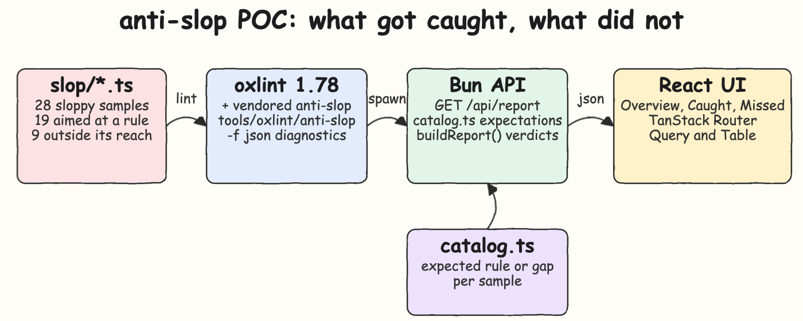
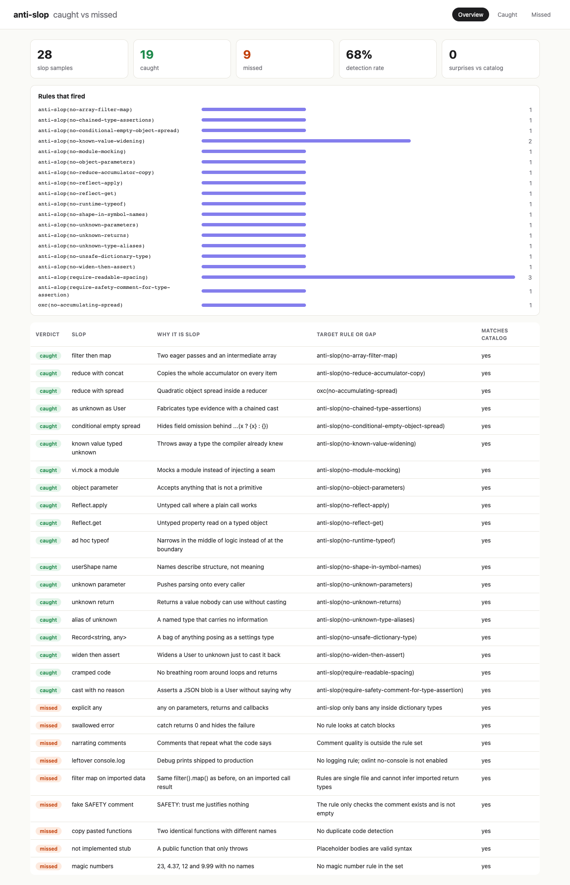
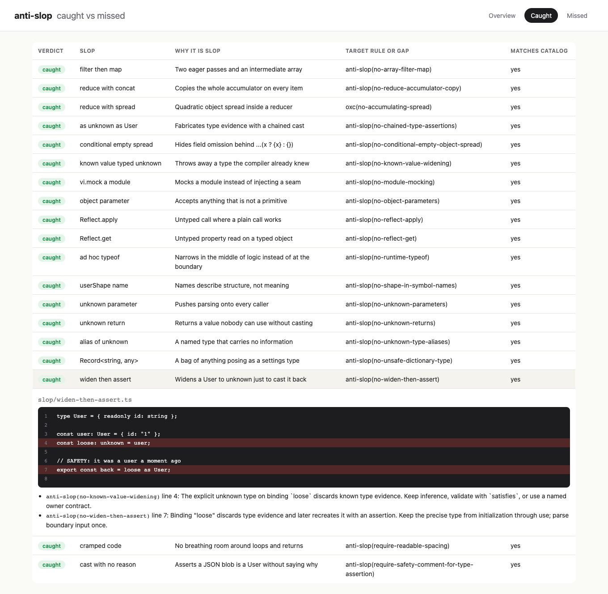
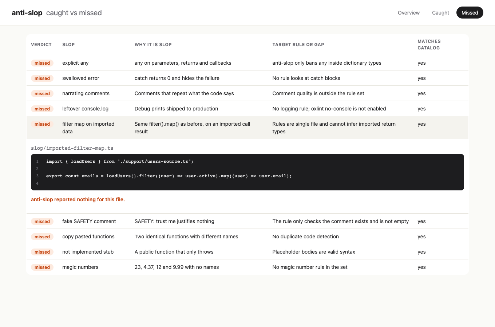

# ts-anti-slop-poc

A POC that throws 28 pieces of sloppy TypeScript at [anti-slop](https://github.com/dmmulroy/anti-slop), a set of opinionated Oxlint rules, and shows in a web UI what it **caught** and what it **missed**, with the source code, the flagged lines and the rule messages.

Result: **19 caught, 9 missed (68%)**, and every result matches what the catalog predicted (0 surprises).

## How it works

1. `slop/` holds one small file per kind of slop.
2. `server/catalog.ts` says, for every file, which rule should catch it, or why anti-slop cannot (the gap).
3. The vendored plugin lives in `tools/oxlint/anti-slop/` and is wired in `oxlint.config.ts` with every generic rule on and the default oxlint rules off, so only anti-slop is measured.
4. `GET /api/report` spawns `oxlint -f json slop`, parses the diagnostics, joins them with the catalog and reads each file's source.
5. A sample is `caught` when any rule fires on its file and `missed` when nothing fires.
6. `asExpected` compares the verdict with the catalog. A sample that should be caught must be flagged by its own target rule, so if the linter changes, the UI and the tests show a surprise.
7. The React UI shows the counters, the rules that fired, and a table for each tab. Click a row to see the code with the flagged lines highlighted.

## Architecture



## Features

* **Caught vs missed verdicts**: each slop sample is judged by what the real linter reported, not by what the docs claim.
* **Known gaps**: every missed sample says why anti-slop cannot see it, so you know what still needs code review.
* **Surprise detection**: a catalog claim that no longer matches the linter shows up in the UI and fails the tests.
* **Code view with flagged lines**: the exact lines and messages anti-slop reported, next to the code.
* **Rule coverage**: which rules fired and how often across the sample set.

## Stack

* **TypeScript 7.0.2**: strict types end to end; the UI imports the server's report types.
* **Bun 1.4.4**: runs the API, the tests and installs, with no extra server framework.
* **oxlint 1.78.0 + @oxlint/plugins 1.78.0**: the versions upstream anti-slop is tested against.
* **anti-slop (vendored)**: copied into `tools/oxlint/anti-slop/` as the upstream project recommends; the upstream revision is in `UPSTREAM_REVISION`.
* **Vite 8 + React 19.3**: the UI.
* **TanStack Router, Query and Table**: file-based routes for the 3 tabs, one cached report query and the sample table.

## API

| Method | Path | Response |
|---|---|---|
| GET | `/api/report` | `Report`: `samples[]` (file, title, slop, expect, rule or gap, verdict, asExpected, findings, source), `caught`, `missed`, `surprises`, `rules[]` |

Every response echoes the `X-Correlation-Id` header, or creates one if the request has none.

## Key data structures and design decisions

* `Expectation` is a discriminated union: `{ expect: "caught", rule }` or `{ expect: "missed", gap }`. A sample cannot claim both.
* `buildReport` is a pure function of catalog, findings and sources, so its tests use plain fakes.
* `Linter` and `SourceReader` are interfaces at the process boundary; `oxlintLinter` and `fileReader` are the real implementations.
* The oxlint JSON is parsed from `unknown` and fails loud on an unexpected format, instead of reporting zero findings and turning every sample into "missed".
* `slop/support/` holds clean helper code used by the imported-data sample. It is not in the catalog.
* The vendored plugin keeps its upstream comments and code untouched (MIT, `tools/oxlint/anti-slop/LICENSE`). Only the `*.test.ts` files and the Effect rule group were left out.

## Slop samples

| Caught by anti-slop | Missed by anti-slop |
|---|---|
| filter then map, reduce with concat, reduce with spread, `as unknown as`, conditional empty spread, known value typed `unknown`, `vi.mock`, `object` parameter, `Reflect.apply`, `Reflect.get`, ad hoc `typeof`, `userShape` name, `unknown` parameter, `unknown` return, alias of `unknown`, `Record<string, any>`, widen then assert, cramped spacing, cast with no reason | explicit `any`, swallowed error, narrating comments, leftover `console.log`, filter/map on imported data, fake `SAFETY: trust me` comment, copy pasted functions, `not implemented` stub, magic numbers |

## How to run

```bash
./scripts/setup.sh
./scripts/start-all.sh
./scripts/ui.sh
```

Lint the slop directly from the CLI:

```bash
bun run lint
```

Run the tests (server unit tests, an integration test that runs the real linter on `slop/`, typecheck and the web build):

```bash
./scripts/test-all.sh
```

## Printscreens

### Overview



The counters at the top: 28 samples, 19 caught, 9 missed, a 68% detection rate and 0 surprises against the catalog. The middle card lists every rule that fired and how many times. `require-readable-spacing` and `no-known-value-widening` fire on more than one file. The table lists every sample with its verdict, why it is slop, and the rule that targets it or the reason anti-slop cannot see it.

### Caught



Only the 19 samples anti-slop flagged. The "widen then assert" row is open: the file widens a `User` to `unknown` and casts it back. Lines 4 and 7 are highlighted, and two rules explain the problem: `no-known-value-widening` and `no-widen-then-assert`.

### Missed



The 9 samples anti-slop let through. The open row is the same `filter().map()` that is caught in the Caught tab, but here it runs on the result of an imported function. The rules work on one file at a time and cannot infer imported return types, so nothing is reported.

## Scripts

All scripts live in `scripts/` and run from any directory of the repository.

| Script | What it does |
|---|---|
| `./scripts/setup.sh` | Installs dependencies and prepares the app |
| `./scripts/start-all.sh` | Starts every service and prints the full link of each one |
| `./scripts/status.sh` | Shows every service port as UP or DOWN |
| `./scripts/test-all.sh` | Runs every test suite |
| `./scripts/ui.sh` | Opens the UI in the browser |
| `./scripts/stop-all.sh` | Stops every service |

Ports are declared in `scripts/ports.env` (backend `8790`, frontend `5190`).

```bash
./scripts/setup.sh
./scripts/start-all.sh
./scripts/status.sh
./scripts/ui.sh
./scripts/stop-all.sh
```
