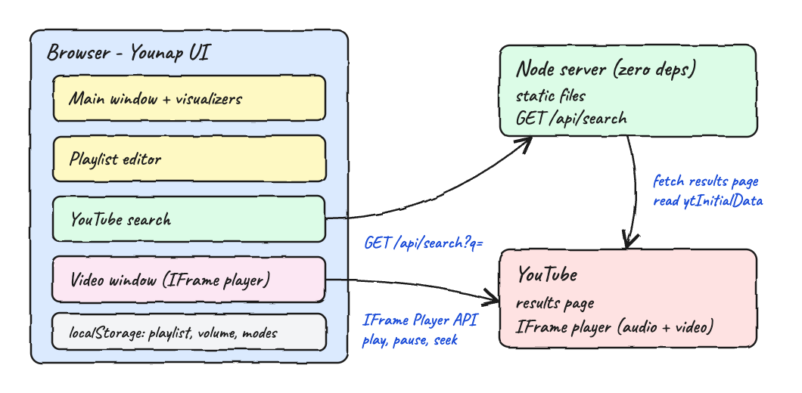
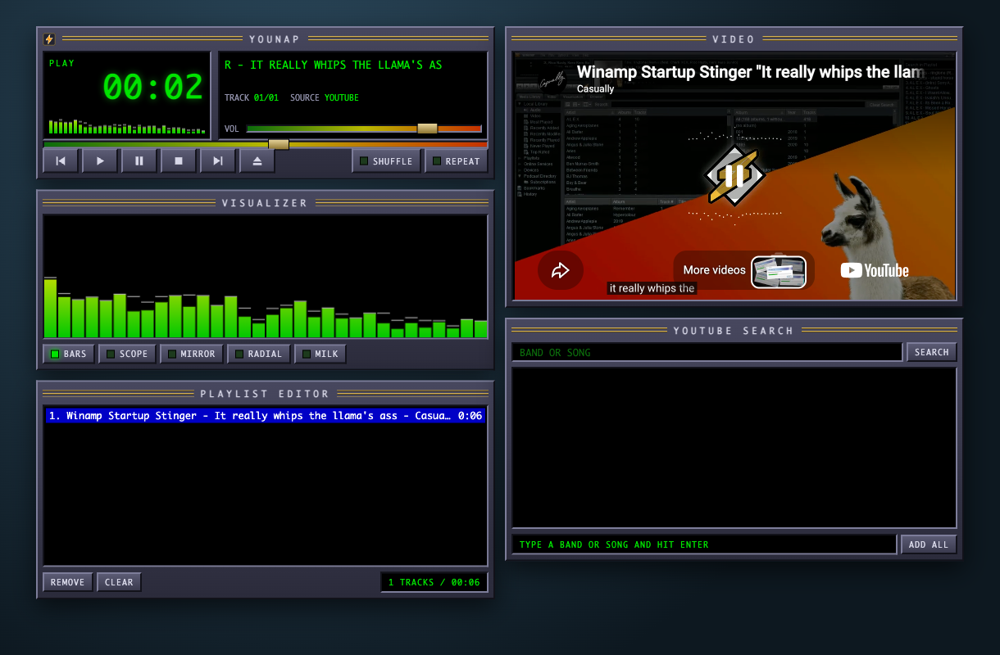
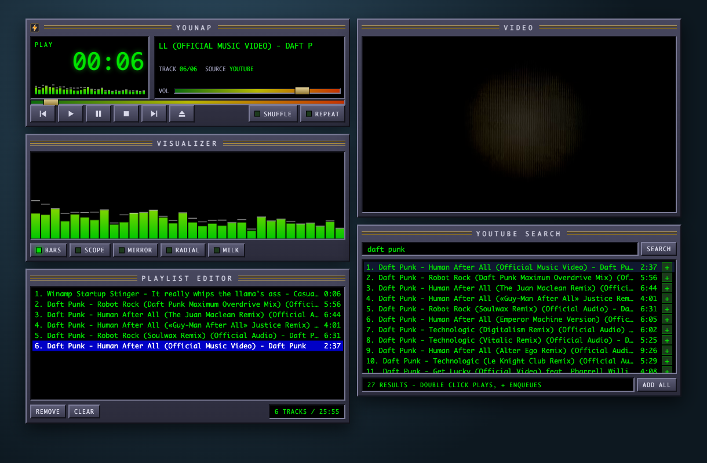
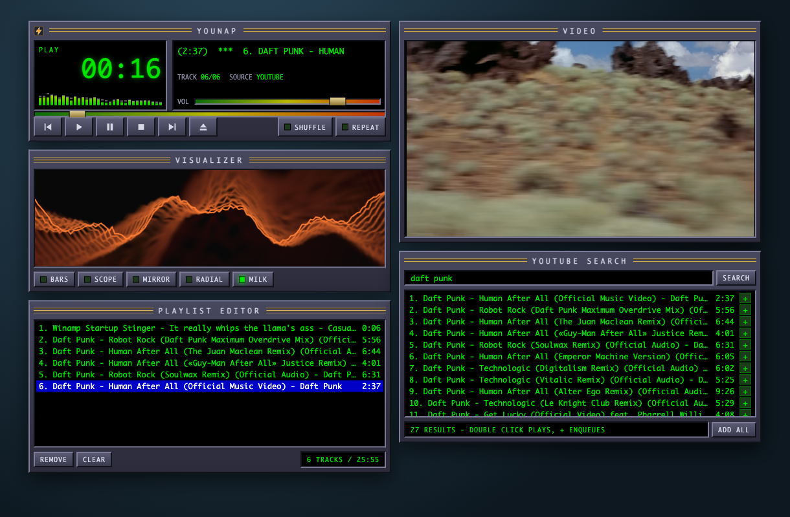
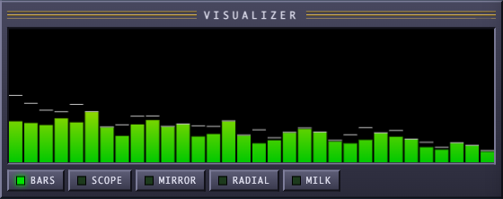
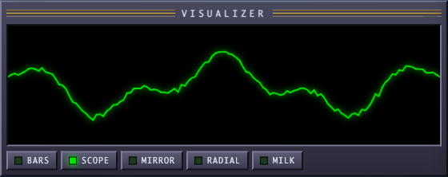
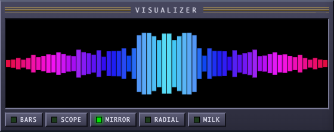
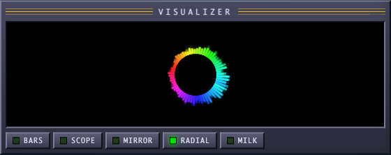
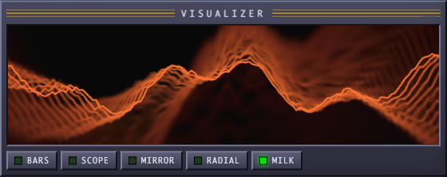

<p align="center"></p>

# Younap

Younap is Winamp for YouTube. You search a band or a song, build a playlist and play it through a
classic Winamp-style interface: main window, visualizer, playlist editor, video window and search.
The songs come straight from YouTube, nothing is downloaded.

## How it Works?

1. The Node server serves the UI and exposes one endpoint, `GET /api/search`.
2. A search fetches the public YouTube results page and reads the `ytInitialData` JSON inside it, so no API key is needed.
3. Live streams and channels are dropped, every remaining video becomes a track with id, title, channel and duration.
4. The browser keeps the playlist and hands the current track id to the official YouTube IFrame player, shown in the Video window.
5. The Winamp controls (play, pause, stop, next, previous, seek, volume) drive that player through the IFrame Player API.
6. When a song ends the playlist picks the next one, honoring shuffle and repeat. A video that refuses embedding is struck through and skipped.
7. Playlist, volume, shuffle, repeat and the chosen visualization are saved in `localStorage`.
8. A first launch opens with the Winamp startup stinger "it really whips the llama's ass" as track 1.

## Architecture



## Features

* **Winamp interface** - beveled windows, green LED clock, scrolling title, gold slider knobs, all drawn in plain CSS.
* **YouTube search** - type a band or a song, get tracks with channel and duration, no API key.
* **Playlist editor** - double click a result to play it, `+` to enqueue it, `ADD ALL` to enqueue every result, `REMOVE` and `CLEAR` to trim.
* **Five visualizations** - BARS, SCOPE, MIRROR, RADIAL and MILK. Pick one with its button or click the canvas for the next.
* **Llama opening** - the startup stinger sits at the top of a fresh playlist and plays on launch. Browsers block sound before a click, so it starts on the first click when autoplay is refused.
* **Shuffle and repeat** - shuffle never replays the song that just ended, repeat wraps the playlist.
* **Winamp keys** - `Z` previous, `X` play, `C` pause, `V` stop, `B` next, `Delete` removes the selected song.
* **Skips blocked videos** - a video whose owner forbids embedding is marked and the next song starts.
* **Remembers you** - the playlist and settings survive a reload.

## Known Limits

* The visualizations are synthesized. The YouTube player runs in a cross-origin iframe, so the browser gives the page no access to the audio samples. The waves move while a song plays and follow a fixed 120 BPM pulse, they do not follow the real sound.
* There is no equalizer for the same reason.
* Search reads the public results page. If YouTube changes that page the search fails with a clear error instead of returning an empty list.

## Stack

* **Node.js 20+** - built-in `http`, `fetch` and `node --test`, zero npm dependencies.
* **Vanilla JavaScript modules** - no framework and no build step.
* **CSS** - the whole skin, no images besides the logo.
* **Canvas 2D** - the five visualizations.
* **YouTube IFrame Player API** - the official embedded player for audio and video.
* **Bash** - the operational scripts.

## Contracts/APIs

### `GET /api/search?q=<band or song>`

| Status | Body | When |
|---|---|---|
| 200 | `[{ "id", "title", "channel", "duration", "seconds" }]` | search worked |
| 400 | `{ "error": "q is required" }` | `q` missing or blank |
| 502 | `{ "error": "<reason>" }` | YouTube failed or its page changed |

```json
[
  {
    "id": "K0HSD_i2DvA",
    "title": "Daft Punk - Around The World (Official Music Video Remastered)",
    "channel": "Daft Punk",
    "duration": "4:02",
    "seconds": 242
  }
]
```

Every other path serves a file from `public/`.

## Key Data Structures and Design Decisions

* **Track** - `{ id, title, channel, duration, seconds }`, plus `blocked` once YouTube refuses to embed it.
* **Player state** - `{ tracks, current, selected, shuffle, repeat, volume, visual }`. `current` is the playing index, `-1` when nothing is loaded.
* **Pure playlist logic** - `public/js/playlist.js` holds next, previous, remove and clock formatting with no DOM access, so the same file runs in the browser and in the Node tests.
* **Official player instead of stream extraction** - playback uses the YouTube embed, which keeps the app inside YouTube rules and needs no extra tool. The price is no access to the audio samples.
* **Recursive result walk** - the parser collects every `videoRenderer` wherever it sits in the page data, because YouTube moves results between shelves often.
* **Injected search** - `createApp(searchFn)` receives the search function, so the server tests never touch the network.

## How to Run

```bash
./scripts/setup.sh
./scripts/start-all.sh
./scripts/ui.sh
```

`start-all.sh` prints the link of the app. Stop it with `./scripts/stop-all.sh`.

## How to Test

```bash
./scripts/test-all.sh
```

23 tests cover the results parser, the playlist rules and the HTTP contract.

## Printscreens

### Opening



A first launch: the llama stinger is track 1 and is playing, the clock runs and the Video window shows the YouTube player.

### Playing a searched band



A search for a band on the right, four results enqueued with `+` and one started with a double click. The playing song is white on blue in the playlist editor, its title scrolls in the main window and the BARS visualization runs.

### MILK visualization



The same session with the MILK visualization, a wave that leaves a zooming color trail.

### The five visualizations

| BARS | SCOPE |
|---|---|
|  |  |

| MIRROR | RADIAL |
|---|---|
|  |  |

| MILK |
|---|
|  |

BARS is the classic spectrum with falling peaks, SCOPE an oscilloscope line, MIRROR a spectrum mirrored around the center, RADIAL a rotating ring of spokes and MILK a wave with a feedback trail.

## Scripts

All scripts live in `scripts/` and run from any directory of the repository.

| Script | What it does |
|---|---|
| `./scripts/setup.sh` | Checks that Node 20 or newer is installed and prepares the app |
| `./scripts/start-all.sh` | Starts the server and prints its full link |
| `./scripts/status.sh` | Shows the server port as UP or DOWN |
| `./scripts/test-all.sh` | Runs every test suite |
| `./scripts/ui.sh` | Opens the UI in the browser |
| `./scripts/stop-all.sh` | Stops the server |

Ports are declared in `scripts/ports.env`.

```bash
./scripts/setup.sh
./scripts/start-all.sh
./scripts/status.sh
./scripts/ui.sh
./scripts/stop-all.sh
```
